<p align="center">
  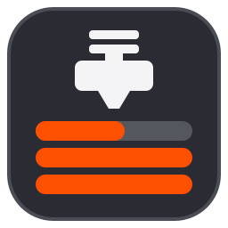
</p>

<h1 align="center">LayerPeek</h1>
<p align="center"><i>pro tiskárny Prusa</i></p>

<p align="center">
  <b>Sleduj své tiskárny Prusa živě, přímo z oznamovací oblasti nebo z řádku nabídek.</b><br>
  Kamera v reálném čase, průběh tisku a notifikace přes lokální síť. Bez cloudu, bez účtu, bez otevřené záložky v prohlížeči.
</p>

<p align="center">
  <a href="https://github.com/pfoltynek/LayerPeek/releases"><b>Stáhnout</b></a> ·
  <a href="#rychlý-start">Rychlý start</a> ·
  <a href="#jak-to-vypadá">Snímky</a> ·
  <a href="#funkce">Funkce</a> ·
  <a href="#experimentální-funkce">Experimentální</a> ·
  <a href="manuals/cs/manual.md"><b>Příručka</b></a> ·
  <a href="README.md">English</a>
</p>

<p align="center">
  <a href="https://github.com/pfoltynek/LayerPeek/releases"></a>
  <a href="LICENSE"></a>
  
  
  <a href="https://github.com/pfoltynek/LayerPeek/stargazers"></a>
</p>

<p align="center">
  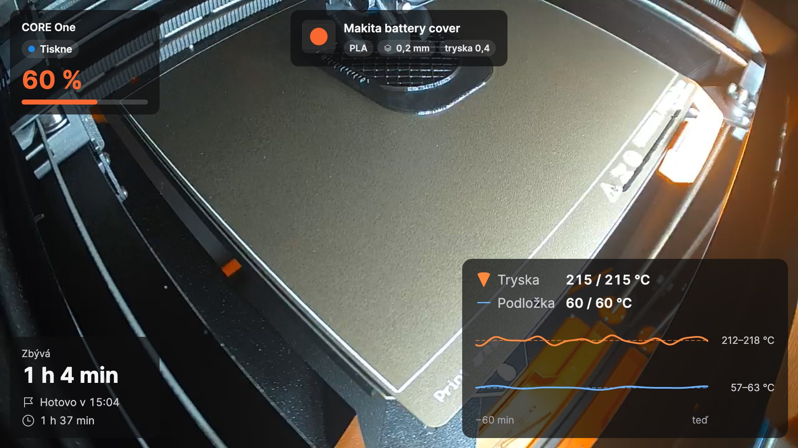
</p>

---

Spustíš devítihodinový tisk a vrátíš se k práci. Drží první vrstva? Nezamotala se cívka? Kolik ještě zbývá?
Obvykle se jdeš podívat k tiskárně, nebo máš otevřenou záložku v prohlížeči a pořád ji obnovuješ.

**LayerPeek** ti odpověď dá na jeden pohled. Ikona v oznamovací oblasti Windows nebo v řádku nabídek macOS ukazuje
stav a průběh tisku všech tiskáren. Jedním kliknutím otevřeš **živé okno kamery** s průběhem tisku, teplotami a časem
dokončení přímo v obraze. Když se něco stane, hned přijde **systémová notifikace**: tisk je hotový, tiskárna vyžaduje
zásah, chyba, tiskárna je offline.

S tiskárnami komunikuje **přímo přes lokální síť** pomocí PrusaLink, API zabudovaného ve firmwaru tiskárny. Obraz
z kamery i údaje o tisku zůstávají ve tvé síti: žádná cloudová služba, žádný účet, žádná telemetrie.

> [!NOTE]
> Jde o nezávislý komunitní projekt. **Není** to oficiální produkt společnosti Prusa Research a s Prusa Research a.s.
> nijak nesouvisí. *Prusa*, *PrusaLink* a *Prusa Connect* jsou ochranné známky svých vlastníků.

## K čemu se hodí

- **Dlouhé tisky.** Spusť devítihodinový tisk a nemysli na něj. LayerPeek ti pár minut před koncem připomene, že tisk
  končí, dá vědět, až je hotový, a když chceš, i až tiskárna vychladne a můžeš ji vypnout.
- **Dohled při práci.** Malý náhled sedí v rohu obrazovky vždy navrchu a pod obrazem ukazuje průběh, zbývající čas
  a čas dokončení. Špagety nebo nepovedená první vrstva? Uvidíš to hned.
- **Tiskárenská farma.** Přidej tolik tiskáren, kolik máš. Jedna ikona ukazuje nejdůležitější stav, každá tiskárna má
  vlastní podmenu, okno kamery i rozložení widgetů.
- **Klid, i když nejsi u stolu.** Nativní notifikace na Windows i macOS při dokončení, pozastavení a zastavení tisku,
  při chybě, když tiskárna vyžaduje zásah nebo přestane odpovídat.
- **Soukromí.** Všechno se děje v tvé lokální síti. Funguje to, i když nejde internet, a obraz z kamery nikdy neteče
  přes cizí server.

## Proč se ti bude líbit

- 🎥 **Živá kamera, ne jednotlivé snímky.** Stream RTSP/H.264 v reálném čase z kamery Prusa Buddy3D (nebo jiné RTSP
  kamery), dekódovaný lokálně přes FFmpeg.
- 📼 **Záznam, když ho potřebuješ.** Nahraj tisk, nech si poslední minuty jako v autokameře a ulož je, když se něco
  pokazí, nebo pořiď timelapse ([experimentální](#experimentální-funkce)). Všechno zůstává na tvém disku v rámci
  limitu velikosti.
- 🕵️ **Oko navíc.** Volitelná detekce chyb tisku ([experimentální](#experimentální-funkce)) hlídá kamerou podložku
  a se snímkem dá vědět, když díl zmizí nebo se objeví špagety. Běží lokálně, bez cloudu.
- 🧩 **Widgety si rozmístíš sám. Stav, časy, teploty s grafem, název tisku s náhledem z G-code a chladnutí, každý ve
  třech velikostech, rozmístěné přetažením přímo v okně kamery, pro každou tiskárnu zvlášť.
- 🔔 **Dozvíš se to, když na tom záleží.** Nativní notifikace na Windows i macOS a připomínka pár minut před koncem
  tisku.
- 🖨️ **Celá tiskárenská farma v jedné ikoně.** Společná ikona ukazuje nejdůležitější stav a každá tiskárna má
  vlastní podmenu.
- 🪶 **Malá a tichá.** Jeden nativní spustitelný soubor (Native AOT), žádný .NET k instalaci, žádné hlavní okno,
  žádná služba na pozadí. Prostě žije v oznamovací oblasti Windows nebo v řádku nabídek macOS.
- 🔒 **Bezpečná k heslům.** Hesla jsou ve Správci pověření Windows nebo v Klíčence macOS. Webové rozhraní PrusaLink se
  otevře rovnou přihlášené a heslo se do prohlížeče nikdy nepředává.
- 🌍 **Mluví tvým jazykem.** Angličtina, čeština, slovenština, němčina, španělština, francouzština, italština
  a polština.
- 💚 **Zdarma a open source** pod GPL-3.0. Žádné reklamy, žádné předplatné, žádná „pro“ verze.

## Jak to vypadá

### Widgety: tvoje údaje tam, kde je chceš

Okno kamery ukazuje obraz a přes něj **karty widgetů**. Vyber, které widgety má každá tiskárna, zvol velikost **S**,
**M** nebo **L** a přetáhni je na kterékoli ze šesti míst přímo v okně kamery (**Upravit rozložení**). Zvýrazněná
karta vynikne barvou akcentu a neprůhlednost karet udrží text čitelný i na světlém obrazu.

<p align="center">
  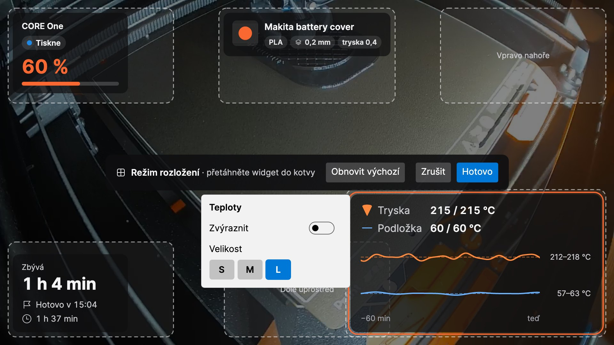
</p>

Jeden widget ve třech velikostech, tady teploty: S ukazuje hodnoty, M přidá graf za poslední hodinu, L popisky
a rozsah teplot.

<p align="center">
  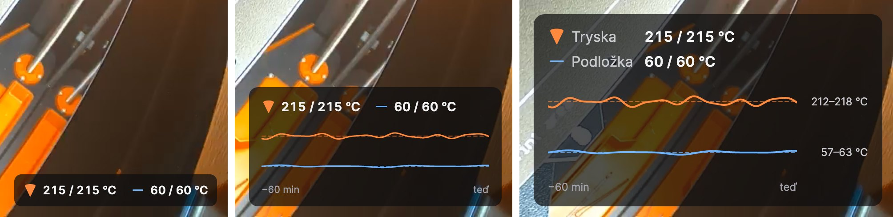
</p>

| Widget | Ukazuje |
|---|---|
| **Stav** | název tiskárny, stav a průběh |
| **Časy** | zbývající čas, kdy bude tisk hotový, dobu tisku |
| **Teploty** | trysku a podložku (skutečná / cílová) s grafem za posledních 60 minut |
| **Název tisku** | název souboru bez nadbytečných údajů ze sliceru, materiál, výšku vrstvy, trysku a náhled z G-code |
| **Vychladnutí** | po tisku: jak vychladla tryska a podložka a kdy je tiskárnu bezpečné vypnout |

### Normální okno, nebo malý náhled

**Normální okno** je na pořádný pohled: libovolná velikost, libovolný monitor, celá obrazovka klávesou F11 (na macOS
⌃⌘F). **Malý náhled** je na zbytek dne: malé okno, které zůstává nad ostatními okny, s informačním pásem pod obrazem
(průběh, zbývající čas, čas dokončení) a dvěma řádky, které můžeš rozbalit: název tisku a graf teplot. Mezi oběma
přepneš jedním kliknutím.

<p align="center">
  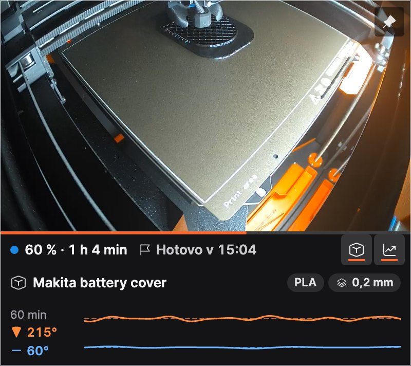
</p>

### Nahrávání, dashcam a timelapse

Nahraj tisk ručně nebo automaticky každý tisk, nech si poslední minuty tisku jako v autokameře, nebo pořiď timelapse.
Když se kamera nahrává, okno ukazuje červené **REC**, když se pořizuje timelapse, oranžové **TL** (i v malém náhledu
a na celé obrazovce).

<p align="center">
  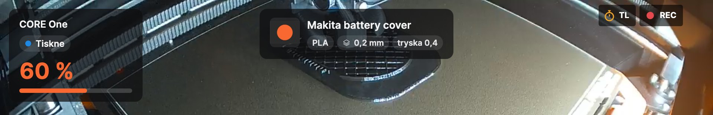
</p>

Co se u které tiskárny pořizuje, nastavíš na její podzáložce **Kamera**; složka, limit velikosti, dashcam
a experimentální funkce jsou na záložce **Nahrávání**.

| Podzáložka Kamera u tiskárny | Záložka Nahrávání |
|---|---|
| 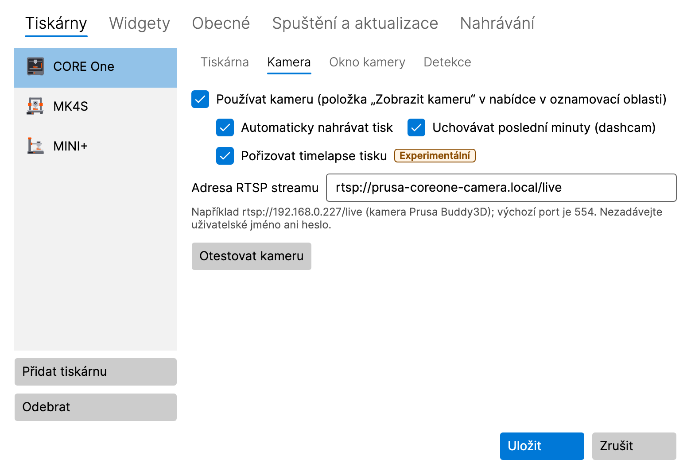 | 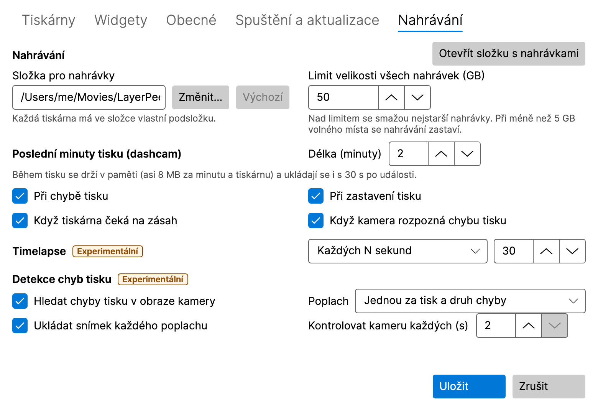 |

### Nastavení

Všechno nastavíš v jednom okně: tiskárny a kamery, widgety pro každou tiskárnu, nahrávání a detekci chyb tisku,
notifikace, interval dotazování, jazyk, spuštění po přihlášení a aktualizace.

| Widgety | Tiskárny |
|---|---|
| 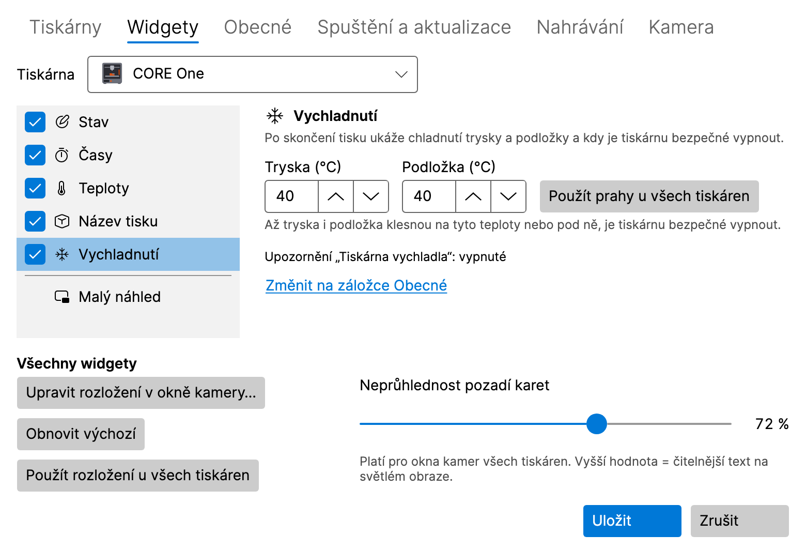 | 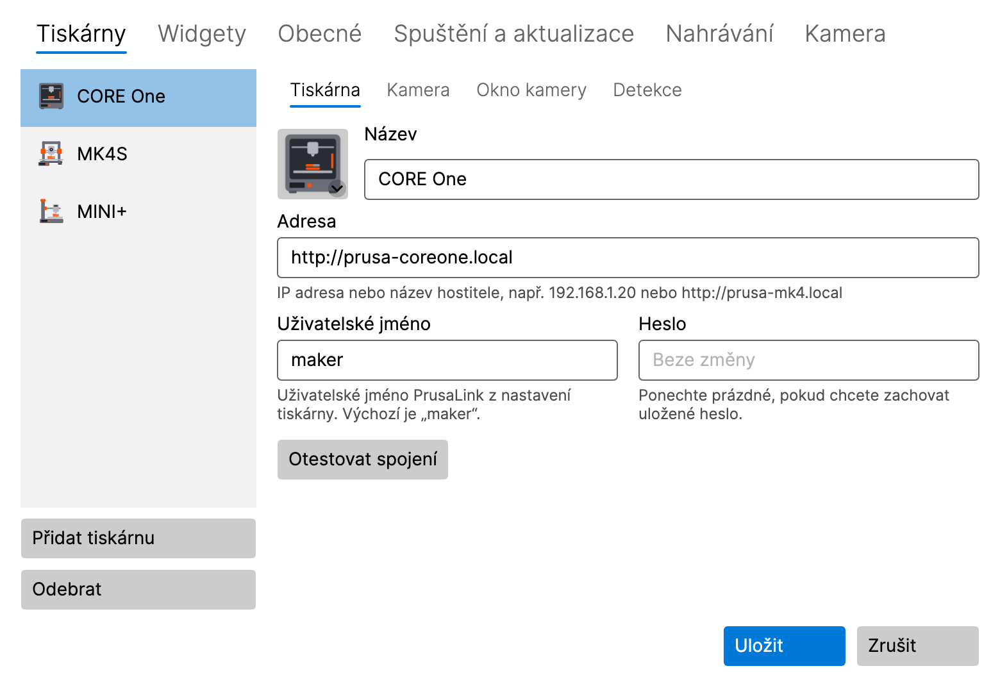 |

### Diagnostika

Teploty, ventilátory, rychlost, průtok, výška osy Z, firmware a graf teplot za posledních 30 minut, 2 hodiny nebo 24
hodin.

<p align="center">
  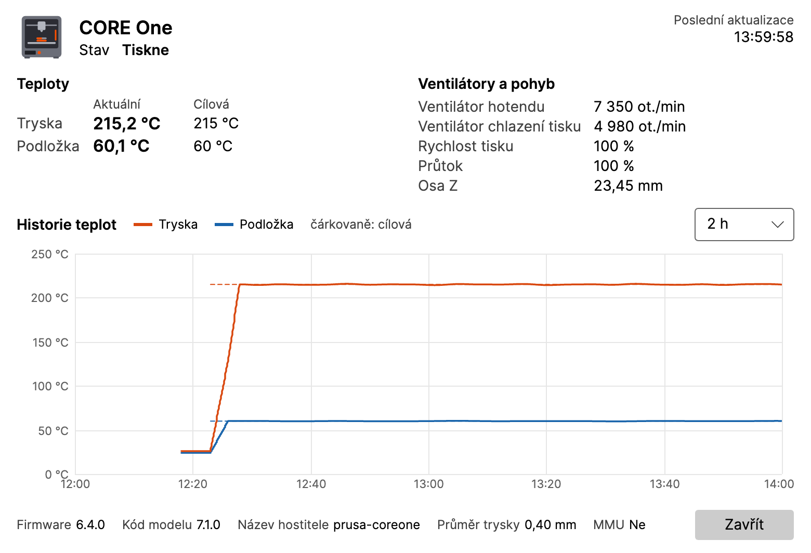
</p>

<sub>Snímky vznikají přímo z aplikace (vykreslení skutečných oken bez zobrazení na obrazovce, snímek ze skutečného
záznamu kamery Buddy3D a simulovaná data tiskárny), viz [docs/readme-screenshots.md](docs/readme-screenshots.md).</sub>

## Funkce

### V oznamovací oblasti / řádku nabídek

- Ikona ukazuje stav tiskárny: nečinná, tiskne (ikona se s průběhem tisku postupně plní), pozastaveno, hotovo,
  vyžaduje zásah, chyba, offline. Podrobnosti jsou v tooltipu: průběh, zbývající čas a název souboru.
- Menu má podmenu pro každou tiskárnu: zobrazení a skrytí kamery, nahrávání, dashcam a timelapse, diagnostika, web
  PrusaLink. Když se kamera tiskárny nahrává, tooltip ukazuje **Nahrává se**.

### Okno kamery

- Živý RTSP stream s widgety přes obraz: stav (název, stav, průběh), časy (zbývá, dokončení, doba tisku), teploty
  s malým grafem, název tisku s náhledem z G-code a chladnutí po tisku. Widgety, jejich velikost i místo si vybereš
  sám, přetáhneš je přímo v okně kamery.
- Tři režimy: **normální**, **malý náhled** (zůstává nad ostatními okny, pod obrazem má informační pás, jehož obsah si
  vybereš) a **celá obrazovka** (F11, na macOS ⌃⌘F).
- Pro každou tiskárnu zvlášť: výchozí režim, velikost, umístění, monitor a „vždy navrchu“. Okno si umí pamatovat,
  kde jsi ho nechal.
- Špendlík v okně ukazuje, zda zůstává navrchu, a jedním kliknutím to přepne; malý náhled má tenký obrys, takže je
  vidět i nad tmavými okny.
- Po výpadku kamery nebo Wi-Fi se samo znovu připojí.
- Když tiskárnu vypneš, okno se samo zavře, a až ji zapneš, otevře se na stejném místě (jde vypnout).

### Nahrávání a dashcam

- **Nahrávání** kamery do MP4 bez překódování: **Nahrávat** / **Zastavit nahrávání** v menu tiskárny nebo tlačítko
  nahrávání v okně kamery, nebo **Automaticky nahrávat tisk** na podzáložce **Kamera** tiskárny (ve výchozím stavu
  vypnuté), které nahraje každý tisk od začátku do minuty po jeho konci, i když okno kamery není otevřené.
  **Přehrát poslední nahrávku** a **Otevřít složku s nahrávkami** jsou v menu tiskárny.
- Nahrávky se ukládají do složky Videa (Windows) / Filmy (macOS) pod `LayerPeek`, každá tiskárna má vlastní podsložku
  a soubory se jmenují podle času a tisku. Na záložce **Nahrávání** změníš složku a celkový limit velikosti (výchozí
  50 GB): nad ním se mažou nejstarší nahrávky a při méně než 5 GB volného místa se nahrávání zastaví.
- **Dashcam:** **Uchovávat poslední minuty (dashcam)** na podzáložce **Kamera** tiskárny (ve výchozím stavu vypnuté)
  drží během tisku v paměti poslední 2 minuty kamery (1–10 min na záložce **Nahrávání**, asi 8 MB za minutu
  a tiskárnu; na disk se nic nezapisuje, dokud se neuloží). Uloží se i s 30 s po události při chybě tisku, když
  tiskárna čeká na zásah, při zastavení tisku a když detekce chyb tisku vyhlásí poplach (každou událost jde vypnout),
  nebo ručně přes **Uložit posledních 2 min** v menu tiskárny nebo v kontextové nabídce okna kamery.
- Když nahrávání nebo uložení posledních minut selže, ukáže se notifikace.
- **Timelapse** a **detekce chyb tisku** jsou experimentální, viz [Experimentální funkce](#experimentální-funkce).

### Notifikace

- Spuštění, dokončení, pozastavení, obnovení a zastavení tisku, chyba, tiskárna vyžaduje zásah, tiskárna offline.
- Připomínka „zbývá N minut“, abys byl u tiskárny, až tisk skončí.
- Volitelné upozornění „tiskárna vychladla“, abys věděl, kdy ji můžeš vypnout.
- Zvuk vypnutý, jen pro důležité události, nebo pro všechny.

### Diagnostika

- Model tiskárny a firmware, aktuální stav a čas poslední aktualizace.
- Teplota trysky a podložky (skutečná a cílová), otáčky ventilátoru hotendu a tiskového ventilátoru, rychlost tisku,
  průtok a výška osy Z.
- Živý graf teplot trysky a podložky za posledních 30 minut, 2 hodiny nebo 24 hodin (jen v paměti).

### Řešení problémů v aplikaci

- Okno **O aplikaci** uloží diagnostický balíček (logy, informace o verzi a systému, nastavení bez hesel) nebo
  zkopíruje krátké hlášení do schránky, takže nahlášení chyby zabere minutu.

## Experimentální funkce

Některé funkce jsou označené jako **experimentální**: v nastavení mají štítek **Experimentální** a položky menu, které
je spouštějí, končí „(experimentální)“. Fungují a pokrývají je testy, ale jsou vyladěné na omezených datech, takže se
v další verzi můžou změnit nebo nemusí vždy fungovat spolehlivě. Všechny jsou vypnuté, dokud je nezapneš nebo
nespustíš. Vyzkoušel jsi některou? Napiš prosím do [issue](https://github.com/pfoltynek/LayerPeek/issues), jak to
dopadlo: nejvíc pomůžou skutečné tisky, hlavně ty nepovedené.

### Detekce chyb tisku

LayerPeek umí hlídat tisk kamerou a dát vědět, když se na podložce něco pokazí. Detektor **Změna na podložce** pozná
zmizení nebo posun dílu a novou hmotu na podložce (špagety, utržený díl).

<p align="center">
  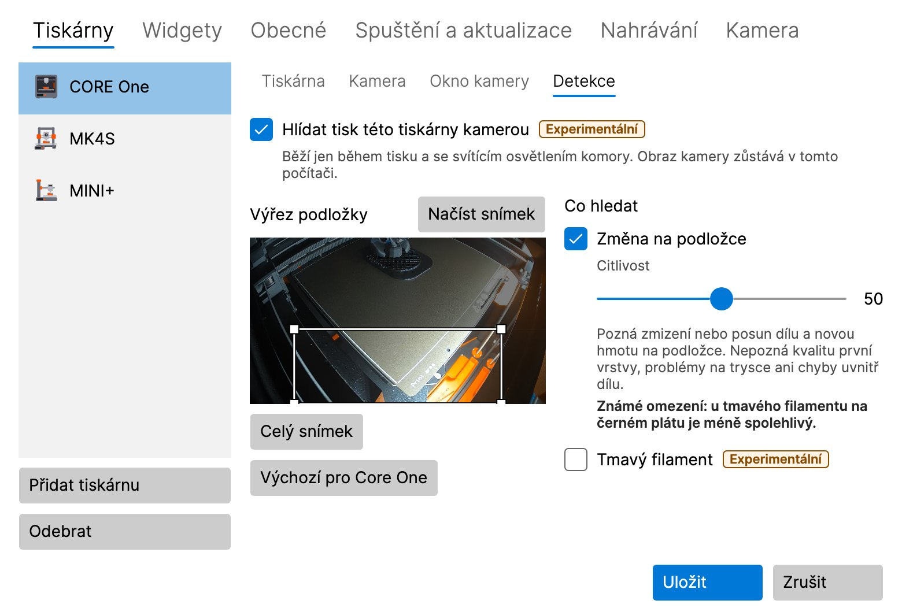
</p>

- **Zapíná se** na dvou místech (ve výchozím stavu vypnutá): **Hledat chyby tisku v obraze kamery** na záložce
  **Nahrávání** (pro všechny tiskárny) a **Hlídat tisk této tiskárny kamerou** na podzáložce **Detekce** tiskárny.
  Tiskárna musí mít zapnutou kameru.
- **Výřez podložky:** část obrazu, která se hlídá. Myší nakreslíš nový obdélník, přesuneš ho nebo za roh změníš jeho
  velikost; jde to i šipkami (Shift+šipky mění velikost). **Celý snímek** hlídá celý obraz, **Načíst snímek** vezme
  nový snímek z kamery a u Core One vrátí **Výchozí pro Core One** jeho předvolbu (kterou Core One dostane i ve
  výchozím stavu).
- **Citlivost:** 0–100, výchozí 50. Vyšší znamená víc poplachů, i falešných; nižší méně poplachů, ale chyba může
  uniknout.
- **Poplach** je notifikace „Možná chyba tisku – Změna na podložce“ se snímkem z kamery a se stejným zvukem jako chyba
  tisku. Kliknutím otevřeš okno kamery. Tlačítko **Falešný poplach** si uloží místní záznam pro ladění: nic neopustí
  počítač a citlivost se nezmění.
- **Výchozí nastavení na záložce Nahrávání:** jeden poplach za tisk a druh chyby (**Poplach** jde přepnout na znovu
  každých 10 min, dokud trvá), snímek JPEG každého poplachu ve složce s nahrávkami tiskárny (**Ukládat snímek každého
  poplachu**) a kontrola kamery každé 2 s (**Kontrolovat kameru každých (s)**, 2–5 s). Běžící dashcam uloží poslední
  minuty.
- Běží jen během tisku a se svítícím osvětlením komory, dekóduje jen klíčové snímky, funguje i bez otevřeného okna
  kamery a obraz kamery zůstává v tvém počítači.
- **Tmavý filament** *(experimentální, ve výchozím stavu vypnutý)* na podzáložce **Detekce**: u černého nebo velmi
  tmavého filamentu se jako změna počítá i menší ztmavnutí podložky. Na tmavém plátu najde o něco víc, s vyšším
  rizikem falešných poplachů.
- **Omezení:** nepozná kvalitu první vrstvy, problémy na trysce ani chyby uvnitř dílu. U tmavého filamentu na černém
  plátu je méně spolehlivá (i s volbou **Tmavý filament**). S celým snímkem jako výřezem můžou falešné poplachy
  způsobit pohyblivé části tiskárny. Je vyladěná na simulovaných selháních a jednom skutečném úspěšném tisku na Core
  One s kamerou Buddy3D, zatím ne na skutečných nepovedených tiscích, takže může selhání přehlédnout nebo vyhlásit
  planý poplach.

### Tisk do vzduchu

- Druhý detektor na podzáložce **Detekce** tiskárny, **ve výchozím stavu vypnutý**, nabízí se jen u tiskáren, jejichž
  podložka při tisku sjíždí dolů (Core One, Core One L, XL, XL+); u ostatních modelů se nezobrazí.
- Pozná, že tiskárna dál tiskne (osa Z roste), ale na podložce už nic nepřibývá, například když nepozorovaně došel
  filament, prokluzuje podavač nebo se ucpala tryska. Při dobrém tisku stojí horní hrany dílů u trysky; když se netiskne,
  sjíždějí s podložkou dolů.
- Sleduje váš výřez podložky prodloužený nahoru k trysce, žádný další výřez není potřeba.
- **Omezení:** chybu nahlásí až poté, co osa Z vystoupá o další ~3 mm (minuty, u pomalých tisků i půl hodiny a víc).
  Nehodnotí díly schované převážně pod hlavou ani prvních ~6 mm po startu. Čisticí věž, která dál roste, může chybu
  zakrýt, a když přestane růst jen jeden z několika dílů, nenahlásí to. **Díl se širší spodní částí, která skončí dřív,
  nebo několik dílů, z nichž většina skončí dřív, může vyvolat planý poplach.** Ladil se na simulovaných selháních,
  skutečný tisk do vzduchu zatím nahraný není.

### Timelapse

Timelapse je krátké video celého tisku: ve výchozím stavu jeden snímek za 30 s, během pauzy tisku žádný, přehrávané
rychlostí 30 snímků za sekundu. Ukládá se jako `…_timelapse.mp4` do složky s nahrávkami tiskárny a počítá se do
limitu velikosti nahrávek.

- **Ručně:** **Spustit timelapse (experimentální)** / **Zastavit timelapse (experimentální)** v menu tiskárny nebo
  tlačítko se stopkami v okně kamery. Během timelapse ukazuje okno oranžové **TL** (ztlumené, když je tisk
  pozastavený). **Přehrát poslední timelapse** je v menu tiskárny.
- **Automaticky:** **Pořizovat timelapse tisku** na podzáložce **Kamera** tiskárny (ve výchozím stavu vypnuté) pořídí
  timelapse každého tisku od jeho začátku do minuty po konci, i bez otevřeného okna kamery.
- **Čas mezi snímky:** vedle nadpisu **Timelapse** na záložce **Nahrávání**, 5–600 s.
- **Každou N. vrstvu (odhad):** přepni **Každých N sekund** vedle nadpisu a snímek se pořídí na začátku nové vrstvy
  (N = 1–100, výchozí 1), k tomu jeden na začátku a jeden hotového dílu. PrusaLink vrstvy nehlásí, takže je LayerPeek
  odhaduje z výšky osy Z při každém dotazu (z-hopy odfiltruje). Vrstvy kratší než asi dva dotazy se sloučí
  a výjimečně přidá snímek z-hop nebo výměna nástroje. Vyzkoušené na skutečném tisku na Core One: při dotazování
  každé 2–5 s našel každou vrstvu.
- **Omezení:** snímky jsou klíčové snímky kamery uložené bez překódování, takže u kamery Buddy3D může snímek přijít až
  asi o 2 s mimo interval.

### Timelapse z nahrávky

**Vytvořit timelapse z nahrávky… (experimentální)** v menu tiskárny se zeptá na nahrávku z LayerPeeku a udělá z ní
timelapse se stejným časem mezi snímky, uložený vedle ní jako `…_recording_timelapse.mp4`. Nahrávka rozdělená
výpadkem kamery (`…-2.mp4`) se vezme celá. Položka menu ukazuje průběh a jde jí vytváření zrušit; notifikace dá
vědět, až bude hotovo.

### Export timelapse do JPEG

**Exportovat timelapse do JPEG… (experimentální)** v menu tiskárny se zeptá na timelapse z LayerPeeku a uloží jeho
snímky jako číslované soubory JPEG (`0001.jpg`, …) do složky vedle něj, třeba pro vlastní střih videa. Průběh a zrušení
jsou v položce menu, notifikace dá vědět, až bude hotovo, a složka se počítá do limitu velikosti nahrávek.

## Podporované tiskárny

Každá tiskárna Prusa s **firmwarem Buddy 6.x a PrusaLink**:

| Tiskárna | Stav |
|---|---|
| Prusa CORE One | ✅ otestováno (s kamerou Buddy3D) |
| Original Prusa MK4 / MK4S | 🟡 mělo by fungovat, zatím neotestováno |
| Original Prusa MK3.9 / MK3.9S, MK3.5 / MK3.5S | 🟡 mělo by fungovat, zatím neotestováno |
| Original Prusa XL | 🟡 mělo by fungovat, zatím neotestováno |
| Original Prusa MINI / MINI+ | 🟡 mělo by fungovat, zatím neotestováno |
| Original Prusa MK3 / MK3S (8bitový firmware) | ❌ tiskárna nemá zabudovaný PrusaLink |

Všechny tiskárny s firmwarem Buddy 6.x mají stejné PrusaLink API. Používáš aplikaci s jiným modelem? Vyplň prosím
krátké [hlášení kompatibility tiskárny](https://github.com/pfoltynek/LayerPeek/issues/new?template=printer_compatibility.yml) (zaškrtávací seznam v angličtině, stačí jedna zkouška
na Windows nebo macOS), ať ho můžeme označit jako otestovaný.

Kamera je volitelná. I bez ní máš ikonu, notifikace a diagnostiku. Kamera musí poskytovat stream **RTSP H.264**
dostupný z tvého počítače, například kamera Prusa Buddy3D nebo většina IP kamer.

| Platforma | Stav |
|---|---|
| Windows 10/11 x64 | ✅ podporováno |
| Windows na ARM64 | ❌ nepodporováno |
| macOS (Apple Silicon) | ✅ podporováno od 0.3.0 (aplikace v menu baru) |

## Rychlý start

> [!TIP]
> Celá **[uživatelská příručka](manuals/cs/manual.md)** popisuje všechny funkce na Windows i macOS. Je i v dalších
> jazycích: English, Slovenčina, Deutsch, Español, Français, Italiano a Polski, viz [všechny jazyky](manuals/README.md).

### 1. Stažení

Stáhni poslední verzi ze stránky [Releases](https://github.com/pfoltynek/LayerPeek/releases):

- **Instalátor** `LayerPeek-X.Y.Z-win-x64-Setup.exe`: instaluje jen pro tvého uživatele, bez práv správce, do
  `%LOCALAPPDATA%\LayerPeek` a přidá LayerPeek do nabídky Start. Odinstaluješ ho v **Nastavení → Aplikace**.
- **ZIP** `LayerPeek-X.Y.Z-win-x64.zip`: rozbal ho kamkoli a spusť `LayerPeek.exe`.

> [!IMPORTANT]
> Verze 0.x jsou **předběžné**. Nastavení se mezi verzemi může změnit. Sestavení nejsou podepsaná, takže Windows
> SmartScreen zobrazí „Systém Windows ochránil váš počítač“ s „Neznámým vydavatelem“. Klikni na
> **Další informace → Přesto spustit**, nebo si [aplikaci sestav sám](#sestavení-ze-zdrojových-kódů).

Odinstalace ponechá tvoje nastavení (`%APPDATA%\LayerPeek`) a hesla (Správce pověření Windows) a instalátor po sobě
nechá vlastní log v `%LOCALAPPDATA%\velopack`. Smazat je můžeš ručně. Logy aplikace v `%LOCALAPPDATA%\LayerPeek\logs`
se s aplikací smažou. Instalace přes verzi ZIP tuto složku také nahradí, včetně logů verze ZIP.

#### macOS (Apple Silicon)

- **Obraz disku** `LayerPeek-X.Y.Z-osx-arm64.dmg`: otevři ho a přetáhni **LayerPeek** do složky **Aplikace**.
- **Archiv** `LayerPeek-X.Y.Z-osx-arm64.tar.gz`: obsahuje `LayerPeek.app`; rozbal ho a aplikaci přesuň do Aplikací.

Od verze 0.3.0 vychází LayerPeek i pro macOS. Je jen v menu baru, bez ikony v Docku, a umí totéž co na Windows,
včetně notifikací a okna kamery.

> [!IMPORTANT]
> Sestavení pro macOS mají jen ad-hoc podpis a Apple je **nenotarizoval**, takže Gatekeeper první spuštění zablokuje
> („Apple nemůže ověřit…“). Klikni na **Hotovo**, otevři **Nastavení systému → Soukromí a zabezpečení**, u zprávy
> o LayerPeeku klikni na **Přesto otevřít**, potvrď heslem nebo Touch ID a aplikaci otevři znovu. Pokročilí uživatelé
> můžou místo toho stažené aplikaci odebrat příznak karantény: `xattr -dr com.apple.quarantine /Applications/LayerPeek.app`.
> Spouštěj aplikaci ze složky Aplikace, ne přímo z obrazu disku: „Otevřít při přihlášení“ funguje jen tam.

Od macOS 15 se první spojení s tiskárnou nebo kamerou zeptá na přístup do **místní sítě**: klikni na **Povolit**.
Pokud jsi ho zamítl, zapni LayerPeek v **Nastavení systému → Soukromí a zabezpečení → Místní síť**.

### 2. Zapni PrusaLink na tiskárně

Na tiskárně otevři **Nastavení → Síť → PrusaLink**. Zkontroluj, že je PrusaLink zapnutý, a poznamenej si
**uživatelské jméno** (výchozí je `maker`), **heslo** a **IP adresu** tiskárny.

### 3. Přidej tiskárnu

1. V oznamovací oblasti Windows nebo v řádku nabídek macOS se objeví ikona Prusa. Na Windows ji možná budeš muset
   připnout ze skrytých ikon (`^`).
2. V menu ikony zvol **Přidat tiskárnu…** a vyplň:
   - **Název:** libovolné pojmenování.
   - **Adresa:** IP adresa nebo název počítače, např. `192.168.1.20` nebo `http://prusa-mk4.local`.
   - **Uživatelské jméno** a **Heslo:** údaje z kroku 2.
3. Klikni na **Otestovat spojení** a pak na **Uložit**.

Ikona hned začne ukazovat stav tiskárny.

### 4. Zapni kameru (volitelné)

V nastavení tiskárny zadej RTSP adresu kamery, např. `rtsp://192.168.1.21/live` pro kameru Buddy3D. Uživatelské
jméno ani heslo do adresy nepiš. Klikni na **Otestovat kameru**, ulož a v podmenu tiskárny zvol **Zobrazit kameru**.

### Další nastavení

- **Notifikace:** které události chceš, režim zvuku a upozornění na zbývající minuty.
- **Okno kamery:** výchozí režim, velikost, monitor a vždy navrchu a jestli se okno zavře, když se tiskárna vypne,
  a znovu otevře po jejím zapnutí (ve výchozím stavu zapnuté).
- **Nahrávání:** složka a limit velikosti nahrávek, dashcam a experimentální timelapse a detekce chyb tisku.
- **Widgety:** které widgety se ukazují přes obraz, jejich nastavení (např. prahy vychladnutí trysky a podložky
  u každé tiskárny), neprůhlednost karet a rozložení.
- **Obecné:** jak často se aplikace ptá tiskáren na stav, jazyk a podrobné logování.
- **Kamera:** nastavení pro všechny kamery: snímková frekvence malého náhledu (Úsporný 5 fps, ve výchozím stavu Vyvážený
  10 fps, Plynulý s každým snímkem, nebo vlastní omezení 1–30 fps).
- **Spuštění a aktualizace:** spouštění LayerPeeku po přihlášení do Windows (ve výchozím stavu zapnuté – zapne ho instalátor;
  jen v nainstalované verzi). Na macOS: **Otevřít při přihlášení** (ve výchozím stavu vypnuté, jen pro LayerPeek.app
  zkopírovanou z obrazu disku, např. do Aplikací). Pokud jsi LayerPeek vypnul v Nastavení systému → Obecné → Položky
  při přihlášení, povolit ho jde jen tam; okno nastavení nabídne tlačítko, které tu stránku otevře. **Automaticky
  kontrolovat aktualizace** (ve výchozím stavu zapnuté: krátce po spuštění a pak jednou denně se LayerPeek zeptá
  GitHubu na novou verzi), jestli aktualizace nabízejí předběžné verze a **Zkontrolovat teď**. Nová verze se ukáže jako
  položka v nabídce v oznamovací oblasti / menu baru a jednou jako notifikace: nainstalovaná verze pro Windows
  a LayerPeek.app na macOS ji stáhnou, ukončí se a spustí novou verzi; verze ZIP otevře stránku vydání. Na macOS se
  aplikace aktualizuje sama jen z trvalého místa, např. ze složky Aplikace, ne přímo z obrazu disku nebo ze Stažených
  souborů.

### Kde jsou uložená data

| Co | Kde (Windows) | Kde (macOS) |
|---|---|---|
| Nastavení | `%APPDATA%\LayerPeek\settings.json` | `~/Library/Application Support/LayerPeek/settings.json` |
| Hesla | Správce pověření Windows | přihlašovací Klíčenka |
| Logy | `%LOCALAPPDATA%\LayerPeek\logs` | `~/Library/Logs/LayerPeek` |

Historie teplot je jen v paměti a na disk se nikdy neukládá. Co si pamatuje kontrola aktualizací (kdy naposledy
kontrolovala, nejnovější nalezenou verzi), je v `update-state.json` vedle nastavení. Aplikace se nepřipojuje nikam
jinam než k tiskárnám a kamerám, které přidáš, a pokud kontrolu aktualizací nevypneš, ke GitHubu (seznam vydání
LayerPeeku, bez účtu a tokenu, a stažení aktualizace, kterou spustíš).

## Plán

- `winget install` hned po zveřejnění prvního vydání
- Podepsaná sestavení (bez varování SmartScreenu) a instalace přes Homebrew na macOS. Záleží na tom, jestli se
  podaří sehnat peníze na podpisové certifikáty (Apple Developer Program, podpis pro Windows); možnosti podpory
  projektu přibudou později.

Máš nápad? [Založ issue](https://github.com/pfoltynek/LayerPeek/issues).

## Časté otázky

**Funguje to i mimo domácí síť?**
Ne. Aplikace mluví s tiskárnami přímo přes lokální síť (PrusaLink). Můžeš použít VPN do domácí sítě. Prusa Connect
aplikace nepodporuje: nemá veřejné API pro aplikace třetích stran.

**Nahrazuje to Prusa Connect nebo web PrusaLink?**
Ne, doplňuje je. Je to rychlý pohled přímo na ploše. Pro nahrávání souborů a spouštění tisků otevři z menu web
PrusaLink: přihlásí tě automaticky.

**Umí tiskárnu ovládat (pozastavit, zastavit)?**
V této verzi ne. Je to záměrně nástroj jen pro sledování: přístup jen pro čtení je bezpečnější u nástroje, který běží
pořád.

**Nezpomaluje to tiskárnu?**
Ne. Na stav se ptá jednou za pár sekund (nastavitelné), stejně jako web PrusaLink.

## Sestavení ze zdrojových kódů

### Prerekvizity

- [.NET SDK 11](https://dotnet.microsoft.com/download/dotnet/11.0). Přesná verze je v [`global.json`](global.json),
  používají se jen stabilní vydání SDK, žádné preview.
- Git.
- Jen pro **Native AOT publish**: na Windows Visual Studio Build Tools s workloadem *Desktop development with C++*,
  na macOS Xcode Command Line Tools.
- První build na Windows stáhne LGPL knihovny FFmpeg pro kameru (~77 MB, ověřené přes SHA-256). Na macOS první build
  stáhne oficiální zdrojový kód FFmpeg (~12 MB, ověřený přes SHA-256) a přeloží z něj LGPL build přes Xcode Command
  Line Tools (asi minuta).

Podrobnosti jsou v [docs/prerequisites.md](docs/prerequisites.md).

### Sestavení, testy, spuštění

```bash
git clone https://github.com/pfoltynek/LayerPeek.git
cd LayerPeek

dotnet build                                      # sestaví celé řešení
dotnet test                                       # spustí všechny testy
dotnet run --project src/LayerPeek.App  # spustí tray aplikaci
```

Nemáš po ruce tiskárnu? V repozitáři je [simulátor](docs/simulator.md) tiskáren PrusaLink a RTSP kamery pro vývoj.

### Native AOT publish

```bash
dotnet publish src/LayerPeek.App -c Release -r win-x64     # na Windows
dotnet publish src/LayerPeek.App -c Release -r osx-arm64   # na macOS
```

AOT nejde kompilovat napříč operačními systémy: binárky pro Windows se sestavují na Windows, pro macOS na macOS.

### Vydání

Vydání se sestavují lokálně skripty v PowerShellu 7.2+ ve složce `scripts/` (build, testy, AOT publish, smoke test,
archivy, kontrolní součty SHA-256, vydání na GitHubu). Verze je v `<Version>` v `Directory.Build.props`, poznámky
k vydání v [CHANGELOG.md](CHANGELOG.md). Jeden příkaz, `pwsh scripts/release.ps1 -Version X.Y.Z` (nejdřív s `-DryRun`),
provede vydání podle Gitflow (větev release, sloučení do `main` s tagem `vX.Y.Z`, sloučení zpět do `develop`), sestaví
tag a nahraje ho do konceptu vydání na GitHubu; před každým pushem a nahráním se zeptá. Zveřejnění konceptu zůstává
samostatný ruční krok (`scripts/release-publish.ps1`). Spouští se na Windows nebo na macOS, podle toho, který OS
jde první; druhý OS může své soubory doplnit později, i do už zveřejněného vydání
(`scripts/release-upload.ps1 -AddToPublished`). Celý postup je v [docs/release.md](docs/release.md).
Kontroly na Macu, které může udělat jen člověk (Gatekeeper, oprávnění macOS, otevření při přihlášení, monitory, uspaný
displej), jsou v jednom postupu v [docs/macos-manual-testing.md](docs/macos-manual-testing.md).

### Struktura projektu

| Cesta | Obsah |
|---|---|
| `src/LayerPeek.Core` | doménový model, abstrakce, monitoring a detekce událostí (bez UI a bez HTTP) |
| `src/LayerPeek.PrusaLink` | klient PrusaLink REST API a lokální proxy webu |
| `src/LayerPeek.Camera.FFmpeg` | kamera RTSP/H.264 přes FFmpeg |
| `src/LayerPeek.Detection` | detektory chyb tisku z obrazu kamery (čisté C#) |
| `src/LayerPeek.App` | Avalonia tray aplikace, okna, platformní kód |
| `tests/` | unit, UI (Avalonia headless) a E2E testy v xUnit v3 |
| `tools/` | vývojové nástroje, např. simulátor tiskárny PrusaLink a kamery |
| `docs/` | architektura a poznámky k API |
| `tasks/` | backlog úkolů |

Postaveno na [.NET](https://dotnet.microsoft.com/), [Avalonia UI](https://avaloniaui.net/),
[CommunityToolkit.Mvvm](https://github.com/CommunityToolkit/dotnet) a [FFmpeg](https://ffmpeg.org/).

### Jak projekt vzniká

Projekt se vyvíjí s pomocí AI: většinu kódu, testů a dokumentace napsal [Claude Code](https://claude.com/claude-code)
podle zadání autora. Všechna produktová rozhodnutí dělá autor, každá změna prochází automatickými testy (unit,
headless UI a end-to-end testy proti simulátoru tiskárny) a revizí a aplikace je vyzkoušená na skutečné tiskárně.
Celý postup je veřejný: backlog úkolů je v `tasks/`, instrukce agentů v `.claude/agents/` a pravidla pro kód
v [CLAUDE.md](CLAUDE.md).

## Jak přispět

Příspěvky jsou vítané: hlášení chyb, nápady, překlady i pull requesty. Podrobnosti jsou
v [CONTRIBUTING.md](CONTRIBUTING.md) (anglicky).

- **Chyby a nápady:** založ [issue](https://github.com/pfoltynek/LayerPeek/issues). Uveď model tiskárny,
  verzi firmwaru a operační systém. Hodně pomůže diagnostický balíček z okna O aplikaci.
- **Překlady:** texty aplikace jsou v `src/LayerPeek.App/Resources/Strings.*.resx`. Opravy i nové jazyky
  jsou velmi vítané.
- **Pull requesty:** projekt používá Gitflow. Větev založ z `develop` a PR směřuj do `develop`. `dotnet build`
  a `dotnet test` musí projít **bez jediného varování**, protože varování se počítají jako chyby.
- **Native AOT:** žádná neomezená reflexe, `System.Text.Json` jen přes generované kontexty a každý nový NuGet balíček
  musí být kompatibilní s trimmingem a AOT. Všechna pravidla jsou v [CLAUDE.md](CLAUDE.md).
- **Jazyk:** kód, komentáře a commit zprávy jsou anglicky. Úkoly v `tasks/` a dokumentace v `docs/` jsou česky.

Žádná CLA se nepodepisuje. Odesláním příspěvku souhlasíš s tím, že je licencovaný pod licencí projektu
(GPL-3.0-only).

### Bezpečnost

Bezpečnostní chyby prosím nehlas ve veřejných issues. Použij
[soukromé hlášení zranitelností](https://github.com/pfoltynek/LayerPeek/security/advisories/new) na GitHubu.
Viz [SECURITY.md](SECURITY.md) (anglicky).

## Licence

Copyright © Petr Foltýnek

Tento program je svobodný software: můžeš ho šířit a upravovat podle podmínek
**GNU General Public License, pouze verze 3** (SPDX: `GPL-3.0-only`). Plné znění (anglicky) je v souboru
[LICENSE](LICENSE). Závazné je pouze anglické znění licence.

Program je šířen v naději, že bude užitečný, ale **bez jakékoli záruky**, a to i bez předpokládané záruky
prodejnosti nebo vhodnosti pro určitý účel.

### Komponenty třetích stran

Aplikace obsahuje nativní knihovny **FFmpeg** pod licencí LGPL. Jsou linkované dynamicky a dají se vyměnit. Text
licence FFmpeg je přibalený jako `FFmpeg-LICENSE.txt`. Všechny komponenty třetích stran, jejich verze a plná znění
licencí najdeš v aplikaci v okně **O aplikaci → Licence třetích stran…**.

---

<p align="center">
  Ušetřil ti LayerPeek cestu k tiskárně? Dej mu prosím ⭐. Pomůžeš tím ostatním makerům ho najít.
</p>
