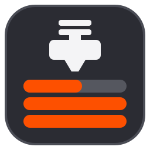

<p align="center">
  
</p>

<h1 align="center">LayerPeek</h1>
<p align="center"><i>for Prusa printers</i></p>

<p align="center">
  <b>Watch your Prusa printers live, right from the system tray.</b><br>
  Real-time camera, print progress and notifications over your local network. No cloud, no account, no browser tab.
</p>

<p align="center">
  <a href="https://github.com/pfoltynek/LayerPeek/releases"><b>Download</b></a> ·
  <a href="#quick-start">Quick start</a> ·
  <a href="#features">Features</a> ·
  <a href="README.cz.md">Česky</a>
</p>

<p align="center">
  <a href="https://github.com/pfoltynek/LayerPeek/releases"></a>
  <a href="LICENSE"></a>
  
  
  <a href="https://github.com/pfoltynek/LayerPeek/stargazers"></a>
</p>

<!--
  SCREENSHOT (hero): docs/images/camera-overlay.png
  Camera window in normal mode during a real print, overlay with progress, temperatures and finish time.
  Recommended 1600×900 px, PNG, no personal data in the file name or the printer name.
<p align="center">
  
</p>
-->

---

You start a 9-hour print and go back to work. Is the first layer sticking? Did the spool tangle? How long is left?
Normally you walk to the printer, or open a browser tab and keep reloading it.

**LayerPeek** puts the answer one glance away. The tray icon shows the state and progress of every
printer. A click opens a **live camera window** with the print progress, temperatures and the finish time on top of the
picture. When something happens, a **system notification** tells you right away: print finished, printer needs
attention, error, printer offline.

It talks to your printers **directly over your local network** through PrusaLink, the API built into the printer
firmware. Nothing leaves your network: no cloud service, no account, no telemetry.

> [!NOTE]
> This is an independent community project. It is **not** an official product of Prusa Research and is not affiliated
> with or endorsed by Prusa Research a.s. *Prusa*, *PrusaLink* and *Prusa Connect* are trademarks of their respective
> owners.

## Why you'll like it

- 🎥 **Live camera, not snapshots.** Real-time RTSP/H.264 stream from the Prusa Buddy3D camera (or any RTSP camera),
  decoded locally with FFmpeg. A compact always-on-top window can sit in the corner of your screen while you work.
- 🏠 **Local network only.** The app talks to the printers on your LAN. It works even when your internet is down, and
  your camera picture never goes through somebody else's server.
- 🔔 **You hear about it when it matters.** Native Windows notifications for finished, paused and stopped prints,
  errors, "needs attention" and printers going offline, plus a reminder a few minutes before the print ends.
- 🖨️ **Your whole print farm in one icon.** Add as many printers as you have. One combined icon shows the most
  important state, and each printer has its own submenu.
- 🪶 **Tiny and quiet.** A single native executable (Native AOT), no .NET runtime to install, no main window, no
  background service. It just lives in the tray.
- 🔒 **Safe with your passwords.** Passwords go to the Windows Credential Manager. The PrusaLink web interface opens
  already signed in, and your password is never handed to the browser.
- 🌍 **Speaks your language.** English, Czech, Slovak, German, Spanish, French, Italian and Polish.
- 💚 **Free and open source** under GPL-3.0. No ads, no subscription, no "pro" version.

## Screenshots

<!--
  SCREENSHOTS: add the files to docs/images/ and remove this comment wrapper.
  Recommended: PNG, 100 % or 150 % display scaling, light Windows theme, no real IP addresses or serial numbers.

| Tray menu | Mini camera window |
|---|---|
|  |  |

| Notification | Diagnostics |
|---|---|
|  |  |
-->

*Screenshots are coming with the first release.*

## Features

### In the tray

- The icon shows the printer state: idle, printing (the icon fills up as the print progresses), paused, finished,
  needs attention, error, offline. The tooltip shows the details: progress, time left and file name.
- The menu has a submenu for each printer: show or hide the camera, open the diagnostics, open the PrusaLink web.

### Camera window

- Live RTSP stream with overlay widgets: status (name, state, progress), times (remaining, finish, print time),
  temperatures with a small chart, print name with the G-code thumbnail, and cool-down after the print. You choose the
  widgets, their size and where they sit: drag them right in the camera window.
- Three modes: **normal**, **mini** (a small preview that stays on top of other windows, with an info strip below the
  image) and **full screen** (F11).
- Per printer: start mode, size, position, monitor and "always on top". The window can remember where you left it.
- Reconnects automatically when the camera or Wi-Fi drops out.

### Notifications

- Print started, finished, paused, resumed, stopped, error, needs attention, printer offline.
- "N minutes remaining" reminder, so you can be at the printer when the print ends.
- Optional "printer cooled down" notification, so you know when you can switch it off.
- Sound off, on for important events only, or on for all events.

### Diagnostics

- Printer model and firmware, current state and the time of the last update.
- Nozzle and bed temperatures (actual and target), hotend and print fan speeds, print speed, flow and Z height.
- Live temperature chart for the nozzle and the bed: last 30 minutes, 2 hours or 24 hours (kept in memory only).

### Troubleshooting built in

- The **About** window saves a diagnostic bundle (logs, version and system info, settings without passwords) or copies
  a short report to the clipboard, so a bug report takes a minute.

## Supported printers

Any Prusa printer with **Buddy firmware 6.x and PrusaLink**:

| Printer | Status |
|---|---|
| Prusa CORE One | ✅ tested (with the Buddy3D camera) |
| Original Prusa MK4 / MK4S | 🟡 should work, not tested yet |
| Original Prusa MK3.9 / MK3.9S, MK3.5 / MK3.5S | 🟡 should work, not tested yet |
| Original Prusa XL | 🟡 should work, not tested yet |
| Original Prusa MINI / MINI+ | 🟡 should work, not tested yet |
| Original Prusa MK3 / MK3S (8-bit firmware) | ❌ the printer has no built-in PrusaLink |

All printers with Buddy firmware 6.x share the same PrusaLink API. Do you run the app with another model? Please
[let us know](https://github.com/pfoltynek/LayerPeek/issues) whether it works, so we can mark it as tested.

The camera is optional. Without it you still get the tray icon, notifications and diagnostics. The camera has to
provide an **RTSP H.264** stream reachable from your computer, for example the Prusa Buddy3D camera or most IP
cameras.

| Platform | Status |
|---|---|
| Windows 10/11 x64 | ✅ supported |
| Windows on ARM64 | 🚧 planned |
| macOS (Apple Silicon) | ✅ supported since 0.3.0 (menu bar app) |

## Quick start

### 1. Download

Get the latest build from the [Releases](https://github.com/pfoltynek/LayerPeek/releases) page:

- **Installer** `LayerPeek-X.Y.Z-win-x64-Setup.exe`: installs for your user only, without administrator rights, into
  `%LOCALAPPDATA%\LayerPeek` and adds LayerPeek to the Start menu. Uninstall it in **Settings → Apps**.
- **ZIP** `LayerPeek-X.Y.Z-win-x64.zip`: unpack it anywhere and run `LayerPeek.exe`.

> [!IMPORTANT]
> Versions 0.x are **previews**. Settings may change between versions. Builds are not code-signed, so Windows
> SmartScreen shows "Windows protected your PC" with an "Unknown publisher". Click **More info → Run anyway**, or
> [build the app yourself](#building-from-source).

Uninstalling keeps your settings (`%APPDATA%\LayerPeek`) and passwords (Windows Credential Manager), and the installer
leaves its own log in `%LOCALAPPDATA%\velopack`. You can delete them by hand. The app's logs in
`%LOCALAPPDATA%\LayerPeek\logs` are deleted with the app. Installing over the ZIP version replaces that folder too,
including the ZIP version's logs.

#### macOS (Apple Silicon)

- **Disk image** `LayerPeek-X.Y.Z-osx-arm64.dmg`: open it and drag **LayerPeek** to **Applications**.
- **Archive** `LayerPeek-X.Y.Z-osx-arm64.tar.gz`: contains `LayerPeek.app`; unpack it and move the app to Applications.

Since version 0.3.0 LayerPeek is also released for macOS. It lives in the menu bar only, without a Dock icon, and has
the same features as on Windows, including notifications and the camera window.

> [!IMPORTANT]
> The macOS builds are only ad-hoc signed and **not notarized** by Apple, so Gatekeeper blocks the first start
> ("Apple could not verify…"). Click **Done**, then open **System Settings → Privacy & Security**, click **Open Anyway**
> next to the message about LayerPeek, confirm with your password or Touch ID and open the app again. Advanced users can
> remove the quarantine flag of the downloaded app instead: `xattr -dr com.apple.quarantine /Applications/LayerPeek.app`.
> Start the app from Applications, not straight from the disk image: "Open at Login" works only there.

On macOS 15 and later, the first connection to a printer or camera asks for **Local Network** access: click **Allow**.
If you denied it, turn LayerPeek on in **System Settings → Privacy & Security → Local Network**.

### 2. Enable PrusaLink on the printer

On the printer, open **Settings → Network → PrusaLink**. Check that PrusaLink is enabled and note the **user name**
(the default is `maker`), the **password** and the printer's **IP address**.

### 3. Add the printer

1. A Prusa icon appears in the system tray. On Windows you may need to pin it from the hidden-icons area (`^`).
2. Open the tray menu, choose **Add printer…** and fill in:
   - **Name:** any name you like.
   - **Address:** an IP address or host name, e.g. `192.168.1.20` or `http://prusa-mk4.local`.
   - **User name** and **Password:** the values from step 2.
3. Click **Test connection**, then **Save**.

The icon starts showing the printer's state immediately.

### 4. Turn on the camera (optional)

In the printer's settings, enter the camera's RTSP address, e.g. `rtsp://192.168.1.21/live` for the Buddy3D camera.
Don't put a user name or password in the URL. Click **Test camera**, save, and choose **Show camera** in the printer's
submenu.

### Other settings

- **Notifications:** which events you want, the sound mode and the "minutes remaining" reminder.
- **Camera window:** start mode, size, monitor and always on top.
- **Widgets:** which overlay widgets are shown, their settings (e.g. the cool-down threshold), card opacity and layout.
- **General:** how often the printers are polled, the language and detailed logging.
- **Startup and updates:** start LayerPeek after you sign in to Windows (off by default; only the installed version),
  and whether updates offer pre-release versions. On macOS: **Open at Login** (off by default; only for LayerPeek.app copied out of
  the disk image, e.g. to Applications). If you turned LayerPeek off in System Settings → General → Login Items, only you can
  allow it there again; the settings window offers a button that opens that page.

### Where data is stored

| What | Where (Windows) | Where (macOS) |
|---|---|---|
| Settings | `%APPDATA%\LayerPeek\settings.json` | `~/Library/Application Support/LayerPeek/settings.json` |
| Passwords | Windows Credential Manager | login Keychain |
| Logs | `%LOCALAPPDATA%\LayerPeek\logs` | `~/Library/Logs/LayerPeek` |

The temperature history is kept only in memory and is never written to disk. The app makes no connections except to
the printers and cameras you add.

## Roadmap

- Update check in the app, with a one-click update of the installed version
- `winget install` as soon as the first release is public
- Code-signed builds (no SmartScreen warning) and installation through Homebrew on macOS. This depends on funding the
  signing certificates (Apple Developer Program, Windows code signing); sponsorship options will follow.
- Windows on ARM64
- MMU3 status
- Prusa Connect (cloud) as an optional second source for printers outside your network

Have an idea? [Open an issue](https://github.com/pfoltynek/LayerPeek/issues).

## FAQ

**Does it work outside my home network?**
Not yet. The app talks to the printers directly over the LAN. You can use a VPN to your home network; optional Prusa
Connect support is on the roadmap.

**Does it replace Prusa Connect or PrusaLink web?**
No, it complements them. It is the quick "glance" view on your desktop. For uploading files and starting prints, open
the PrusaLink web from the tray menu: it signs you in automatically.

**Can it control the printer (pause, stop)?**
Not in this version. It is a monitoring tool on purpose: read-only access is safer for a tool that runs all the time.

**Does it slow the printer down?**
No. It asks for the state every few seconds (configurable), the same way the PrusaLink web does.

## Building from source

### Prerequisites

- [.NET SDK 11](https://dotnet.microsoft.com/download/dotnet/11.0). The exact version is pinned in
  [`global.json`](global.json) and preview versions are allowed.
- Git.
- For a **Native AOT publish** only: on Windows the Visual Studio Build Tools with the *Desktop development with
  C++* workload, on macOS the Xcode Command Line Tools.
- The first build on Windows downloads the LGPL FFmpeg libraries for the camera (~77 MB, verified by SHA-256). On
  macOS the first build downloads the official FFmpeg source (~12 MB, verified by SHA-256) and compiles an LGPL build
  with the Xcode Command Line Tools (about a minute).

See [docs/prerequisites.md](docs/prerequisites.md) for details (in Czech).

### Build, test, run

```bash
git clone https://github.com/pfoltynek/LayerPeek.git
cd LayerPeek

dotnet build                                      # build the whole solution
dotnet test                                       # run all tests
dotnet run --project src/LayerPeek.App  # start the tray app
```

No printer at hand? The repository contains a [simulator](docs/simulator.md) of PrusaLink printers and an RTSP camera
for development (in Czech).

### Native AOT publish

```bash
dotnet publish src/LayerPeek.App -c Release -r win-x64     # on Windows
dotnet publish src/LayerPeek.App -c Release -r osx-arm64   # on macOS
```

AOT code can't be cross-compiled between operating systems: build Windows binaries on Windows and macOS binaries on
macOS.

### Making a release

Releases are built locally with PowerShell 7.2+ scripts in `scripts/` (build, tests, AOT publish, smoke test, archives,
SHA-256 checksums, GitHub release). The version comes from `<Version>` in `Directory.Build.props` and the release notes
from [CHANGELOG.md](CHANGELOG.md). One command, `pwsh scripts/release.ps1 -Version X.Y.Z` (try `-DryRun` first), runs the
Gitflow release (release branch, merge into `main` with the tag `vX.Y.Z`, merge back into `develop`), builds the tag and
uploads it into a draft GitHub release, asking before every push and upload. Publishing the draft stays a separate
manual step (`scripts/release-publish.ps1`). See [docs/release.md](docs/release.md) for the full procedure (in Czech).
The checks on a Mac that only a person can do (Gatekeeper, macOS permissions, Open at Login, monitors, a sleeping
display) are collected in one walk-through in [docs/macos-manual-testing.md](docs/macos-manual-testing.md) (in Czech).

### Project structure

| Path | Contents |
|---|---|
| `src/LayerPeek.Core` | domain model, abstractions, monitoring and event detection (no UI, no HTTP specifics) |
| `src/LayerPeek.PrusaLink` | PrusaLink REST client and the local web proxy |
| `src/LayerPeek.PrusaConnect` | Prusa Connect cloud client (planned) |
| `src/LayerPeek.Camera.FFmpeg` | RTSP/H.264 camera feed via FFmpeg |
| `src/LayerPeek.App` | Avalonia tray app, windows, platform specifics |
| `tests/` | xUnit v3 unit, UI (Avalonia headless) and E2E tests |
| `tools/` | developer tools, e.g. the PrusaLink printer and camera simulator |
| `docs/` | architecture and API notes (in Czech) |
| `tasks/` | task backlog (in Czech) |

Built with [.NET](https://dotnet.microsoft.com/), [Avalonia UI](https://avaloniaui.net/),
[CommunityToolkit.Mvvm](https://github.com/CommunityToolkit/dotnet) and [FFmpeg](https://ffmpeg.org/).

### How this project is made

This project is developed with the help of AI: most of the code, tests and documentation were written with
[Claude Code](https://claude.com/claude-code) under the maintainer's direction. Every product decision is made by the
maintainer, every change goes through automated tests (unit, headless UI and end-to-end tests against a printer
simulator) and a review, and the app is tested on a real printer. The whole process is public: the task backlog is in
`tasks/`, the agent instructions in `.claude/agents/` and the coding rules in [CLAUDE.md](CLAUDE.md).

## Contributing

Contributions are welcome: bug reports, ideas, translations and pull requests. See [CONTRIBUTING.md](CONTRIBUTING.md)
for the details.

- **Bugs and ideas:** open an [issue](https://github.com/pfoltynek/LayerPeek/issues). Include your printer
  model, firmware version and OS. The diagnostic bundle from the About window helps a lot.
- **Translations:** UI strings are in `src/LayerPeek.App/Resources/Strings.*.resx`. Fixes and new languages
  are very welcome.
- **Pull requests:** the project uses Gitflow. Branch from `develop` and open the PR against `develop`.
  `dotnet build` and `dotnet test` must pass with **zero warnings**, because warnings are treated as errors.
- **Native AOT:** no unconstrained reflection, `System.Text.Json` only through source-generated contexts, and any new
  NuGet package must be trim/AOT compatible. See [CLAUDE.md](CLAUDE.md) for the full coding rules.
- **Language:** code, comments and commit messages are in English. Task and design notes in `tasks/` and `docs/` are
  in Czech.

There is no CLA. By submitting a contribution you agree that it is licensed under the project's license
(GPL-3.0-only).

### Security

Please don't report security issues in public issues. Use GitHub's
[private vulnerability reporting](https://github.com/pfoltynek/LayerPeek/security/advisories/new) instead.
See [SECURITY.md](SECURITY.md).

## License

Copyright © Petr Foltýnek

This program is free software: you can redistribute it and/or modify it under the terms of the
**GNU General Public License, version 3 only** (SPDX: `GPL-3.0-only`). See [LICENSE](LICENSE) for the full text.

This program is distributed in the hope that it will be useful, but **without any warranty**; without even the
implied warranty of merchantability or fitness for a particular purpose.

### Third-party components

The app bundles the native **FFmpeg** libraries, which are licensed under the LGPL. They are dynamically linked and
can be replaced. The FFmpeg license text ships with the app as `FFmpeg-LICENSE.txt`. All third-party components,
their versions and full license texts are listed in the app under **About → Third-party licences…**.

---

<p align="center">
  If LayerPeek saves you a walk to the printer, please give it a ⭐. It helps other makers find it.
</p>
