# Uživatelská příručka LayerPeek

*Pro LayerPeek 0.5 ve Windows 10/11 a macOS (Apple Silicon).* · [Další jazyky](../README.md)

LayerPeek hlídá vaše 3D tiskárny Prusa přes místní síť a ukazuje jejich stav v oznamovací oblasti Windows nebo v řádku
nabídek macOS. Nemá žádné hlavní okno: všechno začíná v nabídce ikony. Tato příručka popisuje oba systémy; kde se
Windows a macOS liší, text to uvádí nebo ukazuje obě varianty.

> [!NOTE]
> LayerPeek je nezávislý komunitní projekt, nikoli oficiální produkt společnosti Prusa Research.

## Obsah

1. [Co budete potřebovat](#1-co-budete-potřebovat)
2. [Instalace](#2-instalace)
3. [První kroky](#3-první-kroky)
4. [Ikona a její nabídka](#4-ikona-a-její-nabídka)
5. [Okno kamery](#5-okno-kamery)
6. [Widgety](#6-widgety)
7. [Upozornění](#7-upozornění)
8. [Nahrávání, dashcam a timelapse](#8-nahrávání-dashcam-a-timelapse)
9. [Detekce chyb tisku (experimentální)](#9-detekce-chyb-tisku-experimentální)
10. [Diagnostika](#10-diagnostika)
11. [Přehled nastavení](#11-přehled-nastavení)
12. [Aktualizace](#12-aktualizace)
13. [Kde jsou uložena vaše data](#13-kde-jsou-uložena-vaše-data)
14. [Řešení problémů](#14-řešení-problémů)
15. [Odinstalace](#15-odinstalace)

## 1. Co budete potřebovat

- **Tiskárnu Prusa s firmwarem Buddy 6.x a PrusaLinkem**: CORE One (vyzkoušeno), MK4/MK4S, MK3.9/MK3.9S, MK3.5/MK3.5S,
  XL a MINI/MINI+. Original Prusa MK3/MK3S nemá vestavěný PrusaLink a podporována není.
- **Počítač ve stejné místní síti** jako tiskárna:
  - Windows 10 nebo 11, x64 (Windows na ARM podporováno není),
  - macOS na Apple Silicon (M1 nebo novější).
- **Kameru (volitelně):** jakoukoli kameru se streamem **RTSP H.264**, na kterou váš počítač dosáhne, například kameru
  Prusa Buddy3D. I bez kamery máte k dispozici ikonu, upozornění a diagnostiku.

LayerPeek funguje jen ve vaší místní síti. Nepoužívá Prusa Connect ani žádnou jinou cloudovou službu. Mimo domov se
k tiskárnám dostanete přes VPN do domácí sítě.

Zatím je otestovaná jen CORE One. Máte jiný model? Pošlete prosím krátké [hlášení kompatibility tiskárny](https://github.com/pfoltynek/LayerPeek/issues/new?template=printer_compatibility.yml) (formulář je v angličtině); stačí jedna zkouška na Windows nebo macOS.

## 2. Instalace

Nejnovější verzi stáhnete na stránce [Releases](https://github.com/pfoltynek/LayerPeek/releases).

> [!IMPORTANT]
> Verze 0.x jsou předběžné a sestavení nejsou podepsaná společností Microsoft ani notarizovaná společností Apple. Systém
> vás proto při prvním spuštění varuje; postup níže ukazuje, jak varování obejít.

### 2.1 Windows

Můžete si vybrat ze dvou balíčků:

| Balíček | Co dělá |
|---|---|
| **Instalátor** `LayerPeek-X.Y.Z-win-x64-Setup.exe` (doporučeno) | Nainstaluje LayerPeek jen pro vašeho uživatele, bez oprávnění správce, do `%LOCALAPPDATA%\LayerPeek`, přidá ho do nabídky Start, spouští ho po přihlášení a umí se sám aktualizovat. |
| **ZIP** `LayerPeek-X.Y.Z-win-x64.zip` | Rozbalte ho kamkoli a spusťte `LayerPeek.exe`. Po přihlášení se nespouští a sám se neaktualizuje (místo toho otevře stránku s vydáním). |

Při prvním spuštění zobrazí Windows SmartScreen hlášení **„Systém Windows ochránil váš počítač“** s *neznámým
vydavatelem*. Klikněte na **Další informace** a potom na **Přesto spustit**.

### 2.2 macOS

| Balíček | Co dělá |
|---|---|
| **Obraz disku** `LayerPeek-X.Y.Z-osx-arm64.dmg` (doporučeno) | Otevřete ho a přetáhněte **LayerPeek** do složky **Aplikace**. |
| **Archiv** `LayerPeek-X.Y.Z-osx-arm64.tar.gz` | Obsahuje `LayerPeek.app`; rozbalte ho a aplikaci přesuňte do složky **Aplikace**. |

LayerPeek vždy spouštějte ze složky **Aplikace**, ne přímo z obrazu disku nebo ze složky Stažené soubory: jen odtud se
může otevírat při přihlášení a sám se aktualizovat.

Při prvním spuštění aplikaci zablokuje Gatekeeper (*„Apple nemůže ověřit…“*, anglicky *„Apple could not verify…“*):

1. Klikněte na **Hotovo**.
2. Otevřete **Nastavení systému → Soukromí a zabezpečení**, sjeďte dolů a u zprávy o LayerPeeku klikněte na
   **Přesto otevřít** (Open Anyway).
3. Potvrďte heslem nebo pomocí Touch ID a LayerPeek otevřete znovu.

Pokročilí uživatelé mohou místo toho odstranit příznak karantény v Terminálu:
`xattr -dr com.apple.quarantine /Applications/LayerPeek.app`.

LayerPeek žije jen v řádku nabídek. Nemá ikonu v Docku a neobjevuje se v přepínači aplikací (⌘⇥).

## 3. První kroky

### 3.1 Zapnutí PrusaLinku na tiskárně

Na displeji tiskárny otevřete **Nastavení → Síť → PrusaLink** (Settings → Network → PrusaLink). Zkontrolujte, že je
PrusaLink zapnutý, a poznamenejte si:

- **IP adresu** tiskárny (nebo její název hostitele),
- **uživatelské jméno** (výchozí je `maker`),
- **heslo**.

### 3.2 Přidání tiskárny

1. Najděte ikonu LayerPeeku:
   - **Windows:** v oznamovací oblasti na pravém konci hlavního panelu. Pokud ji nevidíte, klikněte na šipku **`^`**
     (skryté ikony) a přetáhněte ikonu na hlavní panel, aby zůstala viditelná.
   - **macOS:** v řádku nabídek nahoře na obrazovce.
2. Otevřete nabídku ikony (**Windows:** klikněte na ikonu pravým tlačítkem, **macOS:** klikněte na ni) a vyberte
   **Přidat tiskárnu…**. Otevře se okno **Nastavení** na záložce **Tiskárny**.
3. Vyplňte:
   - **Název:** libovolný název, např. `CORE One`.
   - **Adresa:** IP adresa nebo název hostitele, např. `192.168.1.20` nebo `http://prusa-mk4.local`.
   - **Uživatelské jméno** a **Heslo:** údaje z tiskárny.
4. Klikněte na **Otestovat spojení**. Funkční spojení ohlásí kód modelu a verzi firmwaru.
5. Klikněte na **Uložit**.

  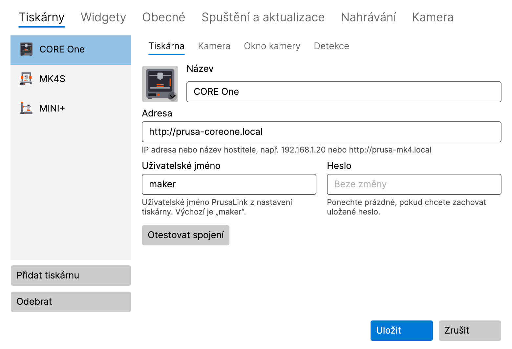

Ikona hned začne ukazovat stav tiskárny. Další tiskárny přidáte stejně: **Přidat tiskárnu** na záložce **Tiskárny**.

**macOS 15 a novější:** při prvním připojení k tiskárně nebo kameře se systém zeptá na přístup k **místní síti**
(Local Network). Klikněte na **Povolit**. Pokud jste přístup zamítli, podívejte se do části
[Řešení problémů](#14-řešení-problémů).

Heslo se ukládá do **Správce pověření ve Windows** (Credential Manager) nebo do **Klíčenky v macOS** (Keychain), nikdy
do souboru s nastavením. Když tiskárnu později upravujete, pole pro heslo ukazuje **Beze změny**; nechte ho prázdné
a uložené heslo zůstane.

### 3.3 Přidání kamery (volitelné)

1. V **Nastavení → Tiskárny** vyberte tiskárnu a otevřete její podzáložku **Kamera**.
2. Zapněte **Používat kameru (položka „Zobrazit kameru“ v nabídce v oznamovací oblasti)**.
3. Zadejte **Adresa RTSP streamu**, např. `rtsp://192.168.1.21/live` pro kameru Buddy3D (výchozí port je 554).
   Do adresy nepište uživatelské jméno ani heslo.
4. Klikněte na **Otestovat kameru**. Funkční kamera ukáže snímek a své rozlišení.
5. Klikněte na **Uložit** a v podnabídce tiskárny vyberte **Zobrazit kameru**.

### 3.4 Obrázek tiskárny

Seznam tiskáren ukazuje u každé tiskárny obrázek, vybraný automaticky podle jejího modelu. Kliknutím na obrázek můžete
zvolit jiný model, obecnou ilustraci nebo vlastní obrázek (PNG, JPG).

## 4. Ikona a její nabídka

### 4.1 Co ikona ukazuje

Ikona ukazuje nejdůležitější stav ze všech vašich tiskáren:

| Stav | Význam |
|---|---|
| **Připravena** | tiskárna nic nedělá |
| **Tiskne** | ikona se postupně plní podle průběhu tisku |
| **Pozastaveno** | tisk je pozastavený |
| **Dokončeno** / **Zastaveno** | tisk skončil |
| **Vyžaduje zásah** | tiskárna na vás čeká (např. výměna filamentu nebo dotaz na jejím displeji) |
| **Chyba** | tiskárna hlásí chybu |
| **Nedostupná** | tiskárna není dosažitelná |
| **Neplatné přihlašovací údaje** | tiskárna odmítla uživatelské jméno nebo heslo |

Když na ikonu najedete myší, zobrazí se v bublině podrobnosti: průběh, zbývající čas a název souboru. Zatímco se kamera
tiskárny nahrává, bublina ukazuje **Nahrává se**.

### 4.2 Nabídka

- **Windows:** klikněte na ikonu pravým tlačítkem.
- **macOS:** klikněte na ikonu v řádku nabídek.

Nabídka obsahuje:

- **Jednu podnabídku pro každou tiskárnu**; v jejím záhlaví je název tiskárny, stav a průběh a obsahuje:
  - **Zobrazit kameru** / **Skrýt kameru** a, když je okno otevřené, **Přenést kameru do popředí**,
  - **Nahrávat** / **Zastavit nahrávání**, **Přehrát poslední nahrávku**, **Otevřít složku s nahrávkami**,
  - **Uložit posledních 2 min** (když je zapnutý dashcam, viz [8.3](#83-dashcam-poslední-minuty)),
  - položky pro timelapse (experimentální, viz [8.4](#84-timelapse-experimentální)),
  - **Otevřít PrusaLink**: otevře webové rozhraní PrusaLinku tiskárny v prohlížeči, rovnou přihlášené. Vaše heslo se
    prohlížeči nikdy nepředává.
- **Diagnostika…** (viz [10](#10-diagnostika))
- **Nastavení…**
- **Je dostupná nová verze X.Y.Z** (jen když je k dispozici aktualizace, viz [12](#12-aktualizace))
- **Uživatelská příručka**: otevře tuto příručku
- **O aplikaci**
- **Ukončit**

Dokud nepřidáte první tiskárnu, nabídka místo podnabídek tiskáren nabízí **Přidat tiskárnu…**.

## 5. Okno kamery

  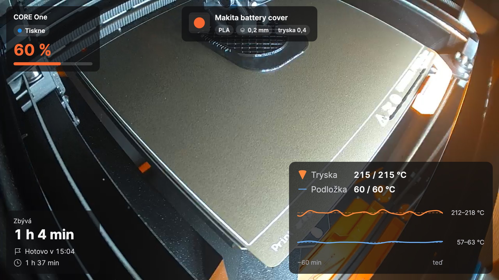

Otevřete ho položkou **Zobrazit kameru** v podnabídce tiskárny. Okno ukazuje živý obraz z kamery a nad ním
[widgety](#6-widgety). Tlačítka v okně se objeví, když po něm přejedete myší.

### 5.1 Tři režimy

| Režim | Jak přepnout | K čemu slouží |
|---|---|---|
| **Normální okno** | tlačítko v okně nebo dvojklik v malém náhledu | pořádný pohled, libovolná velikost, libovolný monitor |
| **Malý náhled** | tlačítko **Malý náhled vždy navrchu** | malé okno, které celý den zůstává nad ostatními okny |
| **Celá obrazovka** | **Windows:** F11 · **macOS:** ⌃⌘F · nebo dvojklik na obraz; **Esc** vrátí zpět | celá obrazovka |

Malý náhled má pod obrazem informační pás (průběh, zbývající čas, čas dokončení). Dvě tlačítka rozbalí další řádky:
**název tisku** a **graf teplot**. Co pás ukazuje, nastavíte na podzáložce **Okno kamery** tiskárny
(viz [11.1](#111-tiskárny)).

Aby šetřil procesor, ukazuje malý náhled ve výchozím nastavení nejvýš 10 snímků za sekundu, což malému obrazu stačí;
normální okno a celá obrazovka ukazují každý snímek kamery. Omezení se nastavuje na záložce **Kamera** v nastavení (viz
[11.6](#116-kamera)).

  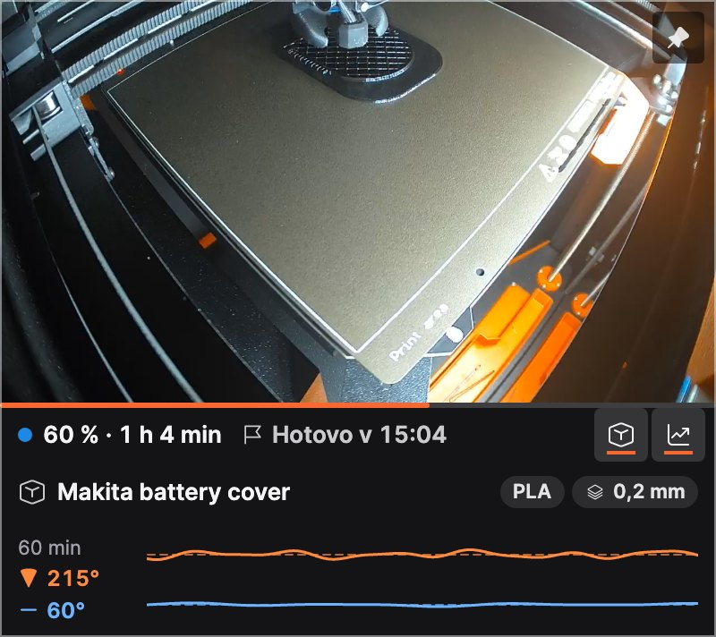

### 5.2 Vždy navrchu

Tlačítko se špendlíkem v okně ukazuje, jestli okno zůstává nad ostatními okny, a jedním kliknutím to přepne. Stejnou
volbu najdete v místní nabídce okna (**Vždy navrchu**).

### 5.3 Místní nabídka okna

Klikněte na obraz pravým tlačítkem (v macOS také se stisknutou klávesou Control) a najdete **Upravit rozložení**,
**Vždy navrchu**, nahrávání, dashcam a timelapse.

### 5.4 Když vypadne spojení

Když vypadne kamera nebo Wi-Fi, okno se samo znovu připojí; mezitím ukazuje **Připojuji se ke kameře…** nebo **Bez
signálu**. Další pokus přijde za 5 sekund; dokud je kamera nedostupná, pauza se zdvojnásobuje až na jednu minutu. Okno
průběžně ukazuje, asi za jak dlouho přijde další pokus; když okno otevřete, obnovíte z minimalizace nebo v nastavení
kliknete na **Otestovat kameru**, zkusí se připojit hned. Když tiskárnu vypnete, okno se zavře a po jejím návratu se
znovu otevře na stejném místě. Vypnout to můžete v **Nastavení → Tiskárny → Okno kamery** (**Zavřít, když se tiskárna
vypne, a znovu otevřít po jejím zapnutí**). Okno, které zavřete sami, zůstane zavřené.

## 6. Widgety

Widgety jsou karty nad obrazem z kamery. Každá tiskárna má vlastní sadu a rozložení.

| Widget | Ukazuje |
|---|---|
| **Stav** | název tiskárny, stav a průběh v procentech |
| **Časy** | zbývající čas, kdy bude tisk hotový, dobu tisku |
| **Teploty** | trysku a podložku (aktuální / cílová) s grafem za posledních 60 minut |
| **Název tisku** | čitelný název souboru s materiálem, výškou vrstvy a tryskou; větší velikosti přidávají náhled G-kódu |
| **Vychladnutí** | po tisku: jak moc už tryska a podložka vychladly a kdy je bezpečné tiskárnu vypnout |

Každý widget má tři velikosti: **S**, **M** a **L**. Tady na příkladu teplot: S ukazuje hodnoty, M přidá graf, L popisky
a rozsah teplot.

  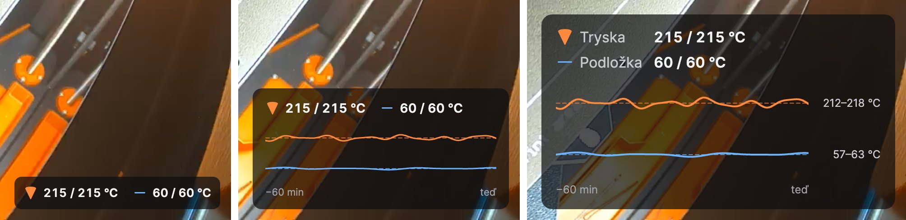

### 6.1 Výběr widgetů

V **Nastavení → Widgety** nahoře vyberte tiskárnu a zaškrtněte widgety, které chcete. Když widget vyberete, zobrazí se
jeho vlastní nastavení, např. prahy vychladnutí trysky a podložky. **Použít rozložení u všech tiskáren** zkopíruje
rozložení na vaše další tiskárny. **Neprůhlednost pozadí karet** udrží text čitelný i na světlém obrazu (pro všechny
tiskárny).

  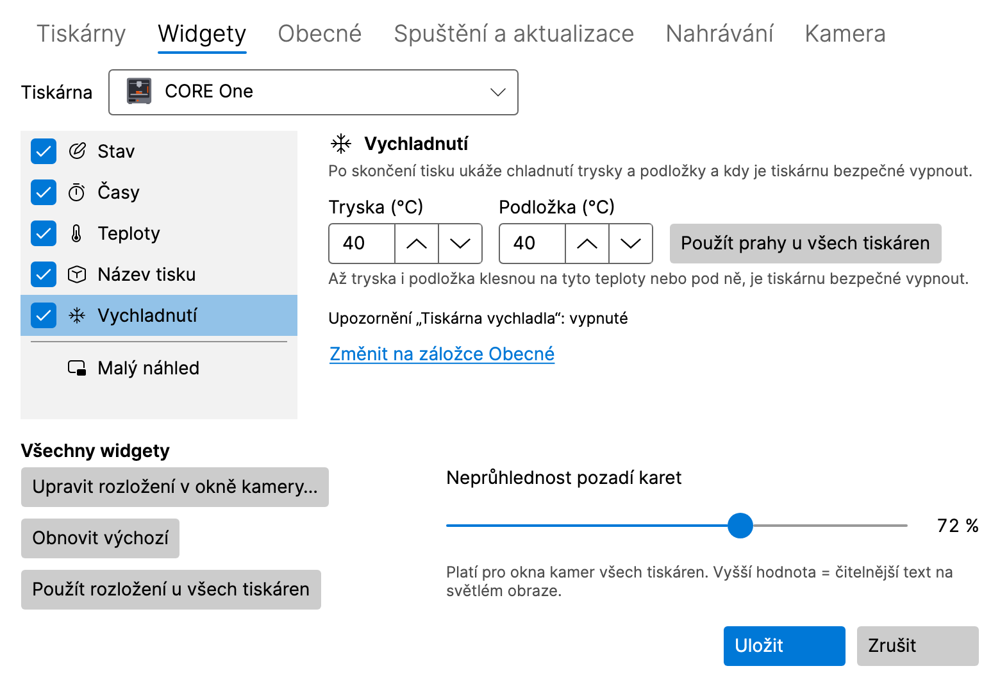

### 6.2 Rozmístění widgetů v okně kamery

V okně kamery klikněte na **Upravit rozložení** (nebo na **Upravit rozložení v okně kamery…** v **Nastavení →
Widgety**). V režimu úprav rozložení:

- widget **přetáhněte** na jedno ze šesti míst (nahoře a dole, vlevo, uprostřed a vpravo),
- kliknutím na widget otevřete jeho volby: **Velikost** (Malá, Střední, Velká) a **Zvýraznit** (ukáže klíčovou hodnotu
  zvýrazňující barvou),
- **Obnovit výchozí** vrátí výchozí rozložení, **Hotovo** ho uloží.

Z klávesnice: **mezerník** widget zvedne, **šipky** ho posouvají, **Enter** otevře jeho volby a **Esc** změny zahodí.
Pokud je okno příliš malé, nejdřív ho zvětšete.

  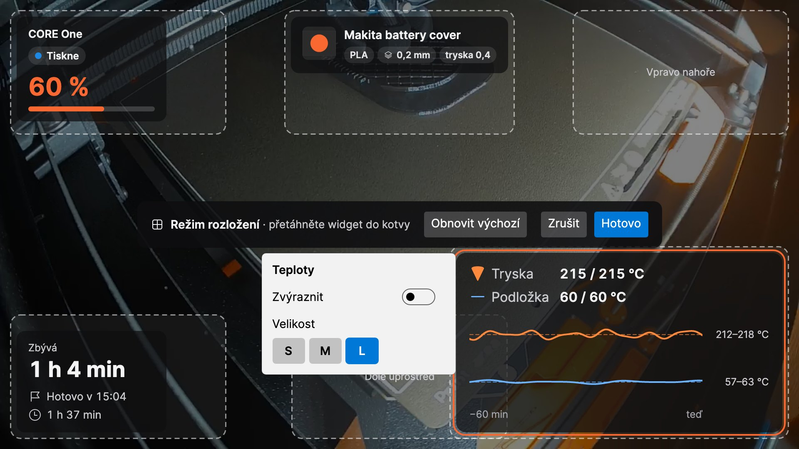

## 7. Upozornění

LayerPeek zobrazuje nativní systémová upozornění při těchto událostech (každé lze zapnout nebo vypnout v **Nastavení →
Obecné**):

- tisk začal, skončil, byl pozastaven, pokračuje a byl zastaven,
- tiskárna vyžaduje zásah (také při odmítnutém heslu), chyba,
- tiskárna přestala být dostupná nebo je opět online,
- **Zbývá N minut**, abyste mohli být u tiskárny, až tisk skončí (**Upozornit, když zbývá tolik minut tisku (0 =
  vypnuto)**),
- **Tiskárna vychladla**: tryska i podložka jsou pod prahy widgetu **Vychladnutí** a tiskárnu je bezpečné vypnout.

**Zvuk** může být vypnutý, zapnutý jen pro důležitá upozornění nebo pro všechna upozornění. **Poslat zkušební
upozornění** ukáže ukázkové upozornění, takže si ověříte, že k vám upozornění dorazí.

- **Windows:** pokud jsou upozornění pro LayerPeek vypnutá v **Nastavení → Systém → Oznámení**, nastavení LayerPeeku to
  oznámí a nabídne **Otevřít nastavení oznámení**. Zkontrolujte také režim **Nerušit**.
- **macOS:** první upozornění požádá o povolení; klikněte na **Povolit**. Pokud jsou upozornění vypnutá v **Nastavení
  systému → Oznámení**, nastavení LayerPeeku nabídne **Otevřít nastavení oznámení**. Zkontrolujte také režim
  **Soustředění** (Focus).

Kliknutím na upozornění tiskárny otevřete webové rozhraní PrusaLinku tiskárny. Poplach při chybě tisku otevře okno
kamery, neúspěšné nahrávání otevře záložku **Nahrávání** v nastavení a dokončený převod timelapse otevře složku
s nahrávkami.

## 8. Nahrávání, dashcam a timelapse

Všechny nahrávky zůstávají na vašem disku. Ve výchozím nastavení se ukládají do složky **Videa** (Windows) nebo **Filmy**
(macOS) do podsložky `LayerPeek`, pro každou tiskárnu do vlastní podsložky, pojmenované podle času a tisku. Video se
ukládá jako MP4 bez překódování, takže skoro vůbec nezatěžuje procesor.

  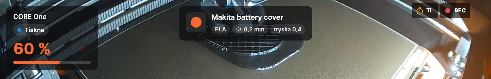

Zatímco se kamera nahrává, okno kamery ukazuje červené **REC**; zatímco se pořizuje timelapse, jantarové **TL**.

### 8.1 Ruční nahrávání

**Nahrávat** / **Zastavit nahrávání** v podnabídce tiskárny nebo tlačítko nahrávání v okně kamery. **Přehrát poslední
nahrávku** a **Otevřít složku s nahrávkami** najdete v podnabídce tiskárny.

### 8.2 Nahrávání každého tisku

Na podzáložce **Kamera** tiskárny zapněte **Automaticky nahrávat tisk**. Každý tisk se nahraje od začátku až do minuty
po jeho konci, i když okno kamery není otevřené.

  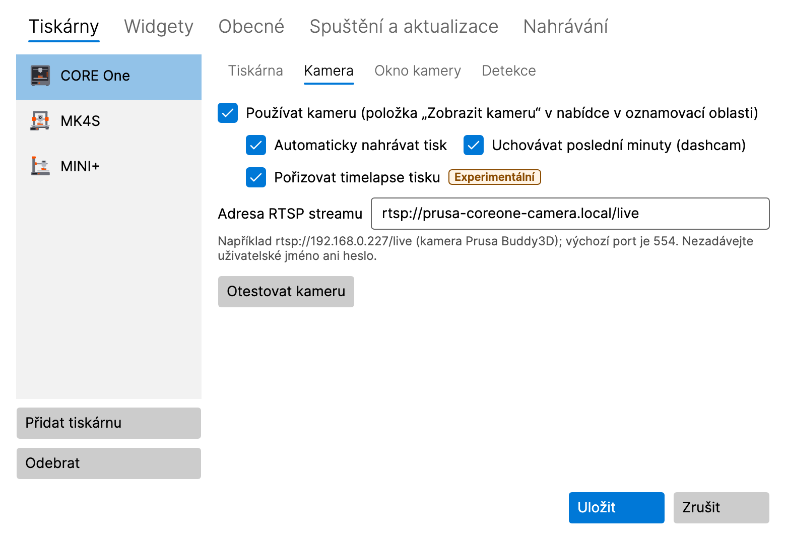

### 8.3 Dashcam: poslední minuty

Na podzáložce **Kamera** tiskárny zapněte **Uchovávat poslední minuty (dashcam)**. Během tisku LayerPeek drží poslední
2 minuty z kamery v paměti (asi 8 MB za minutu a tiskárnu); na disk se nic nezapíše, dokud se záznam neuloží. Poslední
minuty se spolu s 30 sekundami po události uloží:

- automaticky při chybě tisku, když tiskárna vyžaduje zásah, když se tisk zastaví a když detekce chyb tisku vyhlásí
  poplach (každou z těchto možností lze vypnout na záložce **Nahrávání**),
- ručně položkou **Uložit posledních 2 min** v podnabídce tiskárny nebo v místní nabídce okna kamery.

Délku (1–10 minut) nastavíte na záložce **Nahrávání**.

### 8.4 Timelapse (experimentální)

Timelapse je krátké video celého tisku: ve výchozím nastavení jeden snímek každých 30 sekund, během pauzy tisku žádný,
přehrávané rychlostí 30 snímků za sekundu. Ukládá se jako `…_timelapse.mp4` vedle nahrávek.

- **Ručně:** **Spustit timelapse (experimentální)** / **Zastavit timelapse (experimentální)** v podnabídce tiskárny nebo
  tlačítko se stopkami v okně kamery. **Přehrát poslední timelapse** najdete v podnabídce.
- **Každý tisk:** **Pořizovat timelapse tisku** na podzáložce **Kamera** tiskárny.
- **Interval:** na záložce **Nahrávání**, 5–600 sekund, nebo přepněte na **Každou N. vrstvu (odhad)**: snímek se pořídí,
  když začne nová vrstva. PrusaLink vrstvy nehlásí, a tak je LayerPeek odhaduje z výšky osy Z.
- **Vytvořit timelapse z nahrávky… (experimentální)** vytvoří timelapse z existující nahrávky LayerPeeku.
- **Exportovat timelapse do JPEG… (experimentální)** uloží snímky timelapse jako očíslované soubory JPEG, např. pro
  vlastní střih videa.

Oba převody ukazují svůj průběh v položce nabídky, kde je můžete i zrušit, a až budou hotové, dá vám vědět upozornění.

### 8.5 Složka a limit velikosti

Na záložce **Nahrávání** můžete změnit **Složka pro nahrávky** a **Limit velikosti všech nahrávek (GB)** (ve výchozím
nastavení 50 GB). Po překročení limitu se smažou nejstarší nahrávky; když na disku zbývá méně než 5 GB volného místa,
nahrávání se zastaví. Nepovedené nahrávání ohlásí upozornění.

  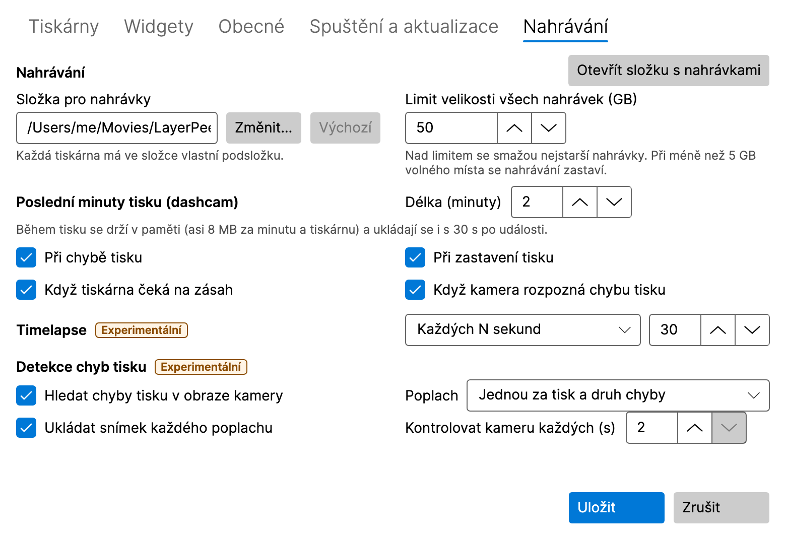

## 9. Detekce chyb tisku (experimentální)

LayerPeek může tisk sledovat kamerou a varovat vás, když se na podložce něco pokazí. Běží jen na vašem počítači; obraz
z kamery ho nikdy neopustí.

  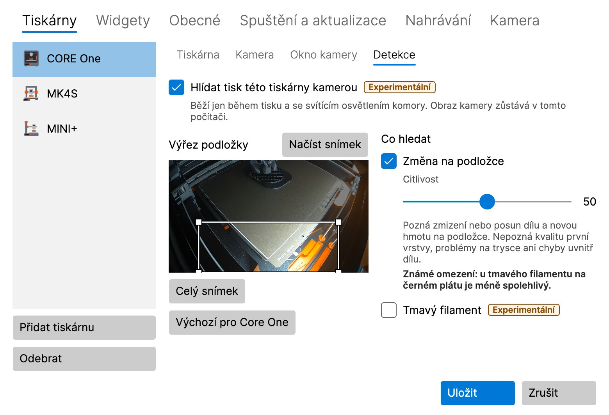

### 9.1 Zapnutí

Ve výchozím nastavení je vypnutá a zapnout ji musíte na dvou místech:

1. **Hledat chyby tisku v obraze kamery** na záložce **Nahrávání** (pro všechny tiskárny),
2. **Hlídat tisk této tiskárny kamerou** na podzáložce **Detekce** tiskárny.

Tiskárna musí mít zapnutou kameru. Detekce běží jen během tisku a při rozsvíceném osvětlení komory, i když okno kamery
není otevřené.

### 9.2 Výřez podložky

**Výřez podložky** je část obrazu, která se hlídá. Myší natáhněte nový obdélník, přesuňte ho nebo za roh změňte jeho
velikost, případně použijte šipky (Shift + šipky mění velikost). **Celý snímek** hlídá celý obraz, **Načíst snímek**
pořídí z kamery nový snímek a u CORE One **Výchozí pro Core One** obnoví jeho předvolbu.

### 9.3 Detektory

- **Změna na podložce** si všimne dílu, který zmizel nebo se posunul, a nového materiálu na podložce (špagety, utržený
  díl). **Tmavý filament** pomáhá s černým nebo velmi tmavým filamentem, za cenu většího počtu planých poplachů.
- **Tisk do vzduchu** (ve výchozím nastavení vypnutý, jen pro tiskárny, jejichž podložka při tisku sjíždí dolů: CORE One,
  CORE One L, XL) si všimne, že tiskárna dál tiskne, ale nic už nepřibývá, např. když došel filament.

**Citlivost** (0–100, ve výchozím nastavení 50): vyšší znamená víc poplachů, i planých; nižší znamená méně poplachů, ale
chyba může uniknout.

### 9.4 Poplach

Poplach je upozornění **Možná chyba tisku – …** se snímkem z kamery. Kliknutím na něj otevřete okno kamery. Tlačítko
**Falešný poplach** uloží místní záznam pro ladění; nic neopustí váš počítač. Na záložce **Nahrávání** nastavíte, jak
často se poplach opakuje, jestli se ukládá snímek každého poplachu a jak často se kontroluje kamera (2–5 sekund).

> [!WARNING]
> Detekce nepozná kvalitu první vrstvy, problémy u trysky ani vady uvnitř dílu. Může chybu přehlédnout nebo vyhlásit
> planý poplach. Nespoléhejte na ni jako na jedinou pojistku tisku bez dozoru.

## 10. Diagnostika

**Diagnostika…** v nabídce ikony (tiskárnu vyberete nahoře v okně) ukazuje model tiskárny a firmware, aktuální stav,
teploty trysky a podložky (aktuální a cílovou), ventilátory, rychlost tisku, průtok a výšku Z a graf teplot za posledních
30 minut, 2 hodiny nebo 24 hodin. Historie se drží jen v paměti a začíná spuštěním LayerPeeku.

  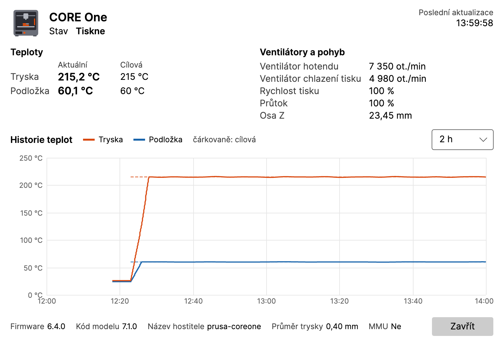

## 11. Přehled nastavení

V nabídce ikony otevřete **Nastavení…**. Změny se použijí po kliknutí na **Uložit**; **Zrušit** je zahodí.

### 11.1 Tiskárny

Seznam tiskáren s tlačítky **Přidat tiskárnu** a **Odebrat**. Každá tiskárna má podzáložky:

- **Tiskárna:** název, adresa, uživatelské jméno, heslo, **Otestovat spojení**.
- **Kamera:** adresa RTSP, **Otestovat kameru**, automatické nahrávání, dashcam a timelapse tisku.
- **Okno kamery:** **Otevřít jako** (jako minule, normální okno, malý náhled, celá obrazovka), monitor, velikost,
  umístění a **Vždy navrchu** pro normální okno i malý náhled, **Pamatovat poslední pozici a velikost**,
  **Zavřít, když se tiskárna vypne, a znovu otevřít po jejím zapnutí** a co ukazuje informační pás malého náhledu.
- **Detekce:** detekce chyb tisku této tiskárny (viz [9](#9-detekce-chyb-tisku-experimentální)).

### 11.2 Widgety

Widgety jednotlivých tiskáren, jejich nastavení a neprůhlednost karet (viz [6](#6-widgety)).

### 11.3 Nahrávání

Složka a limit velikosti nahrávek, dashcam, timelapse a detekce chyb tisku (viz
[8](#8-nahrávání-dashcam-a-timelapse) a [9](#9-detekce-chyb-tisku-experimentální)). Experimentální funkce nesou
štítek **Experimentální**.

### 11.4 Obecné

- **Upozornění:** které události, **Zvuk**, připomínka „zbývá N minut“, **Poslat zkušební upozornění**.
- **Interval dotazování (sekundy):** jak často se LayerPeek tiskáren ptá na jejich stav.
- **Jazyk:** **Podle systému** nebo jeden z jazyků English, Čeština, Slovenčina, Deutsch, Español, Français, Italiano,
  Polski. Mění jen texty; čísla, data a časy se řídí regionálním nastavením vašeho systému.
- **Podrobné logování (Debug):** zapínejte ho, jen když vás o to někdo požádá při řešení problému.

### 11.5 Spuštění a aktualizace

- **Windows:** **Spouštět po přihlášení do Windows**. Ve výchozím nastavení zapnuto; k dispozici jen v nainstalované
  verzi, ne ve verzi ZIP.
- **macOS:** **Otevřít při přihlášení**. Ve výchozím nastavení vypnuto; k dispozici jen tehdy, když je LayerPeek ve
  složce Aplikace. Pokud jste LayerPeek vypnuli v **Nastavení systému → Obecné → Položky otevírané při přihlášení
  a rozšíření** (Login Items & Extensions), můžete ho tam znovu povolit jen vy sami; tlačítko **Otevřít Nastavení
  systému** vás tam přenese.
- **Automaticky kontrolovat aktualizace**, **Nabízet předběžné verze** a **Zkontrolovat teď** (viz [12](#12-aktualizace)).

### 11.6 Kamera

Nastavení pro všechny kamery (kameru jednotlivé tiskárny nastavíte na její podzáložce **Kamera**, viz
[11.1](#111-tiskárny)).

- **Snímková frekvence malého náhledu:** kolik snímků za sekundu malý náhled ukazuje. **Úsporný** (5 fps), **Vyvážený**
  (10 fps, výchozí) nebo **Plynulý** (každý snímek kamery); posuvníkem nastavíte jiné omezení od 1 do 30 fps
  (**Vlastní**). Méně snímků znamená menší zátěž procesoru a méně kopírovaných dat; kamera se dál čte celá, takže
  nahrávky, timelapse a detekce chyb tisku se nemění. Normální okno a celá obrazovka ukazují vždy každý snímek. Změna se
  u otevřeného malého náhledu projeví po **Uložit**.

## 12. Aktualizace

Krátce po spuštění a potom jednou denně se LayerPeek zeptá GitHubu, jestli vyšla nová verze (můžete to vypnout). Nová
verze se objeví jako **Je dostupná nová verze X.Y.Z** v nabídce ikony a jednou jako upozornění.

- **Windows, nainstalovaná verze:** položka nabídky stáhne aktualizaci, ukončí LayerPeek a spustí novou verzi.
- **Windows, verze ZIP:** položka nabídky otevře stránku s vydáním; nový ZIP stáhněte ručně.
- **macOS:** položka nabídky stáhne aktualizaci a LayerPeek restartuje, ale jen když je aplikace ve složce **Aplikace**
  (ne na obrazu disku nebo ve Stažených souborech).

Vaše nastavení a hesla zůstanou zachována.

**Aktualizace odmítnuta:** nainstalovaná verze přijme aktualizaci, jen když jde ověřit její podpis. Když to nejde,
LayerPeek nic nenainstaluje: zobrazí upozornění (jednou pro každou nabízenou verzi; kliknutím se otevře nastavení) a
chybu na záložce **Spuštění a aktualizace** a v nabídce ikony místo nové verze ukáže **Aktualizace odmítnuta…**
(upozornění na novou verzi zmizí). Tak to zůstane, dokud některá další kontrola neuspěje: pak se nová verze nabídne
znovu a upozornění na ni se ukáže ještě jednou. Tuto verzi neinstalujte ručně, samotné vydání mohl někdo podvrhnout:
počkejte na další vydání nebo sledujte oznámení projektu.

## 13. Kde jsou uložena vaše data

| Co | Windows | macOS |
|---|---|---|
| Nastavení | `%APPDATA%\LayerPeek\settings.json` | `~/Library/Application Support/LayerPeek/settings.json` |
| Hesla | Správce pověření ve Windows | přihlašovací klíčenka (login) |
| Logy | `%LOCALAPPDATA%\LayerPeek\logs` | `~/Library/Logs/LayerPeek` |
| Nahrávky | `Videos\LayerPeek` | `Movies/LayerPeek` |

Historie teplot se drží jen v paměti. LayerPeek se připojuje jen k tiskárnám a kamerám, které přidáte, a pokud kontrolu
aktualizací nevypnete, také ke GitHubu (seznam vydání, bez jakéhokoli účtu, a stažení aktualizace, kterou spustíte).
Žádnou telemetrii nesbírá.

## 14. Řešení problémů

**Ikona není vidět (Windows).** Klikněte v oznamovací oblasti na šipku **`^`** a přetáhněte ikonu LayerPeeku na hlavní
panel.

**Tiskárna je Nedostupná.** Zkontrolujte, že je tiskárna zapnutá a připojená k síti, že je adresa správná (zkuste ji
v prohlížeči) a že je váš počítač ve stejné síti. V nastavení tiskárny spusťte **Otestovat spojení**.

**Neplatné přihlašovací údaje.** Zadejte znovu uživatelské jméno a heslo z nabídky tiskárny **Nastavení → Síť →
PrusaLink** a uložte.

**Žádné spojení v macOS.** Možná je vypnutý přístup k místní síti. LayerPeek pak nabídne **Otevřít Nastavení systému**;
zapněte LayerPeek v **Nastavení systému → Soukromí a zabezpečení → Místní síť**.

**Kamera ukazuje Bez signálu.** Ověřte adresu RTSP pomocí **Otestovat kameru** a zkontrolujte, že je kamera zapnutá
a dosažitelná. Do adresy nepište uživatelské jméno ani heslo.

**Upozornění se nezobrazují.** Použijte **Poslat zkušební upozornění** v **Nastavení → Obecné** a zkontrolujte režim
**Nerušit** (Windows) nebo **Soustředění** (macOS).

**Nahlášení chyby.** V nabídce ikony otevřete **O aplikaci**:

- **Uložit diagnostický balíček…** uloží soubor ZIP s logy, informacemi o verzi a systému a s nastavením, **bez hesel
  a klíčů**. Přiložte ho k hlášení chyby.
- **Kopírovat info do schránky** zkopíruje krátké hlášení.
- **Otevřít složku s logy** otevře logy.

Pokud vás někdo požádá o podrobný log, zapněte **Podrobné logování (Debug)** v **Nastavení → Obecné**, zopakujte
problém, uložte balíček a podrobné logování zase vypněte.

Chyby a nápady hlaste v [issues](https://github.com/pfoltynek/LayerPeek/issues) na GitHubu. Uveďte prosím model
tiskárny, verzi firmwaru a operační systém.

## 15. Odinstalace

- **Windows, nainstalovaná verze:** **Nastavení → Aplikace → Nainstalované aplikace → LayerPeek → Odinstalovat**.
- **Windows, verze ZIP:** ukončete LayerPeek a smažte jeho složku.
- **macOS:** ukončete LayerPeek (**Ukončit** v jeho nabídce) a přesuňte **LayerPeek** ze složky **Aplikace** do Koše.

Odinstalace ponechá vaše nastavení, hesla a nahrávky. Pokud je chcete odstranit také, smažte složky z části
[13](#13-kde-jsou-uložena-vaše-data) a záznamy LayerPeeku ve Správci pověření (Windows) nebo v aplikaci Klíčenka
(macOS).
