# LayerPeek-Benutzerhandbuch

*Für LayerPeek 0.5 unter Windows 10/11 und macOS (Apple Silicon).* · [Weitere Sprachen](../README.md)

LayerPeek überwacht Ihre Prusa-3D-Drucker über Ihr lokales Netzwerk und zeigt ihren Zustand im Infobereich von Windows
oder in der Menüleiste von macOS an. Es gibt kein Hauptfenster: Alles beginnt im Menü des Symbols. Dieses Handbuch
beschreibt beide Systeme; wo sich Windows und macOS unterscheiden, sagt der Text das oder zeigt beide Varianten.

> [!NOTE]
> LayerPeek ist ein unabhängiges Community-Projekt und kein offizielles Produkt von Prusa Research.

## Inhalt

1. [Was Sie brauchen](#1-was-sie-brauchen)
2. [Installation](#2-installation)
3. [Erste Schritte](#3-erste-schritte)
4. [Das Symbol und sein Menü](#4-das-symbol-und-sein-menü)
5. [Kamerafenster](#5-kamerafenster)
6. [Widgets](#6-widgets)
7. [Benachrichtigungen](#7-benachrichtigungen)
8. [Aufnahme, Dashcam und Zeitraffer](#8-aufnahme-dashcam-und-zeitraffer)
9. [Erkennung von Druckfehlern (experimentell)](#9-erkennung-von-druckfehlern-experimentell)
10. [Diagnose](#10-diagnose)
11. [Einstellungen im Überblick](#11-einstellungen-im-überblick)
12. [Updates](#12-updates)
13. [Wo Ihre Daten gespeichert werden](#13-wo-ihre-daten-gespeichert-werden)
14. [Fehlerbehebung](#14-fehlerbehebung)
15. [Deinstallation](#15-deinstallation)

## 1. Was Sie brauchen

- **Einen Prusa-Drucker mit Buddy-Firmware 6.x und PrusaLink**: CORE One (getestet), MK4/MK4S, MK3.9/MK3.9S,
  MK3.5/MK3.5S, XL und MINI/MINI+. Der Original Prusa MK3/MK3S hat kein eingebautes PrusaLink und wird nicht
  unterstützt.
- **Einen Computer im selben lokalen Netzwerk** wie der Drucker:
  - Windows 10 oder 11, x64 (Windows on ARM wird nicht unterstützt),
  - macOS auf Apple Silicon (M1 oder neuer).
- **Eine Kamera (optional):** jede Kamera mit einem **RTSP-H.264**-Stream, die Ihr Computer erreichen kann, zum Beispiel
  die Prusa-Kamera Buddy3D. Auch ohne Kamera haben Sie das Symbol, die Benachrichtigungen und die Diagnose.

LayerPeek funktioniert nur in Ihrem lokalen Netzwerk. Es nutzt weder Prusa Connect noch einen anderen Clouddienst.
Unterwegs erreichen Sie die Drucker über ein VPN in Ihr Heimnetzwerk.

Bisher ist nur der CORE One getestet. Haben Sie ein anderes Modell? Bitte senden Sie einen kurzen [Kompatibilitätsbericht](https://github.com/pfoltynek/LayerPeek/issues/new?template=printer_compatibility.yml) (Formular auf Englisch); ein Durchlauf unter Windows oder macOS genügt.

## 2. Installation

Laden Sie die neueste Version von der Seite [Releases](https://github.com/pfoltynek/LayerPeek/releases) herunter.

> [!IMPORTANT]
> Die Versionen 0.x sind Vorschauversionen, und die Builds sind weder von Microsoft signiert noch von Apple notariell
> beglaubigt. Ihr System warnt Sie deshalb beim ersten Start; die folgenden Schritte zeigen, wie Sie daran vorbeikommen.

### 2.1 Windows

Sie haben die Wahl zwischen zwei Paketen:

| Paket | Was es tut |
|---|---|
| **Installationsprogramm** `LayerPeek-X.Y.Z-win-x64-Setup.exe` (empfohlen) | Installiert LayerPeek nur für Ihren Benutzer, ohne Administratorrechte, nach `%LOCALAPPDATA%\LayerPeek`, fügt es dem Startmenü hinzu, startet es nach Ihrer Anmeldung und kann sich selbst aktualisieren. |
| **ZIP** `LayerPeek-X.Y.Z-win-x64.zip` | Entpacken Sie es an einen beliebigen Ort und starten Sie `LayerPeek.exe`. Es startet nicht nach der Anmeldung und aktualisiert sich nicht selbst (stattdessen öffnet es die Release-Seite). |

Beim ersten Start zeigt Windows SmartScreen **„Der Computer wurde durch Windows geschützt“** (*Windows protected your
PC*) mit einem *unbekannten Herausgeber*. Klicken Sie auf **Weitere Informationen** und dann auf **Trotzdem ausführen**.

### 2.2 macOS

| Paket | Was es tut |
|---|---|
| **Disk-Image** `LayerPeek-X.Y.Z-osx-arm64.dmg` (empfohlen) | Öffnen Sie es und ziehen Sie **LayerPeek** in den Ordner **Programme**. |
| **Archiv** `LayerPeek-X.Y.Z-osx-arm64.tar.gz` | Enthält `LayerPeek.app`; entpacken Sie es und verschieben Sie die App in den Ordner **Programme**. |

Starten Sie LayerPeek immer aus dem Ordner **Programme**, nicht direkt aus dem Disk-Image oder dem Ordner „Downloads“:
Nur dort kann es bei der Anmeldung starten und sich selbst aktualisieren.

Beim ersten Start blockiert Gatekeeper die App (*„Apple konnte nicht überprüfen …“*):

1. Klicken Sie auf **Fertig**.
2. Öffnen Sie **Systemeinstellungen → Datenschutz & Sicherheit**, scrollen Sie nach unten und klicken Sie neben der
   Meldung zu LayerPeek auf **Dennoch öffnen**.
3. Bestätigen Sie mit Ihrem Passwort oder mit Touch ID und öffnen Sie LayerPeek erneut.

Erfahrene Benutzer können stattdessen im Terminal das Quarantäne-Attribut entfernen:
`xattr -dr com.apple.quarantine /Applications/LayerPeek.app`.

LayerPeek lebt nur in der Menüleiste. Es hat kein Symbol im Dock und erscheint nicht im App-Umschalter (⌘⇥).

## 3. Erste Schritte

### 3.1 PrusaLink am Drucker aktivieren

Öffnen Sie auf dem Display des Druckers **Einstellungen → Netzwerk → PrusaLink** (*Settings → Network → PrusaLink*).
Prüfen Sie, ob PrusaLink aktiviert ist, und notieren Sie sich:

- die **IP-Adresse** des Druckers (oder seinen Hostnamen),
- den **Benutzernamen** (Standard ist `maker`),
- das **Passwort**.

### 3.2 Drucker hinzufügen

1. Suchen Sie das Symbol von LayerPeek:
   - **Windows:** im Infobereich am rechten Ende der Taskleiste. Wenn Sie es nicht sehen, klicken Sie auf den Pfeil
     **`^`** (ausgeblendete Symbole) und ziehen Sie das Symbol auf die Taskleiste, damit es sichtbar bleibt.
   - **macOS:** in der Menüleiste oben am Bildschirm.
2. Öffnen Sie das Menü des Symbols (**Windows:** Rechtsklick auf das Symbol, **macOS:** Klick darauf) und wählen Sie
   **Drucker hinzufügen…**. Das Fenster **Einstellungen** öffnet sich auf der Registerkarte **Drucker**.
3. Füllen Sie aus:
   - **Name:** ein beliebiger Name, z. B. `CORE One`.
   - **Adresse:** eine IP-Adresse oder ein Hostname, z. B. `192.168.1.20` oder `http://prusa-mk4.local`.
   - **Benutzername** und **Passwort:** die Werte vom Drucker.
4. Klicken Sie auf **Verbindung testen**. Bei einer funktionierenden Verbindung werden der Modellcode und die
   Firmwareversion angezeigt.
5. Klicken Sie auf **Speichern**.

  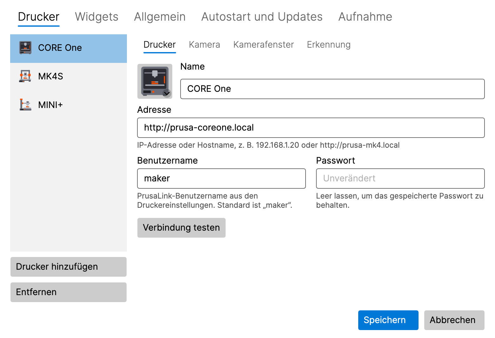

Das Symbol zeigt sofort den Zustand des Druckers an. Weitere Drucker fügen Sie genauso hinzu: **Drucker hinzufügen** auf
der Registerkarte **Drucker**.

**macOS 15 und neuer:** Bei der ersten Verbindung zu einem Drucker oder einer Kamera fragt macOS nach dem Zugriff auf das
**lokale Netzwerk**. Klicken Sie auf **Erlauben**. Wenn Sie den Zugriff abgelehnt haben, lesen Sie unter
[Fehlerbehebung](#14-fehlerbehebung) nach.

Das Passwort wird in der **Windows-Anmeldeinformationsverwaltung** oder im **macOS-Schlüsselbund** gespeichert, niemals
in der Einstellungsdatei. Wenn Sie einen Drucker später bearbeiten, zeigt das Passwortfeld **Unverändert**; lassen Sie es
leer, um das gespeicherte Passwort zu behalten.

### 3.3 Kamera hinzufügen (optional)

1. Wählen Sie in **Einstellungen → Drucker** den Drucker aus und öffnen Sie seinen Unterreiter **Kamera**.
2. Schalten Sie **Kamera verwenden (Eintrag „Kamera anzeigen“ im Menü des Infobereichs)** ein.
3. Geben Sie die **Adresse des RTSP-Streams** ein, z. B. `rtsp://192.168.1.21/live` für die Kamera Buddy3D (der
   Standardport ist 554). Schreiben Sie keinen Benutzernamen und kein Passwort in die Adresse.
4. Klicken Sie auf **Kamera testen**. Eine funktionierende Kamera zeigt ein Standbild und ihre Auflösung.
5. Klicken Sie auf **Speichern** und wählen Sie im Untermenü des Druckers **Kamera anzeigen**.

### 3.4 Bild des Druckers

Die Druckerliste zeigt zu jedem Drucker ein Bild, das automatisch nach seinem Modell ausgewählt wird. Klicken Sie auf das
Bild, um ein anderes Modell, eine allgemeine Illustration oder ein eigenes Bild (PNG, JPG) zu wählen.

## 4. Das Symbol und sein Menü

### 4.1 Was das Symbol zeigt

Das Symbol zeigt den wichtigsten Zustand all Ihrer Drucker:

| Zustand | Bedeutung |
|---|---|
| **Bereit** | der Drucker ist untätig |
| **Druckt** | das Symbol füllt sich mit dem Fortschritt des Drucks |
| **Pausiert** | der Druck ist angehalten |
| **Fertig** / **Gestoppt** | der Druck ist beendet |
| **Eingriff erforderlich** | der Drucker wartet auf Sie (z. B. ein Filamentwechsel oder eine Abfrage auf seinem Display) |
| **Fehler** | der Drucker meldet einen Fehler |
| **Offline** | der Drucker ist nicht erreichbar |
| **Ungültige Anmeldedaten** | der Drucker hat den Benutzernamen oder das Passwort abgelehnt |

Bewegen Sie die Maus über das Symbol, um die Details im Tooltip zu sehen: den Fortschritt, die Restzeit und den
Dateinamen. Während die Kamera eines Druckers aufgenommen wird, steht im Tooltip **Aufnahme läuft**.

### 4.2 Das Menü

- **Windows:** Rechtsklick auf das Symbol.
- **macOS:** Klick auf das Symbol in der Menüleiste.

Das Menü enthält:

- **Ein Untermenü pro Drucker**, dessen Kopfzeile Namen, Zustand und Fortschritt des Druckers zeigt, mit:
  - **Kamera anzeigen** / **Kamera ausblenden** und, solange das Fenster offen ist, **Kamera in den Vordergrund holen**,
  - **Aufnahme starten** / **Aufnahme beenden**, **Letzte Aufnahme abspielen**, **Ordner mit Aufnahmen öffnen**,
  - **Letzte 2 Min. speichern** (wenn die Dashcam eingeschaltet ist, siehe [8.3](#83-dashcam-die-letzten-minuten)),
  - den Einträgen für den Zeitraffer (experimentell, siehe [8.4](#84-zeitraffer-experimentell)),
  - **PrusaLink öffnen**: öffnet die PrusaLink-Weboberfläche des Druckers in Ihrem Browser, bereits angemeldet. Ihr
    Passwort wird dabei nie an den Browser übergeben.
- **Diagnose…** (siehe [10](#10-diagnose))
- **Einstellungen…**
- **Neue Version X.Y.Z verfügbar** (nur wenn ein Update verfügbar ist, siehe [12](#12-updates))
- **Benutzerhandbuch**: öffnet dieses Handbuch
- **Über**
- **Beenden**

Bevor Sie den ersten Drucker hinzufügen, bietet das Menü statt der Untermenüs der Drucker **Drucker hinzufügen…** an.

## 5. Kamerafenster

  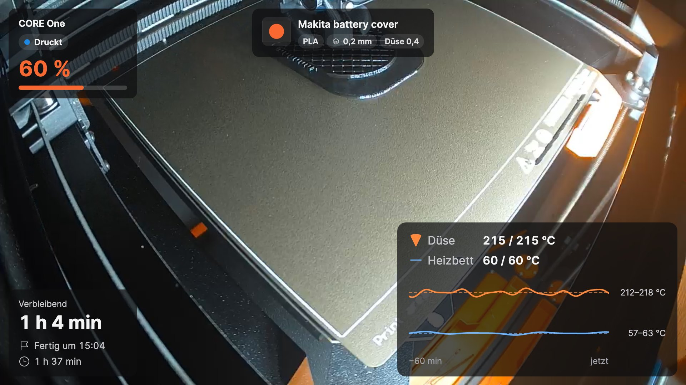

Sie öffnen es mit **Kamera anzeigen** im Untermenü des Druckers. Das Fenster zeigt das Live-Bild der Kamera mit
[Widgets](#6-widgets) darüber. Die Schaltflächen im Fenster erscheinen, wenn Sie die Maus darüber bewegen.

### 5.1 Drei Modi

| Modus | Wie Sie umschalten | Wofür er gedacht ist |
|---|---|---|
| **Normales Fenster** | Schaltfläche im Fenster oder Doppelklick in der Mini-Vorschau | ein richtiger Blick, beliebige Größe, beliebiger Bildschirm |
| **Mini-Vorschau** | Schaltfläche **Kleine Vorschau, immer im Vordergrund** | ein kleines Fenster, das den ganzen Tag über anderen Fenstern bleibt |
| **Vollbild** | **Windows:** F11 · **macOS:** ⌃⌘F · oder Doppelklick auf das Bild; mit **Esc** geht es zurück | der ganze Bildschirm |

Die Mini-Vorschau hat unter dem Bild eine Infoleiste (Fortschritt, Restzeit, Fertigstellungszeit). Zwei Schaltflächen
klappen weitere Zeilen aus: den **Drucknamen** und das **Temperaturdiagramm**. Was die Leiste zeigt, stellen Sie im
Unterreiter **Kamerafenster** des Druckers ein (siehe [11.1](#111-drucker)).

  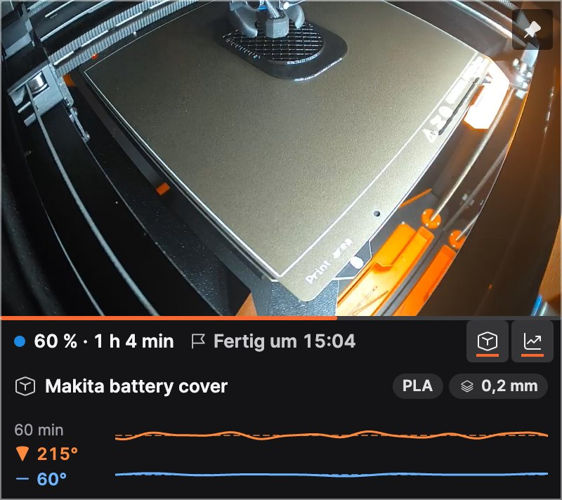

### 5.2 Immer im Vordergrund

Die Pinnadel-Schaltfläche im Fenster zeigt, ob das Fenster über anderen Fenstern bleibt, und schaltet das mit einem Klick
um. Dieselbe Option finden Sie im Kontextmenü des Fensters (**Immer im Vordergrund**).

### 5.3 Kontextmenü des Fensters

Klicken Sie mit der rechten Maustaste auf das Bild (unter macOS auch Control-Klick), um **Layout bearbeiten**, **Immer im
Vordergrund**, die Aufnahme, die Dashcam und den Zeitraffer zu erreichen.

### 5.4 Wenn die Verbindung abbricht

Das Fenster verbindet sich von selbst neu, wenn die Kamera oder das WLAN ausfällt; in der Zwischenzeit zeigt es
**Verbindung zur Kamera wird hergestellt…** oder **Kein Signal**. Der nächste Versuch folgt nach 5 Sekunden; solange die
Kamera nicht erreichbar ist, verdoppelt sich die Pause bis auf eine Minute. Das Fenster zeigt laufend ungefähr, wann der
nächste Versuch kommt; wenn Sie das Fenster öffnen, aus dem minimierten Zustand wiederherstellen oder in den
Einstellungen auf **Kamera testen** klicken, wird sofort erneut versucht. Wenn der Drucker ausgeschaltet wird, schließt
sich das Fenster und öffnet sich an derselben Stelle wieder, sobald der Drucker zurück ist. Das können Sie in
**Einstellungen → Drucker → Kamerafenster** ausschalten (**Bei ausgeschaltetem Drucker schließen, nach dem Einschalten
wieder öffnen**). Ein Fenster, das Sie selbst schließen, bleibt geschlossen.

## 6. Widgets

Widgets sind die Karten über dem Kamerabild. Jeder Drucker hat seine eigene Auswahl und Anordnung.

| Widget | Zeigt |
|---|---|
| **Status** | Name des Druckers, Zustand und Fortschritt in Prozent |
| **Zeiten** | Restzeit, wann der Druck fertig ist, Druckdauer |
| **Temperaturen** | Düse und Heizbett (Ist / Soll) mit einem Diagramm der letzten 60 Minuten |
| **Druckname** | lesbarer Dateiname mit Material, Schichthöhe und Düse; größere Größen zeigen zusätzlich die G-Code-Vorschau |
| **Abkühlung** | nach dem Druck: wie weit Düse und Heizbett abgekühlt sind und wann Sie gefahrlos ausschalten können |

Jedes Widget hat drei Größen: **S**, **M** und **L**. Hier die Temperaturen: S zeigt die Werte, M ergänzt das Diagramm,
L die Beschriftungen und den Temperaturbereich.

  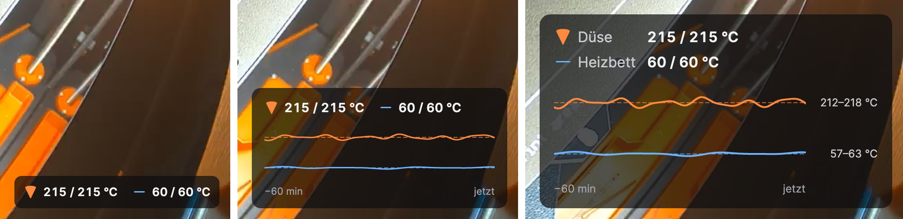

### 6.1 Widgets auswählen

Wählen Sie in **Einstellungen → Widgets** oben den Drucker und haken Sie die gewünschten Widgets an. Wenn Sie ein Widget
auswählen, sehen Sie seine eigenen Einstellungen, z. B. die Abkühlschwellen von Düse und Heizbett. **Layout für alle
Drucker übernehmen** kopiert die Anordnung auf Ihre anderen Drucker. **Deckkraft des Kartenhintergrunds** hält den Text
auf einem hellen Bild lesbar (für alle Drucker).

  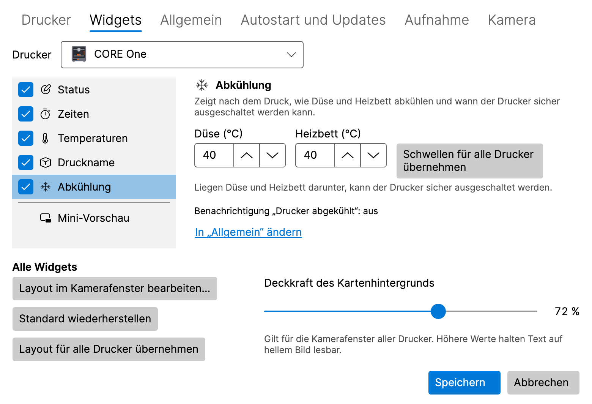

### 6.2 Widgets im Kamerafenster anordnen

Klicken Sie im Kamerafenster auf **Layout bearbeiten** (oder in **Einstellungen → Widgets** auf **Layout im
Kamerafenster bearbeiten…**). Im Layoutmodus können Sie:

- ein Widget an einen der sechs Plätze **ziehen** (oben und unten, jeweils links, Mitte und rechts),
- auf ein Widget klicken, um seine Optionen zu öffnen: **Größe** (Klein, Mittel, Groß) und **Hervorheben** (zeigt den
  wichtigsten Wert in der Akzentfarbe),
- mit **Standard wiederherstellen** die Standardanordnung zurückholen, mit **Fertig** speichern.

Mit der Tastatur: Die **Leertaste** hebt ein Widget an, die **Pfeiltasten** verschieben es, **Eingabe** öffnet seine
Optionen und **Esc** verwirft die Änderungen. Wenn das Fenster zu klein ist, vergrößern Sie es zuerst.

  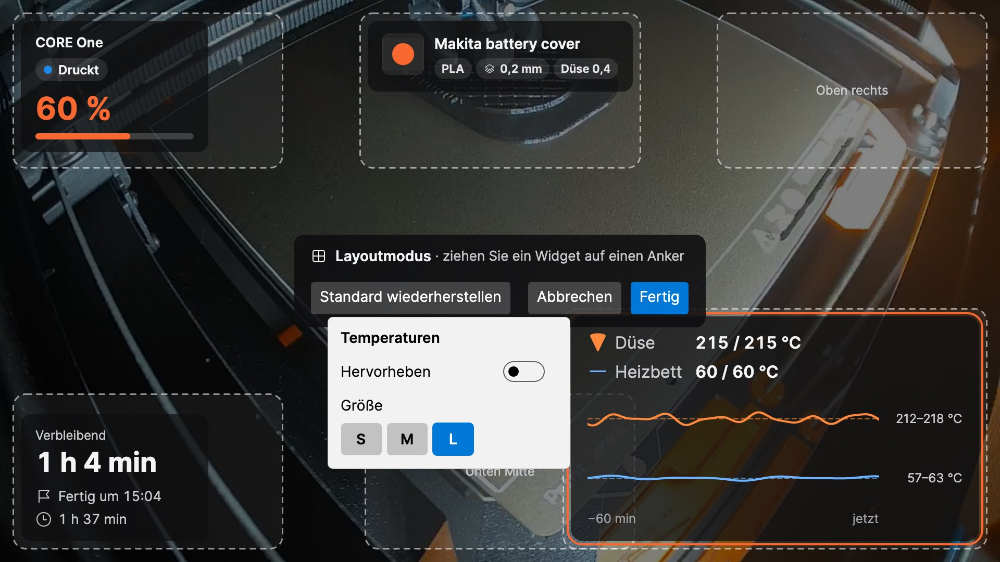

## 7. Benachrichtigungen

LayerPeek zeigt native Systembenachrichtigungen für diese Ereignisse (jedes lässt sich in **Einstellungen → Allgemein**
ein- oder ausschalten):

- Druck gestartet, abgeschlossen, pausiert, fortgesetzt und gestoppt,
- der Drucker erfordert einen Eingriff (auch bei einem abgelehnten Passwort), ein Fehler,
- der Drucker ist offline gegangen oder wieder online,
- **Noch N min**, damit Sie am Drucker sein können, wenn der Druck endet (**Benachrichtigen, wenn noch so viele Minuten
  Druckzeit verbleiben**, 0 = aus),
- **Drucker abgekühlt**: Düse und Heizbett liegen unter den Schwellen des Widgets **Abkühlung**, und Sie können den
  Drucker gefahrlos ausschalten.

**Ton** kann aus sein, nur bei wichtigen Benachrichtigungen erklingen oder bei allen Benachrichtigungen.
**Testbenachrichtigung senden** zeigt ein Beispiel, damit Sie prüfen können, ob die Benachrichtigungen bei Ihnen
ankommen.

- **Windows:** Wenn die Benachrichtigungen für LayerPeek in **Einstellungen → System → Benachrichtigungen** ausgeschaltet
  sind, weisen die Einstellungen von LayerPeek darauf hin und bieten **Benachrichtigungseinstellungen öffnen** an. Prüfen
  Sie auch **Nicht stören**.
- **macOS:** Die erste Benachrichtigung fragt nach der Erlaubnis; klicken Sie auf **Erlauben**. Wenn die
  Benachrichtigungen in **Systemeinstellungen → Mitteilungen** ausgeschaltet sind, bieten die Einstellungen von LayerPeek
  **Mitteilungen öffnen** an. Prüfen Sie auch **Fokus**.

Ein Klick auf eine Druckerbenachrichtigung öffnet die PrusaLink-Weboberfläche des Druckers. Ein Druckfehler-Alarm öffnet
das Kamerafenster, eine fehlgeschlagene Aufnahme den Tab **Aufnahme** der Einstellungen und eine fertige
Zeitraffer-Umwandlung den Ordner mit den Aufnahmen.

## 8. Aufnahme, Dashcam und Zeitraffer

Alle Aufnahmen bleiben auf Ihrer Festplatte. Standardmäßig landen sie im Ordner **Videos** (Windows) bzw. **Filme**
(macOS) unter `LayerPeek`, mit einem Unterordner pro Drucker, benannt nach Uhrzeit und Druck. Das Video wird ohne
Neukodierung als MP4 gespeichert und kostet daher kaum Rechenleistung.

  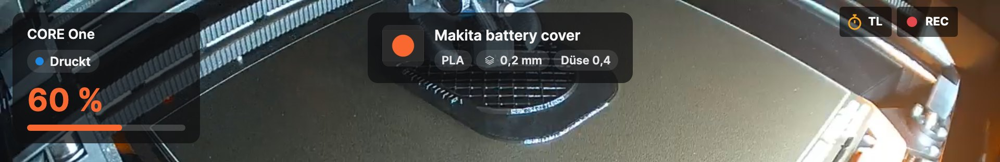

Während die Kamera aufgenommen wird, zeigt das Kamerafenster ein rotes **REC**; während ein Zeitraffer entsteht, ein
bernsteinfarbenes **TL**.

### 8.1 Von Hand aufnehmen

**Aufnahme starten** / **Aufnahme beenden** im Untermenü des Druckers oder die Aufnahme-Schaltfläche im Kamerafenster.
**Letzte Aufnahme abspielen** und **Ordner mit Aufnahmen öffnen** finden Sie im Untermenü des Druckers.

### 8.2 Jeden Druck aufnehmen

Schalten Sie im Unterreiter **Kamera** des Druckers **Drucke automatisch aufnehmen** ein. Jeder Druck wird von seinem
Beginn bis eine Minute nach seinem Ende aufgenommen, auch ohne geöffnetes Kamerafenster.

  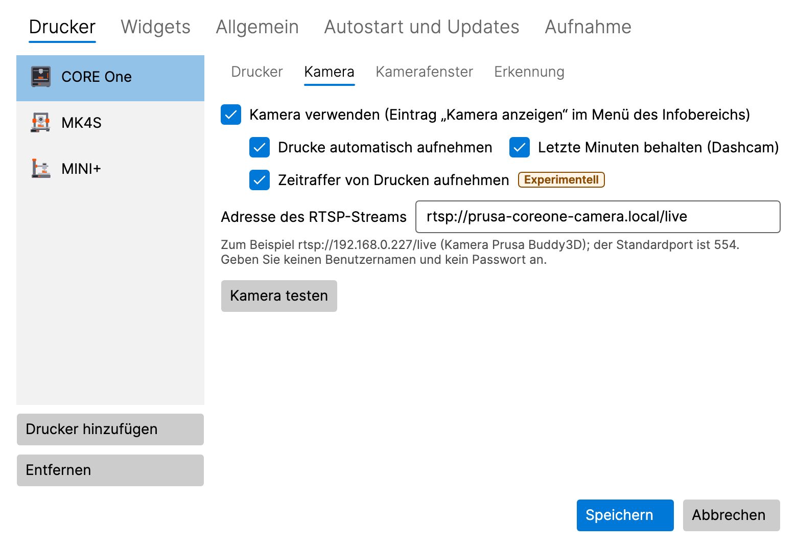

### 8.3 Dashcam: die letzten Minuten

Schalten Sie im Unterreiter **Kamera** des Druckers **Letzte Minuten behalten (Dashcam)** ein. Während eines Drucks hält
LayerPeek die letzten 2 Minuten der Kamera im Arbeitsspeicher (etwa 8 MB pro Minute und Drucker); auf die Festplatte
wird erst etwas geschrieben, wenn gespeichert wird. Die letzten Minuten werden zusammen mit 30 Sekunden nach dem
Ereignis gespeichert:

- automatisch bei einem Druckfehler, wenn der Drucker einen Eingriff erfordert, wenn der Druck gestoppt wird und wenn die
  Erkennung von Druckfehlern Alarm schlägt (jedes davon lässt sich auf der Registerkarte **Aufnahme** ausschalten),
- von Hand mit **Letzte 2 Min. speichern** im Untermenü des Druckers oder im Kontextmenü des Kamerafensters.

Die Länge (1–10 Minuten) stellen Sie auf der Registerkarte **Aufnahme** ein.

### 8.4 Zeitraffer (experimentell)

Ein Zeitraffer ist ein kurzes Video des ganzen Drucks: standardmäßig ein Bild alle 30 Sekunden, keines während der Druck
pausiert, abgespielt mit 30 Bildern pro Sekunde. Er wird als `…_timelapse.mp4` neben den Aufnahmen gespeichert.

- **Von Hand:** **Zeitraffer starten (experimentell)** / **Zeitraffer beenden (experimentell)** im Untermenü des Druckers
  oder die Stoppuhr-Schaltfläche im Kamerafenster. **Letzten Zeitraffer abspielen** finden Sie im Untermenü.
- **Jeder Druck:** **Zeitraffer von Drucken aufnehmen** im Unterreiter **Kamera** des Druckers.
- **Intervall:** auf der Registerkarte **Aufnahme**, 5–600 Sekunden, oder Sie wechseln zu **Jede N. Schicht
  (geschätzt)**: ein Bild, wenn eine neue Schicht beginnt. PrusaLink meldet keine Schichten, daher schätzt LayerPeek sie
  aus der Höhe der Z-Achse.
- **Zeitraffer aus Aufnahme erstellen… (experimentell)** erstellt einen Zeitraffer aus einer vorhandenen Aufnahme von
  LayerPeek.
- **Zeitraffer als JPEG exportieren… (experimentell)** speichert die Bilder eines Zeitraffers als nummerierte
  JPEG-Dateien, z. B. für Ihren eigenen Videoschnitt.

Beide Umwandlungen zeigen ihren Fortschritt im Menüeintrag, wo Sie sie auch abbrechen können, und eine Benachrichtigung
meldet, wenn sie fertig sind.

### 8.5 Ordner und Größengrenze

Auf der Registerkarte **Aufnahme** können Sie den **Ordner für Aufnahmen** und die **Größengrenze aller Aufnahmen (GB)**
ändern (standardmäßig 50 GB). Oberhalb der Grenze werden die ältesten Aufnahmen gelöscht; bei weniger als 5 GB freiem
Speicher auf dem Laufwerk stoppt die Aufnahme. Eine fehlgeschlagene Aufnahme meldet eine Benachrichtigung.

  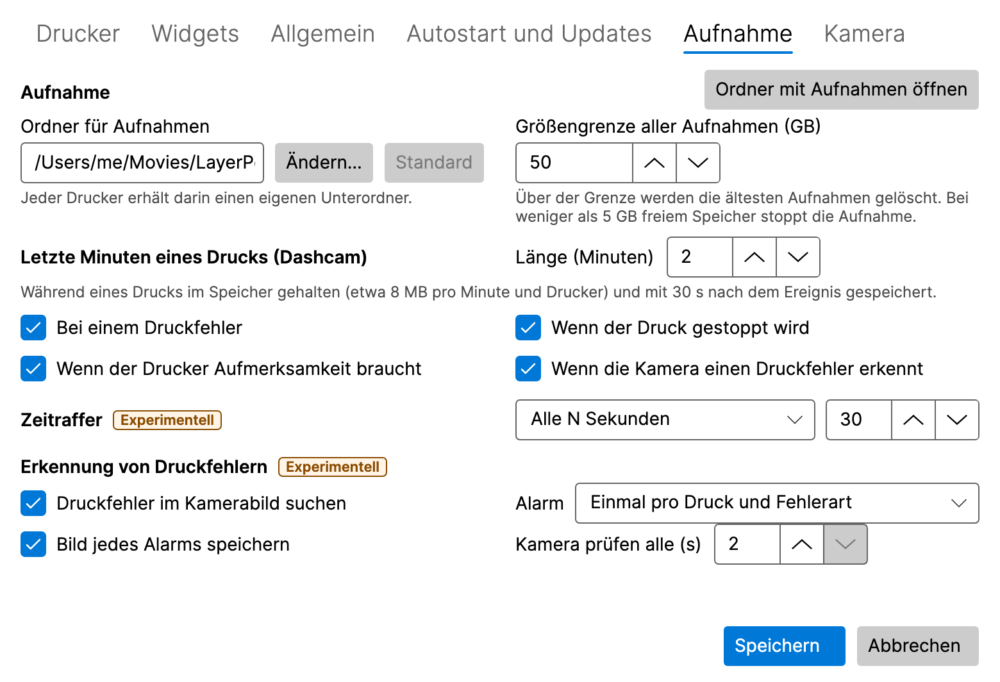

## 9. Erkennung von Druckfehlern (experimentell)

LayerPeek kann einen Druck über die Kamera beobachten und Sie warnen, wenn auf dem Druckbett etwas schiefgeht. Das läuft
nur auf Ihrem Computer; das Kamerabild verlässt ihn nie.

  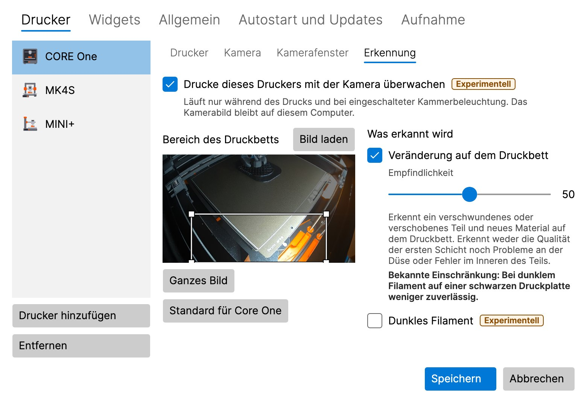

### 9.1 Einschalten

Die Erkennung ist standardmäßig aus und muss an zwei Stellen eingeschaltet werden:

1. **Druckfehler im Kamerabild suchen** auf der Registerkarte **Aufnahme** (für alle Drucker),
2. **Drucke dieses Druckers mit der Kamera überwachen** im Unterreiter **Erkennung** des Druckers.

Die Kamera des Druckers muss eingeschaltet sein. Die Erkennung läuft nur während des Drucks und bei eingeschalteter
Kammerbeleuchtung, auch ohne geöffnetes Kamerafenster.

### 9.2 Bereich des Druckbetts

Der **Bereich des Druckbetts** ist der Teil des Bildes, der beobachtet wird. Ziehen Sie mit der Maus ein neues Rechteck
auf, verschieben Sie es oder ändern Sie seine Größe an einer Ecke, oder verwenden Sie die Pfeiltasten (Umschalt +
Pfeiltasten ändern die Größe). **Ganzes Bild** beobachtet das ganze Bild, **Bild laden** holt ein neues Bild von der
Kamera, und bei einem CORE One stellt **Standard für Core One** dessen Voreinstellung wieder her.

### 9.3 Detektoren

- **Veränderung auf dem Druckbett** bemerkt ein Teil, das verschwunden ist oder sich verschoben hat, und neues Material
  auf dem Druckbett (Spaghetti, ein abgerissenes Teil). **Dunkles Filament** hilft bei schwarzem oder sehr dunklem
  Filament, allerdings mit mehr Fehlalarmen.
- **Drucken ins Leere** (standardmäßig aus, nur für Drucker, deren Druckbett sich beim Drucken nach unten bewegt: CORE
  One, CORE One L, XL) bemerkt, dass der Drucker weiterdruckt, aber nichts mehr wächst, z. B. wenn das Filament
  ausgegangen ist.

**Empfindlichkeit** (0–100, standardmäßig 50): Höher bedeutet mehr Alarme, auch Fehlalarme; niedriger bedeutet weniger
Alarme, aber ein Fehler kann übersehen werden.

### 9.4 Der Alarm

Der Alarm ist eine Benachrichtigung **Möglicher Druckfehler – …** mit einem Kamerabild. Ein Klick darauf öffnet das
Kamerafenster. Die Schaltfläche **Fehlalarm** legt einen lokalen Eintrag zur Feinabstimmung an; nichts verlässt Ihren
Computer. Auf der Registerkarte **Aufnahme** stellen Sie ein, wie oft der Alarm wiederholt wird, ob von jedem Alarm ein
Bild gespeichert wird und wie oft die Kamera geprüft wird (2–5 Sekunden).

> [!WARNING]
> Die Erkennung bemerkt weder die Qualität der ersten Schicht noch Probleme an der Düse oder Fehler im Inneren des
> Teils. Sie kann einen Fehler übersehen oder einen Fehlalarm auslösen. Verlassen Sie sich bei einem unbeaufsichtigten
> Druck nicht auf sie als einzige Absicherung.

## 10. Diagnose

**Diagnose…** im Menü des Symbols (wählen Sie oben im Fenster den Drucker) zeigt das Druckermodell und die Firmware, den
aktuellen Zustand, die Temperaturen von Düse und Heizbett (Ist und Soll), die Lüfter, die Druckgeschwindigkeit, den Fluss
und die Z-Höhe sowie ein Temperaturdiagramm der letzten 30 Minuten, 2 Stunden oder 24 Stunden. Der Verlauf wird nur im
Arbeitsspeicher gehalten und beginnt mit dem Start von LayerPeek.

  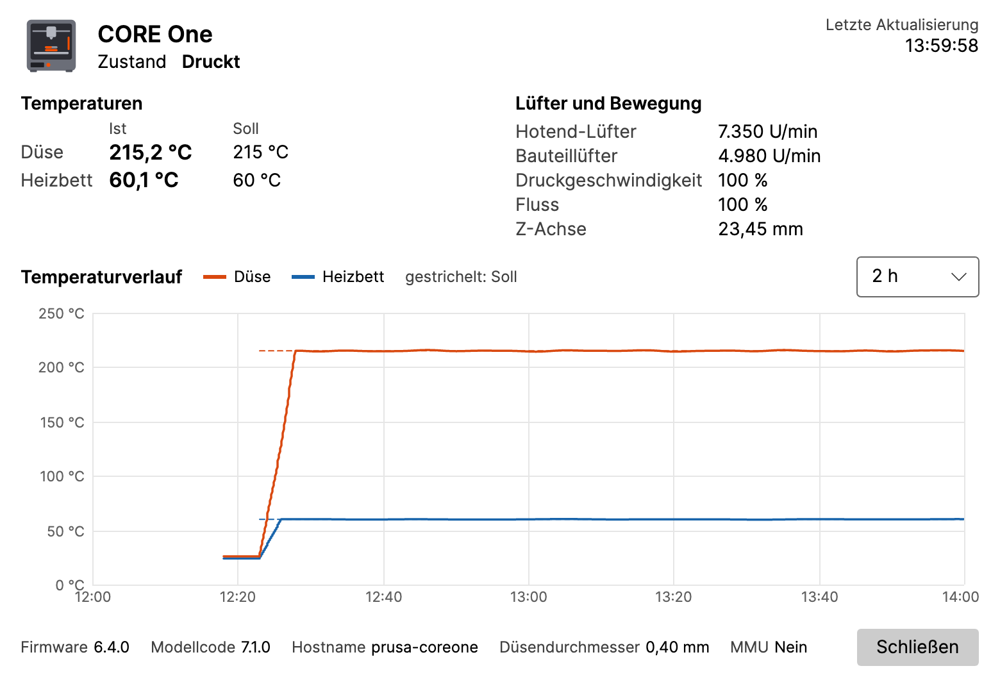

## 11. Einstellungen im Überblick

Öffnen Sie **Einstellungen…** im Menü des Symbols. Änderungen gelten nach **Speichern**; **Abbrechen** verwirft sie.

### 11.1 Drucker

Die Liste der Drucker mit **Drucker hinzufügen** und **Entfernen**. Jeder Drucker hat Unterreiter:

- **Drucker:** Name, Adresse, Benutzername, Passwort, **Verbindung testen**.
- **Kamera:** die RTSP-Adresse, **Kamera testen**, automatische Aufnahme, Dashcam und Zeitraffer von Drucken.
- **Kamerafenster:** **Öffnen als** (wie beim letzten Mal, normales Fenster, Mini-Vorschau, Vollbild), der Bildschirm,
  Größe, Position und **Immer im Vordergrund** für das normale Fenster und die Mini-Vorschau, **Letzte Position und Größe
  merken**, **Bei ausgeschaltetem Drucker schließen, nach dem Einschalten wieder öffnen** und was die Infoleiste der
  Mini-Vorschau zeigt.
- **Erkennung:** die Erkennung von Druckfehlern für diesen Drucker (siehe
  [9](#9-erkennung-von-druckfehlern-experimentell)).

### 11.2 Widgets

Die Widgets jedes Druckers, ihre Einstellungen und die Deckkraft der Karten (siehe [6](#6-widgets)).

### 11.3 Aufnahme

Ordner und Größengrenze der Aufnahmen, die Dashcam, der Zeitraffer und die Erkennung von Druckfehlern (siehe
[8](#8-aufnahme-dashcam-und-zeitraffer) und [9](#9-erkennung-von-druckfehlern-experimentell)). Experimentelle Funktionen
tragen das Abzeichen **Experimentell**.

### 11.4 Allgemein

- **Benachrichtigungen:** welche Ereignisse, **Ton**, die Erinnerung „Noch N Minuten“, **Testbenachrichtigung senden**.
- **Abfrageintervall (Sekunden):** wie oft die Drucker nach ihrem Zustand gefragt werden.
- **Sprache:** **Systemsprache** oder eine von Čeština, Deutsch, English, Español, Français, Italiano, Polski,
  Slovenčina. Sie ändert nur die Texte; Zahlen, Datum und Uhrzeit richten sich nach den Regionaleinstellungen Ihres
  Systems.
- **Ausführliche Protokollierung (Debug):** Schalten Sie sie nur ein, wenn Sie bei der Fehlersuche darum gebeten werden.

### 11.5 Autostart und Updates

- **Windows:** **Nach der Anmeldung bei Windows starten**. Standardmäßig ein; nur in der installierten Version verfügbar,
  nicht in der ZIP-Version.
- **macOS:** **Bei der Anmeldung öffnen**. Standardmäßig aus; nur verfügbar, wenn LayerPeek im Ordner „Programme“ liegt.
  Wenn Sie LayerPeek in **Systemeinstellungen → Allgemein → Anmeldeobjekte & Erweiterungen** ausgeschaltet haben, können
  nur Sie es dort wieder erlauben; die Schaltfläche **Systemeinstellungen öffnen** bringt Sie dorthin.
- **Automatisch nach Updates suchen**, **Vorabversionen anbieten** und **Jetzt prüfen** (siehe [12](#12-updates)).

## 12. Updates

Kurz nach dem Start und dann einmal täglich fragt LayerPeek bei GitHub nach, ob eine neue Version erschienen ist (das
können Sie ausschalten). Eine neue Version erscheint als **Neue Version X.Y.Z verfügbar** im Menü des Symbols und einmal
als Benachrichtigung.

- **Windows, installierte Version:** Der Menüeintrag lädt das Update herunter, beendet LayerPeek und startet die neue
  Version.
- **Windows, ZIP-Version:** Der Menüeintrag öffnet die Release-Seite; laden Sie das neue ZIP von Hand herunter.
- **macOS:** Der Menüeintrag lädt das Update herunter und startet LayerPeek neu, aber nur, wenn die App im Ordner
  **Programme** liegt (nicht im Disk-Image oder in „Downloads“).

Ihre Einstellungen und Passwörter bleiben erhalten.

**Update abgelehnt:** Die installierte Version nimmt ein Update nur an, wenn seine Signatur überprüft werden kann. Wenn
das nicht geht, installiert LayerPeek nichts: Es zeigt eine Benachrichtigung (einmal pro angebotener Version; ein Klick
öffnet die Einstellungen) und einen Fehler auf dem Tab **Autostart und Updates**, und das Menü des Symbols zeigt statt
der neuen Version **Update abgelehnt…** (die Benachrichtigung über die neue Version wird entfernt). Das bleibt so, bis
eine spätere Prüfung gelingt. Installieren Sie diese Version nicht manuell, das Release selbst könnte manipuliert sein:
Warten Sie auf die nächste Version oder verfolgen Sie die Ankündigungen des Projekts.

## 13. Wo Ihre Daten gespeichert werden

| Was | Windows | macOS |
|---|---|---|
| Einstellungen | `%APPDATA%\LayerPeek\settings.json` | `~/Library/Application Support/LayerPeek/settings.json` |
| Passwörter | Windows-Anmeldeinformationsverwaltung | Schlüsselbund „Anmeldung“ (login) |
| Protokolle | `%LOCALAPPDATA%\LayerPeek\logs` | `~/Library/Logs/LayerPeek` |
| Aufnahmen | `Videos\LayerPeek` | `Movies/LayerPeek` (im Finder „Filme“) |

Der Temperaturverlauf wird nur im Arbeitsspeicher gehalten. LayerPeek verbindet sich nur mit den Druckern und Kameras,
die Sie hinzufügen, und – sofern Sie die Update-Suche nicht ausschalten – mit GitHub (die Liste der Releases, ohne
Konto, und der Download eines Updates, das Sie starten). Es gibt keine Telemetrie.

## 14. Fehlerbehebung

**Das Symbol ist nicht zu sehen (Windows).** Klicken Sie im Infobereich auf den Pfeil **`^`** und ziehen Sie das Symbol
von LayerPeek auf die Taskleiste.

**Der Drucker ist offline.** Prüfen Sie, ob der Drucker eingeschaltet und mit dem Netzwerk verbunden ist, ob die Adresse
stimmt (probieren Sie sie im Browser aus) und ob Ihr Computer im selben Netzwerk ist. Führen Sie in den Einstellungen des
Druckers **Verbindung testen** aus.

**Ungültige Anmeldedaten.** Geben Sie den Benutzernamen und das Passwort aus **Einstellungen → Netzwerk → PrusaLink** am
Drucker erneut ein und speichern Sie.

**Keine Verbindung unter macOS.** Möglicherweise ist der Zugriff auf das lokale Netzwerk ausgeschaltet. LayerPeek bietet
dann **Systemeinstellungen öffnen** an; schalten Sie LayerPeek in **Systemeinstellungen → Datenschutz & Sicherheit →
Lokales Netzwerk** ein.

**Die Kamera zeigt „Kein Signal“.** Prüfen Sie die RTSP-Adresse mit **Kamera testen** und ob die Kamera eingeschaltet
und erreichbar ist. Schreiben Sie keinen Benutzernamen und kein Passwort in die Adresse.

**Benachrichtigungen erscheinen nicht.** Verwenden Sie **Testbenachrichtigung senden** in **Einstellungen → Allgemein**
und prüfen Sie **Nicht stören** (Windows) bzw. **Fokus** (macOS).

**Einen Fehler melden.** Öffnen Sie **Über** im Menü des Symbols:

- **Diagnosepaket speichern…** speichert eine ZIP-Datei mit den Protokollen, Versions- und Systeminformationen und den
  Einstellungen, **ohne Passwörter und Schlüssel**. Hängen Sie sie an Ihre Fehlermeldung an.
- **Infos in die Zwischenablage kopieren** kopiert einen kurzen Bericht.
- **Protokollordner öffnen** öffnet die Protokolle.

Wenn Sie um ein ausführliches Protokoll gebeten werden, schalten Sie in **Einstellungen → Allgemein** die
**Ausführliche Protokollierung (Debug)** ein, wiederholen Sie das Problem, speichern Sie das Paket und schalten Sie die
ausführliche Protokollierung wieder aus.

Melden Sie Fehler und Ideen in den [Issues](https://github.com/pfoltynek/LayerPeek/issues) auf GitHub. Bitte geben Sie
Ihr Druckermodell, die Firmwareversion und Ihr Betriebssystem an.

## 15. Deinstallation

- **Windows, installierte Version:** **Einstellungen → Apps → Installierte Apps → LayerPeek → Deinstallieren**.
- **Windows, ZIP-Version:** Beenden Sie LayerPeek und löschen Sie seinen Ordner.
- **macOS:** Beenden Sie LayerPeek (**Beenden** in seinem Menü) und bewegen Sie **LayerPeek** aus dem Ordner
  **Programme** in den Papierkorb.

Bei der Deinstallation bleiben Ihre Einstellungen, Passwörter und Aufnahmen erhalten. Um auch sie zu entfernen, löschen
Sie die Ordner aus [13](#13-wo-ihre-daten-gespeichert-werden) und die Einträge von LayerPeek in der
Anmeldeinformationsverwaltung (Windows) bzw. in der Schlüsselbundverwaltung (macOS).
