# LayerPeek user manual

*For LayerPeek 0.5 on Windows 10/11 and macOS (Apple Silicon).* · [Other languages](../README.md)

LayerPeek watches your Prusa 3D printers over your local network and shows their state in the Windows notification
area or the macOS menu bar. It has no main window: everything starts from the icon's menu. This manual describes both
systems; where Windows and macOS differ, the text says so or shows both variants.

> [!NOTE]
> LayerPeek is an independent community project, not an official product of Prusa Research.

## Contents

1. [What you need](#1-what-you-need)
2. [Installation](#2-installation)
3. [Getting started](#3-getting-started)
4. [The icon and its menu](#4-the-icon-and-its-menu)
5. [Camera window](#5-camera-window)
6. [Widgets](#6-widgets)
7. [Notifications](#7-notifications)
8. [Recording, dashcam and timelapse](#8-recording-dashcam-and-timelapse)
9. [Print failure detection (experimental)](#9-print-failure-detection-experimental)
10. [Diagnostics](#10-diagnostics)
11. [Settings reference](#11-settings-reference)
12. [Updates](#12-updates)
13. [Where your data is stored](#13-where-your-data-is-stored)
14. [Securing access to PrusaLink](#14-securing-access-to-prusalink)
15. [Troubleshooting](#15-troubleshooting)
16. [Uninstalling](#16-uninstalling)

## 1. What you need

- **A Prusa printer with Buddy firmware 6.x and PrusaLink**: CORE One (tested), MK4/MK4S, MK3.9/MK3.9S, MK3.5/MK3.5S,
  XL and MINI/MINI+. The Original Prusa MK3/MK3S has no built-in PrusaLink and is not supported.
- **A computer on the same local network** as the printer:
  - Windows 10 or 11, x64 (Windows on ARM is not supported),
  - macOS on Apple Silicon (M1 or newer).
- **A camera (optional):** any camera with an **RTSP H.264** stream reachable from your computer, for example the Prusa
  Buddy3D camera. Without a camera you still get the icon, notifications and diagnostics.

LayerPeek works only on your local network. It does not use Prusa Connect or any other cloud service. Away from home
you can reach the printers through a VPN into your home network.

Only the CORE One has been tested so far. Do you have another model? Please send a short [printer compatibility report](https://github.com/pfoltynek/LayerPeek/issues/new?template=printer_compatibility.yml): one run on Windows or macOS is enough.

## 2. Installation

Download the latest version from the [Releases](https://github.com/pfoltynek/LayerPeek/releases) page.

> [!IMPORTANT]
> Versions 0.x are previews and the builds are not signed by Microsoft or notarized by Apple. Your system therefore
> warns you on the first start; the steps below show how to get past it.

### 2.1 Windows

You can choose between two packages:

| Package | What it does |
|---|---|
| **Installer** `LayerPeek-X.Y.Z-win-x64-Setup.exe` (recommended) | Installs LayerPeek for your user only, without administrator rights, into `%LOCALAPPDATA%\LayerPeek`, adds it to the Start menu, starts it after you sign in and can update itself. |
| **ZIP** `LayerPeek-X.Y.Z-win-x64.zip` | Unpack it anywhere and run `LayerPeek.exe`. It does not start after sign-in and does not update itself (it opens the release page instead). |

On the first start Windows SmartScreen shows **"Windows protected your PC"** with an *Unknown publisher*. Click
**More info** and then **Run anyway**.

### 2.2 macOS

| Package | What it does |
|---|---|
| **Disk image** `LayerPeek-X.Y.Z-osx-arm64.dmg` (recommended) | Open it and drag **LayerPeek** to **Applications**. |
| **Archive** `LayerPeek-X.Y.Z-osx-arm64.tar.gz` | Contains `LayerPeek.app`; unpack it and move the app to **Applications**. |

Always start LayerPeek from **Applications**, not straight from the disk image or the Downloads folder: only there can
it open at login and update itself.

On the first start Gatekeeper blocks the app (*"Apple could not verify…"*):

1. Click **Done**.
2. Open **System Settings → Privacy & Security**, scroll down and click **Open Anyway** next to the message about
   LayerPeek.
3. Confirm with your password or Touch ID and open LayerPeek again.

Advanced users can remove the quarantine flag in Terminal instead:
`xattr -dr com.apple.quarantine /Applications/LayerPeek.app`.

LayerPeek lives only in the menu bar. It has no Dock icon and does not appear in the app switcher (⌘⇥).

## 3. Getting started

### 3.1 Enable PrusaLink on the printer

On the printer's display open **Settings → Network → PrusaLink**. Check that PrusaLink is enabled and note:

- the printer's **IP address** (or its host name),
- the **user name** (the default is `maker`),
- the **password**.

### 3.2 Add the printer

1. Find the LayerPeek icon:
   - **Windows:** in the notification area at the right end of the taskbar. If you don't see it, click the arrow
     **`^`** (hidden icons) and drag the icon onto the taskbar so that it stays visible.
   - **macOS:** in the menu bar at the top of the screen.
2. Open the icon's menu (**Windows:** right-click the icon, **macOS:** click it) and choose **Add printer…**. The
   **Settings** window opens on the **Printers** tab.
3. Fill in:
   - **Name:** any name you like, e.g. `CORE One`.
   - **Address:** an IP address or host name, e.g. `192.168.1.20` or `http://prusa-mk4.local`.
   - **User name** and **Password:** the values from the printer.
4. Click **Test connection**. A working connection reports the model code and the firmware version.
5. Click **Save**.

<p align="center">
  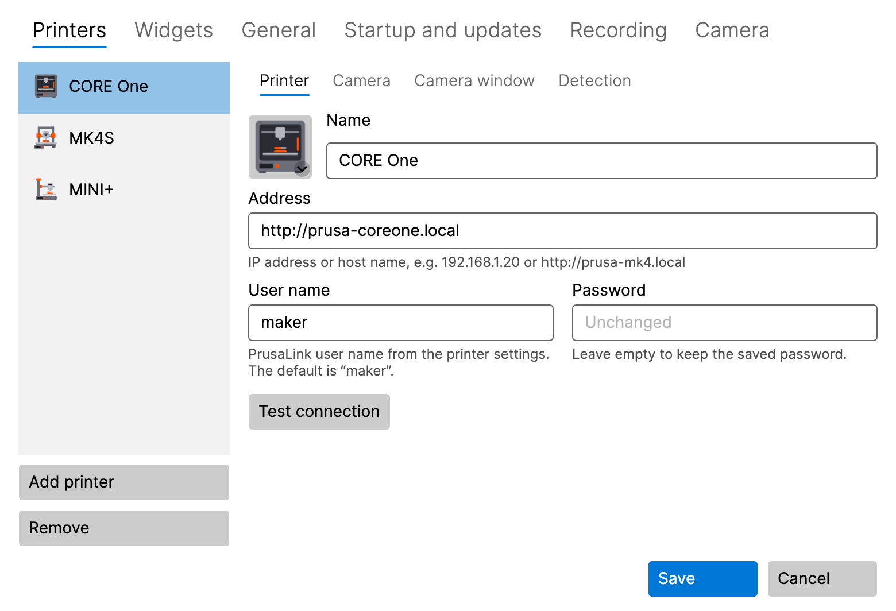
</p>

The icon starts showing the printer's state right away. Add more printers the same way: **Add printer** on the
**Printers** tab.

**macOS 15 and later:** the first connection to a printer or camera asks for **Local Network** access. Click **Allow**.
If you denied it, see [Troubleshooting](#15-troubleshooting).

The password is stored in the **Windows Credential Manager** or in the **macOS Keychain**, never in the settings file.
When you edit a printer later, the password field shows **Unchanged**; leave it empty to keep the saved password.

**Warning under the address:** an `http://` address that may be outside the local network (a public IP address, or a
host name other than a name without a dot or one ending in `.local`, `.lan` or `.home.arpa`) shows a warning in place of
the hint. PrusaLink signs in without encryption, so the password could be intercepted on the way. Saving is still
allowed. Prefer `https://` through a reverse proxy, or a VPN. **More information** next to the warning opens [Securing
access to PrusaLink](#14-securing-access-to-prusalink).

### 3.3 Add the camera (optional)

1. In **Settings → Printers**, select the printer and open its **Camera** sub-tab.
2. Switch on **Use the camera ("Show camera" item in the tray menu)**.
3. Enter the **RTSP stream address**, e.g. `rtsp://192.168.1.21/live` for the Buddy3D camera (the default port is 554).
   Don't put a user name or password in the address.
4. Click **Test camera**. A working camera shows a snapshot and its resolution.
5. Click **Save** and choose **Show camera** in the printer's submenu.

Like the printer address, a camera address that may be outside the local network shows a warning: RTSP is not encrypted,
so the camera image could be intercepted on the way. Saving is still allowed; prefer a VPN. The same link next to it
opens [Securing access to PrusaLink](#14-securing-access-to-prusalink).

### 3.4 Printer image

The printer list shows a picture of each printer, chosen automatically by its model. Click the picture to choose another
model, a generic illustration or your own image (PNG, JPG).

## 4. The icon and its menu

### 4.1 What the icon shows

The icon shows the most important state of all your printers:

| State | Meaning |
|---|---|
| **Ready** | the printer is idle |
| **Printing** | the icon fills up as the print progresses |
| **Paused** | the print is paused |
| **Finished** / **Stopped** | the print has ended |
| **Needs attention** | the printer waits for you (e.g. a filament change or a prompt on its display) |
| **Error** | the printer reports an error |
| **Offline** | the printer cannot be reached |
| **Invalid credentials** | the printer rejected the user name or password |

Hover the mouse over the icon to see the details in its tooltip: the progress, time left and file name. While a
printer's camera is being recorded, the tooltip says **Recording**.

### 4.2 The menu

- **Windows:** right-click the icon.
- **macOS:** click the icon in the menu bar.

The menu contains:

- **One submenu per printer**, its header showing the printer's name, state and progress, with:
  - **Show camera** / **Hide camera**, and **Bring camera to front** while the window is open,
  - **Start recording** / **Stop recording**, **Play last recording**, **Open recordings folder**,
  - **Save the last 2 min** (when the dashcam is on, see [8.3](#83-dashcam-the-last-minutes)),
  - the timelapse items (experimental, see [8.4](#84-timelapse-experimental)),
  - **Open PrusaLink**: opens the printer's PrusaLink web interface in your browser, already signed in. Your password
    is never handed to the browser.
- **Diagnostics…** (see [10](#10-diagnostics))
- **Settings…**
- **New version X.Y.Z available** (only when an update is available, see [12](#12-updates))
- **User manual**: opens this manual
- **About**
- **Quit**

Before you add the first printer, the menu offers **Add printer…** instead of the printer submenus.

## 5. Camera window

<p align="center">
  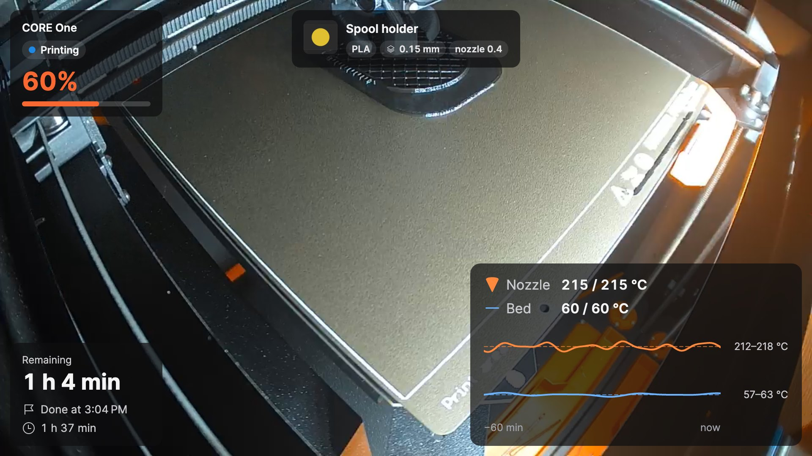
</p>

Open it with **Show camera** in the printer's submenu. The window shows the live camera picture with
[widgets](#6-widgets) on top. The buttons in the window appear when you move the mouse over it.

### 5.1 Three modes

| Mode | How to switch | What it is for |
|---|---|---|
| **Normal window** | button in the window, or double-click in the mini preview | a proper look, any size, any monitor |
| **Mini preview** | button **Mini preview, always on top** | a small window that stays on top of other windows all day |
| **Full screen** | **Windows:** F11 · **macOS:** ⌃⌘F · or double-click the picture; **Esc** goes back | the whole screen |

The mini preview has an info strip below the picture (progress, time left, finish time). Two buttons fold out further
rows: the **print name** and the **temperature chart**. What the strip shows is set in the printer's **Camera window**
sub-tab (see [11.1](#111-printers)).

To save CPU, the mini preview shows at most 10 frames per second by default, which is plenty for the small picture; the
normal window and full screen show every frame of the camera. The limit is set on the **Camera** tab of the settings (see
[11.6](#116-camera)).

<p align="center">
  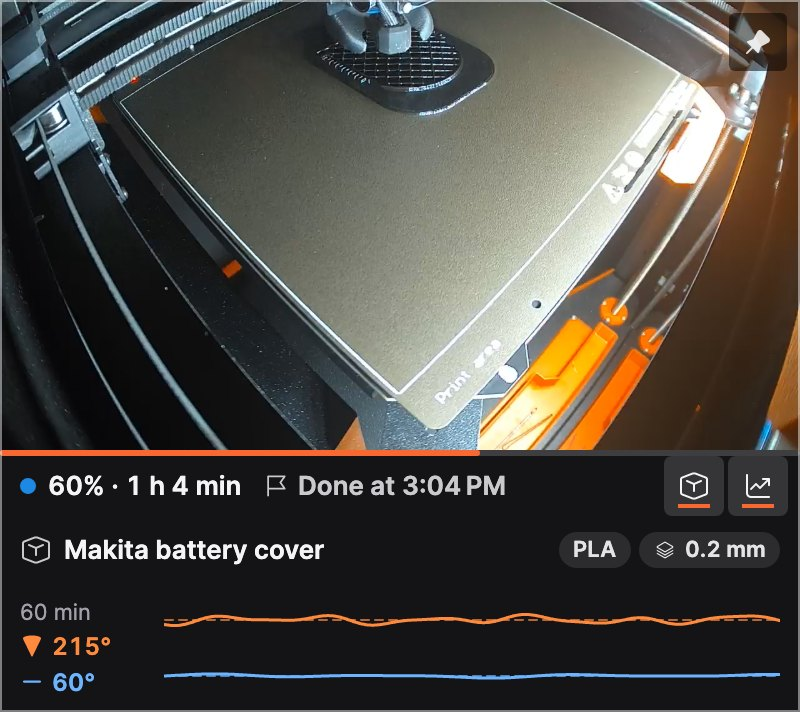
</p>

### 5.2 Always on top

The pin button in the window shows whether the window stays on top of other windows and switches it with one click.
The same option is in the window's context menu (**Always on top**).

### 5.3 Context menu of the window

Right-click the picture (on macOS also Control-click) for **Edit layout**, **Always on top**, recording, the dashcam
and the timelapse.

### 5.4 When the connection drops

The window reconnects by itself when the camera or Wi-Fi drops out; meanwhile it shows **Connecting to the camera…** or
**No signal**. It tries again after 5 seconds; while the camera stays unreachable, the pause doubles up to one minute.
The window shows roughly how long until the next attempt and keeps it up to date; opening the window, restoring it from
the minimised state or clicking **Test camera** in the settings tries again at once. When the printer is switched off,
the window closes and opens again at the same place when the printer is back. You can switch this off in **Settings →
Printers → Camera window** (**Close when the printer turns off, reopen when it is back on**). A window you close
yourself stays closed.

## 6. Widgets

Widgets are the cards over the camera picture. Each printer has its own set and layout.

| Widget | Shows |
|---|---|
| **Status** | printer name, state and progress in percent |
| **Times** | time left, when the print will be done, print time |
| **Temperatures** | nozzle and bed (actual / target) with a chart of the last 60 minutes |
| **Print name** | readable file name with material, layer height and nozzle; larger sizes add the G-code preview |
| **Cool-down** | after the print: how far the nozzle and bed have cooled and when it is safe to switch off |

Each widget has three sizes: **S**, **M** and **L**. Here the temperatures: S shows the values, M adds the chart, L the
labels and the temperature range.

<p align="center">
  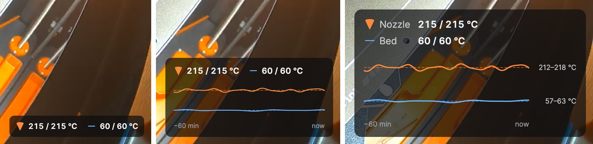
</p>

### 6.1 Choosing widgets

In **Settings → Widgets**, pick the printer at the top and tick the widgets you want. Selecting a widget shows its own
settings, e.g. the cool-down thresholds of the nozzle and bed. **Use layout for all printers** copies the layout to your
other printers. **Card background opacity** keeps the text readable on a bright picture (for all printers).

<p align="center">
  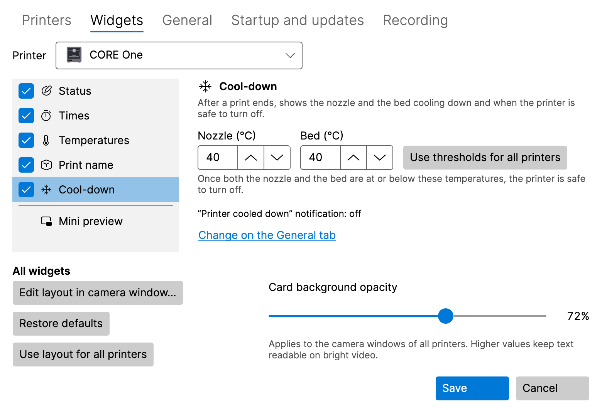
</p>

### 6.2 Arranging widgets in the camera window

Click **Edit layout** in the camera window (or **Edit layout in camera window…** in **Settings → Widgets**). In layout
mode:

- **drag** a widget to one of the six places (top and bottom, left, centre and right),
- click a widget to open its options: **Size** (Small, Medium, Large) and **Highlight** (shows the key value in the
  accent colour),
- **Restore defaults** returns the default layout, **Done** saves it.

With the keyboard: **Space** picks a widget up, the **arrow keys** move it, **Enter** opens its options and **Esc**
discards the changes. If the window is too small, enlarge it first.

<p align="center">
  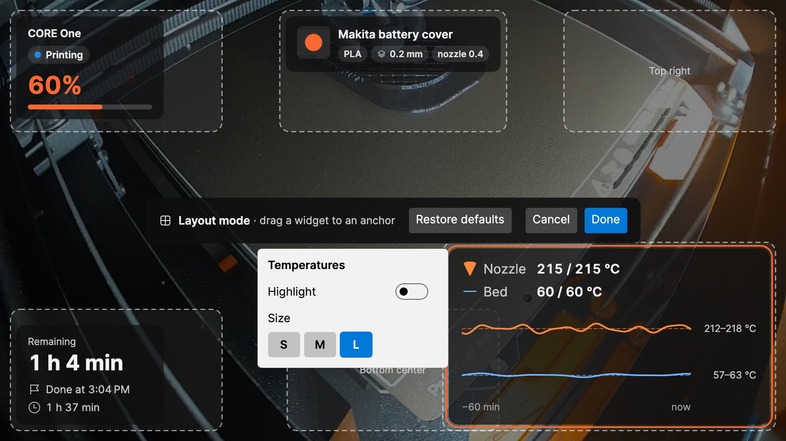
</p>

## 7. Notifications

LayerPeek shows native system notifications for these events (each can be switched on or off in **Settings → General**):

- print started, finished, paused, resumed and stopped,
- the printer needs attention (also a rejected password), an error,
- the printer went offline or is back online,
- **N minutes remaining**, so you can be at the printer when the print ends (**Notify when this many minutes of
  printing remain (0 = off)**),
- **Printer cooled down**: the nozzle and bed are below the thresholds of the **Cool-down** widget and the printer is
  safe to switch off.

**Sound** can be off, on for important notifications only or on for all notifications. **Send test notification**
shows a sample, so you can check that notifications reach you.

- **Windows:** if notifications are turned off for LayerPeek in **Settings → System → Notifications**, the LayerPeek
  settings say so and offer **Open notification settings**. Also check **Do not disturb**.
- **macOS:** the first notification asks for permission; click **Allow**. If notifications are turned off in
  **System Settings → Notifications**, the LayerPeek settings offer **Open notification settings**. Also check
  **Focus**.

Clicking a printer notification opens the printer's PrusaLink web interface. A print failure alarm opens the camera
window, a failed recording opens the **Recording** tab of the settings, and a finished timelapse conversion opens the
recordings folder.

## 8. Recording, dashcam and timelapse

All recordings stay on your disk. By default they go to the **Videos** folder (Windows) or the **Movies** folder (macOS)
under `LayerPeek`, one subfolder per printer, named after the time and the print. The video is stored as MP4 without
re-encoding, so it costs almost no CPU.

<p align="center">
  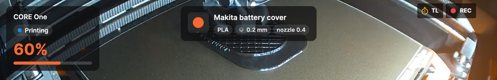
</p>

While the camera is recorded, the camera window shows a red **REC**; while a timelapse is taken, an amber **TL**.

### 8.1 Recording by hand

**Start recording** / **Stop recording** in the printer's submenu, or the record button in the camera window. **Play
last recording** and **Open recordings folder** are in the printer's submenu.

### 8.2 Recording every print

Switch on **Record prints automatically** on the printer's **Camera** sub-tab. Every print is recorded from its start
to a minute after its end, also without an open camera window.

<p align="center">
  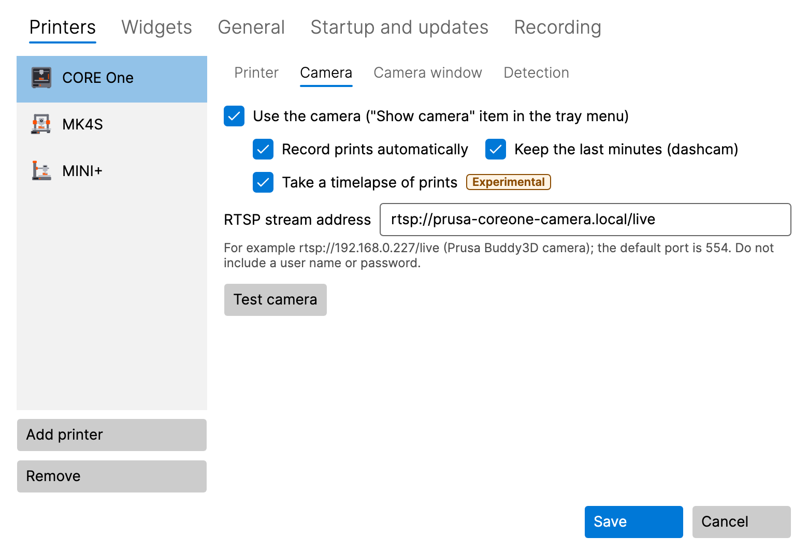
</p>

### 8.3 Dashcam: the last minutes

Switch on **Keep the last minutes (dashcam)** on the printer's **Camera** sub-tab. During a print LayerPeek keeps the
last 2 minutes of the camera in memory (about 8 MB per minute and printer); nothing is written to the disk until it is
saved. The last minutes, together with 30 seconds after the event, are saved:

- automatically on a print error, when the printer needs attention, when the print is stopped and when print failure
  detection raises an alarm (each can be switched off on the **Recording** tab),
- by hand with **Save the last 2 min** in the printer's submenu or the context menu of the camera window.

The length (1–10 minutes) is set on the **Recording** tab.

### 8.4 Timelapse (experimental)

A timelapse is a short video of the whole print: one frame every 30 seconds by default, none while the print is paused,
played at 30 frames per second. It is saved as `…_timelapse.mp4` next to the recordings.

- **By hand:** **Start timelapse (experimental)** / **Stop timelapse (experimental)** in the printer's submenu or the
  stopwatch button in the camera window. **Play last timelapse** is in the submenu.
- **Every print:** **Take a timelapse of prints** on the printer's **Camera** sub-tab.
- **Interval:** on the **Recording** tab, 5–600 seconds, or switch to **Every N-th layer (estimate)**: a frame when a
  new layer starts. PrusaLink reports no layers, so LayerPeek estimates them from the height of the Z axis.
- **Create timelapse from recording… (experimental)** makes a timelapse of an existing LayerPeek recording.
- **Export timelapse to JPEG… (experimental)** saves the frames of a timelapse as numbered JPEG files, e.g. for your own
  video editing.

Both conversions show their progress in the menu item, where you can also cancel them, and a notification tells you
when they are done.

### 8.5 Folder and size limit

On the **Recording** tab you can change the **Folder for recordings** and the **Size limit of all recordings (GB)**
(50 GB by default). Above the limit the oldest recordings are deleted; with less than 5 GB of free space on the drive,
recording stops. A failed recording shows a notification.

<p align="center">
  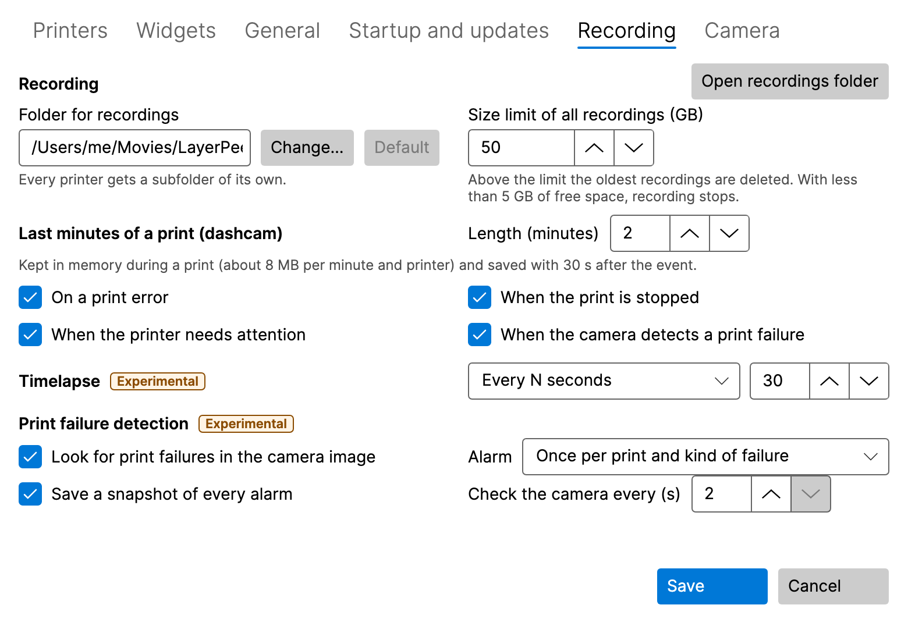
</p>

## 9. Print failure detection (experimental)

LayerPeek can watch a print through the camera and warn you when something goes wrong on the bed. It runs on your
computer only; the camera picture never leaves it.

<p align="center">
  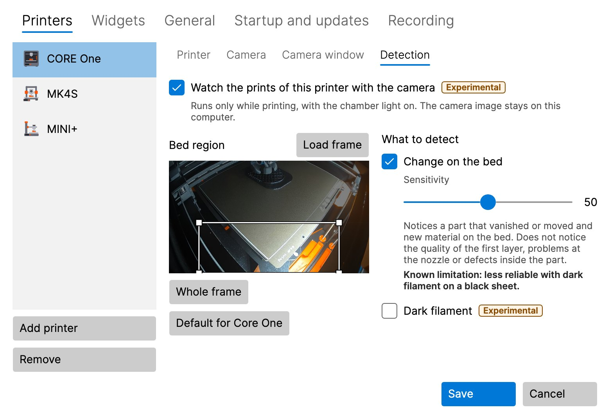
</p>

### 9.1 Switching it on

It is off by default and has to be switched on in two places:

1. **Look for print failures in the camera image** on the **Recording** tab (for all printers),
2. **Watch the prints of this printer with the camera** on the printer's **Detection** sub-tab.

The printer needs its camera switched on. Detection runs only while printing and with the chamber light on, also without
an open camera window.

### 9.2 Bed region

The **Bed region** is the part of the picture that is watched. Drag a new rectangle, move it or change its size at a
corner with the mouse, or use the arrow keys (Shift + arrows change its size). **Whole frame** watches the whole
picture, **Load frame** takes a new picture from the camera and, for a CORE One, **Default for Core One** restores its
preset.

### 9.3 Detectors

- **Change on the bed** notices a part that vanished or moved and new material on the bed (spaghetti, a part torn off).
  **Dark filament** helps with black or very dark filament, at the cost of more false alarms.
- **Printing into the air** (off by default, only for printers whose bed moves down while printing: CORE One, CORE One
  L, XL) notices that the printer goes on printing but nothing grows any more, e.g. when the filament ran out.

**Sensitivity** (0–100, 50 by default): higher means more alarms, also false ones; lower means fewer alarms, but a
failure may be missed.

### 9.4 The alarm

The alarm is a notification **Possible print failure – …** with a snapshot of the camera. Clicking it opens the camera
window. The **False alarm** button keeps a local record for tuning; nothing leaves your computer. On the **Recording**
tab you set how often the alarm repeats, whether a snapshot of every alarm is saved, and how often the camera is checked
(2–5 seconds).

> [!WARNING]
> Detection does not notice the quality of the first layer, problems at the nozzle or defects inside the part. It may
> miss a failure or raise a false alarm. Don't rely on it as the only safeguard of an unattended print.

## 10. Diagnostics

**Diagnostics…** in the icon's menu (pick the printer at the top of the window) shows the printer model and firmware, the current state, the nozzle and bed
temperatures (actual and target), the fans, print speed, flow and Z height, and a temperature chart of the last
30 minutes, 2 hours or 24 hours. The history is kept in memory only and starts when LayerPeek starts.

<p align="center">
  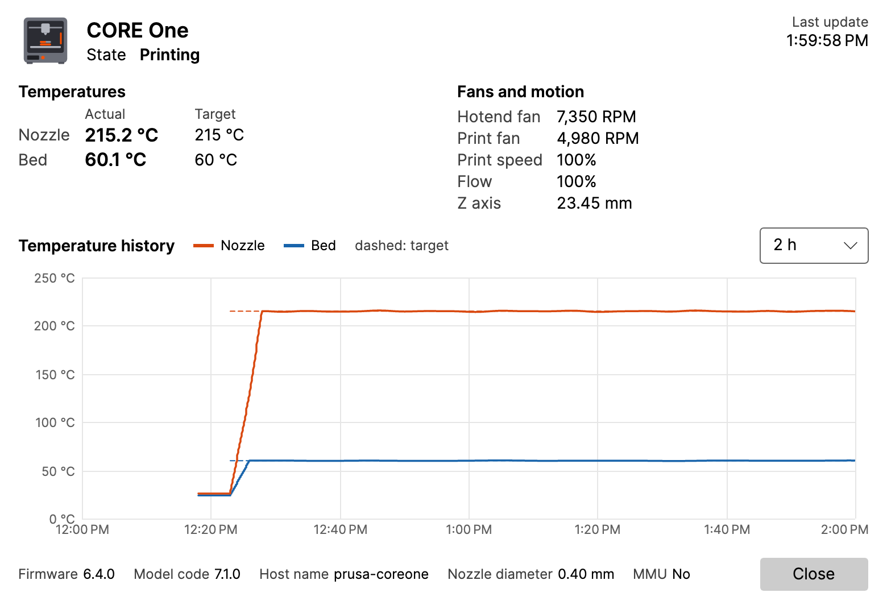
</p>

## 11. Settings reference

Open **Settings…** from the icon's menu. Changes apply after **Save**; **Cancel** discards them.

### 11.1 Printers

The list of printers with **Add printer** and **Remove**. Each printer has sub-tabs:

- **Printer:** name, address, user name, password, **Test connection**.
- **Camera:** the RTSP address, **Test camera**, automatic recording, dashcam and timelapse of prints.
- **Camera window:** **Open as** (same as last time, normal window, mini preview, full screen), the monitor, size,
  position and **Always on top** of the normal window and the mini preview, **Remember the last position and size**,
  **Close when the printer turns off, reopen when it is back on**, and what the info strip of the mini preview shows.
- **Detection:** print failure detection of this printer (see [9](#9-print-failure-detection-experimental)).

### 11.2 Widgets

The widgets of each printer, their settings and the card opacity (see [6](#6-widgets)).

### 11.3 Recording

The folder and size limit of the recordings, the dashcam, the timelapse and print failure detection (see
[8](#8-recording-dashcam-and-timelapse) and [9](#9-print-failure-detection-experimental)). Experimental features carry
an **Experimental** badge.

### 11.4 General

- **Notifications:** which events, **Sound**, the "minutes remaining" reminder, **Send test notification**.
- **Polling interval (seconds):** how often the printers are asked for their state.
- **Language:** **System default** or one of Čeština, Deutsch, English, Español, Français, Italiano, Polski, Slovenčina.
  It changes only the texts; numbers, dates and times follow the regional settings of your system.
- **Detailed logging (Debug):** turn it on only when asked to while troubleshooting.

### 11.5 Startup and updates

- **Windows:** **Start automatically when I sign in to Windows**. On by default; available only in the installed version,
  not in the ZIP version.
- **macOS:** **Open at login**. Off by default; available only when LayerPeek is in the Applications folder. If you turned
  LayerPeek off in **System Settings → General → Login Items & Extensions**, only you can allow it there again; the
  **Open System Settings** button takes you there.
- **Check for updates automatically**, **Offer pre-release versions** and **Check now** (see [12](#12-updates)).

### 11.6 Camera

Settings for all cameras (each printer's camera is set up on its **Camera** sub-tab, see [11.1](#111-printers)).

- **Mini preview frame rate:** how many frames per second the mini preview shows. **Economy** (5 fps), **Balanced**
  (10 fps, the default) or **Smooth** (every frame of the camera); the slider sets any other limit from 1 to 30 fps
  (**Custom**). Fewer frames mean less CPU load and less image data copied; the camera is still read in full, so
  recordings, timelapses and print failure detection are not affected. The normal window and full screen always show
  every frame. The change applies to an open mini preview after **Save**.

## 12. Updates

Shortly after the start and then once a day, LayerPeek asks GitHub whether a new version was released (you can switch
this off). A new version shows up as **New version X.Y.Z available** in the icon's menu and once as a notification.

- **Windows, installed version:** the menu item downloads the update, quits LayerPeek and starts the new version.
- **Windows, ZIP version:** the menu item opens the release page; download the new ZIP by hand.
- **Windows, installed with winget:** use the menu item as well. `winget upgrade` (also as part of `winget upgrade --all`)
  works too, but it closes a running LayerPeek abruptly, does not start it again (start it from the Start menu) and
  deletes the log files in `%LOCALAPPDATA%\LayerPeek\logs`.
- **macOS:** the menu item downloads the update and restarts LayerPeek, but only when the app is in **Applications**
  (not on the disk image or in Downloads).

Your settings and passwords are kept.

**Update refused:** the installed version accepts an update only when its signature can be verified. When it cannot,
LayerPeek installs nothing: it shows a notification (once per offered version; clicking it opens the settings) and an
error on the **Startup and updates** tab, and the icon's menu shows **Update refused…** instead of the new version (the
notification about the new version is removed). This stays until a later check succeeds: then the new version is offered
again and its notification shows once more. Do not install that version by hand, the release itself may have been
tampered with: wait for the next release or follow the project's announcements.

## 13. Where your data is stored

| What | Windows | macOS |
|---|---|---|
| Settings | `%APPDATA%\LayerPeek\settings.json` | `~/Library/Application Support/LayerPeek/settings.json` |
| Passwords | Windows Credential Manager | login Keychain |
| Logs | `%LOCALAPPDATA%\LayerPeek\logs` | `~/Library/Logs/LayerPeek` |
| Recordings | `Videos\LayerPeek` | `Movies/LayerPeek` |

The temperature history is kept only in memory. LayerPeek connects only to the printers and cameras you add and,
unless you switch the update check off, to GitHub (the list of releases, without any account, and the download of an
update you start). There is no telemetry.

## 14. Securing access to PrusaLink

PrusaLink on the printer speaks only plain **HTTP**, there is no HTTPS on the printer itself. Prusa designs PrusaLink
for the local network and advises against reaching it from the internet through a port forward on the router; use an
encrypted VPN instead. On a home network that only you use, this is usually enough. Read on if other people or devices
share the network between your computer and the printer (shared Wi-Fi, office, workshop, dormitory) or if you want to
reach the printer from elsewhere.

An `http://` printer address or a camera address that may be outside the local network gets a warning in the settings
(see [3.2 Add the printer](#32-add-the-printer)); saving it is still allowed.

### 14.1 What the risk is

- **Anyone who can see the traffic** between your computer and the printer can read it: the printer's state, file names
  and G-code uploaded through the PrusaLink web interface.
- **The login:** LayerPeek signs in with HTTP Digest, the only login the printer offers besides the API key. The
  password itself is not sent, but Digest on the printer is the old MD5 variant (RFC 2069). From one recorded login an
  attacker can try to guess the password offline, and for up to 5 minutes can repeat the same recorded request. Digest
  does not protect the content: someone who can change the traffic can change the data.
- **The API key:** tools that sign in with the API key (the `X-Api-Key` header) send the PrusaLink password itself,
  readable by anyone listening. In PrusaSlicer choose **HTTP digest** instead of the API key.
- **With the password**, anyone controls the printer through PrusaLink: starts and stops prints, uploads and deletes
  files.

### 14.2 The password

The printer generates the password itself; current firmware makes it 15 random characters from 57 letters and digits
(without the easily confused 0, O, 1, l and I). Guessing such a password from a recorded login is not practical. On
printers with Buddy firmware you cannot type in your own password, you can only generate a new one.

Generate a new password whenever the old one may have leaked (a shared photo of the display or of the PrusaLink QR code,
which contains the password, or the API key used on an untrusted network):

1. On the printer open **Settings → Network → PrusaLink** and choose **Generate Password**.
2. In LayerPeek open **Settings → Printers**, select the printer, type the new password in **Password** on the
   **Printer** sub-tab, click **Test connection** and **Save**.
3. Change it also in other tools that use PrusaLink (PrusaSlicer and others).

### 14.3 A separate network and firewall

- Put the printers and cameras into a **separate network** on your router (for IoT devices, a VLAN). Allow the computer
  with LayerPeek to reach them: TCP port **80** of the printer (PrusaLink) and the RTSP port of the camera (**554** by
  default). Guest networks often block connections between devices; check your router's manual.
- **Never forward a router port** to the printer. To reach it from elsewhere, connect to your home network through a
  VPN.
- LayerPeek itself offers nothing to the network: **Open PrusaLink** listens only on `127.0.0.1` of your computer. Your
  computer's firewall does not need any new rule for LayerPeek.

### 14.4 HTTPS through a reverse proxy

A small computer next to the printer (for example a Raspberry Pi) runs a reverse proxy, **Caddy** or **nginx**.
LayerPeek talks to the proxy over HTTPS; only the proxy talks to the printer over plain HTTP. Connect the proxy and the
printer with a short cable or put them on the same switch, and if your router allows it, let only the proxy reach the
printer.

- In LayerPeek enter the proxy's address as the printer address, e.g. `https://printer.home.arpa`. The name must lead to
  the proxy (a DNS entry in your router or the `hosts` file).
- Use **one host name or port per printer**, not a path such as `https://proxy/mk4/`. The printer checks the login
  against the path of the request, so a proxy that removes such a prefix makes the printer reject the password.
- The camera (RTSP) does not go through the proxy; LayerPeek connects to it directly.

**Caddy** (the `Caddyfile`, `192.168.1.20` is the printer):

```caddyfile
printer.home.arpa {
	tls internal
	reverse_proxy 192.168.1.20
}
```

`tls internal` makes Caddy issue the certificate from its own certification authority (CA). Trust its root certificate
on your computer (see [14.5](#145-trusting-the-certificate-on-your-computer)); when Caddy runs as a Linux service, the
file is `/var/lib/caddy/.local/share/caddy/pki/authorities/local/root.crt`. Caddy passes the path and the login headers
on unchanged.

**nginx** (a `server` block, e.g. in `/etc/nginx/conf.d/printer.conf`):

```nginx
server {
    listen 443 ssl;
    server_name printer.home.arpa;
    ssl_certificate     /etc/nginx/tls/printer.crt;
    ssl_certificate_key /etc/nginx/tls/printer.key;
    client_max_body_size 0;

    location / {
        proxy_pass http://192.168.1.20;
    }
}
```

`proxy_pass` without a path passes the path on unchanged. `client_max_body_size 0` lifts the 1 MB limit, so that
uploading G-code through the PrusaLink web interface works. nginx needs a certificate from your own CA, for example made
with OpenSSL:

```sh
openssl req -x509 -newkey rsa:3072 -nodes -days 3650 -subj "/CN=Printer proxy CA" \
  -addext "basicConstraints=critical,CA:TRUE" -addext "keyUsage=critical,keyCertSign,cRLSign" \
  -keyout ca.key -out ca.crt
openssl req -newkey rsa:3072 -nodes -subj "/CN=printer.home.arpa" -keyout printer.key -out printer.csr
printf "subjectAltName=DNS:printer.home.arpa\nextendedKeyUsage=serverAuth\n" > printer.ext
openssl x509 -req -in printer.csr -CA ca.crt -CAkey ca.key -CAcreateserial -days 825 \
  -extfile printer.ext -out printer.crt
```

Copy `printer.crt` and `printer.key` to the proxy and `ca.crt` to your computers; keep `ca.key` safe and off the
network. The server certificate is valid for 825 days, the longest macOS accepts.

### 14.5 Trusting the certificate on your computer

LayerPeek accepts only certificates that your system trusts. A self-signed certificate, or one from a CA the system does
not know, fails: **Test connection** reports *"The secure (https) connection failed. Try the address with http:// or
check the printer's certificate."*, the printer shows as **Offline** and **Diagnostics** shows *"The secure (https)
connection to the printer failed."* LayerPeek cannot trust a single certificate by itself; add your CA certificate
(`ca.crt`, or Caddy's `root.crt`) to the system:

- **Windows:** press **Win+R**, run `certmgr.msc`, right-click **Trusted Root Certification Authorities →
  Certificates**, choose **All Tasks → Import…** and import the file into **Trusted Root Certification Authorities**;
  confirm the security warning. Or in a terminal: `certutil -user -addstore Root ca.crt`.
- **macOS:** open **Keychain Access** (find it with Spotlight), select the **login** keychain and drag the file onto the
  window. Double-click the certificate, open **Trust** and set **When using this certificate** to **Always Trust**;
  confirm with your password.

Then run **Test connection** again.

Sources: PrusaLink [on the local
network](https://help.prusa3d.com/article/prusa-connect-and-prusalink-explained_302608), [port forward and
VPN](https://help.prusa3d.com/article/prusalink-sl1-sl1s_146094), [HTTP digest in
PrusaSlicer](https://help.prusa3d.com/article/prusalink-troubleshooting_304411); firmware: [port 80 without
TLS](https://github.com/prusa3d/Prusa-Firmware-Buddy/blob/7d8bf6858b363c453c0617bceab5e66997d8fc25/lib/WUI/http_lifetime.cpp),
[Digest and API
key](https://github.com/prusa3d/Prusa-Firmware-Buddy/blob/7d8bf6858b363c453c0617bceab5e66997d8fc25/lib/WUI/nhttp/req_parser.cpp),
[nonce
validity](https://github.com/prusa3d/Prusa-Firmware-Buddy/blob/7d8bf6858b363c453c0617bceab5e66997d8fc25/src/common/http/types.h),
[password
generation](https://github.com/prusa3d/Prusa-Firmware-Buddy/blob/7d8bf6858b363c453c0617bceab5e66997d8fc25/lib/WUI/wui.cpp)
and
[length](https://github.com/prusa3d/Prusa-Firmware-Buddy/blob/7d8bf6858b363c453c0617bceab5e66997d8fc25/src/persistent_stores/store_instances/config_store/constants.hpp),
[PrusaLink
menu](https://github.com/prusa3d/Prusa-Firmware-Buddy/blob/7d8bf6858b363c453c0617bceab5e66997d8fc25/src/gui/screen_prusa_link.cpp);
[RFC 2069](https://www.rfc-editor.org/rfc/rfc2069); [Caddy
`reverse_proxy`](https://caddyserver.com/docs/caddyfile/directives/reverse_proxy),
[`tls`](https://caddyserver.com/docs/caddyfile/directives/tls), [data directory](https://caddyserver.com/docs/running);
[nginx `proxy_pass`](https://nginx.org/en/docs/http/ngx_http_proxy_module.html#proxy_pass),
[`client_max_body_size`](https://nginx.org/en/docs/http/ngx_http_core_module.html#client_max_body_size); [Apple
certificate requirements](https://support.apple.com/en-us/103769), [Keychain
Access](https://support.apple.com/guide/keychain-access/change-the-trust-settings-of-a-certificate-kyca11871/mac);
[certutil](https://learn.microsoft.com/en-us/windows-server/administration/windows-commands/certutil).

## 15. Troubleshooting

**The icon is not visible (Windows).** Click the arrow **`^`** in the notification area and drag the LayerPeek icon onto
the taskbar.

**The printer is Offline.** Check that the printer is on and connected to the network, that the address is right (try
it in a browser) and that your computer is on the same network. Run **Test connection** in the printer's settings.

**Invalid credentials.** Enter the user name and password from the printer's **Settings → Network → PrusaLink** again
and save.

**The secure (https) connection failed.** The printer address starts with `https://`. Either it points straight at the
printer, which offers no HTTPS (use `http://`), or your system does not trust the proxy's certificate: see
[14.5](#145-trusting-the-certificate-on-your-computer).

**No connection on macOS.** Local Network access may be off. LayerPeek then offers **Open System Settings**; turn
LayerPeek on in **System Settings → Privacy & Security → Local Network**.

**The camera shows No signal.** Check the RTSP address with **Test camera**, and that the camera is on and reachable.
Don't put a user name or password in the address.

**Notifications don't appear.** Use **Send test notification** in **Settings → General** and check **Do not disturb**
(Windows) or **Focus** (macOS).

**Reporting a bug.** Open **About** from the icon's menu:

- **Save diagnostic bundle…** saves a ZIP file with the logs, version and system information and the settings,
  **without passwords and keys**. Attach it to your bug report.
- **Copy info to clipboard** copies a short report.
- **Open log folder** opens the logs.

If you are asked for a detailed log, switch on **Detailed logging (Debug)** in **Settings → General**, repeat the
problem, save the bundle and switch the detailed logging off again.

Report bugs and ideas in the [issues](https://github.com/pfoltynek/LayerPeek/issues) on GitHub. Please include your
printer model, firmware version and operating system.

## 16. Uninstalling

- **Windows, installed version:** **Settings → Apps → Installed apps → LayerPeek → Uninstall**.
- **Windows, ZIP version:** quit LayerPeek and delete its folder.
- **macOS:** quit LayerPeek (**Quit** in its menu) and move **LayerPeek** from **Applications** to the Trash.

Uninstalling keeps your settings, passwords and recordings. To remove them too, delete the folders from
[13](#13-where-your-data-is-stored) and the LayerPeek entries in the Credential Manager (Windows) or Keychain Access
(macOS).
