# Manual de usuario de LayerPeek

*Para LayerPeek 0.5 en Windows 10/11 y macOS (Apple Silicon).* · [Otros idiomas](../README.md)

LayerPeek vigila sus impresoras 3D Prusa a través de la red local y muestra su estado en el área de notificación de
Windows o en la barra de menús de macOS. No tiene ventana principal: todo empieza en el menú del icono. Este manual
describe ambos sistemas; donde Windows y macOS se diferencian, el texto lo indica o muestra las dos variantes.

> [!NOTE]
> LayerPeek es un proyecto independiente de la comunidad, no un producto oficial de Prusa Research.

## Contenido

1. [Qué necesita](#1-qué-necesita)
2. [Instalación](#2-instalación)
3. [Primeros pasos](#3-primeros-pasos)
4. [El icono y su menú](#4-el-icono-y-su-menú)
5. [Ventana de la cámara](#5-ventana-de-la-cámara)
6. [Widgets](#6-widgets)
7. [Notificaciones](#7-notificaciones)
8. [Grabación, dashcam y timelapse](#8-grabación-dashcam-y-timelapse)
9. [Detección de fallos de impresión (experimental)](#9-detección-de-fallos-de-impresión-experimental)
10. [Diagnóstico](#10-diagnóstico)
11. [Referencia de la configuración](#11-referencia-de-la-configuración)
12. [Actualizaciones](#12-actualizaciones)
13. [Dónde se guardan sus datos](#13-dónde-se-guardan-sus-datos)
14. [Proteger el acceso a PrusaLink](#14-proteger-el-acceso-a-prusalink)
15. [Solución de problemas](#15-solución-de-problemas)
16. [Desinstalación](#16-desinstalación)

## 1. Qué necesita

- **Una impresora Prusa con firmware Buddy 6.x y PrusaLink**: CORE One (probada), MK4/MK4S, MK3.9/MK3.9S,
  MK3.5/MK3.5S, XL y MINI/MINI+. La Original Prusa MK3/MK3S no tiene PrusaLink integrado y no es compatible.
- **Un ordenador en la misma red local** que la impresora:
  - Windows 10 u 11, x64 (Windows en ARM no es compatible),
  - macOS en Apple Silicon (M1 o posterior).
- **Una cámara (opcional):** cualquier cámara con una transmisión **RTSP H.264** accesible desde su ordenador, por
  ejemplo la cámara Prusa Buddy3D. Sin cámara sigue teniendo el icono, las notificaciones y el diagnóstico.

LayerPeek funciona solo en su red local. No usa Prusa Connect ni ningún otro servicio en la nube. Fuera de casa puede
acceder a las impresoras mediante una VPN a su red doméstica.

Por ahora solo se ha probado la CORE One. ¿Tiene otro modelo? Envíe un breve [informe de compatibilidad de la impresora](https://github.com/pfoltynek/LayerPeek/issues/new?template=printer_compatibility.yml) (formulario en inglés); basta con una prueba en Windows o macOS.

## 2. Instalación

Descargue la última versión desde la página [Releases](https://github.com/pfoltynek/LayerPeek/releases).

> [!IMPORTANT]
> Las versiones 0.x son versiones preliminares y sus compilaciones no están firmadas por Microsoft ni notarizadas por
> Apple. Por eso el sistema le muestra una advertencia en el primer inicio; los pasos siguientes explican cómo
> continuar.

### 2.1 Windows

Puede elegir entre dos paquetes:

| Paquete | Qué hace |
|---|---|
| **Instalador** `LayerPeek-X.Y.Z-win-x64-Setup.exe` (recomendado) | Instala LayerPeek solo para su usuario, sin derechos de administrador, en `%LOCALAPPDATA%\LayerPeek`, lo añade al menú Inicio, lo inicia al iniciar sesión y puede actualizarse solo. |
| **ZIP** `LayerPeek-X.Y.Z-win-x64.zip` | Descomprímalo en cualquier carpeta y ejecute `LayerPeek.exe`. No se inicia al iniciar sesión ni se actualiza solo (en su lugar abre la página de la versión). |

En el primer inicio, Windows SmartScreen muestra **«Windows protegió su PC»** con un *Editor desconocido*. Haga clic en
**Más información** y después en **Ejecutar de todas formas**.

### 2.2 macOS

| Paquete | Qué hace |
|---|---|
| **Imagen de disco** `LayerPeek-X.Y.Z-osx-arm64.dmg` (recomendada) | Ábrala y arrastre **LayerPeek** a **Aplicaciones**. |
| **Archivo comprimido** `LayerPeek-X.Y.Z-osx-arm64.tar.gz` | Contiene `LayerPeek.app`; descomprímalo y mueva la app a **Aplicaciones**. |

Inicie LayerPeek siempre desde **Aplicaciones**, no directamente desde la imagen de disco ni desde la carpeta
Descargas: solo desde ahí puede abrirse al iniciar sesión y actualizarse sola.

En el primer inicio, Gatekeeper bloquea la app (*«Apple no ha podido verificar…»*):

1. Haga clic en **OK** (Done).
2. Abra **Ajustes del Sistema → Privacidad y seguridad**, desplácese hacia abajo y haga clic en **Abrir igualmente**
   junto al mensaje sobre LayerPeek.
3. Confirme con su contraseña o Touch ID y vuelva a abrir LayerPeek.

Los usuarios avanzados pueden, en su lugar, quitar el atributo de cuarentena en Terminal:
`xattr -dr com.apple.quarantine /Applications/LayerPeek.app`.

LayerPeek vive solo en la barra de menús. No tiene icono en el Dock y no aparece en el selector de apps (⌘⇥).

## 3. Primeros pasos

### 3.1 Activar PrusaLink en la impresora

En la pantalla de la impresora abra **Settings → Network → PrusaLink** (Ajustes → Red → PrusaLink). Compruebe que
PrusaLink está activado y anote:

- la **dirección IP** de la impresora (o su nombre de host),
- el **nombre de usuario** (el predeterminado es `maker`),
- la **contraseña**.

### 3.2 Añadir la impresora

1. Busque el icono de LayerPeek:
   - **Windows:** en el área de notificación, en el extremo derecho de la barra de tareas. Si no lo ve, haga clic en la
     flecha **`^`** (iconos ocultos) y arrastre el icono a la barra de tareas para que quede siempre visible.
   - **macOS:** en la barra de menús, en la parte superior de la pantalla.
2. Abra el menú del icono (**Windows:** clic derecho en el icono, **macOS:** clic en él) y elija **Añadir impresora…**.
   Se abre la ventana **Configuración** en la pestaña **Impresoras**.
3. Rellene:
   - **Nombre:** el nombre que prefiera, p. ej. `CORE One`.
   - **Dirección:** una dirección IP o un nombre de host, p. ej. `192.168.1.20` o `http://prusa-mk4.local`.
   - **Nombre de usuario** y **Contraseña:** los valores de la impresora.
4. Haga clic en **Probar conexión**. Si la conexión funciona, se muestran el código del modelo y la versión del firmware.
5. Haga clic en **Guardar**.

<p align="center">
  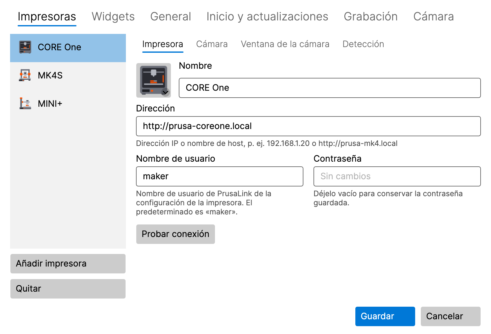
</p>

El icono empieza a mostrar el estado de la impresora de inmediato. Añada más impresoras de la misma forma: **Añadir
impresora** en la pestaña **Impresoras**.

**macOS 15 y posterior:** la primera conexión a una impresora o cámara solicita acceso a la **Red local**. Haga clic en
**Permitir**. Si lo denegó, consulte [Solución de problemas](#15-solución-de-problemas).

La contraseña se guarda en el **Administrador de credenciales de Windows** o en el **Llavero de macOS**, nunca en el
archivo de configuración. Cuando más adelante edite una impresora, el campo de la contraseña muestra **Sin cambios**;
déjelo vacío para conservar la contraseña guardada.

**Advertencia bajo la dirección:** una dirección `http://` que puede estar fuera de la red local (una dirección IP
pública, o un nombre de host que no sea un nombre sin punto ni termine en `.local`, `.lan` o `.home.arpa`) muestra una
advertencia en lugar de la ayuda. PrusaLink inicia sesión sin cifrar, así que la contraseña podría ser interceptada por
el camino. Se puede guardar igualmente. Es mejor usar `https://` a través de un proxy inverso, o una VPN. **Más
información** junto a la advertencia abre el capítulo [Proteger el acceso a
PrusaLink](#14-proteger-el-acceso-a-prusalink).

### 3.3 Añadir la cámara (opcional)

1. En **Configuración → Impresoras**, seleccione la impresora y abra su subpestaña **Cámara**.
2. Active **Usar la cámara (elemento «Mostrar cámara» del menú del área de notificación)**.
3. Introduzca la **Dirección de la transmisión RTSP**, p. ej. `rtsp://192.168.1.21/live` para la cámara Buddy3D (el
   puerto predeterminado es el 554). No ponga ningún nombre de usuario ni contraseña en la dirección.
4. Haga clic en **Probar cámara**. Si la cámara funciona, se muestran una instantánea y su resolución.
5. Haga clic en **Guardar** y elija **Mostrar cámara** en el submenú de la impresora.

Igual que la dirección de la impresora, una dirección de cámara que puede estar fuera de la red local muestra una
advertencia: RTSP no está cifrado, así que la imagen de la cámara podría ser interceptada por el camino. Se puede
guardar igualmente; es mejor usar una VPN. El mismo enlace junto a ella abre el capítulo [Proteger el acceso a
PrusaLink](#14-proteger-el-acceso-a-prusalink).

### 3.4 Imagen de la impresora

La lista de impresoras muestra una imagen de cada impresora, elegida automáticamente según su modelo. Haga clic en la
imagen para elegir otro modelo, una ilustración genérica o una imagen propia (PNG, JPG).

## 4. El icono y su menú

### 4.1 Qué muestra el icono

El icono muestra el estado más importante de todas sus impresoras:

| Estado | Significado |
|---|---|
| **Lista** | la impresora está inactiva |
| **Imprimiendo** | el icono se va llenando a medida que avanza la impresión |
| **En pausa** | la impresión está en pausa |
| **Terminado** / **Detenido** | la impresión ha finalizado |
| **Requiere atención** | la impresora le espera (p. ej. un cambio de filamento o una pregunta en su pantalla) |
| **Error** | la impresora informa de un error |
| **Sin conexión** | no se puede contactar con la impresora |
| **Credenciales no válidas** | la impresora rechazó el nombre de usuario o la contraseña |

Pase el ratón por encima del icono para ver los detalles en su información emergente: el progreso, el tiempo restante y
el nombre del archivo. Mientras se graba la cámara de una impresora, la información emergente indica **Grabando**.

### 4.2 El menú

- **Windows:** haga clic derecho en el icono.
- **macOS:** haga clic en el icono de la barra de menús.

El menú contiene:

- **Un submenú por impresora**, cuyo encabezado muestra el nombre, el estado y el progreso de la impresora, con:
  - **Mostrar cámara** / **Ocultar cámara**, y **Traer la cámara al frente** mientras la ventana está abierta,
  - **Grabar** / **Detener grabación**, **Reproducir última grabación**, **Abrir carpeta de grabaciones**,
  - **Guardar los últimos 2 min** (cuando la dashcam está activada, consulte [8.3](#83-dashcam-los-últimos-minutos)),
  - los elementos del timelapse (experimental, consulte [8.4](#84-timelapse-experimental)),
  - **Abrir PrusaLink**: abre la interfaz web PrusaLink de la impresora en su navegador, con la sesión ya iniciada. Su
    contraseña nunca se entrega al navegador.
- **Diagnóstico…** (consulte [10](#10-diagnóstico))
- **Configuración…**
- **Nueva versión X.Y.Z disponible** (solo cuando hay una actualización, consulte [12](#12-actualizaciones))
- **Manual de usuario**: abre este manual
- **Acerca de**
- **Salir**

Antes de añadir la primera impresora, el menú ofrece **Añadir impresora…** en lugar de los submenús de las impresoras.

## 5. Ventana de la cámara

<p align="center">
  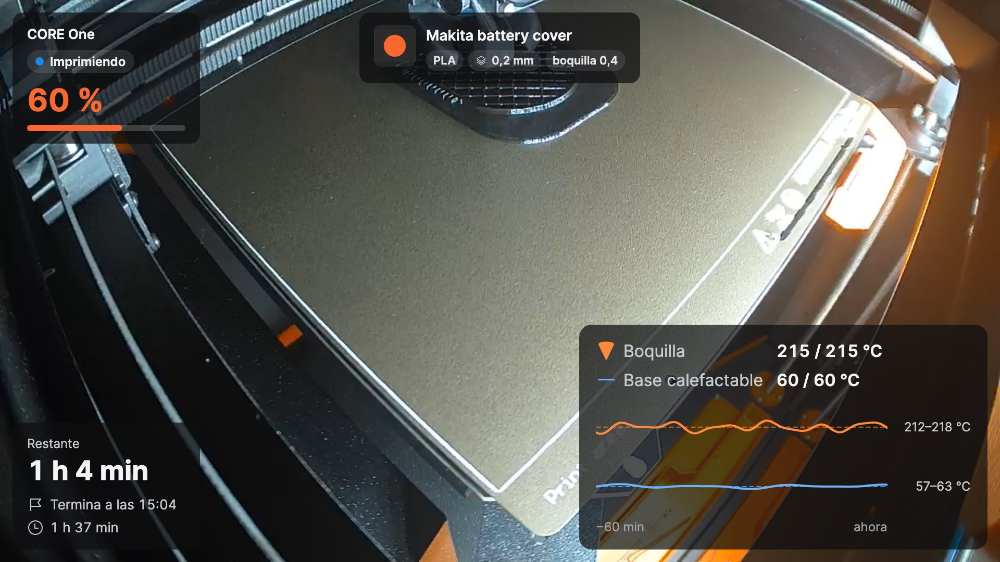
</p>

Ábrala con **Mostrar cámara** en el submenú de la impresora. La ventana muestra la imagen en directo de la cámara con
[widgets](#6-widgets) encima. Los botones de la ventana aparecen al mover el ratón sobre ella.

### 5.1 Tres modos

| Modo | Cómo cambiar | Para qué sirve |
|---|---|---|
| **Ventana normal** | botón en la ventana, o doble clic en la vista mini | para verla bien, a cualquier tamaño y en cualquier monitor |
| **Vista mini** | botón **Vista previa pequeña, siempre encima** | una ventana pequeña que se queda por encima de las demás todo el día |
| **Pantalla completa** | **Windows:** F11 · **macOS:** ⌃⌘F · o doble clic en la imagen; **Esc** vuelve atrás | toda la pantalla |

La vista mini tiene una franja de información debajo de la imagen (progreso, tiempo restante, hora de finalización).
Dos botones despliegan filas adicionales: el **nombre de la impresión** y el **gráfico de temperaturas**. Lo que muestra
la franja se configura en la subpestaña **Ventana de la cámara** de la impresora (consulte [11.1](#111-impresoras)).

Para ahorrar CPU, la vista mini muestra por defecto como máximo 10 fotogramas por segundo, más que suficiente para la
imagen pequeña; la ventana normal y la pantalla completa muestran todos los fotogramas de la cámara. El límite se
configura en la pestaña **Cámara** de la configuración (consulte [11.6](#116-cámara)).

<p align="center">
  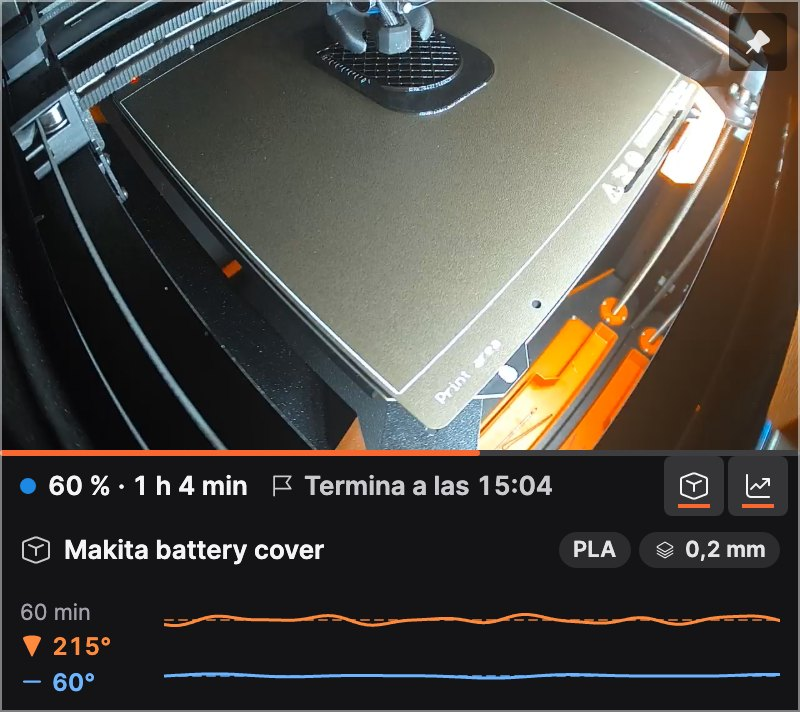
</p>

### 5.2 Siempre encima

El botón de chincheta de la ventana indica si la ventana se queda por encima de las demás y lo cambia con un solo clic.
La misma opción está en el menú contextual de la ventana (**Siempre encima**).

### 5.3 Menú contextual de la ventana

Haga clic derecho en la imagen (en macOS también Control + clic) para acceder a **Editar diseño**, **Siempre encima**,
la grabación, la dashcam y el timelapse.

### 5.4 Cuando se pierde la conexión

La ventana se vuelve a conectar sola cuando se pierde la cámara o la wifi; mientras tanto muestra **Conectando con la
cámara…** o **Sin señal**. Vuelve a intentarlo a los 5 segundos; mientras la cámara siga sin responder, la pausa se
duplica hasta un minuto. La ventana indica aproximadamente cuándo llega el próximo intento y lo mantiene actualizado; al
abrir la ventana, restaurarla tras minimizarla o hacer clic en **Probar cámara** en la configuración, lo vuelve a
intentar enseguida. Cuando se apaga la impresora, la ventana se cierra y se vuelve a abrir en el mismo lugar cuando la
impresora vuelve a estar disponible. Puede desactivarlo en **Configuración → Impresoras → Ventana de la cámara**
(**Cerrar al apagarse la impresora y volver a abrir al encenderse**). Una ventana que cierre usted mismo permanece
cerrada.

## 6. Widgets

Los widgets son las tarjetas que aparecen sobre la imagen de la cámara. Cada impresora tiene su propio conjunto y su
propia disposición.

| Widget | Muestra |
|---|---|
| **Estado** | nombre de la impresora, estado y progreso en porcentaje |
| **Tiempos** | tiempo restante, cuándo terminará la impresión, tiempo de impresión |
| **Temperaturas** | boquilla y base (actual / objetivo) con un gráfico de los últimos 60 minutos |
| **Nombre de impresión** | nombre de archivo legible con material, altura de capa y boquilla; los tamaños mayores añaden la vista previa del G-code |
| **Enfriamiento** | tras la impresión: cuánto se han enfriado la boquilla y la base, y cuándo es seguro apagar |

Cada widget tiene tres tamaños: **S**, **M** y **L**. Aquí, las temperaturas: S muestra los valores, M añade el
gráfico y L, las etiquetas y el rango de temperaturas.

<p align="center">
  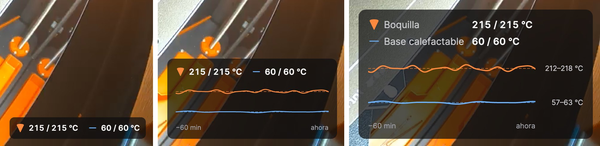
</p>

### 6.1 Elegir widgets

En **Configuración → Widgets**, elija la impresora arriba y marque los widgets que desee. Al seleccionar un widget se
muestran sus propios ajustes, p. ej. los umbrales de enfriamiento de la boquilla y la base. **Usar el diseño en todas
las impresoras** copia la disposición a sus demás impresoras. **Opacidad del fondo de las tarjetas** mantiene el texto
legible sobre una imagen clara (para todas las impresoras).

<p align="center">
  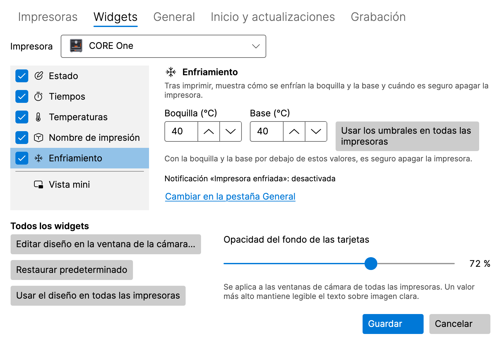
</p>

### 6.2 Organizar los widgets en la ventana de la cámara

Haga clic en **Editar diseño** en la ventana de la cámara (o en **Editar diseño en la ventana de la cámara…** en
**Configuración → Widgets**). En el modo de diseño:

- **arrastre** un widget a uno de los seis lugares (arriba y abajo; izquierda, centro y derecha),
- haga clic en un widget para abrir sus opciones: **Tamaño** (Pequeño, Mediano, Grande) y **Resaltar** (muestra el
  valor clave en el color de acento),
- **Restaurar predeterminado** recupera la disposición predeterminada y **Listo** la guarda.

Con el teclado: **Espacio** toma un widget, las **teclas de flecha** lo mueven, **Intro** abre sus opciones y **Esc**
descarta los cambios. Si la ventana es demasiado pequeña, amplíela primero.

<p align="center">
  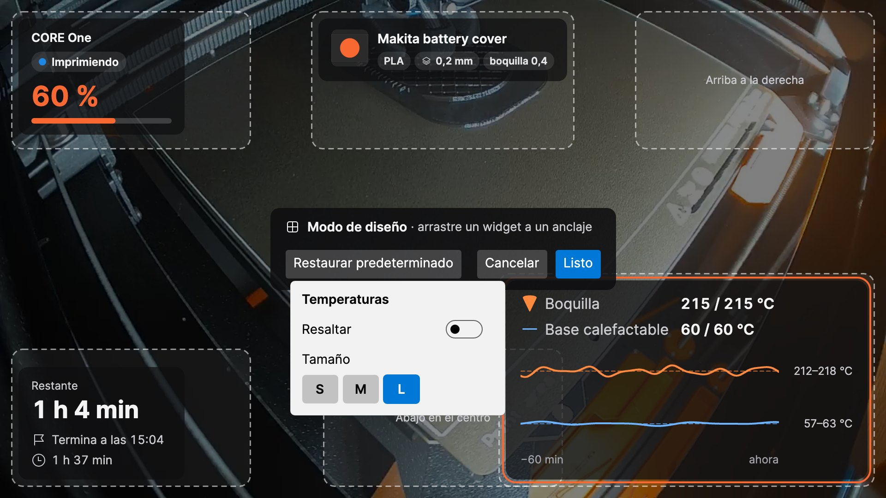
</p>

## 7. Notificaciones

LayerPeek muestra notificaciones nativas del sistema para estos eventos (cada uno se puede activar o desactivar en
**Configuración → General**):

- impresión iniciada, terminada, en pausa, reanudada y detenida,
- la impresora requiere atención (también una contraseña rechazada), un error,
- la impresora se ha desconectado o vuelve a estar en línea,
- **Quedan N minutos**, para que pueda estar junto a la impresora cuando termine la impresión (**Avisar cuando queden
  estos minutos de impresión (0 = desactivado)**),
- **Impresora enfriada**: la boquilla y la base están por debajo de los umbrales del widget **Enfriamiento** y ya se
  puede apagar la impresora con seguridad.

El **Sonido** puede estar desactivado, activado solo para las notificaciones importantes o activado para todas.
**Enviar notificación de prueba** muestra un ejemplo para que pueda comprobar que las notificaciones le llegan.

- **Windows:** si las notificaciones de LayerPeek están desactivadas en **Configuración → Sistema → Notificaciones**,
  la configuración de LayerPeek lo indica y ofrece **Abrir configuración de notificaciones**. Compruebe también **No
  molestar**.
- **macOS:** la primera notificación pide permiso; haga clic en **Permitir**. Si las notificaciones están desactivadas
  en **Ajustes del Sistema → Notificaciones**, la configuración de LayerPeek ofrece **Abrir ajustes de
  Notificaciones**. Compruebe también los **Modos de concentración**.

Al hacer clic en una notificación de la impresora se abre su interfaz web PrusaLink. Una alarma de fallo de impresión
abre la ventana de la cámara, una grabación fallida abre la pestaña **Grabación** de la configuración y una conversión
de timelapse terminada abre la carpeta de grabaciones.

## 8. Grabación, dashcam y timelapse

Todas las grabaciones se quedan en su disco. De forma predeterminada se guardan en la carpeta **Vídeos** (Windows) o
**Películas** (macOS), dentro de `LayerPeek`, con una subcarpeta por impresora y nombres según la hora y la impresión.
El vídeo se guarda como MP4 sin recodificar, por lo que apenas consume CPU.

<p align="center">
  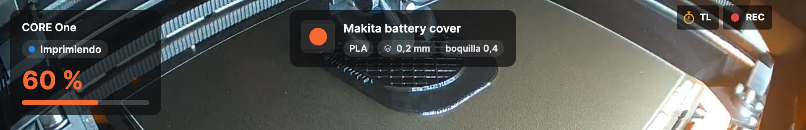
</p>

Mientras se graba la cámara, la ventana de la cámara muestra **REC** en rojo; mientras se toma un timelapse, **TL** en
ámbar.

### 8.1 Grabar a mano

**Grabar** / **Detener grabación** en el submenú de la impresora, o el botón de grabación de la ventana de la cámara.
**Reproducir última grabación** y **Abrir carpeta de grabaciones** están en el submenú de la impresora.

### 8.2 Grabar todas las impresiones

Active **Grabar cada impresión** en la subpestaña **Cámara** de la impresora. Cada impresión se graba
desde su inicio hasta un minuto después de su fin, también sin la ventana de la cámara abierta.

<p align="center">
  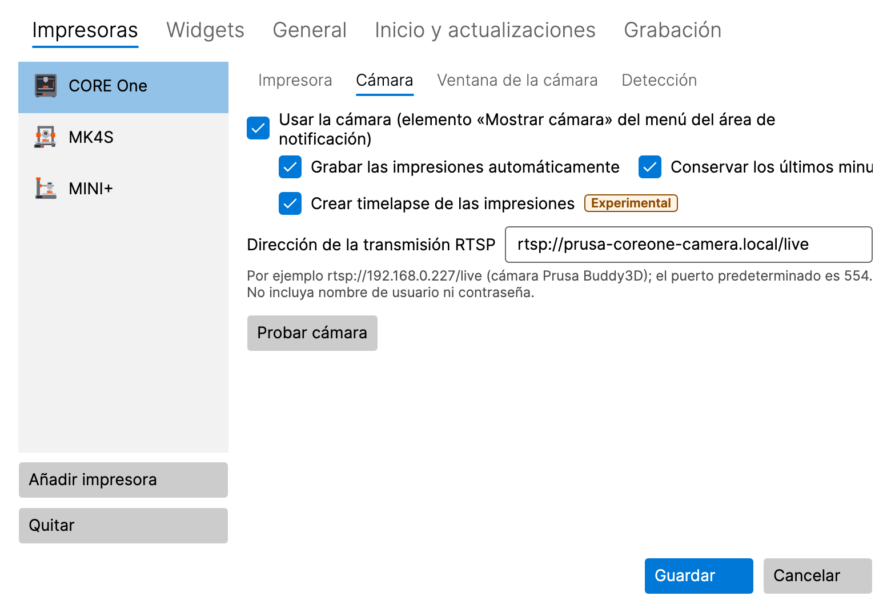
</p>

### 8.3 Dashcam: los últimos minutos

Active **Conservar últimos minutos (dashcam)** en la subpestaña **Cámara** de la impresora. Durante una impresión,
LayerPeek conserva en memoria los últimos 2 minutos de la cámara (unos 8 MB por minuto e impresora); no se escribe nada
en el disco hasta que se guardan. Los últimos minutos, junto con los 30 segundos posteriores al evento, se guardan:

- automáticamente ante un error de impresión, cuando la impresora requiere atención, cuando se detiene la impresión y
  cuando la detección de fallos de impresión da la alarma (cada caso se puede desactivar en la pestaña **Grabación**),
- a mano con **Guardar los últimos 2 min** en el submenú de la impresora o en el menú contextual de la ventana de la
  cámara.

La duración (1–10 minutos) se configura en la pestaña **Grabación**.

### 8.4 Timelapse (experimental)

Un timelapse es un vídeo corto de toda la impresión: de forma predeterminada, un fotograma cada 30 segundos, ninguno
mientras la impresión está en pausa, reproducido a 30 fotogramas por segundo. Se guarda como `…_timelapse.mp4` junto a
las grabaciones.

- **A mano:** **Iniciar timelapse (experimental)** / **Detener timelapse (experimental)** en el submenú de la impresora
  o el botón del cronómetro en la ventana de la cámara. **Reproducir último timelapse** está en el submenú.
- **Cada impresión:** **Crear timelapse de las impresiones** en la subpestaña **Cámara** de la impresora.
- **Intervalo:** en la pestaña **Grabación**, de 5 a 600 segundos, o cambie a **Cada N capas (estimación)**: un
  fotograma cada vez que empieza una capa nueva. PrusaLink no informa de las capas, así que LayerPeek las estima a
  partir de la altura del eje Z.
- **Crear timelapse desde una grabación… (experimental)** crea un timelapse a partir de una grabación de LayerPeek
  existente.
- **Exportar timelapse a JPEG… (experimental)** guarda los fotogramas de un timelapse como archivos JPEG numerados,
  p. ej. para su propia edición de vídeo.

Ambas conversiones muestran su progreso en el elemento del menú, donde también puede cancelarlas, y una notificación le
avisa cuando terminan.

### 8.5 Carpeta y límite de tamaño

En la pestaña **Grabación** puede cambiar la **Carpeta de grabaciones** y el **Límite de tamaño de todas las grabaciones
(GB)** (50 GB de forma predeterminada). Por encima del límite se eliminan las grabaciones más antiguas; con menos de
5 GB libres en la unidad, la grabación se detiene. Una grabación fallida muestra una notificación.

<p align="center">
  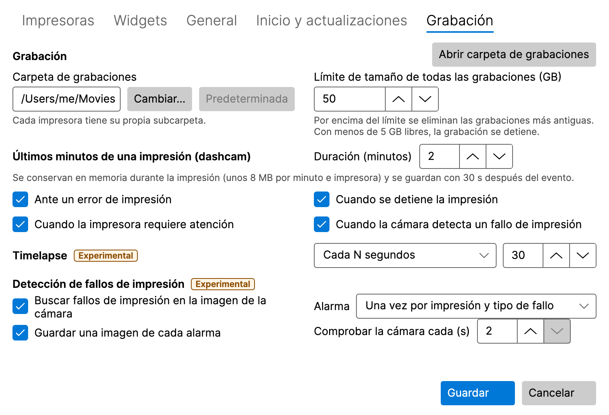
</p>

## 9. Detección de fallos de impresión (experimental)

LayerPeek puede vigilar una impresión a través de la cámara y avisarle cuando algo va mal en la base. Funciona solo en
su ordenador; la imagen de la cámara nunca sale de él.

<p align="center">
  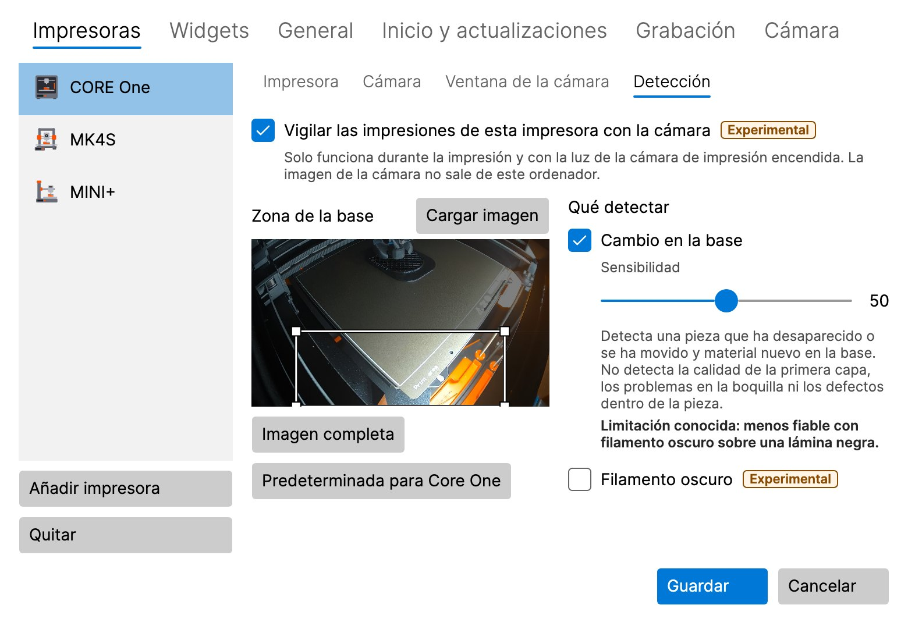
</p>

### 9.1 Activarla

Está desactivada de forma predeterminada y hay que activarla en dos lugares:

1. **Buscar fallos de impresión en la imagen de la cámara** en la pestaña **Grabación** (para todas las impresoras),
2. **Vigilar las impresiones de esta impresora con la cámara** en la subpestaña **Detección** de la impresora.

La impresora necesita tener la cámara activada. La detección solo funciona durante la impresión y con la luz interior
de la impresora encendida, también sin la ventana de la cámara abierta.

### 9.2 Zona de la base

La **Zona de la base** es la parte de la imagen que se vigila. Dibuje un rectángulo nuevo arrastrando, muévalo o cambie
su tamaño desde una esquina con el ratón, o use las teclas de flecha (Mayús + flechas cambian su tamaño). **Imagen
completa** vigila toda la imagen, **Cargar imagen** toma una imagen nueva de la cámara y, para una CORE One,
**Predeterminada para Core One** restablece su ajuste predefinido.

### 9.3 Detectores

- **Cambio en la base** detecta una pieza que ha desaparecido o se ha movido y material nuevo en la base (espaguetis,
  una pieza arrancada). **Filamento oscuro** ayuda con filamento negro o muy oscuro, a costa de más falsas alarmas.
- **Impresión en el aire** (desactivado de forma predeterminada, solo para impresoras cuya base baja durante la
  impresión: CORE One, CORE One L, XL) detecta que la impresora sigue imprimiendo pero ya no crece nada, p. ej. cuando
  se ha acabado el filamento.

**Sensibilidad** (0–100, 50 de forma predeterminada): un valor más alto significa más alarmas, también falsas; uno más
bajo significa menos alarmas, pero puede pasarse por alto un fallo.

### 9.4 La alarma

La alarma es una notificación **Posible fallo de impresión – …** con una instantánea de la cámara. Al hacer clic en
ella se abre la ventana de la cámara. El botón **Falsa alarma** guarda un registro local para el ajuste fino; nada sale
de su ordenador. En la pestaña **Grabación** se configura cada cuánto se repite la alarma, si se guarda una instantánea
de cada alarma y cada cuánto se revisa la cámara (2–5 segundos).

> [!WARNING]
> La detección no aprecia la calidad de la primera capa, los problemas en la boquilla ni los defectos dentro de la
> pieza. Puede pasar por alto un fallo o dar una falsa alarma. No confíe en ella como única protección de una impresión
> desatendida.

## 10. Diagnóstico

**Diagnóstico…** en el menú del icono (elija la impresora en la parte superior de la ventana) muestra el modelo y el
firmware de la impresora, el estado actual, las temperaturas de la boquilla y la base (actual y objetivo), los
ventiladores, la velocidad de impresión, el flujo y la altura Z, y un gráfico de temperaturas de los últimos
30 minutos, 2 horas o 24 horas. El historial se guarda solo en memoria y empieza cuando se inicia LayerPeek.

<p align="center">
  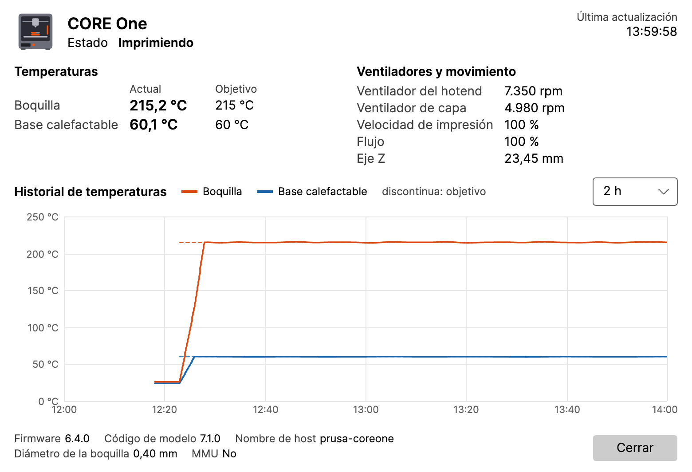
</p>

## 11. Referencia de la configuración

Abra **Configuración…** desde el menú del icono. Los cambios se aplican tras pulsar **Guardar**; **Cancelar** los
descarta.

### 11.1 Impresoras

La lista de impresoras con **Añadir impresora** y **Quitar**. Cada impresora tiene subpestañas:

- **Impresora:** nombre, dirección, nombre de usuario, contraseña, **Probar conexión**.
- **Cámara:** la dirección RTSP, **Probar cámara**, grabación automática, dashcam y timelapse de las impresiones.
- **Ventana de la cámara:** **Abrir como** (como la última vez, ventana normal, vista mini, pantalla completa), el
  monitor, el tamaño, la posición y **Siempre encima** de la ventana normal y de la vista mini, **Recordar la última
  posición y tamaño**, **Cerrar al apagarse la impresora y volver a abrir al encenderse**, y lo que muestra la franja de
  información de la vista mini.
- **Detección:** detección de fallos de impresión de esta impresora (consulte
  [9](#9-detección-de-fallos-de-impresión-experimental)).

### 11.2 Widgets

Los widgets de cada impresora, sus ajustes y la opacidad de las tarjetas (consulte [6](#6-widgets)).

### 11.3 Grabación

La carpeta y el límite de tamaño de las grabaciones, la dashcam, el timelapse y la detección de fallos de impresión
(consulte [8](#8-grabación-dashcam-y-timelapse) y [9](#9-detección-de-fallos-de-impresión-experimental)). Las funciones
experimentales llevan la etiqueta **Experimental**.

### 11.4 General

- **Notificaciones:** qué eventos, **Sonido**, el recordatorio de los minutos restantes, **Enviar notificación de
  prueba**.
- **Intervalo de consulta (segundos):** cada cuánto se pregunta a las impresoras por su estado.
- **Idioma:** **Idioma del sistema** o uno de estos: English, Čeština, Slovenčina, Deutsch, Español, Français, Italiano,
  Polski. Solo cambia los textos; los números, las fechas y las horas siguen la configuración regional de su sistema.
- **Registro detallado (Debug):** actívelo solo cuando se lo pidan durante la solución de un problema.

### 11.5 Inicio y actualizaciones

- **Windows:** **Iniciar al iniciar sesión en Windows**. Activado de forma predeterminada; disponible solo en la
  versión instalada, no en la versión ZIP.
- **macOS:** **Abrir al iniciar sesión**. Desactivado de forma predeterminada; disponible solo cuando LayerPeek está en
  la carpeta Aplicaciones. Si desactivó LayerPeek en **Ajustes del Sistema → General → Ítems de inicio y extensiones**,
  solo usted puede volver a permitirlo allí; el botón **Abrir Ajustes del Sistema** le lleva a ese lugar.
- **Buscar actualizaciones automáticamente**, **Ofrecer versiones preliminares** y **Comprobar ahora** (consulte
  [12](#12-actualizaciones)).

### 11.6 Cámara

Ajustes para todas las cámaras (la cámara de cada impresora se configura en su subpestaña **Cámara**, consulte
[11.1](#111-impresoras)).

- **Fotogramas de la vista mini:** cuántos fotogramas por segundo muestra la vista mini. **Ahorro** (5 fps),
  **Equilibrado** (10 fps, el valor predeterminado) o **Fluido** (todos los fotogramas de la cámara); con el control
  deslizante se fija otro límite de 1 a 30 fps (**Personalizado**). Menos fotogramas suponen menos carga de CPU y menos
  datos copiados; la cámara se sigue leyendo completa, así que las grabaciones, los timelapses y la detección de errores
  de impresión no cambian. La ventana normal y la pantalla completa muestran siempre todos los fotogramas. El cambio se
  aplica a una vista mini abierta después de **Guardar**.

## 12. Actualizaciones

Poco después del inicio y luego una vez al día, LayerPeek pregunta a GitHub si se ha publicado una nueva versión (puede
desactivarlo). Una nueva versión aparece como **Nueva versión X.Y.Z disponible** en el menú del icono y una vez como
notificación.

- **Windows, versión instalada:** el elemento del menú descarga la actualización, cierra LayerPeek e inicia la nueva
  versión.
- **Windows, versión ZIP:** el elemento del menú abre la página de la versión; descargue el nuevo ZIP a mano.
- **macOS:** el elemento del menú descarga la actualización y reinicia LayerPeek, pero solo cuando la app está en
  **Aplicaciones** (no en la imagen de disco ni en Descargas).

Su configuración y sus contraseñas se conservan.

**Actualización rechazada:** la versión instalada solo acepta una actualización cuando puede verificar su firma. Si no
puede, LayerPeek no instala nada: muestra una notificación (una vez por cada versión ofrecida; al hacer clic se abre la
configuración) y un error en la pestaña **Inicio y actualizaciones**, y el menú del icono muestra **Actualización
rechazada…** en lugar de la nueva versión (la notificación de la nueva versión se retira). Así sigue hasta que una
comprobación posterior tenga éxito: entonces la nueva versión se vuelve a ofrecer y su notificación aparece una vez más.
No instale esa versión a mano, la propia versión publicada podría estar manipulada: espere a la próxima versión o siga
los anuncios del proyecto.

## 13. Dónde se guardan sus datos

| Qué | Windows | macOS |
|---|---|---|
| Configuración | `%APPDATA%\LayerPeek\settings.json` | `~/Library/Application Support/LayerPeek/settings.json` |
| Contraseñas | Administrador de credenciales de Windows | llavero de inicio de sesión |
| Registros | `%LOCALAPPDATA%\LayerPeek\logs` | `~/Library/Logs/LayerPeek` |
| Grabaciones | `Videos\LayerPeek` | `Movies/LayerPeek` |

El historial de temperaturas se guarda solo en memoria. LayerPeek se conecta únicamente a las impresoras y cámaras que
usted añada y, salvo que desactive la búsqueda de actualizaciones, a GitHub (la lista de versiones, sin ninguna cuenta,
y la descarga de una actualización que usted inicie). No hay telemetría.

## 14. Proteger el acceso a PrusaLink

PrusaLink en la impresora solo habla **HTTP** sin cifrar; la propia impresora no ofrece HTTPS. Prusa diseña PrusaLink
para la red local y desaconseja acceder a él desde internet mediante una redirección de puertos en el router; en su
lugar recomienda una VPN cifrada. En una red doméstica que solo usa usted, esto suele bastar. Siga leyendo si otras
personas o dispositivos comparten la red entre su ordenador y la impresora (Wi-Fi compartida, oficina, taller,
residencia) o si quiere acceder a la impresora desde fuera.

Una dirección de impresora `http://` o una dirección de cámara que puede estar fuera de la red local recibe una
advertencia en los ajustes (véase [3.2 Añadir la impresora](#32-añadir-la-impresora)); se puede guardar igualmente.

### 14.1 En qué consiste el riesgo

- **Cualquiera que pueda ver el tráfico** entre su ordenador y la impresora puede leerlo: el estado de la impresora, los
  nombres de archivo y el G-code subido a través de la interfaz web de PrusaLink.
- **El inicio de sesión:** LayerPeek inicia sesión con HTTP Digest, el único inicio de sesión que ofrece la impresora
  además de la clave API. La contraseña no se envía, pero el Digest de la impresora es la variante antigua con MD5 (RFC
  2069). Con un inicio de sesión capturado, un atacante puede intentar adivinar la contraseña sin conexión y, durante
  hasta 5 minutos, repetir la misma petición capturada. Digest no protege el contenido: quien pueda modificar el tráfico
  puede modificar los datos.
- **La clave API:** las herramientas que inician sesión con la clave API (la cabecera `X-Api-Key`) envían la propia
  contraseña de PrusaLink, legible para cualquiera que escuche. En PrusaSlicer elija **HTTP digest** en lugar de la
  clave API.
- **Con la contraseña**, cualquiera controla la impresora a través de PrusaLink: inicia y detiene impresiones, sube y
  borra archivos.

### 14.2 La contraseña

La impresora genera la contraseña por sí misma; el firmware actual la forma con 15 caracteres aleatorios de entre 57
letras y cifras (sin los fáciles de confundir 0, O, 1, l e I). Adivinar una contraseña así a partir de un inicio de
sesión capturado no es viable en la práctica. En las impresoras con firmware Buddy no puede escribir su propia
contraseña; solo puede generar una nueva.

Genere una contraseña nueva siempre que la anterior pueda haberse filtrado (una foto compartida de la pantalla o del
código QR de PrusaLink, que contiene la contraseña, o la clave API usada en una red no fiable):

1. En la impresora abra **Settings → Network → PrusaLink** (Ajustes → Red → PrusaLink) y elija **Generate Password**
   (Generar Contraseña).
2. En LayerPeek abra **Configuración → Impresoras**, seleccione la impresora, escriba la contraseña nueva en
   **Contraseña** en la subpestaña **Impresora**, haga clic en **Probar conexión** y en **Guardar**.
3. Cámbiela también en otras herramientas que usen PrusaLink (PrusaSlicer y otras).

### 14.3 Una red separada y el cortafuegos

- Coloque las impresoras y las cámaras en una **red separada** de su router (para dispositivos IoT, una VLAN). Permita
  que el ordenador con LayerPeek llegue a ellas: el puerto TCP **80** de la impresora (PrusaLink) y el puerto RTSP de la
  cámara (**554** por defecto). Las redes de invitados suelen bloquear las conexiones entre dispositivos; consulte el
  manual de su router.
- **Nunca redirija un puerto del router** a la impresora. Para acceder desde fuera, conéctese a su red doméstica
  mediante una VPN.
- LayerPeek no ofrece nada a la red: **Abrir PrusaLink** escucha solo en `127.0.0.1` de su ordenador. El cortafuegos de
  su ordenador no necesita ninguna regla nueva para LayerPeek.

### 14.4 HTTPS mediante un proxy inverso

Un pequeño ordenador junto a la impresora (por ejemplo, una Raspberry Pi) ejecuta un proxy inverso, **Caddy** o
**nginx**. LayerPeek se comunica con el proxy por HTTPS; solo el proxy habla con la impresora por HTTP sin cifrar.
Conecte el proxy y la impresora con un cable corto o al mismo switch y, si su router lo permite, deje que solo el proxy
llegue a la impresora.

- En LayerPeek introduzca la dirección del proxy como dirección de la impresora, p. ej. `https://printer.home.arpa`. El
  nombre debe llevar al proxy (una entrada DNS en el router o el archivo `hosts`).
- Use **un nombre de host o un puerto por impresora**, no una ruta como `https://proxy/mk4/`. La impresora comprueba el
  inicio de sesión según la ruta de la petición, así que un proxy que elimina ese prefijo hace que la impresora rechace
  la contraseña.
- La cámara (RTSP) no pasa por el proxy; LayerPeek se conecta a ella directamente.

**Caddy** (el archivo `Caddyfile`, `192.168.1.20` es la impresora):

```caddyfile
printer.home.arpa {
	tls internal
	reverse_proxy 192.168.1.20
}
```

Con `tls internal`, Caddy emite el certificado desde su propia autoridad de certificación (CA). Confíe en su certificado
raíz en su ordenador (vea [14.5](#145-confiar-en-el-certificado-en-su-ordenador)); cuando Caddy se ejecuta como servicio
de Linux, el archivo es `/var/lib/caddy/.local/share/caddy/pki/authorities/local/root.crt`. Caddy transmite la ruta y
las cabeceras de inicio de sesión sin cambios.

**nginx** (un bloque `server`, p. ej. en `/etc/nginx/conf.d/printer.conf`):

```nginx
server {
    listen 443 ssl;
    server_name printer.home.arpa;
    ssl_certificate     /etc/nginx/tls/printer.crt;
    ssl_certificate_key /etc/nginx/tls/printer.key;
    client_max_body_size 0;

    location / {
        proxy_pass http://192.168.1.20;
    }
}
```

`proxy_pass` sin ruta transmite la ruta sin cambios. `client_max_body_size 0` elimina el límite de 1 MB para que
funcione la subida de G-code a través de la interfaz web de PrusaLink. nginx necesita un certificado de su propia CA,
creado por ejemplo con OpenSSL:

```sh
openssl req -x509 -newkey rsa:3072 -nodes -days 3650 -subj "/CN=Printer proxy CA" \
  -addext "basicConstraints=critical,CA:TRUE" -addext "keyUsage=critical,keyCertSign,cRLSign" \
  -keyout ca.key -out ca.crt
openssl req -newkey rsa:3072 -nodes -subj "/CN=printer.home.arpa" -keyout printer.key -out printer.csr
printf "subjectAltName=DNS:printer.home.arpa\nextendedKeyUsage=serverAuth\n" > printer.ext
openssl x509 -req -in printer.csr -CA ca.crt -CAkey ca.key -CAcreateserial -days 825 \
  -extfile printer.ext -out printer.crt
```

Copie `printer.crt` y `printer.key` al proxy y `ca.crt` a sus ordenadores; guarde `ca.key` en un lugar seguro y fuera de
la red. El certificado del servidor es válido 825 días, lo máximo que acepta macOS.

### 14.5 Confiar en el certificado en su ordenador

LayerPeek solo acepta certificados en los que confía su sistema. Un certificado autofirmado, o uno de una CA que el
sistema no conoce, falla: **Probar conexión** indica *«La conexión segura (https) ha fallado. Pruebe la dirección con
http:// o compruebe el certificado de la impresora.»*, la impresora aparece **Sin conexión** y **Diagnóstico** muestra
*«Falló la conexión segura (https) con la impresora.»* LayerPeek no puede confiar por sí mismo en un certificado
concreto; añada el certificado de su CA (`ca.crt` o el `root.crt` de Caddy) al sistema:

- **Windows:** pulse **Win+R**, ejecute `certmgr.msc`, haga clic con el botón derecho en **Entidades de certificación
  raíz de confianza → Certificados** (Trusted Root Certification Authorities → Certificates), elija **Todas las tareas →
  Importar…** e importe el archivo en **Entidades de certificación raíz de confianza**; confirme la advertencia de
  seguridad. O en un terminal: `certutil -user -addstore Root ca.crt`.
- **macOS:** abra **Acceso a Llaveros** (búsquelo con Spotlight), seleccione el llavero **Inicio de sesión** (login) y
  arrastre el archivo a la ventana. Haga doble clic en el certificado, abra **Confiar** y ajuste **Al utilizar este
  certificado** en **Confiar siempre** (Always Trust); confirme con su contraseña.

Después ejecute de nuevo **Probar conexión**.

Fuentes: PrusaLink [en la red local](https://help.prusa3d.com/article/prusa-connect-and-prusalink-explained_302608),
[redirección de puertos y VPN](https://help.prusa3d.com/article/prusalink-sl1-sl1s_146094), [HTTP digest en
PrusaSlicer](https://help.prusa3d.com/article/prusalink-troubleshooting_304411); firmware: [puerto 80 sin
TLS](https://github.com/prusa3d/Prusa-Firmware-Buddy/blob/7d8bf6858b363c453c0617bceab5e66997d8fc25/lib/WUI/http_lifetime.cpp),
[Digest y clave
API](https://github.com/prusa3d/Prusa-Firmware-Buddy/blob/7d8bf6858b363c453c0617bceab5e66997d8fc25/lib/WUI/nhttp/req_parser.cpp),
[validez del
nonce](https://github.com/prusa3d/Prusa-Firmware-Buddy/blob/7d8bf6858b363c453c0617bceab5e66997d8fc25/src/common/http/types.h),
[generación de la
contraseña](https://github.com/prusa3d/Prusa-Firmware-Buddy/blob/7d8bf6858b363c453c0617bceab5e66997d8fc25/lib/WUI/wui.cpp)
y
[longitud](https://github.com/prusa3d/Prusa-Firmware-Buddy/blob/7d8bf6858b363c453c0617bceab5e66997d8fc25/src/persistent_stores/store_instances/config_store/constants.hpp),
[menú
PrusaLink](https://github.com/prusa3d/Prusa-Firmware-Buddy/blob/7d8bf6858b363c453c0617bceab5e66997d8fc25/src/gui/screen_prusa_link.cpp);
[RFC 2069](https://www.rfc-editor.org/rfc/rfc2069); [Caddy
`reverse_proxy`](https://caddyserver.com/docs/caddyfile/directives/reverse_proxy),
[`tls`](https://caddyserver.com/docs/caddyfile/directives/tls), [directorio de
datos](https://caddyserver.com/docs/running); [nginx
`proxy_pass`](https://nginx.org/en/docs/http/ngx_http_proxy_module.html#proxy_pass),
[`client_max_body_size`](https://nginx.org/en/docs/http/ngx_http_core_module.html#client_max_body_size); [requisitos de
Apple para certificados](https://support.apple.com/en-us/103769), [Acceso a
Llaveros](https://support.apple.com/guide/keychain-access/change-the-trust-settings-of-a-certificate-kyca11871/mac);
[certutil](https://learn.microsoft.com/en-us/windows-server/administration/windows-commands/certutil).

## 15. Solución de problemas

**El icono no se ve (Windows).** Haga clic en la flecha **`^`** del área de notificación y arrastre el icono de
LayerPeek a la barra de tareas.

**La impresora está Sin conexión.** Compruebe que la impresora está encendida y conectada a la red, que la dirección es
correcta (pruébela en un navegador) y que su ordenador está en la misma red. Ejecute **Probar conexión** en la
configuración de la impresora.

**Credenciales no válidas.** Vuelva a introducir el nombre de usuario y la contraseña de **Settings → Network →
PrusaLink** (Ajustes → Red → PrusaLink) de la impresora y guarde.

**La conexión segura (https) ha fallado.** La dirección de la impresora empieza por `https://`. O bien apunta
directamente a la impresora, que no ofrece HTTPS (use `http://`), o bien su sistema no confía en el certificado del
proxy: vea [14.5](#145-confiar-en-el-certificado-en-su-ordenador).

**No hay conexión en macOS.** Es posible que el acceso a la Red local esté desactivado. En ese caso LayerPeek ofrece
**Abrir Ajustes del Sistema**; active LayerPeek en **Ajustes del Sistema → Privacidad y seguridad → Red local**.

**La cámara muestra Sin señal.** Compruebe la dirección RTSP con **Probar cámara**, y que la cámara está encendida y
accesible. No ponga ningún nombre de usuario ni contraseña en la dirección.

**No aparecen las notificaciones.** Use **Enviar notificación de prueba** en **Configuración → General** y compruebe
**No molestar** (Windows) o los **Modos de concentración** (macOS).

**Informar de un error.** Abra **Acerca de** desde el menú del icono:

- **Guardar paquete de diagnóstico…** guarda un archivo ZIP con los registros, la versión, la información del sistema y
  la configuración, **sin contraseñas ni claves**. Adjúntelo a su informe de error.
- **Copiar información al portapapeles** copia un informe breve.
- **Abrir carpeta de registros** abre los registros.

Si le piden un registro detallado, active **Registro detallado (Debug)** en **Configuración → General**, repita el
problema, guarde el paquete y vuelva a desactivar el registro detallado.

Informe de errores y comparta ideas en las [issues](https://github.com/pfoltynek/LayerPeek/issues) de GitHub. Indique
el modelo de su impresora, la versión del firmware y el sistema operativo.

## 16. Desinstalación

- **Windows, versión instalada:** **Configuración → Aplicaciones → Aplicaciones instaladas → LayerPeek → Desinstalar**.
- **Windows, versión ZIP:** salga de LayerPeek y elimine su carpeta.
- **macOS:** salga de LayerPeek (**Salir** en su menú) y mueva **LayerPeek** de **Aplicaciones** a la Papelera.

La desinstalación conserva su configuración, sus contraseñas y sus grabaciones. Para eliminarlas también, borre las
carpetas de [13](#13-dónde-se-guardan-sus-datos) y las entradas de LayerPeek en el Administrador de credenciales
(Windows) o en Acceso a Llaveros (macOS).
