# Manuel d'utilisation de LayerPeek

*Pour LayerPeek 0.5 sous Windows 10/11 et macOS (Apple Silicon).* · [Autres langues](../README.md)

LayerPeek surveille vos imprimantes 3D Prusa via votre réseau local et affiche leur état dans la zone de notification de
Windows ou dans la barre des menus de macOS. Il n'a pas de fenêtre principale : tout part du menu de son icône. Ce manuel
décrit les deux systèmes ; là où Windows et macOS diffèrent, le texte le précise ou montre les deux variantes.

> [!NOTE]
> LayerPeek est un projet communautaire indépendant, et non un produit officiel de Prusa Research.

## Sommaire

1. [Ce dont vous avez besoin](#1-ce-dont-vous-avez-besoin)
2. [Installation](#2-installation)
3. [Premiers pas](#3-premiers-pas)
4. [L'icône et son menu](#4-licône-et-son-menu)
5. [Fenêtre de la caméra](#5-fenêtre-de-la-caméra)
6. [Widgets](#6-widgets)
7. [Notifications](#7-notifications)
8. [Enregistrement, dashcam et timelapse](#8-enregistrement-dashcam-et-timelapse)
9. [Détection des échecs d'impression (expérimental)](#9-détection-des-échecs-dimpression-expérimental)
10. [Diagnostic](#10-diagnostic)
11. [Référence des paramètres](#11-référence-des-paramètres)
12. [Mises à jour](#12-mises-à-jour)
13. [Où sont stockées vos données](#13-où-sont-stockées-vos-données)
14. [Dépannage](#14-dépannage)
15. [Désinstallation](#15-désinstallation)

## 1. Ce dont vous avez besoin

- **Une imprimante Prusa avec le firmware Buddy 6.x et PrusaLink** : CORE One (testée), MK4/MK4S, MK3.9/MK3.9S,
  MK3.5/MK3.5S, XL et MINI/MINI+. L'Original Prusa MK3/MK3S n'intègre pas PrusaLink et n'est pas prise en charge.
- **Un ordinateur sur le même réseau local** que l'imprimante :
  - Windows 10 ou 11, x64 (Windows sur ARM n'est pas pris en charge),
  - macOS sur Apple Silicon (M1 ou plus récent).
- **Une caméra (facultatif) :** n'importe quelle caméra avec un flux **RTSP H.264** accessible depuis votre ordinateur,
  par exemple la caméra Prusa Buddy3D. Sans caméra, vous avez quand même l'icône, les notifications et le diagnostic.

LayerPeek fonctionne uniquement sur votre réseau local. Il n'utilise ni Prusa Connect ni aucun autre service cloud. Loin
de chez vous, vous pouvez accéder aux imprimantes via un VPN vers votre réseau domestique.

Pour l'instant, seule la CORE One a été testée. Vous avez un autre modèle ? Envoyez un court [rapport de compatibilité de l'imprimante](https://github.com/pfoltynek/LayerPeek/issues/new?template=printer_compatibility.yml) (formulaire en anglais) ; un seul essai sous Windows ou macOS suffit.

## 2. Installation

Téléchargez la dernière version depuis la page [Releases](https://github.com/pfoltynek/LayerPeek/releases).

> [!IMPORTANT]
> Les versions 0.x sont des préversions et ne sont ni signées par Microsoft ni notariées par Apple. Votre système vous
> avertit donc au premier démarrage ; les étapes ci-dessous expliquent comment passer outre.

### 2.1 Windows

Vous avez le choix entre deux paquets :

| Paquet | Ce qu'il fait |
|---|---|
| **Programme d'installation** `LayerPeek-X.Y.Z-win-x64-Setup.exe` (recommandé) | Installe LayerPeek pour votre seul utilisateur, sans droits d'administrateur, dans `%LOCALAPPDATA%\LayerPeek`, l'ajoute au menu Démarrer, le lance après l'ouverture de session et peut se mettre à jour tout seul. |
| **ZIP** `LayerPeek-X.Y.Z-win-x64.zip` | Décompressez-le où vous voulez et lancez `LayerPeek.exe`. Il ne démarre pas après l'ouverture de session et ne se met pas à jour tout seul (il ouvre la page de la version à la place). |

Au premier démarrage, Windows SmartScreen affiche **« Windows a protégé votre ordinateur »** avec un *Éditeur inconnu*.
Cliquez sur **Informations complémentaires**, puis sur **Exécuter quand même**.

### 2.2 macOS

| Paquet | Ce qu'il fait |
|---|---|
| **Image disque** `LayerPeek-X.Y.Z-osx-arm64.dmg` (recommandé) | Ouvrez-la et faites glisser **LayerPeek** dans **Applications**. |
| **Archive** `LayerPeek-X.Y.Z-osx-arm64.tar.gz` | Contient `LayerPeek.app` ; décompressez-la et déplacez l'app dans **Applications**. |

Lancez toujours LayerPeek depuis **Applications**, et non directement depuis l'image disque ou le dossier
Téléchargements : c'est seulement là qu'il peut s'ouvrir avec la session et se mettre à jour.

Au premier démarrage, Gatekeeper bloque l'app (*« Apple n'a pas pu vérifier… »*) :

1. Cliquez sur **Terminé**.
2. Ouvrez **Réglages Système → Confidentialité et sécurité**, faites défiler vers le bas et cliquez sur
   **Ouvrir quand même** à côté du message concernant LayerPeek.
3. Confirmez avec votre mot de passe ou Touch ID et ouvrez de nouveau LayerPeek.

Les utilisateurs avancés peuvent plutôt supprimer l'attribut de quarantaine dans le Terminal :
`xattr -dr com.apple.quarantine /Applications/LayerPeek.app`.

LayerPeek vit uniquement dans la barre des menus. Il n'a pas d'icône dans le Dock et n'apparaît pas dans le sélecteur
d'apps (⌘⇥).

## 3. Premiers pas

### 3.1 Activer PrusaLink sur l'imprimante

Sur l'écran de l'imprimante, ouvrez **Settings → Network → PrusaLink** (Paramètres → Réseau → PrusaLink). Vérifiez que
PrusaLink est activé et notez :

- l'**adresse IP** de l'imprimante (ou son nom d'hôte),
- le **nom d'utilisateur** (par défaut `maker`),
- le **mot de passe**.

### 3.2 Ajouter l'imprimante

1. Trouvez l'icône de LayerPeek :
   - **Windows :** dans la zone de notification, à l'extrémité droite de la barre des tâches. Si vous ne la voyez pas,
     cliquez sur la flèche **`^`** (Afficher les icônes cachées) et faites glisser l'icône sur la barre des tâches pour
     qu'elle reste visible.
   - **macOS :** dans la barre des menus, en haut de l'écran.
2. Ouvrez le menu de l'icône (**Windows :** clic droit sur l'icône, **macOS :** clic sur l'icône) et choisissez
   **Ajouter une imprimante…**. La fenêtre **Paramètres** s'ouvre sur l'onglet **Imprimantes**.
3. Remplissez :
   - **Nom :** le nom de votre choix, p. ex. `CORE One`.
   - **Adresse :** une adresse IP ou un nom d'hôte, p. ex. `192.168.1.20` ou `http://prusa-mk4.local`.
   - **Nom d'utilisateur** et **Mot de passe :** les valeurs de l'imprimante.
4. Cliquez sur **Tester la connexion**. Une connexion qui fonctionne indique le code du modèle et la version du firmware.
5. Cliquez sur **Enregistrer**.

  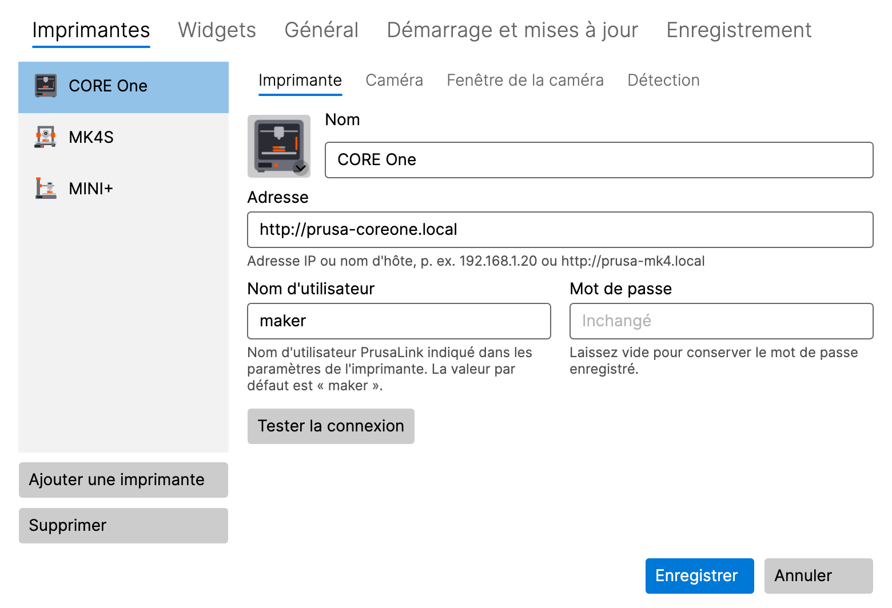

L'icône affiche aussitôt l'état de l'imprimante. Ajoutez d'autres imprimantes de la même façon : **Ajouter une
imprimante** dans l'onglet **Imprimantes**.

**macOS 15 et versions ultérieures :** la première connexion à une imprimante ou à une caméra demande l'accès au
**Réseau local**. Cliquez sur **Autoriser**. Si vous l'avez refusé, consultez [Dépannage](#14-dépannage).

Le mot de passe est stocké dans le **Gestionnaire d'identification** de Windows (Credential Manager) ou dans le
**Trousseau** de macOS (Keychain), jamais dans le fichier de paramètres. Lorsque vous modifiez une imprimante plus tard,
le champ du mot de passe affiche **Inchangé** ; laissez-le vide pour conserver le mot de passe enregistré.

### 3.3 Ajouter la caméra (facultatif)

1. Dans **Paramètres → Imprimantes**, sélectionnez l'imprimante et ouvrez son sous-onglet **Caméra**.
2. Activez **Utiliser la caméra (élément « Afficher la caméra » du menu de la zone de notification)**.
3. Saisissez l'**Adresse du flux RTSP**, p. ex. `rtsp://192.168.1.21/live` pour la caméra Buddy3D (le port par défaut
   est 554). Ne mettez ni nom d'utilisateur ni mot de passe dans l'adresse.
4. Cliquez sur **Tester la caméra**. Une caméra qui fonctionne affiche une image et sa résolution.
5. Cliquez sur **Enregistrer** et choisissez **Afficher la caméra** dans le sous-menu de l'imprimante.

### 3.4 Image de l'imprimante

La liste des imprimantes affiche une image de chaque imprimante, choisie automatiquement selon son modèle. Cliquez sur
l'image pour choisir un autre modèle, une illustration générique ou votre propre image (PNG, JPG).

## 4. L'icône et son menu

### 4.1 Ce que montre l'icône

L'icône affiche l'état le plus important de toutes vos imprimantes :

| État | Signification |
|---|---|
| **Prête** | l'imprimante est inactive |
| **Impression en cours** | l'icône se remplit au fil de l'impression |
| **En pause** | l'impression est en pause |
| **Terminé** / **Arrêté** | l'impression est finie |
| **Intervention requise** | l'imprimante vous attend (p. ex. un changement de filament ou une question sur son écran) |
| **Erreur** | l'imprimante signale une erreur |
| **Hors ligne** | l'imprimante est injoignable |
| **Identifiants non valides** | l'imprimante a refusé le nom d'utilisateur ou le mot de passe |

Survolez l'icône avec la souris pour voir les détails dans son info-bulle : la progression, le temps restant et le nom
du fichier. Pendant l'enregistrement de la caméra d'une imprimante, l'info-bulle indique **Enregistrement en cours**.

### 4.2 Le menu

- **Windows :** clic droit sur l'icône.
- **macOS :** clic sur l'icône dans la barre des menus.

Le menu contient :

- **Un sous-menu par imprimante**, dont l'en-tête affiche le nom, l'état et la progression de l'imprimante, avec :
  - **Afficher la caméra** / **Masquer la caméra**, et **Mettre la caméra au premier plan** tant que la fenêtre est
    ouverte,
  - **Enregistrer** / **Arrêter l'enregistrement**, **Lire le dernier enregistrement**, **Ouvrir le dossier des
    enregistrements**,
  - **Sauvegarder les 2 dernières min** (quand la dashcam est activée, voir [8.3](#83-dashcam--les-dernières-minutes)),
  - les éléments du timelapse (expérimental, voir [8.4](#84-timelapse-expérimental)),
  - **Ouvrir PrusaLink** : ouvre l'interface web PrusaLink de l'imprimante dans votre navigateur, déjà connecté. Votre
    mot de passe n'est jamais transmis au navigateur.
- **Diagnostic…** (voir [10](#10-diagnostic))
- **Paramètres…**
- **Nouvelle version X.Y.Z disponible** (uniquement quand une mise à jour est disponible, voir [12](#12-mises-à-jour))
- **Manuel d'utilisation**: ouvre ce manuel
- **À propos**
- **Quitter**

Tant que vous n'avez pas ajouté de première imprimante, le menu propose **Ajouter une imprimante…** à la place des
sous-menus des imprimantes.

## 5. Fenêtre de la caméra

  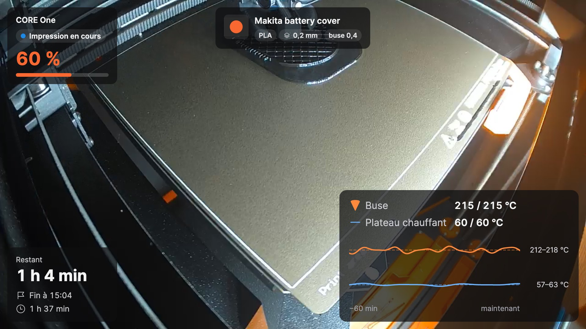

Ouvrez-la avec **Afficher la caméra** dans le sous-menu de l'imprimante. La fenêtre affiche l'image en direct de la
caméra avec des [widgets](#6-widgets) par-dessus. Les boutons de la fenêtre apparaissent lorsque vous la survolez avec
la souris.

### 5.1 Trois modes

| Mode | Comment basculer | À quoi il sert |
|---|---|---|
| **Fenêtre normale** | bouton dans la fenêtre, ou double-clic dans le mini-aperçu | pour bien regarder, à n'importe quelle taille, sur n'importe quel écran |
| **Mini-aperçu** | bouton **Petit aperçu, toujours au premier plan** | une petite fenêtre qui reste au-dessus des autres fenêtres toute la journée |
| **Plein écran** | **Windows :** F11 · **macOS :** ⌃⌘F · ou double-clic sur l'image ; **Esc** pour revenir | l'écran entier |

Le mini-aperçu comporte un bandeau d'informations sous l'image (progression, temps restant, heure de fin). Deux boutons
déplient des lignes supplémentaires : le **nom de l'impression** et le **graphique des températures**. Le contenu du
bandeau se règle dans le sous-onglet **Fenêtre de la caméra** de l'imprimante (voir [11.1](#111-imprimantes)).

  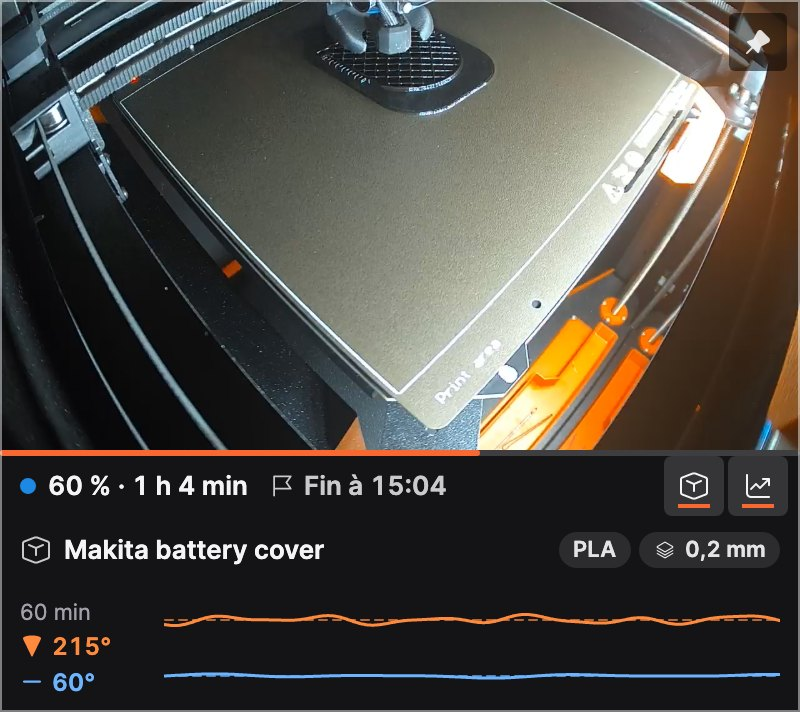

### 5.2 Toujours au premier plan

Le bouton en forme d'épingle de la fenêtre indique si la fenêtre reste au-dessus des autres fenêtres et permet de
basculer d'un simple clic. La même option se trouve dans le menu contextuel de la fenêtre (**Toujours au premier
plan**).

### 5.3 Menu contextuel de la fenêtre

Faites un clic droit sur l'image (sur macOS, également Contrôle-clic) pour accéder à **Modifier la disposition**,
**Toujours au premier plan**, à l'enregistrement, à la dashcam et au timelapse.

### 5.4 Quand la connexion est coupée

La fenêtre se reconnecte d'elle-même quand la caméra ou le Wi-Fi décroche ; entre-temps, elle affiche **Connexion à la
caméra…** ou **Pas de signal**. Quand l'imprimante est éteinte, la fenêtre se ferme, puis se rouvre au même endroit
quand l'imprimante est de retour. Vous pouvez désactiver ce comportement dans **Paramètres → Imprimantes → Fenêtre de la
caméra** (**Fermer quand l'imprimante s'éteint, rouvrir quand elle est rallumée**). Une fenêtre que vous fermez
vous-même reste fermée.

## 6. Widgets

Les widgets sont les cartes affichées par-dessus l'image de la caméra. Chaque imprimante a son propre jeu de widgets et
sa propre disposition.

| Widget | Affiche |
|---|---|
| **État** | le nom de l'imprimante, son état et la progression en pourcentage |
| **Temps** | le temps restant, l'heure de fin de l'impression, la durée d'impression |
| **Températures** | la buse et le plateau (réelle / cible) avec un graphique des 60 dernières minutes |
| **Nom de l'impression** | le nom de fichier lisible avec le matériau, la hauteur de couche et la buse ; les grandes tailles ajoutent l'aperçu du G-code |
| **Refroidissement** | après l'impression : à quel point la buse et le plateau ont refroidi et quand l'imprimante peut être éteinte sans risque |

Chaque widget existe en trois tailles : **S**, **M** et **L**. Ici, les températures : S affiche les valeurs, M ajoute
le graphique, L les libellés et la plage de températures.

  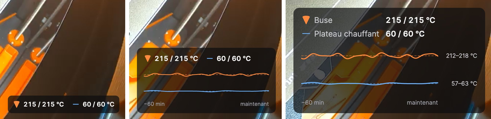

### 6.1 Choisir les widgets

Dans **Paramètres → Widgets**, choisissez l'imprimante en haut et cochez les widgets souhaités. Sélectionner un widget
affiche ses propres réglages, p. ex. les seuils de refroidissement de la buse et du plateau. **Disposition pour toutes
les imprimantes** copie la disposition vers vos autres imprimantes. **Opacité du fond des cartes** garde le texte
lisible sur une image claire (pour toutes les imprimantes).

  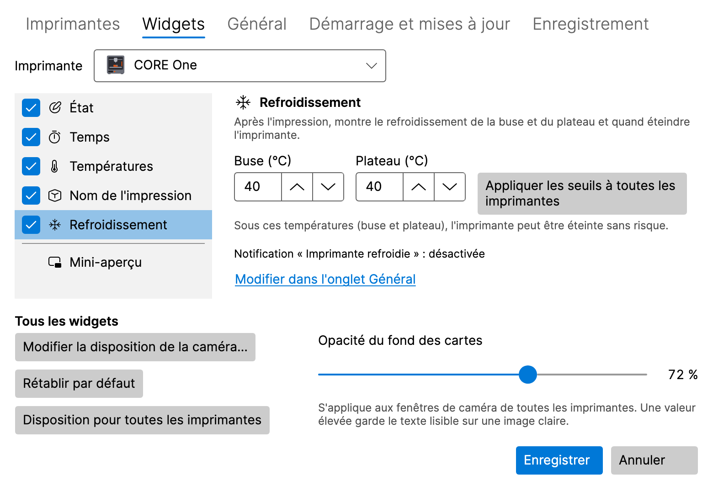

### 6.2 Disposer les widgets dans la fenêtre de la caméra

Cliquez sur **Modifier la disposition** dans la fenêtre de la caméra (ou sur **Modifier la disposition de la caméra…**
dans **Paramètres → Widgets**). En mode disposition :

- **faites glisser** un widget vers l'un des six emplacements (en haut et en bas, à gauche, au centre et à droite),
- cliquez sur un widget pour ouvrir ses options : **Taille** (Petite, Moyenne, Grande) et **Mettre en évidence**
  (affiche la valeur clé dans la couleur d'accentuation),
- **Rétablir par défaut** restaure la disposition par défaut, **Terminé** l'enregistre.

Au clavier : **Espace** soulève un widget, les **flèches** le déplacent, **Entrée** ouvre ses options et **Esc** annule
les modifications. Si la fenêtre est trop petite, agrandissez-la d'abord.

  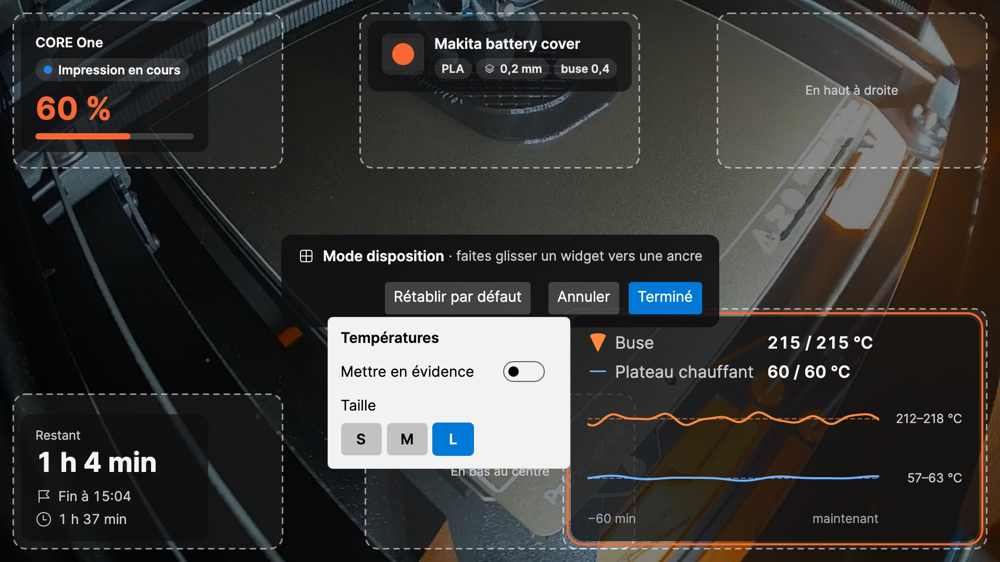

## 7. Notifications

LayerPeek affiche des notifications natives du système pour les événements suivants (chacun peut être activé ou
désactivé dans **Paramètres → Général**) :

- impression démarrée, terminée, en pause, reprise et arrêtée,
- l'imprimante requiert une intervention (y compris un mot de passe refusé), une erreur,
- l'imprimante est hors ligne ou de nouveau en ligne,
- **Temps restant : N min**, pour que vous soyez près de l'imprimante quand l'impression se termine (**Notifier
  lorsqu'il reste ce nombre de minutes d'impression**, 0 = désactivé),
- **Imprimante refroidie** : la buse et le plateau sont sous les seuils du widget **Refroidissement** et l'imprimante
  peut être éteinte sans risque.

Le **Son** peut être désactivé, activé uniquement pour les notifications importantes ou activé pour toutes les
notifications. **Envoyer une notification de test** affiche un exemple, pour vérifier que les notifications vous
parviennent bien.

- **Windows :** si les notifications de LayerPeek sont désactivées dans **Paramètres → Système → Notifications**, les
  paramètres de LayerPeek l'indiquent et proposent **Ouvrir les paramètres de notification**. Vérifiez aussi **Ne pas
  déranger**.
- **macOS :** la première notification demande l'autorisation ; cliquez sur **Autoriser**. Si les notifications sont
  désactivées dans **Réglages Système → Notifications**, les paramètres de LayerPeek proposent **Ouvrir les réglages
  Notifications**. Vérifiez aussi **Concentration**.

Cliquer sur une notification d'imprimante ouvre l'interface web PrusaLink de l'imprimante. Une alerte d'échec
d'impression ouvre la fenêtre de la caméra, un enregistrement échoué ouvre l'onglet **Enregistrement** des paramètres et
une conversion de timelapse terminée ouvre le dossier des enregistrements.

## 8. Enregistrement, dashcam et timelapse

Tous les enregistrements restent sur votre disque. Par défaut, ils vont dans le dossier **Vidéos** (Windows) ou
**Films** (macOS), sous `LayerPeek`, avec un sous-dossier par imprimante, nommé d'après l'heure et l'impression. La
vidéo est stockée en MP4 sans réencodage : elle ne sollicite presque pas le processeur.

  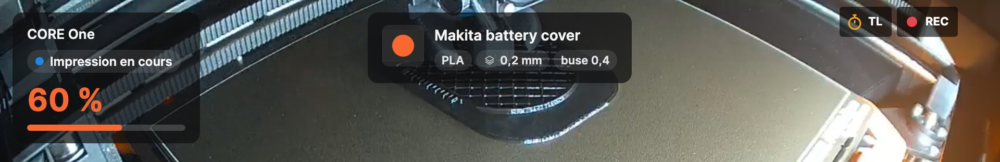

Pendant l'enregistrement de la caméra, la fenêtre de la caméra affiche un **REC** rouge ; pendant la prise d'un
timelapse, un **TL** orange.

### 8.1 Enregistrer manuellement

**Enregistrer** / **Arrêter l'enregistrement** dans le sous-menu de l'imprimante, ou le bouton d'enregistrement dans la
fenêtre de la caméra. **Lire le dernier enregistrement** et **Ouvrir le dossier des enregistrements** se trouvent dans
le sous-menu de l'imprimante.

### 8.2 Enregistrer chaque impression

Activez **Enregistrer chaque impression** dans le sous-onglet **Caméra** de l'imprimante. Chaque
impression est enregistrée depuis son début jusqu'à une minute après sa fin, même sans fenêtre de la caméra ouverte.

  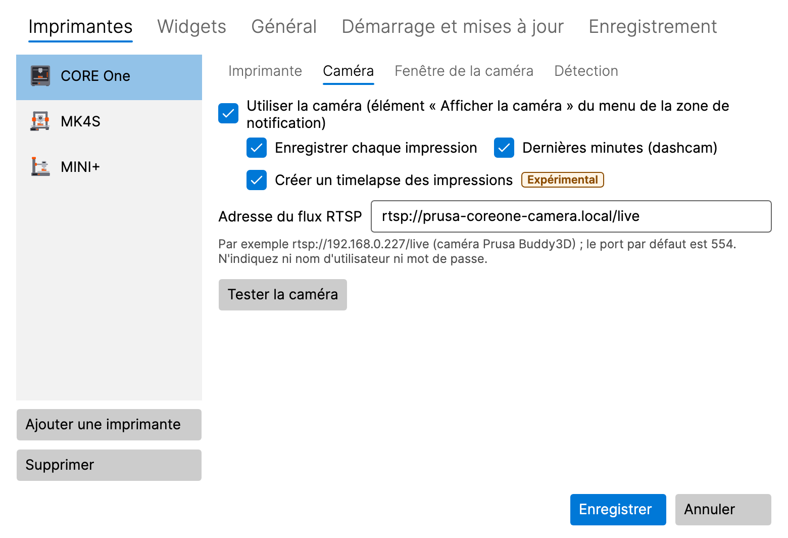

### 8.3 Dashcam : les dernières minutes

Activez **Dernières minutes (dashcam)** dans le sous-onglet **Caméra** de l'imprimante. Pendant une
impression, LayerPeek garde en mémoire les 2 dernières minutes de la caméra (environ 8 Mo par minute et par
imprimante) ; rien n'est écrit sur le disque tant qu'elles ne sont pas sauvegardées. Les dernières minutes, plus les
30 secondes qui suivent l'événement, sont sauvegardées :

- automatiquement en cas d'erreur d'impression, quand l'imprimante requiert une intervention, quand l'impression est
  arrêtée et quand la détection des échecs d'impression déclenche une alerte (chaque cas peut être désactivé dans
  l'onglet **Enregistrement**),
- manuellement avec **Sauvegarder les 2 dernières min** dans le sous-menu de l'imprimante ou dans le menu contextuel de
  la fenêtre de la caméra.

La durée (de 1 à 10 minutes) se règle dans l'onglet **Enregistrement**.

### 8.4 Timelapse (expérimental)

Un timelapse est une courte vidéo de toute l'impression : une image toutes les 30 secondes par défaut, aucune pendant
la pause de l'impression, lue à 30 images par seconde. Il est enregistré sous `…_timelapse.mp4` à côté des
enregistrements.

- **Manuellement :** **Démarrer le timelapse (expérimental)** / **Arrêter le timelapse (expérimental)** dans le
  sous-menu de l'imprimante ou le bouton chronomètre dans la fenêtre de la caméra. **Lire le dernier timelapse** se
  trouve dans le sous-menu.
- **Chaque impression :** **Créer un timelapse des impressions** dans le sous-onglet **Caméra** de l'imprimante.
- **Intervalle :** dans l'onglet **Enregistrement**, de 5 à 600 secondes, ou passez à **Toutes les N couches (env.)** :
  une image au début de chaque nouvelle couche. PrusaLink ne signale pas les couches, LayerPeek les estime donc d'après
  la hauteur de l'axe Z.
- **Créer un timelapse depuis un enregistrement… (expérimental)** crée un timelapse à partir d'un enregistrement
  LayerPeek existant.
- **Exporter le timelapse en JPEG… (expérimental)** enregistre les images d'un timelapse sous forme de fichiers JPEG
  numérotés, p. ex. pour votre propre montage vidéo.

Les deux conversions affichent leur progression dans l'élément de menu, où vous pouvez aussi les annuler, et une
notification vous prévient quand elles sont terminées.

### 8.5 Dossier et limite de taille

Dans l'onglet **Enregistrement**, vous pouvez modifier le **Dossier des enregistrements** et la **Limite de taille de
tous les enregistrements (Go)** (50 Go par défaut). Au-delà de la limite, les enregistrements les plus anciens sont
supprimés ; s'il reste moins de 5 Go d'espace libre sur le disque, l'enregistrement s'arrête. Un enregistrement qui
échoue affiche une notification.

  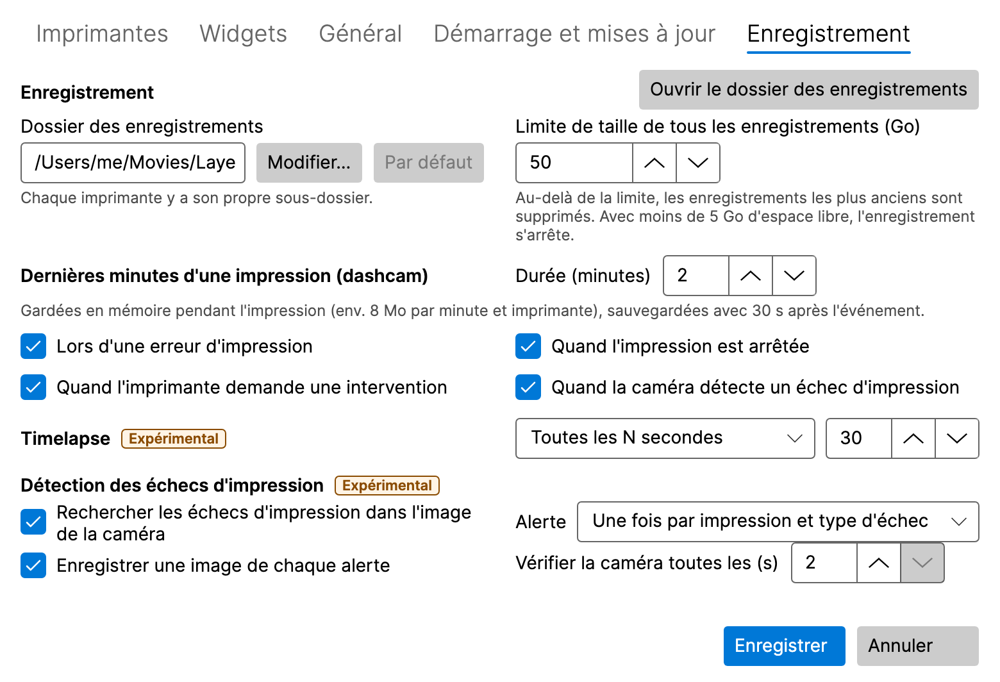

## 9. Détection des échecs d'impression (expérimental)

LayerPeek peut surveiller une impression avec la caméra et vous avertir quand quelque chose tourne mal sur le plateau.
Elle s'exécute uniquement sur votre ordinateur ; l'image de la caméra n'en sort jamais.

  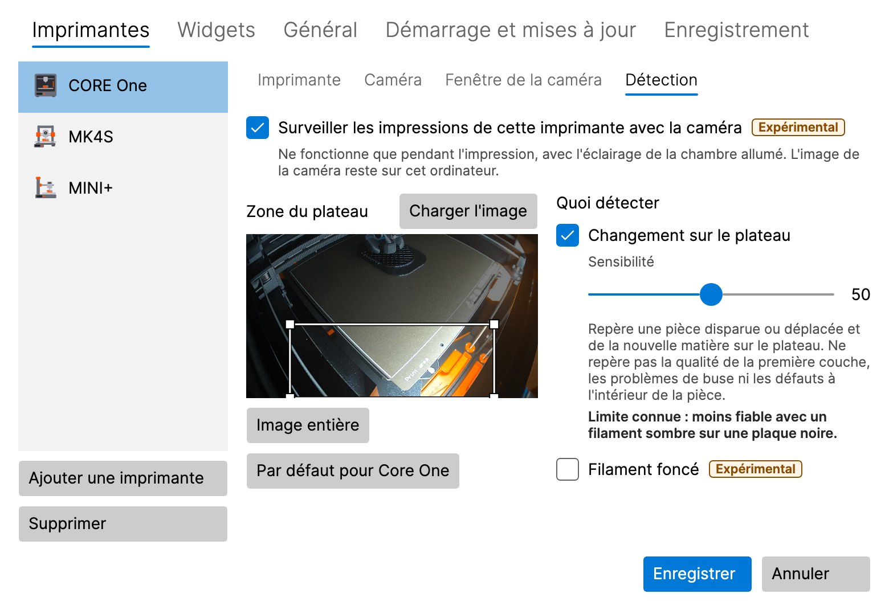

### 9.1 L'activer

Elle est désactivée par défaut et doit être activée à deux endroits :

1. **Rechercher les échecs d'impression dans l'image de la caméra** dans l'onglet **Enregistrement** (pour toutes les
   imprimantes),
2. **Surveiller les impressions de cette imprimante avec la caméra** dans le sous-onglet **Détection** de l'imprimante.

La caméra de l'imprimante doit être activée. La détection ne fonctionne que pendant l'impression et avec l'éclairage de
la chambre allumé, même sans fenêtre de la caméra ouverte.

### 9.2 Zone du plateau

La **Zone du plateau** est la partie de l'image qui est surveillée. Tracez un nouveau rectangle, déplacez-le ou
modifiez sa taille par un coin avec la souris, ou utilisez les flèches (Maj + flèches modifient sa taille).
**Image entière** surveille toute l'image, **Charger l'image** prend une nouvelle image de la caméra et, pour une
CORE One, **Par défaut pour Core One** rétablit son préréglage.

### 9.3 Détecteurs

- **Changement sur le plateau** repère une pièce qui a disparu ou bougé et de la nouvelle matière sur le plateau
  (spaghetti, pièce arrachée). **Filament foncé** aide avec un filament noir ou très foncé, au prix de davantage de
  fausses alertes.
- **Impression dans le vide** (désactivé par défaut, uniquement pour les imprimantes dont le plateau descend pendant
  l'impression : CORE One, CORE One L, XL) repère que l'imprimante continue d'imprimer mais que plus rien ne grandit,
  p. ex. quand le filament est épuisé.

**Sensibilité** (de 0 à 100, 50 par défaut) : plus elle est élevée, plus il y a d'alertes, y compris de fausses ; plus
elle est basse, moins il y a d'alertes, mais un échec peut passer inaperçu.

### 9.4 L'alerte

L'alerte est une notification **Échec d'impression possible – …** accompagnée d'une image de la caméra. Cliquer dessus
ouvre la fenêtre de la caméra. Le bouton **Fausse alerte** conserve une trace locale pour le réglage ; rien ne quitte
votre ordinateur. Dans l'onglet **Enregistrement**, vous réglez la fréquence de répétition de l'alerte, l'enregistrement
ou non d'une image de chaque alerte, et la fréquence de vérification de la caméra (de 2 à 5 secondes).

> [!WARNING]
> La détection ne repère ni la qualité de la première couche, ni les problèmes au niveau de la buse, ni les défauts à
> l'intérieur de la pièce. Elle peut manquer un échec ou déclencher une fausse alerte. Ne comptez pas sur elle comme
> seule protection d'une impression sans surveillance.

## 10. Diagnostic

**Diagnostic…** dans le menu de l'icône (choisissez l'imprimante en haut de la fenêtre) affiche le modèle et le firmware
de l'imprimante, l'état actuel, les températures de la buse et du plateau (réelle et cible), les ventilateurs, la
vitesse d'impression, le débit et la hauteur Z, ainsi qu'un graphique des températures des 30 dernières minutes, des
2 dernières heures ou des 24 dernières heures. L'historique est conservé uniquement en mémoire et commence au démarrage
de LayerPeek.

  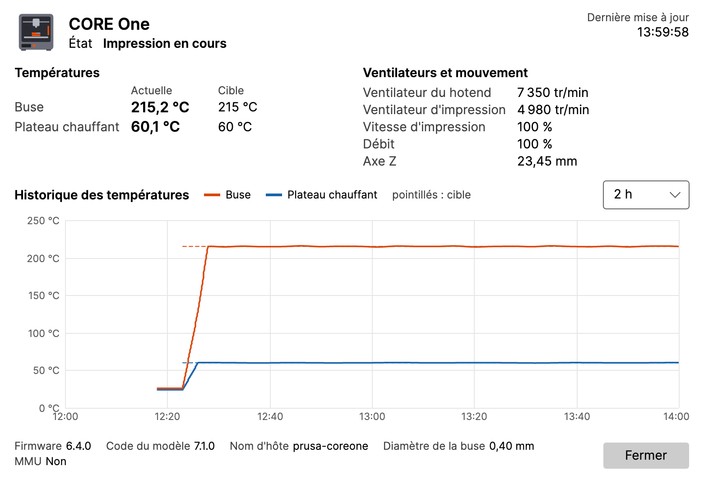

## 11. Référence des paramètres

Ouvrez **Paramètres…** depuis le menu de l'icône. Les modifications s'appliquent après **Enregistrer** ; **Annuler** les
abandonne.

### 11.1 Imprimantes

La liste des imprimantes avec **Ajouter une imprimante** et **Supprimer**. Chaque imprimante a des sous-onglets :

- **Imprimante :** nom, adresse, nom d'utilisateur, mot de passe, **Tester la connexion**.
- **Caméra :** l'adresse RTSP, **Tester la caméra**, l'enregistrement automatique, la dashcam et le timelapse des
  impressions.
- **Fenêtre de la caméra :** **Ouvrir en** (comme la dernière fois, fenêtre normale, mini-aperçu, plein écran),
  l'écran, la taille, la position et **Toujours au premier plan** de la fenêtre normale et du mini-aperçu,
  **Mémoriser la dernière position et la dernière taille**, **Fermer quand l'imprimante s'éteint, rouvrir quand elle
  est rallumée**, et le contenu du bandeau d'informations du mini-aperçu.
- **Détection :** la détection des échecs d'impression de cette imprimante (voir
  [9](#9-détection-des-échecs-dimpression-expérimental)).

### 11.2 Widgets

Les widgets de chaque imprimante, leurs réglages et l'opacité des cartes (voir [6](#6-widgets)).

### 11.3 Enregistrement

Le dossier et la limite de taille des enregistrements, la dashcam, le timelapse et la détection des échecs d'impression
(voir [8](#8-enregistrement-dashcam-et-timelapse) et [9](#9-détection-des-échecs-dimpression-expérimental)). Les
fonctions expérimentales portent un badge **Expérimental**.

### 11.4 Général

- **Notifications :** les événements, **Son**, le rappel « minutes restantes », **Envoyer une notification de test**.
- **Intervalle d'interrogation (secondes) :** la fréquence à laquelle l'état des imprimantes est demandé.
- **Langue :** **Langue du système** ou l'une des langues suivantes : English, Čeština, Slovenčina, Deutsch, Español,
  Français, Italiano, Polski. Elle ne modifie que les textes ; les nombres, les dates et les heures suivent les
  paramètres régionaux de votre système.
- **Journalisation détaillée (Debug) :** ne l'activez que si on vous le demande lors d'un dépannage.

### 11.5 Démarrage et mises à jour

- **Windows :** **Démarrer à l'ouverture de session Windows**. Activé par défaut ; disponible uniquement dans la version
  installée, pas dans la version ZIP.
- **macOS :** **Ouvrir avec la session**. Désactivé par défaut ; disponible uniquement quand LayerPeek se trouve dans le
  dossier Applications. Si vous avez désactivé LayerPeek dans **Réglages Système → Général → Ouverture et extensions**
  (Login Items & Extensions), vous seul pouvez l'y autoriser à nouveau ; le bouton **Ouvrir Réglages Système** vous y
  emmène.
- **Rechercher automatiquement les mises à jour**, **Proposer les versions préliminaires** et **Vérifier maintenant**
  (voir [12](#12-mises-à-jour)).

## 12. Mises à jour

Peu après le démarrage, puis une fois par jour, LayerPeek demande à GitHub si une nouvelle version est sortie (vous
pouvez désactiver cette vérification). Une nouvelle version apparaît sous la forme **Nouvelle version X.Y.Z disponible**
dans le menu de l'icône et une seule fois sous forme de notification.

- **Windows, version installée :** l'élément de menu télécharge la mise à jour, quitte LayerPeek et lance la nouvelle
  version.
- **Windows, version ZIP :** l'élément de menu ouvre la page de la version ; téléchargez le nouveau ZIP manuellement.
- **macOS :** l'élément de menu télécharge la mise à jour et redémarre LayerPeek, mais seulement si l'app se trouve
  dans **Applications** (et non sur l'image disque ou dans Téléchargements).

Vos paramètres et vos mots de passe sont conservés.

## 13. Où sont stockées vos données

| Quoi | Windows | macOS |
|---|---|---|
| Paramètres | `%APPDATA%\LayerPeek\settings.json` | `~/Library/Application Support/LayerPeek/settings.json` |
| Mots de passe | Gestionnaire d'identification Windows | trousseau de session (login) |
| Journaux | `%LOCALAPPDATA%\LayerPeek\logs` | `~/Library/Logs/LayerPeek` |
| Enregistrements | `Videos\LayerPeek` | `Movies/LayerPeek` |

L'historique des températures est conservé uniquement en mémoire. LayerPeek se connecte uniquement aux imprimantes et
caméras que vous ajoutez et, sauf si vous désactivez la recherche de mises à jour, à GitHub (la liste des versions, sans
aucun compte, et le téléchargement d'une mise à jour que vous lancez). Il n'y a aucune télémétrie.

## 14. Dépannage

**L'icône n'est pas visible (Windows).** Cliquez sur la flèche **`^`** dans la zone de notification et faites glisser
l'icône de LayerPeek sur la barre des tâches.

**L'imprimante est Hors ligne.** Vérifiez que l'imprimante est allumée et connectée au réseau, que l'adresse est correcte
(essayez-la dans un navigateur) et que votre ordinateur est sur le même réseau. Lancez **Tester la connexion** dans les
paramètres de l'imprimante.

**Identifiants non valides.** Saisissez de nouveau le nom d'utilisateur et le mot de passe indiqués dans
**Settings → Network → PrusaLink** (Paramètres → Réseau → PrusaLink) sur l'imprimante, puis enregistrez.

**Pas de connexion sur macOS.** L'accès au réseau local est peut-être désactivé. LayerPeek propose alors **Ouvrir
Réglages Système** ; activez LayerPeek dans **Réglages Système → Confidentialité et sécurité → Réseau local**.

**La caméra affiche Pas de signal.** Vérifiez l'adresse RTSP avec **Tester la caméra**, et que la caméra est allumée et
accessible. Ne mettez ni nom d'utilisateur ni mot de passe dans l'adresse.

**Les notifications n'apparaissent pas.** Utilisez **Envoyer une notification de test** dans **Paramètres → Général**
et vérifiez **Ne pas déranger** (Windows) ou **Concentration** (macOS).

**Signaler un bug.** Ouvrez **À propos** depuis le menu de l'icône :

- **Enregistrer le paquet de diagnostic…** enregistre un fichier ZIP contenant les journaux, la version, les
  informations système et les paramètres, **sans mots de passe ni clés**. Joignez-le à votre rapport de bug.
- **Copier les infos dans le presse-papiers** copie un court rapport.
- **Ouvrir le dossier des journaux** ouvre les journaux.

Si on vous demande un journal détaillé, activez **Journalisation détaillée (Debug)** dans **Paramètres → Général**,
reproduisez le problème, enregistrez le paquet, puis désactivez de nouveau la journalisation détaillée.

Signalez les bugs et les idées dans les [issues](https://github.com/pfoltynek/LayerPeek/issues) sur GitHub. Indiquez
le modèle de votre imprimante, la version du firmware et votre système d'exploitation.

## 15. Désinstallation

- **Windows, version installée :** **Paramètres → Applications → Applications installées → LayerPeek → Désinstaller**.
- **Windows, version ZIP :** quittez LayerPeek et supprimez son dossier.
- **macOS :** quittez LayerPeek (**Quitter** dans son menu) et déplacez **LayerPeek** depuis **Applications** vers la
  Corbeille.

La désinstallation conserve vos paramètres, vos mots de passe et vos enregistrements. Pour les supprimer aussi, effacez
les dossiers indiqués en [13](#13-où-sont-stockées-vos-données) et les entrées LayerPeek dans le Gestionnaire
d'identification (Windows) ou dans Trousseaux d'accès (macOS).
