# Manuale utente di LayerPeek

*Per LayerPeek 0.5 su Windows 10/11 e macOS (Apple Silicon).* · [Altre lingue](../README.md)

LayerPeek tiene d’occhio le tue stampanti 3D Prusa attraverso la rete locale e ne mostra lo stato nell’area di notifica
di Windows o nella barra dei menu di macOS. Non ha una finestra principale: tutto parte dal menu dell’icona. Questo
manuale descrive entrambi i sistemi; dove Windows e macOS si comportano in modo diverso, il testo lo dice o mostra
entrambe le varianti.

> [!NOTE]
> LayerPeek è un progetto indipendente della community, non un prodotto ufficiale di Prusa Research.

## Indice

1. [Cosa ti serve](#1-cosa-ti-serve)
2. [Installazione](#2-installazione)
3. [Primi passi](#3-primi-passi)
4. [L’icona e il suo menu](#4-licona-e-il-suo-menu)
5. [Finestra della telecamera](#5-finestra-della-telecamera)
6. [Widget](#6-widget)
7. [Notifiche](#7-notifiche)
8. [Registrazione, dashcam e timelapse](#8-registrazione-dashcam-e-timelapse)
9. [Rilevamento degli errori di stampa (sperimentale)](#9-rilevamento-degli-errori-di-stampa-sperimentale)
10. [Diagnostica](#10-diagnostica)
11. [Guida alle impostazioni](#11-guida-alle-impostazioni)
12. [Aggiornamenti](#12-aggiornamenti)
13. [Dove vengono salvati i tuoi dati](#13-dove-vengono-salvati-i-tuoi-dati)
14. [Risoluzione dei problemi](#14-risoluzione-dei-problemi)
15. [Disinstallazione](#15-disinstallazione)

## 1. Cosa ti serve

- **Una stampante Prusa con firmware Buddy 6.x e PrusaLink**: CORE One (testata), MK4/MK4S, MK3.9/MK3.9S, MK3.5/MK3.5S,
  XL e MINI/MINI+. La Original Prusa MK3/MK3S non ha PrusaLink integrato e non è supportata.
- **Un computer sulla stessa rete locale** della stampante:
  - Windows 10 o 11, x64 (Windows su ARM non è supportato),
  - macOS su Apple Silicon (M1 o successivo).
- **Una telecamera (facoltativa):** qualsiasi telecamera con uno stream **RTSP H.264** raggiungibile dal tuo computer,
  per esempio la telecamera Prusa Buddy3D. Anche senza telecamera hai comunque l’icona, le notifiche e la diagnostica.

LayerPeek funziona solo nella tua rete locale. Non usa Prusa Connect né altri servizi cloud. Quando sei fuori casa puoi
raggiungere le stampanti tramite una VPN verso la tua rete domestica.

Finora è stata testata solo la CORE One. Hai un altro modello? Invia un breve [rapporto di compatibilità della stampante](https://github.com/pfoltynek/LayerPeek/issues/new?template=printer_compatibility.yml) (modulo in inglese): basta una prova su Windows o macOS.

## 2. Installazione

Scarica l’ultima versione dalla pagina [Releases](https://github.com/pfoltynek/LayerPeek/releases).

> [!IMPORTANT]
> Le versioni 0.x sono anteprime e le build non sono firmate da Microsoft né autenticate (notarized) da Apple. Per
> questo il sistema ti avvisa al primo avvio; i passaggi qui sotto spiegano come proseguire.

### 2.1 Windows

Puoi scegliere tra due pacchetti:

| Pacchetto | Cosa fa |
|---|---|
| **Programma di installazione** `LayerPeek-X.Y.Z-win-x64-Setup.exe` (consigliato) | Installa LayerPeek solo per il tuo utente, senza diritti di amministratore, in `%LOCALAPPDATA%\LayerPeek`, lo aggiunge al menu Start, lo avvia dopo l’accesso e può aggiornarsi da solo. |
| **ZIP** `LayerPeek-X.Y.Z-win-x64.zip` | Estrailo dove vuoi ed esegui `LayerPeek.exe`. Non si avvia dopo l’accesso e non si aggiorna da solo (apre invece la pagina della release). |

Al primo avvio Windows SmartScreen mostra **«Windows ha protetto il PC»** con *Autore sconosciuto*. Fai clic su
**Ulteriori informazioni** e poi su **Esegui comunque**.

### 2.2 macOS

| Pacchetto | Cosa fa |
|---|---|
| **Immagine disco** `LayerPeek-X.Y.Z-osx-arm64.dmg` (consigliata) | Aprila e trascina **LayerPeek** in **Applicazioni**. |
| **Archivio** `LayerPeek-X.Y.Z-osx-arm64.tar.gz` | Contiene `LayerPeek.app`; estrailo e sposta l’app in **Applicazioni**. |

Avvia sempre LayerPeek da **Applicazioni**, non direttamente dall’immagine disco o dalla cartella Download: solo da lì
può aprirsi al login e aggiornarsi da solo.

Al primo avvio Gatekeeper blocca l’app (*«Apple non ha potuto verificare…»*, in inglese *"Apple could not verify…"*):

1. Fai clic su **Fine**.
2. Apri **Impostazioni di Sistema → Privacy e sicurezza**, scorri verso il basso e fai clic su **Apri comunque** accanto
   al messaggio su LayerPeek.
3. Conferma con la password o con Touch ID e apri di nuovo LayerPeek.

Gli utenti esperti possono invece rimuovere l’attributo di quarantena nel Terminale:
`xattr -dr com.apple.quarantine /Applications/LayerPeek.app`.

LayerPeek vive solo nella barra dei menu. Non ha un’icona nel Dock e non compare nel selettore delle app (⌘⇥).

## 3. Primi passi

### 3.1 Attivare PrusaLink sulla stampante

Sul display della stampante apri **Impostazioni → Rete → PrusaLink** (Settings → Network → PrusaLink). Verifica che
PrusaLink sia attivo e annota:

- l’**indirizzo IP** della stampante (o il suo nome host),
- il **nome utente** (quello predefinito è `maker`),
- la **password**.

### 3.2 Aggiungere la stampante

1. Trova l’icona di LayerPeek:
   - **Windows:** nell’area di notifica, all’estremità destra della barra delle applicazioni. Se non la vedi, fai clic
     sulla freccia **`^`** (Mostra icone nascoste) e trascina l’icona sulla barra delle applicazioni, così resta sempre
     visibile.
   - **macOS:** nella barra dei menu in alto sullo schermo.
2. Apri il menu dell’icona (**Windows:** clic destro sull’icona, **macOS:** clic sull’icona) e scegli
   **Aggiungi stampante…**. Si apre la finestra **Impostazioni** sulla scheda **Stampanti**.
3. Compila:
   - **Nome:** un nome a piacere, ad es. `CORE One`.
   - **Indirizzo:** un indirizzo IP o un nome host, ad es. `192.168.1.20` oppure `http://prusa-mk4.local`.
   - **Nome utente** e **Password:** i valori presi dalla stampante.
4. Fai clic su **Verifica connessione**. Se la connessione funziona, vengono mostrati il codice del modello e la
   versione del firmware.
5. Fai clic su **Salva**.

  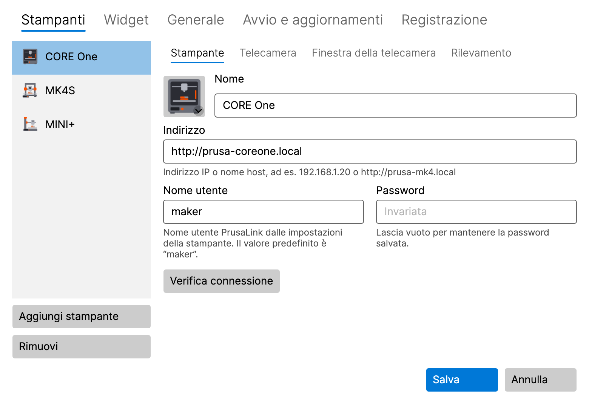

L’icona inizia subito a mostrare lo stato della stampante. Aggiungi altre stampanti allo stesso modo: **Aggiungi
stampante** nella scheda **Stampanti**.

**macOS 15 e successivi:** alla prima connessione a una stampante o a una telecamera il sistema chiede l’accesso alla
**Rete locale**. Fai clic su **Consenti**. Se l’hai negato, vedi [Risoluzione dei problemi](#14-risoluzione-dei-problemi).

La password viene salvata in **Gestione credenziali** di Windows o nel **Portachiavi** di macOS, mai nel file delle
impostazioni. Quando in seguito modifichi una stampante, il campo della password mostra **Invariata**; lascialo vuoto
per mantenere la password salvata.

### 3.3 Aggiungere la telecamera (facoltativo)

1. In **Impostazioni → Stampanti** seleziona la stampante e apri la sua sottoscheda **Telecamera**.
2. Attiva **Usa la telecamera (voce «Mostra telecamera» nel menu dell’area di notifica)**.
3. Inserisci l’**Indirizzo dello stream RTSP**, ad es. `rtsp://192.168.1.21/live` per la telecamera Buddy3D (la porta
   predefinita è 554). Non inserire nome utente o password nell’indirizzo.
4. Fai clic su **Verifica telecamera**. Se la telecamera funziona, vengono mostrate un’istantanea e la sua risoluzione.
5. Fai clic su **Salva** e scegli **Mostra telecamera** nel sottomenu della stampante.

### 3.4 Immagine della stampante

L’elenco delle stampanti mostra un’immagine di ciascuna stampante, scelta automaticamente in base al modello. Fai clic
sull’immagine per scegliere un altro modello, un’illustrazione generica o un’immagine tua (PNG, JPG).

## 4. L’icona e il suo menu

### 4.1 Cosa mostra l’icona

L’icona mostra lo stato più importante tra tutte le tue stampanti:

| Stato | Significato |
|---|---|
| **Pronta** | la stampante è inattiva |
| **In stampa** | l’icona si riempie man mano che la stampa avanza |
| **In pausa** | la stampa è in pausa |
| **Completata** / **Interrotta** | la stampa è terminata |
| **Richiede attenzione** | la stampante ti aspetta (ad es. per un cambio filamento o una richiesta sul display) |
| **Errore** | la stampante segnala un errore |
| **Offline** | la stampante non è raggiungibile |
| **Credenziali non valide** | la stampante ha rifiutato il nome utente o la password |

Passa il mouse sopra l’icona per vedere i dettagli nel suo tooltip: avanzamento, tempo rimanente e nome del file.
Mentre la telecamera di una stampante sta registrando, il tooltip indica **Registrazione in corso**.

### 4.2 Il menu

- **Windows:** clic destro sull’icona.
- **macOS:** clic sull’icona nella barra dei menu.

Il menu contiene:

- **Un sottomenu per ogni stampante**, con nell’intestazione il nome, lo stato e l’avanzamento della stampante, e con:
  - **Mostra telecamera** / **Nascondi telecamera**, e **Porta la telecamera in primo piano** mentre la finestra è
    aperta,
  - **Registra** / **Interrompi registrazione**, **Riproduci ultima registrazione**, **Apri la cartella delle
    registrazioni**,
  - **Salva gli ultimi 2 min** (quando la dashcam è attiva, vedi [8.3](#83-dashcam-gli-ultimi-minuti)),
  - le voci del timelapse (sperimentale, vedi [8.4](#84-timelapse-sperimentale)),
  - **Apri PrusaLink**: apre l’interfaccia web PrusaLink della stampante nel browser, con l’accesso già effettuato. La
    tua password non viene mai passata al browser.
- **Diagnostica…** (vedi [10](#10-diagnostica))
- **Impostazioni…**
- **Nuova versione X.Y.Z disponibile** (solo quando è disponibile un aggiornamento, vedi [12](#12-aggiornamenti))
- **Manuale utente**: apre questo manuale
- **Informazioni**
- **Esci**

Prima che tu aggiunga la prima stampante, il menu offre **Aggiungi stampante…** al posto dei sottomenu delle stampanti.

## 5. Finestra della telecamera

  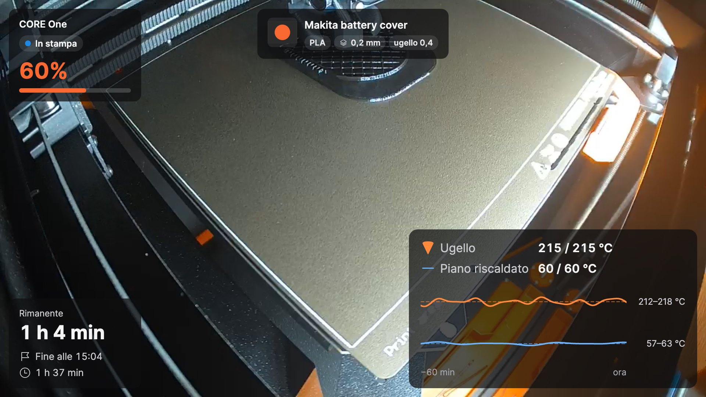

Aprila con **Mostra telecamera** nel sottomenu della stampante. La finestra mostra l’immagine dal vivo della telecamera
con sopra i [widget](#6-widget). I pulsanti della finestra compaiono quando ci passi sopra con il mouse.

### 5.1 Tre modalità

| Modalità | Come passarci | A cosa serve |
|---|---|---|
| **Finestra normale** | pulsante nella finestra, oppure doppio clic nell’anteprima mini | per guardare con calma, a qualsiasi dimensione e su qualsiasi monitor |
| **Anteprima mini** | pulsante **Anteprima piccola, sempre in primo piano** | una finestrella che resta sopra le altre finestre per tutto il giorno |
| **Schermo intero** | **Windows:** F11 · **macOS:** ⌃⌘F · oppure doppio clic sull’immagine; **Esc** per tornare indietro | tutto lo schermo |

L’anteprima mini ha una barra informativa sotto l’immagine (avanzamento, tempo rimanente, ora di fine). Due pulsanti
aprono altre righe: il **nome della stampa** e il **grafico delle temperature**. Cosa mostra la barra si imposta nella
sottoscheda **Finestra della telecamera** della stampante (vedi [11.1](#111-stampanti)).

  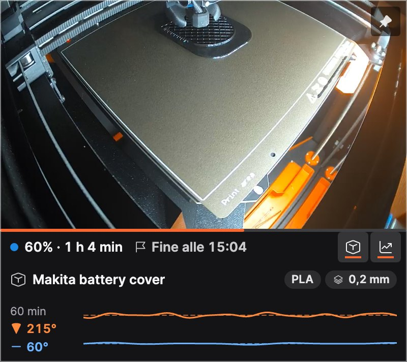

### 5.2 Sempre in primo piano

Il pulsante con la puntina nella finestra mostra se la finestra resta sopra le altre finestre e lo cambia con un solo
clic. La stessa opzione si trova nel menu contestuale della finestra (**Sempre in primo piano**).

### 5.3 Menu contestuale della finestra

Fai clic destro sull’immagine (su macOS anche Ctrl-clic) per **Modifica layout**, **Sempre in primo piano**, la
registrazione, la dashcam e il timelapse.

### 5.4 Quando la connessione cade

La finestra si riconnette da sola quando la telecamera o il Wi-Fi si interrompono; nel frattempo mostra **Connessione
alla telecamera…** o **Nessun segnale**. Quando la stampante viene spenta, la finestra si chiude e si riapre nello
stesso punto quando la stampante torna disponibile. Puoi disattivarlo in **Impostazioni → Stampanti → Finestra della
telecamera** (**Chiudi quando la stampante si spegne, riapri quando si riaccende**). Una finestra che chiudi tu resta
chiusa.

## 6. Widget

I widget sono le schede sopra l’immagine della telecamera. Ogni stampante ha il proprio set e la propria disposizione.

| Widget | Mostra |
|---|---|
| **Stato** | nome della stampante, stato e avanzamento in percentuale |
| **Tempi** | tempo rimanente, quando la stampa sarà pronta, tempo di stampa |
| **Temperature** | ugello e piano (attuale / obiettivo) con un grafico degli ultimi 60 minuti |
| **Nome della stampa** | nome del file leggibile con materiale, altezza dello strato e ugello; le dimensioni più grandi aggiungono l’anteprima del G-code |
| **Raffreddamento** | dopo la stampa: quanto si sono raffreddati ugello e piano e quando puoi spegnere in sicurezza |

Ogni widget ha tre dimensioni: **S**, **M** e **L**. Qui le temperature: S mostra i valori, M aggiunge il grafico, L le
etichette e l’intervallo di temperatura.

  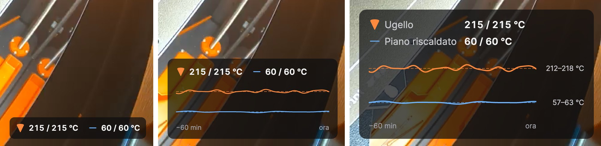

### 6.1 Scegliere i widget

In **Impostazioni → Widget** scegli la stampante in alto e spunta i widget che vuoi. Selezionando un widget compaiono le
sue impostazioni, ad es. le soglie di raffreddamento dell’ugello e del piano. **Usa il layout per tutte le stampanti**
copia la disposizione sulle altre stampanti. **Opacità dello sfondo delle schede** mantiene il testo leggibile su
un’immagine chiara (per tutte le stampanti).

  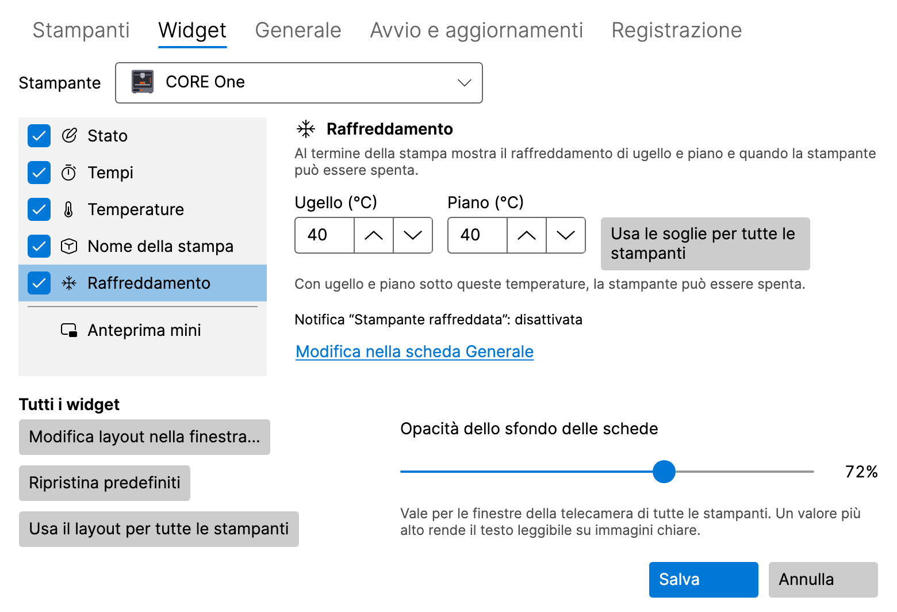

### 6.2 Disporre i widget nella finestra della telecamera

Fai clic su **Modifica layout** nella finestra della telecamera (oppure su **Modifica layout nella finestra…** in
**Impostazioni → Widget**). In modalità layout:

- **trascina** un widget in uno dei sei posti (in alto e in basso, a sinistra, al centro e a destra),
- fai clic su un widget per aprirne le opzioni: **Dimensione** (Piccola, Media, Grande) ed **Evidenzia** (mostra il
  valore principale nel colore di risalto),
- **Ripristina predefiniti** riporta la disposizione predefinita, **Fine** la salva.

Con la tastiera: **Spazio** prende un widget, i **tasti freccia** lo spostano, **Invio** ne apre le opzioni ed **Esc**
annulla le modifiche. Se la finestra è troppo piccola, ingrandiscila prima.

  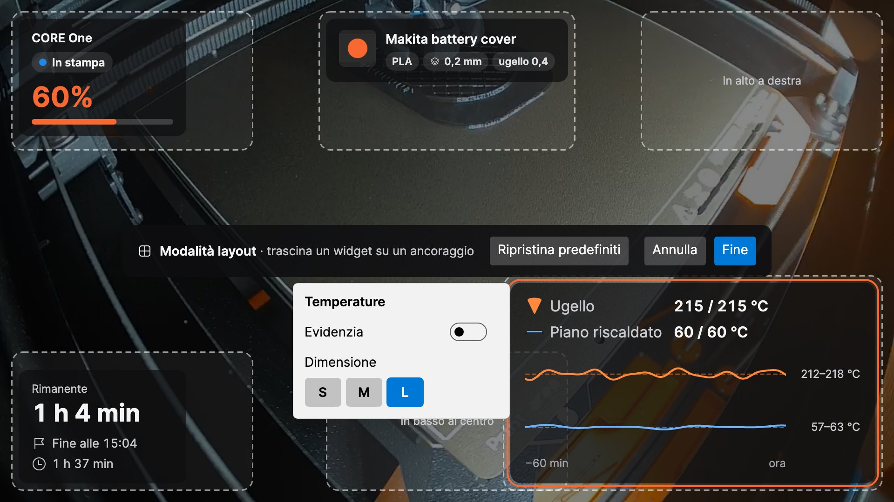

## 7. Notifiche

LayerPeek mostra notifiche native del sistema per questi eventi (ognuno si può attivare o disattivare in
**Impostazioni → Generale**):

- stampa avviata, completata, messa in pausa, ripresa e interrotta,
- la stampante richiede attenzione (anche in caso di password rifiutata), un errore,
- la stampante è andata offline o è di nuovo online,
- **Mancano N minuti**, così puoi essere alla stampante quando la stampa finisce (**Avvisa quando mancano questi minuti
  di stampa (0 = disattivato)**),
- **Stampante raffreddata**: ugello e piano sono sotto le soglie del widget **Raffreddamento** e puoi spegnere la
  stampante in sicurezza.

Il **Suono** può essere disattivato, attivo solo per le notifiche importanti o attivo per tutte le notifiche. **Invia
notifica di prova** mostra un esempio, così puoi verificare che le notifiche ti arrivino.

- **Windows:** se le notifiche di LayerPeek sono disattivate in **Impostazioni → Sistema → Notifiche**, le impostazioni
  di LayerPeek lo segnalano e offrono **Apri impostazioni notifiche**. Controlla anche **Non disturbare**.
- **macOS:** la prima notifica chiede l’autorizzazione; fai clic su **Consenti**. Se le notifiche sono disattivate in
  **Impostazioni di Sistema → Notifiche**, le impostazioni di LayerPeek offrono **Apri impostazioni Notifiche**.
  Controlla anche **Full immersion** (Focus).

Un clic su una notifica della stampante apre l’interfaccia web PrusaLink della stampante. Un allarme di errore di stampa
apre la finestra della telecamera, una registrazione non riuscita apre la scheda **Registrazione** delle impostazioni e
una conversione timelapse completata apre la cartella delle registrazioni.

## 8. Registrazione, dashcam e timelapse

Tutte le registrazioni restano sul tuo disco. Per impostazione predefinita vanno nella cartella **Video** (Windows) o
**Filmati** (macOS), sotto `LayerPeek`, con una sottocartella per ogni stampante e un nome che riporta l’ora e la
stampa. Il video viene salvato come MP4 senza ricodifica, quindi non pesa quasi per niente sulla CPU.

  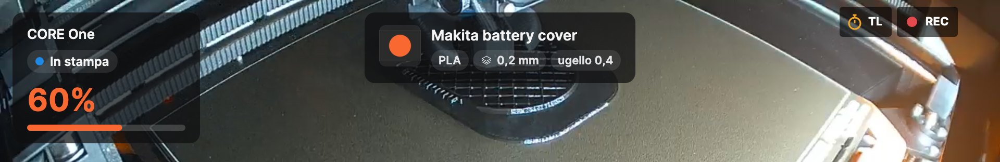

Mentre la telecamera registra, la finestra della telecamera mostra un **REC** rosso; mentre si crea un timelapse, un
**TL** ambra.

### 8.1 Registrare a mano

**Registra** / **Interrompi registrazione** nel sottomenu della stampante, oppure il pulsante di registrazione nella
finestra della telecamera. **Riproduci ultima registrazione** e **Apri la cartella delle registrazioni** si trovano nel
sottomenu della stampante.

### 8.2 Registrare ogni stampa

Attiva **Registra ogni stampa** nella sottoscheda **Telecamera** della stampante. Ogni stampa viene
registrata dall’inizio fino a un minuto dopo la fine, anche senza una finestra della telecamera aperta.

  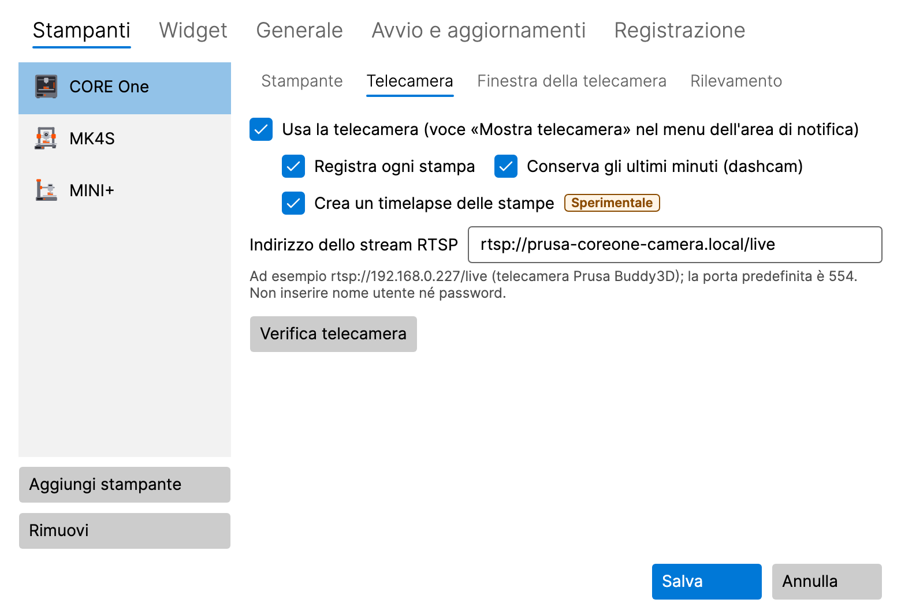

### 8.3 Dashcam: gli ultimi minuti

Attiva **Conserva gli ultimi minuti (dashcam)** nella sottoscheda **Telecamera** della stampante. Durante una stampa
LayerPeek tiene in memoria gli ultimi 2 minuti della telecamera (circa 8 MB al minuto per stampante); sul disco non
viene scritto nulla finché non li salvi. Gli ultimi minuti, insieme ai 30 secondi successivi all’evento, vengono
salvati:

- automaticamente in caso di errore di stampa, quando la stampante richiede attenzione, quando la stampa viene
  interrotta e quando il rilevamento degli errori di stampa lancia un allarme (ognuno si può disattivare nella scheda
  **Registrazione**),
- a mano con **Salva gli ultimi 2 min** nel sottomenu della stampante o nel menu contestuale della finestra della
  telecamera.

La durata (1–10 minuti) si imposta nella scheda **Registrazione**.

### 8.4 Timelapse (sperimentale)

Un timelapse è un breve video dell’intera stampa: per impostazione predefinita un fotogramma ogni 30 secondi, nessuno
mentre la stampa è in pausa, riprodotto a 30 fotogrammi al secondo. Viene salvato come `…_timelapse.mp4` accanto alle
registrazioni.

- **A mano:** **Avvia timelapse (sperimentale)** / **Interrompi timelapse (sperimentale)** nel sottomenu della stampante
  oppure il pulsante con il cronometro nella finestra della telecamera. **Riproduci ultimo timelapse** si trova nel
  sottomenu.
- **Ogni stampa:** **Crea un timelapse delle stampe** nella sottoscheda **Telecamera** della stampante.
- **Intervallo:** nella scheda **Registrazione**, da 5 a 600 secondi, oppure passa a **Ogni N strati (stima)**: un
  fotogramma quando inizia un nuovo strato. PrusaLink non riporta gli strati, quindi LayerPeek li stima dall’altezza
  dell’asse Z.
- **Crea timelapse da una registrazione… (sperimentale)** crea un timelapse da una registrazione di LayerPeek già
  esistente.
- **Esporta timelapse in JPEG… (sperimentale)** salva i fotogrammi di un timelapse come file JPEG numerati, ad es. per
  il tuo montaggio video.

Entrambe le conversioni mostrano l’avanzamento nella voce di menu, dove puoi anche annullarle, e una notifica ti avvisa
quando sono terminate.

### 8.5 Cartella e limite di dimensione

Nella scheda **Registrazione** puoi cambiare la **Cartella delle registrazioni** e il **Limite di dimensione di tutte le
registrazioni (GB)** (50 GB per impostazione predefinita). Oltre il limite vengono eliminate le registrazioni più
vecchie; con meno di 5 GB di spazio libero sull’unità la registrazione si interrompe. Una registrazione non riuscita
mostra una notifica.

  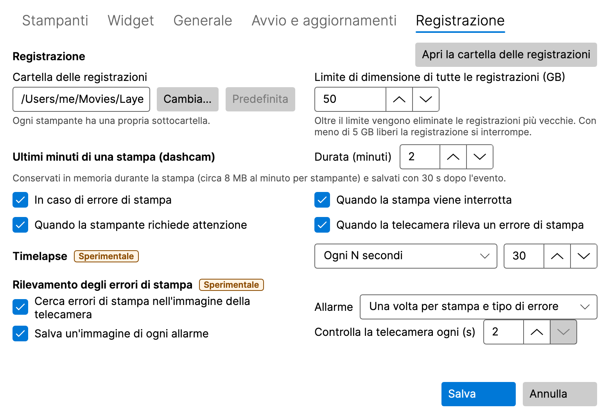

## 9. Rilevamento degli errori di stampa (sperimentale)

LayerPeek può sorvegliare una stampa attraverso la telecamera e avvisarti quando qualcosa va storto sul piano. Funziona
solo sul tuo computer; l’immagine della telecamera non lo lascia mai.

  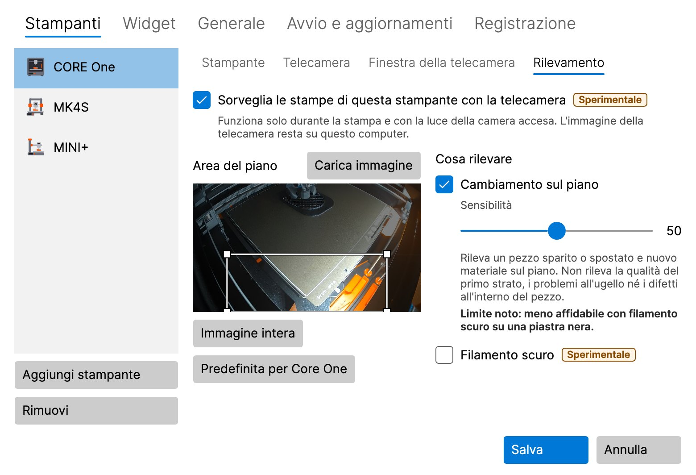

### 9.1 Attivarlo

È disattivato per impostazione predefinita e va attivato in due punti:

1. **Cerca errori di stampa nell’immagine della telecamera** nella scheda **Registrazione** (per tutte le stampanti),
2. **Sorveglia le stampe di questa stampante con la telecamera** nella sottoscheda **Rilevamento** della stampante.

La stampante deve avere la telecamera attivata. Il rilevamento funziona solo durante la stampa e con la luce della
camera accesa, anche senza una finestra della telecamera aperta.

### 9.2 Area del piano

L’**Area del piano** è la parte dell’immagine che viene sorvegliata. Trascina un nuovo rettangolo, spostalo o cambiane
la dimensione da un angolo con il mouse, oppure usa i tasti freccia (Maiusc + frecce ne cambiano la dimensione).
**Immagine intera** sorveglia tutta l’immagine, **Carica immagine** prende una nuova immagine dalla telecamera e, per una
CORE One, **Predefinita per Core One** ripristina la sua impostazione predefinita.

### 9.3 Rilevatori

- **Cambiamento sul piano** nota un pezzo che è sparito o si è spostato e nuovo materiale sul piano (spaghetti, un pezzo
  staccato). **Filamento scuro** aiuta con filamento nero o molto scuro, al prezzo di più falsi allarmi.
- **Stampa nel vuoto** (disattivato per impostazione predefinita, solo per stampanti il cui piano scende durante la
  stampa: CORE One, CORE One L, XL) nota che la stampante continua a stampare ma non cresce più nulla, ad es. quando il
  filamento è finito.

**Sensibilità** (0–100, 50 per impostazione predefinita): più alta significa più allarmi, anche falsi; più bassa
significa meno allarmi, ma un errore potrebbe sfuggire.

### 9.4 L’allarme

L’allarme è una notifica **Possibile errore di stampa – …** con un’istantanea della telecamera. Un clic sulla notifica
apre la finestra della telecamera. Il pulsante **Falso allarme** conserva una registrazione locale per la messa a punto;
nulla lascia il tuo computer. Nella scheda **Registrazione** imposti ogni quanto si ripete l’allarme, se salvare
un’istantanea di ogni allarme e ogni quanto viene controllata la telecamera (da 2 a 5 secondi).

> [!WARNING]
> Il rilevamento non nota la qualità del primo strato, i problemi all’ugello o i difetti all’interno del pezzo. Può non
> accorgersi di un errore o lanciare un falso allarme. Non affidarti a esso come unica protezione di una stampa senza
> sorveglianza.

## 10. Diagnostica

**Diagnostica…** nel menu dell’icona (scegli la stampante in alto nella finestra) mostra il modello e il firmware della
stampante, lo stato attuale, le temperature dell’ugello e del piano (attuale e obiettivo), le ventole, la velocità di
stampa, il flusso e l’altezza Z, e un grafico delle temperature degli ultimi 30 minuti, 2 ore o 24 ore. La cronologia
viene conservata solo in memoria e parte all’avvio di LayerPeek.

  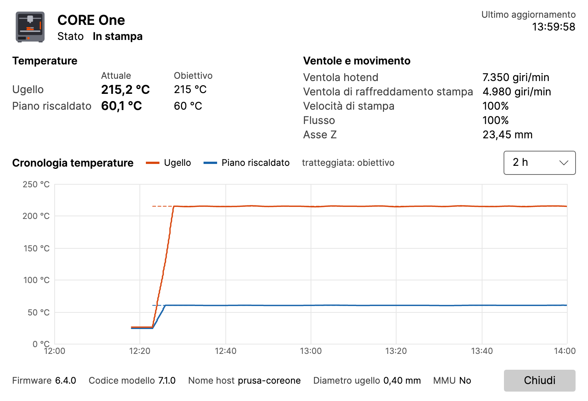

## 11. Guida alle impostazioni

Apri **Impostazioni…** dal menu dell’icona. Le modifiche si applicano dopo **Salva**; **Annulla** le scarta.

### 11.1 Stampanti

L’elenco delle stampanti con **Aggiungi stampante** e **Rimuovi**. Ogni stampante ha delle sottoschede:

- **Stampante:** nome, indirizzo, nome utente, password, **Verifica connessione**.
- **Telecamera:** l’indirizzo RTSP, **Verifica telecamera**, registrazione automatica, dashcam e timelapse delle stampe.
- **Finestra della telecamera:** **Apri come** (come l’ultima volta, finestra normale, anteprima mini, schermo intero),
  il monitor, la dimensione, la posizione e **Sempre in primo piano** della finestra normale e dell’anteprima mini,
  **Ricorda l’ultima posizione e dimensione**, **Chiudi quando la stampante si spegne, riapri quando si riaccende** e
  cosa mostra la barra informativa dell’anteprima mini.
- **Rilevamento:** il rilevamento degli errori di stampa di questa stampante (vedi
  [9](#9-rilevamento-degli-errori-di-stampa-sperimentale)).

### 11.2 Widget

I widget di ogni stampante, le loro impostazioni e l’opacità delle schede (vedi [6](#6-widget)).

### 11.3 Registrazione

La cartella e il limite di dimensione delle registrazioni, la dashcam, il timelapse e il rilevamento degli errori di
stampa (vedi [8](#8-registrazione-dashcam-e-timelapse) e [9](#9-rilevamento-degli-errori-di-stampa-sperimentale)). Le
funzioni sperimentali hanno l’etichetta **Sperimentale**.

### 11.4 Generale

- **Notifiche:** quali eventi, **Suono**, il promemoria «minuti rimanenti», **Invia notifica di prova**.
- **Intervallo di interrogazione (secondi):** ogni quanto alle stampanti viene chiesto il loro stato.
- **Lingua:** **Lingua di sistema** oppure una tra Čeština, Deutsch, English, Español, Français, Italiano, Polski,
  Slovenčina. Cambia solo i testi; numeri, date e orari seguono le impostazioni internazionali del tuo sistema.
- **Registro dettagliato (Debug):** attivalo solo quando ti viene chiesto durante la risoluzione di un problema.

### 11.5 Avvio e aggiornamenti

- **Windows:** **Avvia all’accesso a Windows**. Attivo per impostazione predefinita; disponibile solo nella versione
  installata, non nella versione ZIP.
- **macOS:** **Apri al login**. Disattivato per impostazione predefinita; disponibile solo quando LayerPeek si trova
  nella cartella Applicazioni. Se hai disattivato LayerPeek in **Impostazioni di Sistema → Generali → Elementi login ed
  estensioni** (Login Items & Extensions), solo tu puoi riattivarlo da lì; il pulsante **Apri Impostazioni di Sistema**
  ti ci porta.
- **Controlla automaticamente gli aggiornamenti**, **Offri versioni preliminari** e **Controlla ora** (vedi
  [12](#12-aggiornamenti)).

## 12. Aggiornamenti

Poco dopo l’avvio e poi una volta al giorno LayerPeek chiede a GitHub se è uscita una nuova versione (puoi disattivare
questo controllo). Una nuova versione compare come **Nuova versione X.Y.Z disponibile** nel menu dell’icona e una volta
come notifica.

- **Windows, versione installata:** la voce di menu scarica l’aggiornamento, chiude LayerPeek e avvia la nuova versione.
- **Windows, versione ZIP:** la voce di menu apre la pagina della release; scarica a mano il nuovo ZIP.
- **macOS:** la voce di menu scarica l’aggiornamento e riavvia LayerPeek, ma solo quando l’app si trova in
  **Applicazioni** (non sull’immagine disco o in Download).

Le tue impostazioni e password vengono mantenute.

## 13. Dove vengono salvati i tuoi dati

| Cosa | Windows | macOS |
|---|---|---|
| Impostazioni | `%APPDATA%\LayerPeek\settings.json` | `~/Library/Application Support/LayerPeek/settings.json` |
| Password | Gestione credenziali di Windows | portachiavi «login» |
| Log | `%LOCALAPPDATA%\LayerPeek\logs` | `~/Library/Logs/LayerPeek` |
| Registrazioni | `Videos\LayerPeek` | `Movies/LayerPeek` |

La cronologia delle temperature viene conservata solo in memoria. LayerPeek si connette solo alle stampanti e alle
telecamere che aggiungi e, a meno che tu non disattivi il controllo degli aggiornamenti, a GitHub (l’elenco delle
release, senza alcun account, e il download di un aggiornamento che avvii tu). Non c’è alcuna telemetria.

## 14. Risoluzione dei problemi

**L’icona non è visibile (Windows).** Fai clic sulla freccia **`^`** nell’area di notifica e trascina l’icona di
LayerPeek sulla barra delle applicazioni.

**La stampante è Offline.** Verifica che la stampante sia accesa e collegata alla rete, che l’indirizzo sia corretto
(provalo in un browser) e che il tuo computer sia sulla stessa rete. Esegui **Verifica connessione** nelle impostazioni
della stampante.

**Credenziali non valide.** Inserisci di nuovo il nome utente e la password presi da **Impostazioni → Rete →
PrusaLink** sulla stampante e salva.

**Nessuna connessione su macOS.** L’accesso alla rete locale potrebbe essere disattivato. In questo caso LayerPeek
offre **Apri Impostazioni di Sistema**; attiva LayerPeek in **Impostazioni di Sistema → Privacy e sicurezza → Rete
locale**.

**La telecamera mostra Nessun segnale.** Controlla l’indirizzo RTSP con **Verifica telecamera** e che la telecamera sia
accesa e raggiungibile. Non inserire nome utente o password nell’indirizzo.

**Le notifiche non compaiono.** Usa **Invia notifica di prova** in **Impostazioni → Generale** e controlla **Non
disturbare** (Windows) o **Full immersion** (macOS).

**Segnalare un bug.** Apri **Informazioni** dal menu dell’icona:

- **Salva pacchetto diagnostico…** salva un file ZIP con i log, la versione, le informazioni di sistema e le
  impostazioni, **senza password né chiavi**. Allegalo alla tua segnalazione.
- **Copia informazioni negli appunti** copia un breve rapporto.
- **Apri cartella dei registri** apre i log.

Se ti viene chiesto un log dettagliato, attiva **Registro dettagliato (Debug)** in **Impostazioni → Generale**, riproduci
il problema, salva il pacchetto e poi disattiva di nuovo il registro dettagliato.

Segnala bug e idee nelle [issue](https://github.com/pfoltynek/LayerPeek/issues) su GitHub. Indica il modello della
stampante, la versione del firmware e il sistema operativo.

## 15. Disinstallazione

- **Windows, versione installata:** **Impostazioni → App → App installate → LayerPeek → Disinstalla**.
- **Windows, versione ZIP:** chiudi LayerPeek ed elimina la sua cartella.
- **macOS:** chiudi LayerPeek (**Esci** nel suo menu) e sposta **LayerPeek** da **Applicazioni** al Cestino.

La disinstallazione mantiene impostazioni, password e registrazioni. Per rimuovere anche quelle, elimina le cartelle
indicate in [13](#13-dove-vengono-salvati-i-tuoi-dati) e le voci di LayerPeek in Gestione credenziali (Windows) o in
Accesso Portachiavi (macOS).
