# Instrukcja obsługi LayerPeek

*Dla LayerPeek 0.5 w systemach Windows 10/11 i macOS (Apple Silicon).* · [Inne języki](../README.md)

LayerPeek pilnuje Twoich drukarek 3D Prusa przez sieć lokalną i pokazuje ich stan w obszarze powiadomień systemu
Windows lub na pasku menu macOS. Nie ma okna głównego: wszystko zaczyna się od menu ikony. Ta instrukcja opisuje oba
systemy; tam, gdzie Windows i macOS się różnią, tekst o tym wspomina albo pokazuje oba warianty.

> [!NOTE]
> LayerPeek to niezależny projekt społeczności, a nie oficjalny produkt firmy Prusa Research.

## Spis treści

1. [Czego potrzebujesz](#1-czego-potrzebujesz)
2. [Instalacja](#2-instalacja)
3. [Pierwsze kroki](#3-pierwsze-kroki)
4. [Ikona i jej menu](#4-ikona-i-jej-menu)
5. [Okno kamery](#5-okno-kamery)
6. [Widżety](#6-widżety)
7. [Powiadomienia](#7-powiadomienia)
8. [Nagrywanie, dashcam i timelapse](#8-nagrywanie-dashcam-i-timelapse)
9. [Wykrywanie błędów wydruku (eksperymentalne)](#9-wykrywanie-błędów-wydruku-eksperymentalne)
10. [Diagnostyka](#10-diagnostyka)
11. [Przegląd ustawień](#11-przegląd-ustawień)
12. [Aktualizacje](#12-aktualizacje)
13. [Gdzie są przechowywane Twoje dane](#13-gdzie-są-przechowywane-twoje-dane)
14. [Rozwiązywanie problemów](#14-rozwiązywanie-problemów)
15. [Odinstalowanie](#15-odinstalowanie)

## 1. Czego potrzebujesz

- **Drukarki Prusa z firmware Buddy 6.x i PrusaLink**: CORE One (przetestowana), MK4/MK4S, MK3.9/MK3.9S, MK3.5/MK3.5S,
  XL oraz MINI/MINI+. Original Prusa MK3/MK3S nie ma wbudowanego PrusaLink i nie jest obsługiwana.
- **Komputera w tej samej sieci lokalnej** co drukarka:
  - Windows 10 lub 11, x64 (Windows na ARM nie jest obsługiwany),
  - macOS na Apple Silicon (M1 lub nowszy).
- **Kamery (opcjonalnie):** dowolnej kamery ze strumieniem **RTSP H.264** dostępnym z Twojego komputera, na przykład
  kamery Prusa Buddy3D. Bez kamery nadal masz ikonę, powiadomienia i diagnostykę.

LayerPeek działa wyłącznie w sieci lokalnej. Nie korzysta z Prusa Connect ani z żadnej innej usługi w chmurze. Poza
domem możesz połączyć się z drukarkami przez VPN do swojej sieci domowej.

Na razie przetestowano tylko CORE One. Masz inny model? Wyślij krótki [raport zgodności drukarki](https://github.com/pfoltynek/LayerPeek/issues/new?template=printer_compatibility.yml) (formularz po angielsku); wystarczy jedna próba w systemie Windows lub macOS.

## 2. Instalacja

Pobierz najnowszą wersję ze strony [Releases](https://github.com/pfoltynek/LayerPeek/releases).

> [!IMPORTANT]
> Wersje 0.x to wersje zapoznawcze, a ich kompilacje nie są podpisane przez Microsoft ani notaryzowane przez Apple.
> Dlatego system ostrzeże Cię przy pierwszym uruchomieniu; poniższe kroki pokazują, jak to obejść.

### 2.1 Windows

Do wyboru masz dwa pakiety:

| Pakiet | Co robi |
|---|---|
| **Instalator** `LayerPeek-X.Y.Z-win-x64-Setup.exe` (zalecany) | Instaluje LayerPeek tylko dla Twojego użytkownika, bez uprawnień administratora, do `%LOCALAPPDATA%\LayerPeek`, dodaje go do menu Start, uruchamia po zalogowaniu i potrafi się sam aktualizować. |
| **ZIP** `LayerPeek-X.Y.Z-win-x64.zip` | Rozpakuj go w dowolnym miejscu i uruchom `LayerPeek.exe`. Nie uruchamia się po zalogowaniu i nie aktualizuje się sam (zamiast tego otwiera stronę wydania). |

Przy pierwszym uruchomieniu filtr Windows SmartScreen wyświetli komunikat **„System Windows ochronił ten komputer”**
z informacją *Nieznany wydawca*. Kliknij **Więcej informacji**, a następnie **Uruchom mimo to**.

### 2.2 macOS

| Pakiet | Co robi |
|---|---|
| **Obraz dysku** `LayerPeek-X.Y.Z-osx-arm64.dmg` (zalecany) | Otwórz go i przeciągnij **LayerPeek** do folderu **Aplikacje**. |
| **Archiwum** `LayerPeek-X.Y.Z-osx-arm64.tar.gz` | Zawiera `LayerPeek.app`; rozpakuj je i przenieś aplikację do folderu **Aplikacje**. |

Zawsze uruchamiaj LayerPeek z folderu **Aplikacje**, a nie bezpośrednio z obrazu dysku ani z folderu Pobrane: tylko
stamtąd może się otwierać podczas logowania i sam się aktualizować.

Przy pierwszym uruchomieniu Gatekeeper zablokuje aplikację (*„Apple nie może zweryfikować…”*):

1. Kliknij **Gotowe**.
2. Otwórz **Ustawienia systemowe → Prywatność i ochrona**, przewiń w dół i kliknij **Otwórz mimo to** obok komunikatu
   dotyczącego LayerPeek.
3. Potwierdź hasłem lub Touch ID i ponownie otwórz LayerPeek.

Zaawansowani użytkownicy mogą zamiast tego usunąć flagę kwarantanny w Terminalu:
`xattr -dr com.apple.quarantine /Applications/LayerPeek.app`.

LayerPeek mieszka wyłącznie na pasku menu. Nie ma ikony w Docku i nie pojawia się w przełączniku aplikacji (⌘⇥).

## 3. Pierwsze kroki

### 3.1 Włącz PrusaLink w drukarce

Na wyświetlaczu drukarki otwórz **Ustawienia → Sieć → PrusaLink** (*Settings → Network → PrusaLink*). Sprawdź, czy
PrusaLink jest włączony, i zanotuj:

- **adres IP** drukarki (lub jej nazwę hosta),
- **nazwę użytkownika** (domyślnie `maker`),
- **hasło**.

### 3.2 Dodaj drukarkę

1. Znajdź ikonę LayerPeek:
   - **Windows:** w obszarze powiadomień na prawym końcu paska zadań. Jeśli jej nie widzisz, kliknij strzałkę
     **`^`** (Pokaż ukryte ikony) i przeciągnij ikonę na pasek zadań, żeby była stale widoczna.
   - **macOS:** na pasku menu u góry ekranu.
2. Otwórz menu ikony (**Windows:** kliknij ikonę prawym przyciskiem myszy, **macOS:** kliknij ją) i wybierz
   **Dodaj drukarkę…**. Otworzy się okno **Ustawienia** na karcie **Drukarki**.
3. Wypełnij:
   - **Nazwa:** dowolna nazwa, np. `CORE One`.
   - **Adres:** adres IP lub nazwa hosta, np. `192.168.1.20` lub `http://prusa-mk4.local`.
   - **Nazwa użytkownika** i **Hasło:** wartości z drukarki.
4. Kliknij **Testuj połączenie**. Działające połączenie zgłosi kod modelu i wersję firmware.
5. Kliknij **Zapisz**.

  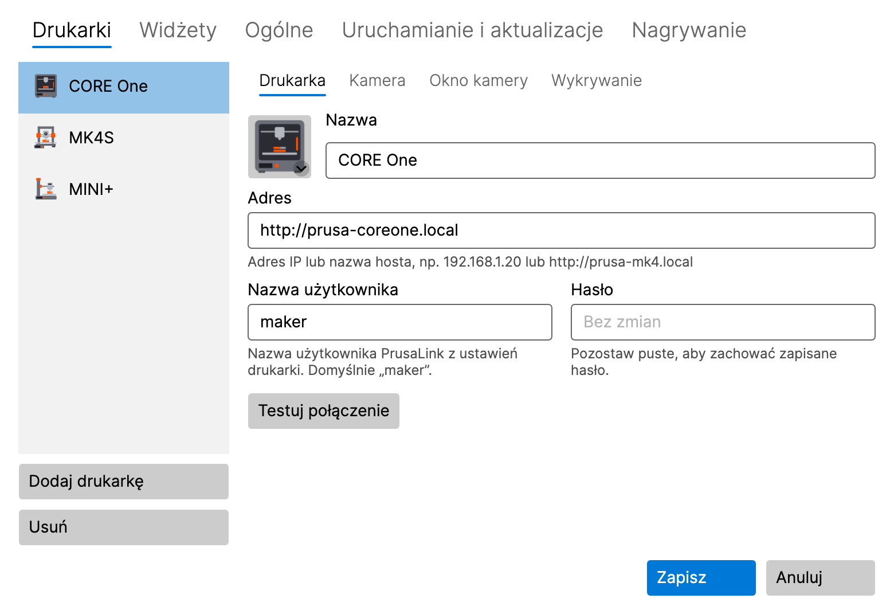

Ikona od razu zaczyna pokazywać stan drukarki. Kolejne drukarki dodajesz tak samo: **Dodaj drukarkę** na karcie
**Drukarki**.

**macOS 15 i nowszy:** przy pierwszym połączeniu z drukarką lub kamerą system zapyta o dostęp do **sieci lokalnej**.
Kliknij **Pozwól**. Jeśli odmówiłeś, zajrzyj do rozdziału [Rozwiązywanie problemów](#14-rozwiązywanie-problemów).

Hasło jest przechowywane w **Menedżerze poświadczeń systemu Windows** lub w **pęku kluczy macOS**, nigdy w pliku
ustawień. Gdy później edytujesz drukarkę, pole hasła pokazuje **Bez zmian**; pozostaw je puste, aby zachować zapisane
hasło.

### 3.3 Dodaj kamerę (opcjonalnie)

1. W **Ustawienia → Drukarki** wybierz drukarkę i otwórz jej podkartę **Kamera**.
2. Włącz **Używaj kamery (pozycja „Pokaż kamerę” w menu obszaru powiadomień)**.
3. Wpisz **Adres strumienia RTSP**, np. `rtsp://192.168.1.21/live` dla kamery Buddy3D (domyślny port to 554).
   Nie wpisuj do adresu nazwy użytkownika ani hasła.
4. Kliknij **Testuj kamerę**. Działająca kamera pokaże obraz i swoją rozdzielczość.
5. Kliknij **Zapisz** i wybierz **Pokaż kamerę** w podmenu drukarki.

### 3.4 Obraz drukarki

Lista drukarek pokazuje obrazek każdej drukarki, wybrany automatycznie według modelu. Kliknij obrazek, aby wybrać inny
model, ogólną ilustrację lub własny obraz (PNG, JPG).

## 4. Ikona i jej menu

### 4.1 Co pokazuje ikona

Ikona pokazuje najważniejszy stan wszystkich Twoich drukarek:

| Stan | Znaczenie |
|---|---|
| **Gotowa** | drukarka jest bezczynna |
| **Drukuje** | ikona wypełnia się wraz z postępem wydruku |
| **Wstrzymano** | wydruk jest wstrzymany |
| **Zakończono** / **Zatrzymano** | wydruk się skończył |
| **Wymaga interwencji** | drukarka czeka na Ciebie (np. wymiana filamentu lub pytanie na wyświetlaczu) |
| **Błąd** | drukarka zgłasza błąd |
| **Offline** | nie można połączyć się z drukarką |
| **Nieprawidłowe dane logowania** | drukarka odrzuciła nazwę użytkownika lub hasło |

Najedź myszą na ikonę, aby zobaczyć szczegóły w podpowiedzi: postęp, pozostały czas i nazwę pliku. Gdy kamera drukarki
jest nagrywana, podpowiedź pokazuje **Trwa nagrywanie**.

### 4.2 Menu

- **Windows:** kliknij ikonę prawym przyciskiem myszy.
- **macOS:** kliknij ikonę na pasku menu.

Menu zawiera:

- **Jedno podmenu dla każdej drukarki**, w nagłówku z nazwą drukarki, stanem i postępem, a w nim:
  - **Pokaż kamerę** / **Ukryj kamerę** oraz **Przenieś kamerę na wierzch**, gdy okno jest otwarte,
  - **Nagrywaj** / **Zatrzymaj nagrywanie**, **Odtwórz ostatnie nagranie**, **Otwórz folder z nagraniami**,
  - **Zapisz ostatnie 2 min** (gdy dashcam jest włączony, zob. [8.3](#83-dashcam-ostatnie-minuty)),
  - pozycje timelapse (eksperymentalne, zob. [8.4](#84-timelapse-eksperymentalny)),
  - **Otwórz PrusaLink**: otwiera interfejs webowy PrusaLink drukarki w przeglądarce, od razu zalogowany. Twoje hasło
    nigdy nie jest przekazywane przeglądarce.
- **Diagnostyka…** (zob. [10](#10-diagnostyka))
- **Ustawienia…**
- **Dostępna nowa wersja X.Y.Z** (tylko gdy jest dostępna aktualizacja, zob. [12](#12-aktualizacje))
- **Podręcznik użytkownika**: otwiera tę instrukcję
- **O programie**
- **Zakończ**

Zanim dodasz pierwszą drukarkę, menu zamiast podmenu drukarek oferuje **Dodaj drukarkę…**.

## 5. Okno kamery

  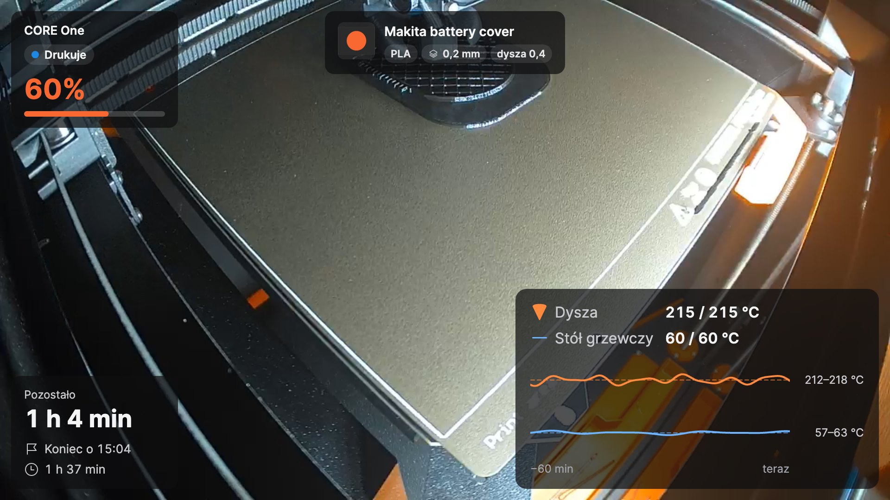

Otwórz je pozycją **Pokaż kamerę** w podmenu drukarki. Okno pokazuje obraz z kamery na żywo, a na nim
[widżety](#6-widżety). Przyciski w oknie pojawiają się, gdy najedziesz na nie myszą.

### 5.1 Trzy tryby

| Tryb | Jak przełączyć | Do czego służy |
|---|---|---|
| **Zwykłe okno** | przycisk w oknie lub dwukrotne kliknięcie w małym podglądzie | wygodne oglądanie, dowolny rozmiar, dowolny monitor |
| **Mały podgląd** | przycisk **Mały podgląd, zawsze na wierzchu** | małe okno, które przez cały dzień zostaje nad innymi oknami |
| **Pełny ekran** | **Windows:** F11 · **macOS:** ⌃⌘F · lub dwukrotne kliknięcie obrazu; **Esc** wraca | cały ekran |

Mały podgląd ma pod obrazem pasek informacji (postęp, pozostały czas, godzina zakończenia). Dwa przyciski rozwijają
kolejne wiersze: **nazwę wydruku** i **wykres temperatur**. To, co pokazuje pasek, ustawisz w podkarcie
**Okno kamery** drukarki (zob. [11.1](#111-drukarki)).

  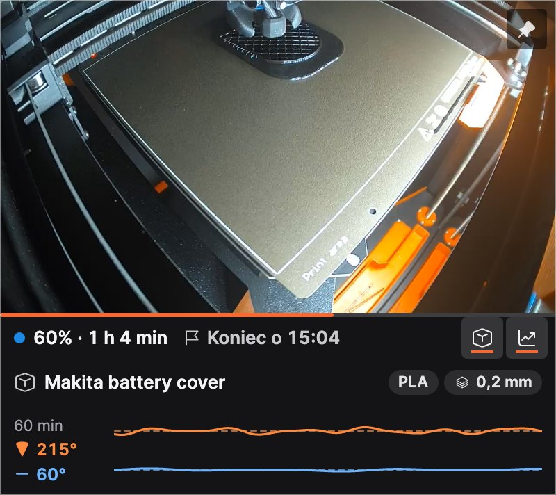

### 5.2 Zawsze na wierzchu

Przycisk pinezki w oknie pokazuje, czy okno zostaje nad innymi oknami, i jednym kliknięciem to przełącza. Ta sama opcja
jest w menu kontekstowym okna (**Zawsze na wierzchu**).

### 5.3 Menu kontekstowe okna

Kliknij obraz prawym przyciskiem myszy (w macOS także z klawiszem Control), aby otworzyć **Edytuj układ**,
**Zawsze na wierzchu**, nagrywanie, dashcam i timelapse.

### 5.4 Gdy połączenie zostanie przerwane

Okno samo łączy się ponownie, gdy kamera lub Wi-Fi na chwilę zniknie; w tym czasie pokazuje **Łączenie z kamerą…** lub
**Brak sygnału**. Kolejna próba następuje po 5 sekundach; dopóki kamera jest nieosiągalna, przerwa podwaja się aż do
jednej minuty. Okno na bieżąco pokazuje, mniej więcej za ile nastąpi kolejna próba; otwarcie okna, przywrócenie go po
zminimalizowaniu lub kliknięcie **Testuj kamerę** w ustawieniach od razu ponawia połączenie. Gdy drukarka zostanie
wyłączona, okno się zamyka i otwiera ponownie w tym samym miejscu, gdy drukarka wróci. Możesz to wyłączyć
w **Ustawienia → Drukarki → Okno kamery** (**Zamknij, gdy drukarka się wyłączy, i otwórz ponownie po jej włączeniu**).
Okno zamknięte ręcznie pozostaje zamknięte.

## 6. Widżety

Widżety to karty nad obrazem z kamery. Każda drukarka ma własny zestaw i układ.

| Widżet | Pokazuje |
|---|---|
| **Stan** | nazwę drukarki, stan i postęp w procentach |
| **Czasy** | pozostały czas, kiedy wydruk się skończy, czas drukowania |
| **Temperatury** | dyszę i stół (aktualna / docelowa) z wykresem z ostatnich 60 minut |
| **Nazwa wydruku** | czytelną nazwę pliku z materiałem, wysokością warstwy i dyszą; większe rozmiary dodają podgląd G-code |
| **Stygnięcie** | po wydruku: jak bardzo ostygły dysza i stół i kiedy można bezpiecznie wyłączyć drukarkę |

Każdy widżet ma trzy rozmiary: **S**, **M** i **L**. Na przykładzie temperatur: S pokazuje wartości, M dodaje wykres,
L etykiety i zakres temperatur.

  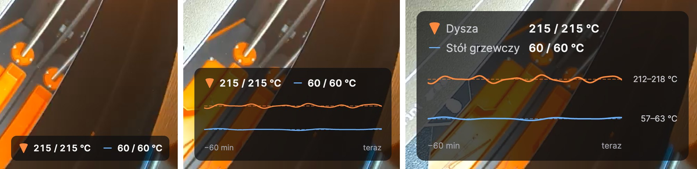

### 6.1 Wybór widżetów

W **Ustawienia → Widżety** wybierz u góry drukarkę i zaznacz widżety, które chcesz. Zaznaczenie widżetu pokazuje jego
własne ustawienia, np. progi stygnięcia dyszy i stołu. **Użyj układu dla wszystkich drukarek** kopiuje układ do
pozostałych drukarek. **Krycie tła kart** sprawia, że tekst pozostaje czytelny na jasnym obrazie (dla wszystkich
drukarek).

  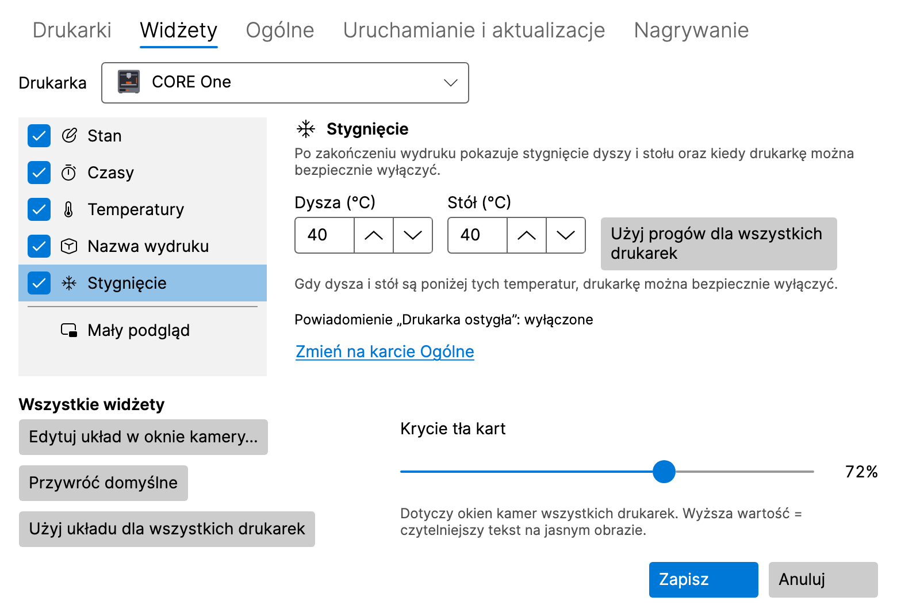

### 6.2 Rozmieszczanie widżetów w oknie kamery

Kliknij **Edytuj układ** w oknie kamery (lub **Edytuj układ w oknie kamery…** w **Ustawienia → Widżety**). W trybie
układu:

- **przeciągnij** widżet w jedno z sześciu miejsc (u góry i u dołu, po lewej, pośrodku i po prawej),
- kliknij widżet, aby otworzyć jego opcje: **Rozmiar** (Mały, Średni, Duży) i **Wyróżnij** (pokazuje kluczową wartość
  w kolorze akcentu),
- **Przywróć domyślne** przywraca domyślny układ, **Gotowe** go zapisuje.

Z klawiatury: **Spacja** podnosi widżet, **klawisze strzałek** go przesuwają, **Enter** otwiera jego opcje, a **Esc**
odrzuca zmiany. Jeśli okno jest za małe, najpierw je powiększ.

  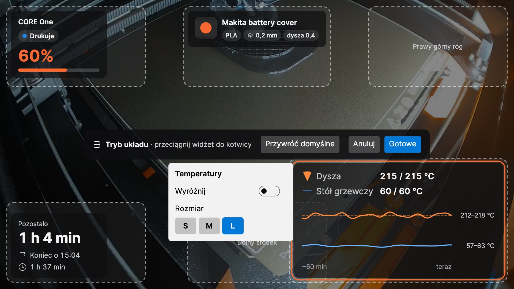

## 7. Powiadomienia

LayerPeek pokazuje natywne powiadomienia systemowe o tych zdarzeniach (każde można włączyć lub wyłączyć w
**Ustawienia → Ogólne**):

- rozpoczęcie, zakończenie, wstrzymanie, wznowienie i zatrzymanie wydruku,
- drukarka wymaga interwencji (także odrzucone hasło), błąd,
- drukarka przeszła w tryb offline lub znów jest online,
- **Pozostało N minut**, żebyś zdążył podejść do drukarki, gdy wydruk się kończy (**Powiadom, gdy do końca druku
  zostanie tyle minut**, 0 = wyłączone),
- **Drukarka ostygła**: dysza i stół mają temperaturę poniżej progów widżetu **Stygnięcie** i drukarkę można
  bezpiecznie wyłączyć.

**Dźwięk** może być wyłączony, włączony tylko dla ważnych powiadomień albo dla wszystkich powiadomień.
**Wyślij powiadomienie testowe** pokazuje przykładowe powiadomienie, dzięki czemu sprawdzisz, czy powiadomienia do
Ciebie docierają.

- **Windows:** jeśli powiadomienia dla LayerPeek są wyłączone w **Ustawienia → System → Powiadomienia**, ustawienia
  LayerPeek o tym informują i oferują **Otwórz ustawienia powiadomień**. Sprawdź też tryb **Nie przeszkadzać**.
- **macOS:** pierwsze powiadomienie poprosi o pozwolenie; kliknij **Pozwól**. Jeśli powiadomienia są wyłączone w
  **Ustawienia systemowe → Powiadomienia**, ustawienia LayerPeek oferują **Otwórz ustawienia powiadomień**. Sprawdź też
  **Tryb skupienia** (Focus).

Kliknięcie powiadomienia drukarki otwiera interfejs webowy PrusaLink tej drukarki. Alarm błędu wydruku otwiera okno
kamery, nieudane nagrywanie otwiera kartę **Nagrywanie** w ustawieniach, a zakończona konwersja timelapse otwiera folder
z nagraniami.

## 8. Nagrywanie, dashcam i timelapse

Wszystkie nagrania zostają na Twoim dysku. Domyślnie trafiają do folderu **Wideo** (Windows) lub **Filmy** (macOS),
do podfolderu `LayerPeek`, w osobnym podfolderze dla każdej drukarki, nazwanym według czasu i wydruku. Wideo jest
zapisywane jako MP4 bez ponownego kodowania, więc prawie nie obciąża procesora.

  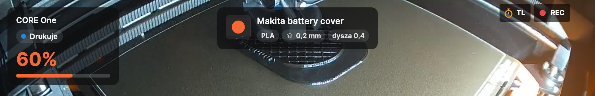

Podczas nagrywania kamery okno kamery pokazuje czerwony wskaźnik **REC**, a podczas tworzenia timelapse bursztynowy
**TL**.

### 8.1 Nagrywanie ręczne

**Nagrywaj** / **Zatrzymaj nagrywanie** w podmenu drukarki lub przycisk nagrywania w oknie kamery.
**Odtwórz ostatnie nagranie** i **Otwórz folder z nagraniami** znajdziesz w podmenu drukarki.

### 8.2 Nagrywanie każdego wydruku

Włącz **Nagrywaj każdy wydruk** w podkarcie **Kamera** drukarki. Każdy wydruk jest nagrywany od początku do
minuty po jego zakończeniu, także bez otwartego okna kamery.

  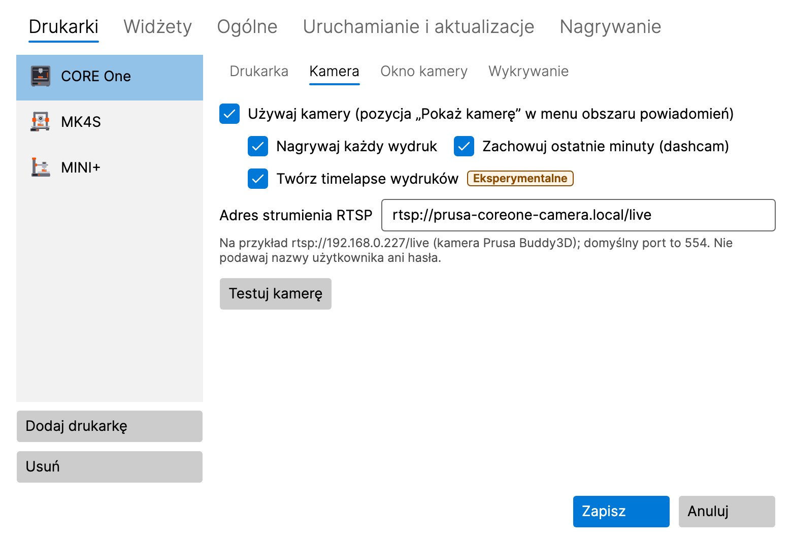

### 8.3 Dashcam: ostatnie minuty

Włącz **Zachowuj ostatnie minuty (dashcam)** w podkarcie **Kamera** drukarki. Podczas wydruku LayerPeek przechowuje
w pamięci ostatnie 2 minuty obrazu z kamery (ok. 8 MB na minutę i drukarkę); nic nie jest zapisywane na dysku, dopóki
nagranie nie zostanie zapisane. Ostatnie minuty wraz z 30 sekundami po zdarzeniu są zapisywane:

- automatycznie przy błędzie wydruku, gdy drukarka wymaga interwencji, gdy wydruk zostanie zatrzymany i gdy wykrywanie
  błędów wydruku podniesie alarm (każdą z tych opcji można wyłączyć na karcie **Nagrywanie**),
- ręcznie pozycją **Zapisz ostatnie 2 min** w podmenu drukarki lub w menu kontekstowym okna kamery.

Długość (1–10 minut) ustawisz na karcie **Nagrywanie**.

### 8.4 Timelapse (eksperymentalny)

Timelapse to krótki film z całego wydruku: domyślnie jedna klatka co 30 sekund, żadna podczas pauzy wydruku,
odtwarzany z prędkością 30 klatek na sekundę. Zapisuje się jako `…_timelapse.mp4` obok nagrań.

- **Ręcznie:** **Uruchom timelapse (eksperymentalny)** / **Zatrzymaj timelapse (eksperymentalny)** w podmenu drukarki
  lub przycisk stopera w oknie kamery. **Odtwórz ostatni timelapse** znajdziesz w podmenu.
- **Każdy wydruk:** **Twórz timelapse wydruków** w podkarcie **Kamera** drukarki.
- **Interwał:** na karcie **Nagrywanie**, 5–600 sekund, albo przełącz na **Co N-tą warstwę (szacunek)**: klatka, gdy
  zaczyna się nowa warstwa. PrusaLink nie zgłasza warstw, więc LayerPeek szacuje je na podstawie wysokości osi Z.
- **Utwórz timelapse z nagrania… (eksperymentalny)** tworzy timelapse z istniejącego nagrania LayerPeek.
- **Eksportuj timelapse do JPEG… (eksperymentalny)** zapisuje klatki timelapse jako ponumerowane pliki JPEG, np. do
  własnej obróbki wideo.

Obie konwersje pokazują postęp w pozycji menu, gdzie możesz je też anulować, a powiadomienie da Ci znać, gdy się
zakończą.

### 8.5 Folder i limit rozmiaru

Na karcie **Nagrywanie** możesz zmienić **Folder na nagrania** oraz **Limit rozmiaru wszystkich nagrań (GB)**
(domyślnie 50 GB). Po przekroczeniu limitu najstarsze nagrania są usuwane; gdy na dysku zostanie mniej niż 5 GB
wolnego miejsca, nagrywanie się zatrzymuje. Nieudane nagrywanie wyświetla powiadomienie.

  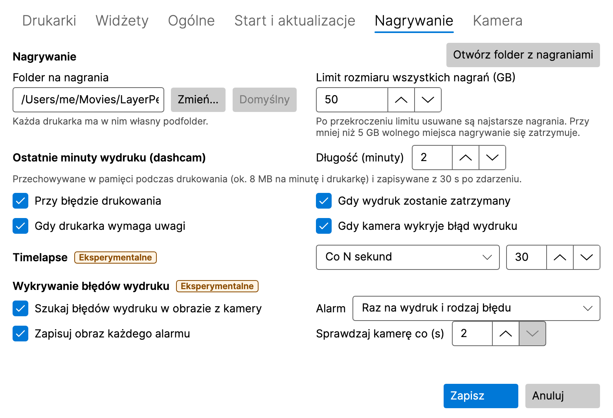

## 9. Wykrywanie błędów wydruku (eksperymentalne)

LayerPeek może obserwować wydruk przez kamerę i ostrzec Cię, gdy na stole coś pójdzie nie tak. Działa wyłącznie na
Twoim komputerze; obraz z kamery nigdy go nie opuszcza.

  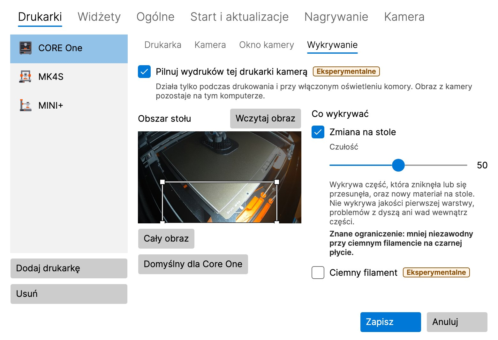

### 9.1 Włączanie

Domyślnie jest wyłączone i trzeba je włączyć w dwóch miejscach:

1. **Szukaj błędów wydruku w obrazie z kamery** na karcie **Nagrywanie** (dla wszystkich drukarek),
2. **Pilnuj wydruków tej drukarki kamerą** w podkarcie **Wykrywanie** drukarki.

Drukarka musi mieć włączoną kamerę. Wykrywanie działa tylko podczas drukowania i przy włączonym oświetleniu komory,
także bez otwartego okna kamery.

### 9.2 Obszar stołu

**Obszar stołu** to część obrazu, która jest obserwowana. Przeciągnij myszą nowy prostokąt, przesuń go lub zmień jego
rozmiar, chwytając za róg, albo użyj klawiszy strzałek (Shift + strzałki zmieniają rozmiar). **Cały obraz** obserwuje
cały obraz, **Wczytaj obraz** pobiera nowy obraz z kamery, a w przypadku CORE One **Domyślny dla Core One** przywraca
jego ustawienie wstępne.

### 9.3 Detektory

- **Zmiana na stole** zauważa część, która zniknęła lub się przesunęła, oraz nowy materiał na stole (spaghetti,
  oderwana część). **Ciemny filament** pomaga przy czarnym lub bardzo ciemnym filamencie, kosztem większej liczby
  fałszywych alarmów.
- **Drukowanie w powietrzu** (domyślnie wyłączone, tylko dla drukarek, których stół podczas drukowania opuszcza się
  w dół: CORE One, CORE One L, XL) zauważa, że drukarka dalej drukuje, ale nic już nie przyrasta, np. gdy skończył się
  filament.

**Czułość** (0–100, domyślnie 50): wyższa oznacza więcej alarmów, także fałszywych; niższa oznacza mniej alarmów, ale
błąd może zostać przeoczony.

### 9.4 Alarm

Alarm to powiadomienie **Możliwy błąd wydruku – …** z obrazem z kamery. Kliknięcie go otwiera okno kamery. Przycisk
**Fałszywy alarm** zapisuje lokalny wpis do dostrajania; nic nie opuszcza Twojego komputera. Na karcie **Nagrywanie**
ustawisz, jak często alarm się powtarza, czy zapisywać obraz każdego alarmu i jak często sprawdzać kamerę
(2–5 sekund).

> [!WARNING]
> Wykrywanie nie ocenia jakości pierwszej warstwy, nie zauważa problemów przy dyszy ani wad wewnątrz części. Może
> przeoczyć błąd albo podnieść fałszywy alarm. Nie polegaj na nim jako jedynym zabezpieczeniu wydruku bez nadzoru.

## 10. Diagnostyka

**Diagnostyka…** w menu ikony (drukarkę wybierasz u góry okna) pokazuje model drukarki i firmware, aktualny stan,
temperatury dyszy i stołu (aktualną i docelową), wentylatory, prędkość druku, przepływ i wysokość Z oraz wykres
temperatur z ostatnich 30 minut, 2 godzin lub 24 godzin. Historia jest przechowywana tylko w pamięci i zaczyna się
w chwili uruchomienia LayerPeek.

  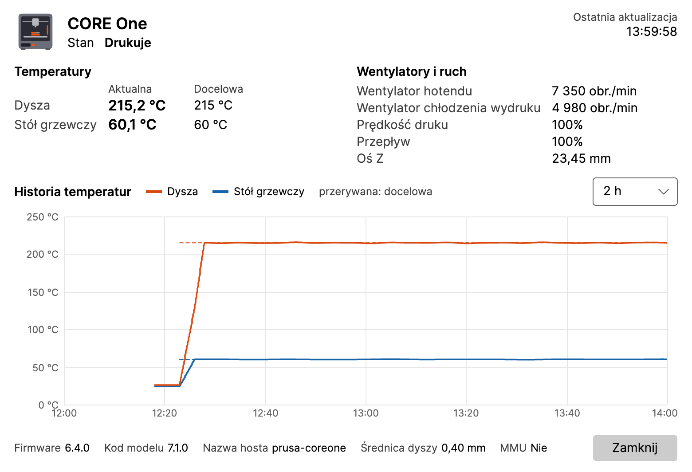

## 11. Przegląd ustawień

Otwórz **Ustawienia…** z menu ikony. Zmiany obowiązują po kliknięciu **Zapisz**; **Anuluj** je odrzuca.

### 11.1 Drukarki

Lista drukarek z przyciskami **Dodaj drukarkę** i **Usuń**. Każda drukarka ma podkarty:

- **Drukarka:** nazwa, adres, nazwa użytkownika, hasło, **Testuj połączenie**.
- **Kamera:** adres RTSP, **Testuj kamerę**, automatyczne nagrywanie, dashcam i timelapse wydruków.
- **Okno kamery:** **Otwórz jako** (jak ostatnio, zwykłe okno, mały podgląd, pełny ekran), monitor, rozmiar,
  położenie i **Zawsze na wierzchu** dla zwykłego okna i małego podglądu, **Zapamiętaj ostatnią pozycję i rozmiar**,
  **Zamknij, gdy drukarka się wyłączy, i otwórz ponownie po jej włączeniu** oraz to, co pokazuje pasek informacji
  małego podglądu.
- **Wykrywanie:** wykrywanie błędów wydruku dla tej drukarki (zob. [9](#9-wykrywanie-błędów-wydruku-eksperymentalne)).

### 11.2 Widżety

Widżety każdej drukarki, ich ustawienia i krycie kart (zob. [6](#6-widżety)).

### 11.3 Nagrywanie

Folder i limit rozmiaru nagrań, dashcam, timelapse i wykrywanie błędów wydruku (zob.
[8](#8-nagrywanie-dashcam-i-timelapse) i [9](#9-wykrywanie-błędów-wydruku-eksperymentalne)). Funkcje eksperymentalne
mają oznaczenie **Eksperymentalne**.

### 11.4 Ogólne

- **Powiadomienia:** które zdarzenia, **Dźwięk**, przypomnienie o pozostałych minutach, **Wyślij powiadomienie
  testowe**.
- **Interwał odpytywania (sekundy):** jak często drukarki są pytane o swój stan.
- **Język:** **Język systemu** lub jeden z: English, Čeština, Slovenčina, Deutsch, Español, Français, Italiano, Polski.
  Zmienia tylko teksty; liczby, daty i godziny są zgodne z ustawieniami regionalnymi Twojego systemu.
- **Szczegółowe logi (Debug):** włączaj tylko wtedy, gdy ktoś Cię o to poprosi przy rozwiązywaniu problemu.

### 11.5 Uruchamianie i aktualizacje

- **Windows:** **Uruchamiaj po zalogowaniu się do systemu Windows**. Domyślnie włączone; dostępne tylko w wersji
  zainstalowanej, nie w wersji ZIP.
- **macOS:** **Otwieraj podczas logowania**. Domyślnie wyłączone; dostępne tylko wtedy, gdy LayerPeek jest w folderze
  Aplikacje. Jeśli wyłączyłeś LayerPeek w **Ustawienia systemowe → Ogólne → Rzeczy i rozszerzenia otwierane podczas
  logowania**, tylko Ty możesz go tam ponownie włączyć; przycisk **Otwórz Ustawienia systemowe** zaprowadzi Cię we
  właściwe miejsce.
- **Automatycznie sprawdzaj aktualizacje**, **Oferuj wersje wstępne** i **Sprawdź teraz** (zob. [12](#12-aktualizacje)).

## 12. Aktualizacje

Krótko po uruchomieniu, a potem raz dziennie LayerPeek pyta GitHub, czy pojawiła się nowa wersja (możesz to wyłączyć).
Nowa wersja pojawi się jako **Dostępna nowa wersja X.Y.Z** w menu ikony i jednorazowo jako powiadomienie.

- **Windows, wersja zainstalowana:** pozycja menu pobiera aktualizację, zamyka LayerPeek i uruchamia nową wersję.
- **Windows, wersja ZIP:** pozycja menu otwiera stronę wydania; nowy plik ZIP pobierz ręcznie.
- **macOS:** pozycja menu pobiera aktualizację i ponownie uruchamia LayerPeek, ale tylko wtedy, gdy aplikacja jest
  w folderze **Aplikacje** (nie na obrazie dysku ani w folderze Pobrane).

Twoje ustawienia i hasła zostają zachowane.

**Aktualizacja odrzucona:** zainstalowana wersja przyjmuje aktualizację tylko wtedy, gdy da się zweryfikować jej podpis.
Jeśli się nie da, LayerPeek niczego nie instaluje: pokazuje powiadomienie (raz dla każdej oferowanej wersji; kliknięcie
otwiera ustawienia) oraz błąd na karcie **Uruchamianie i aktualizacje**, a menu ikony zamiast nowej wersji pokazuje
**Aktualizacja odrzucona…** (powiadomienie o nowej wersji znika). Tak pozostaje, dopóki kolejne sprawdzenie się nie
powiedzie: wtedy nowa wersja jest znowu oferowana, a powiadomienie o niej pojawia się jeszcze raz. Nie instaluj tej
wersji ręcznie, samo wydanie mogło zostać podmienione: poczekaj na kolejne wydanie lub śledź ogłoszenia projektu.

## 13. Gdzie są przechowywane Twoje dane

| Co | Windows | macOS |
|---|---|---|
| Ustawienia | `%APPDATA%\LayerPeek\settings.json` | `~/Library/Application Support/LayerPeek/settings.json` |
| Hasła | Menedżer poświadczeń systemu Windows | pęk kluczy logowania |
| Logi | `%LOCALAPPDATA%\LayerPeek\logs` | `~/Library/Logs/LayerPeek` |
| Nagrania | `Videos\LayerPeek` | `Movies/LayerPeek` |

Historia temperatur jest przechowywana tylko w pamięci. LayerPeek łączy się wyłącznie z dodanymi przez Ciebie
drukarkami i kamerami oraz, jeśli nie wyłączysz sprawdzania aktualizacji, z serwisem GitHub (lista wydań, bez żadnego
konta, oraz pobranie aktualizacji, którą sam uruchomisz). Nie ma żadnej telemetrii.

## 14. Rozwiązywanie problemów

**Ikona nie jest widoczna (Windows).** Kliknij strzałkę **`^`** w obszarze powiadomień i przeciągnij ikonę LayerPeek
na pasek zadań.

**Drukarka jest Offline.** Sprawdź, czy drukarka jest włączona i podłączona do sieci, czy adres jest poprawny
(wypróbuj go w przeglądarce) i czy Twój komputer jest w tej samej sieci. Uruchom **Testuj połączenie** w ustawieniach
drukarki.

**Nieprawidłowe dane logowania.** Wpisz ponownie nazwę użytkownika i hasło z menu drukarki **Ustawienia → Sieć →
PrusaLink** i zapisz.

**Brak połączenia w macOS.** Dostęp do sieci lokalnej może być wyłączony. LayerPeek wtedy oferuje **Otwórz Ustawienia
systemowe**; włącz LayerPeek w **Ustawienia systemowe → Prywatność i ochrona → Sieć lokalna**.

**Kamera pokazuje Brak sygnału.** Sprawdź adres RTSP przyciskiem **Testuj kamerę** oraz to, czy kamera jest włączona
i osiągalna. Nie wpisuj do adresu nazwy użytkownika ani hasła.

**Powiadomienia się nie pojawiają.** Użyj **Wyślij powiadomienie testowe** w **Ustawienia → Ogólne** i sprawdź tryb
**Nie przeszkadzać** (Windows) lub **Tryb skupienia** (macOS).

**Zgłaszanie błędu.** Otwórz **O programie** z menu ikony:

- **Zapisz pakiet diagnostyczny…** zapisuje plik ZIP z logami, informacjami o wersji i systemie oraz ustawieniami,
  **bez haseł i kluczy**. Dołącz go do zgłoszenia błędu.
- **Kopiuj informacje do schowka** kopiuje krótki raport.
- **Otwórz folder z logami** otwiera logi.

Jeśli ktoś poprosi Cię o szczegółowy log, włącz **Szczegółowe logi (Debug)** w **Ustawienia → Ogólne**, powtórz problem,
zapisz pakiet i ponownie wyłącz szczegółowe logi.

Błędy i pomysły zgłaszaj w [issues](https://github.com/pfoltynek/LayerPeek/issues) w serwisie GitHub. Podaj model
drukarki, wersję firmware i system operacyjny.

## 15. Odinstalowanie

- **Windows, wersja zainstalowana:** **Ustawienia → Aplikacje → Zainstalowane aplikacje → LayerPeek → Odinstaluj**.
- **Windows, wersja ZIP:** zakończ LayerPeek i usuń jego folder.
- **macOS:** zakończ LayerPeek (**Zakończ** w jego menu) i przenieś **LayerPeek** z folderu **Aplikacje** do Kosza.

Odinstalowanie zachowuje Twoje ustawienia, hasła i nagrania. Aby je również usunąć, skasuj foldery z rozdziału
[13](#13-gdzie-są-przechowywane-twoje-dane) oraz wpisy LayerPeek w Menedżerze poświadczeń (Windows) lub w aplikacji
Dostęp do pęku kluczy (macOS).
