# Používateľská príručka LayerPeek

*Pre LayerPeek 0.5 vo Windows 10/11 a v macOS (Apple Silicon).* · [Ďalšie jazyky](../README.md)

LayerPeek sleduje vaše 3D tlačiarne Prusa cez lokálnu sieť a ich stav zobrazuje v oznamovacej oblasti Windows alebo
na paneli s ponukami macOS. Nemá hlavné okno: všetko začína v ponuke ikony. Táto príručka popisuje oba systémy;
tam, kde sa Windows a macOS líšia, to text uvádza alebo ukazuje obe varianty.

> [!NOTE]
> LayerPeek je nezávislý komunitný projekt, nie oficiálny produkt spoločnosti Prusa Research.

## Obsah

1. [Čo potrebujete](#1-čo-potrebujete)
2. [Inštalácia](#2-inštalácia)
3. [Začíname](#3-začíname)
4. [Ikona a jej ponuka](#4-ikona-a-jej-ponuka)
5. [Okno kamery](#5-okno-kamery)
6. [Widgety](#6-widgety)
7. [Upozornenia](#7-upozornenia)
8. [Nahrávanie, dashcam a timelapse](#8-nahrávanie-dashcam-a-timelapse)
9. [Detekcia chýb tlače (experimentálne)](#9-detekcia-chýb-tlače-experimentálne)
10. [Diagnostika](#10-diagnostika)
11. [Prehľad nastavení](#11-prehľad-nastavení)
12. [Aktualizácie](#12-aktualizácie)
13. [Kde sú uložené vaše údaje](#13-kde-sú-uložené-vaše-údaje)
14. [Zabezpečenie prístupu k PrusaLinku](#14-zabezpečenie-prístupu-k-prusalinku)
15. [Riešenie problémov](#15-riešenie-problémov)
16. [Odinštalovanie](#16-odinštalovanie)

## 1. Čo potrebujete

- **Tlačiareň Prusa s firmvérom Buddy 6.x a PrusaLinkom**: CORE One (otestovaná), MK4/MK4S, MK3.9/MK3.9S, MK3.5/MK3.5S,
  XL a MINI/MINI+. Original Prusa MK3/MK3S nemá vstavaný PrusaLink a nie je podporovaná.
- **Počítač v rovnakej lokálnej sieti** ako tlačiareň:
  - Windows 10 alebo 11, x64 (Windows na ARM nie je podporovaný),
  - macOS na Apple Silicon (M1 alebo novší).
- **Kamera (voliteľné):** akákoľvek kamera so streamom **RTSP H.264**, ktorá je dostupná z vášho počítača, napríklad
  kamera Prusa Buddy3D. Aj bez kamery máte ikonu, upozornenia a diagnostiku.

LayerPeek funguje iba vo vašej lokálnej sieti. Nepoužíva Prusa Connect ani žiadnu inú cloudovú službu. Mimo domova
sa k tlačiarňam dostanete cez VPN do domácej siete.

Zatiaľ je otestovaná len CORE One. Máte iný model? Pošlite prosím krátke [hlásenie kompatibility tlačiarne](https://github.com/pfoltynek/LayerPeek/issues/new?template=printer_compatibility.yml) (formulár je v angličtine); stačí jedna skúška na Windows alebo macOS.

## 2. Inštalácia

Najnovšiu verziu si stiahnite zo stránky [Releases](https://github.com/pfoltynek/LayerPeek/releases).

> [!IMPORTANT]
> Verzie 0.x sú predbežné a ich zostavy nie sú podpísané spoločnosťou Microsoft ani notarizované spoločnosťou Apple.
> Systém vás preto pri prvom spustení varuje; postup nižšie ukazuje, ako varovanie obísť.

### 2.1 Windows

Môžete si vybrať z dvoch balíkov:

| Balík | Čo robí |
|---|---|
| **Inštalátor** `LayerPeek-X.Y.Z-win-x64-Setup.exe` (odporúčané) | Nainštaluje LayerPeek iba pre vášho používateľa, bez práv správcu, do `%LOCALAPPDATA%\LayerPeek`, pridá ho do ponuky Štart, spúšťa ho po prihlásení a dokáže sa sám aktualizovať. |
| **ZIP** `LayerPeek-X.Y.Z-win-x64.zip` | Rozbaľte ho kamkoľvek a spustite `LayerPeek.exe`. Nespúšťa sa po prihlásení a sám sa neaktualizuje (namiesto toho otvorí stránku s vydaniami). |

Pri prvom spustení zobrazí Windows SmartScreen hlásenie **„Systém Windows ochránil váš počítač“** s *neznámym
vydavateľom*. Kliknite na **Ďalšie informácie** a potom na **Spustiť aj tak**.

### 2.2 macOS

| Balík | Čo robí |
|---|---|
| **Obraz disku** `LayerPeek-X.Y.Z-osx-arm64.dmg` (odporúčané) | Otvorte ho a pretiahnite **LayerPeek** do priečinka **Aplikácie**. |
| **Archív** `LayerPeek-X.Y.Z-osx-arm64.tar.gz` | Obsahuje `LayerPeek.app`; rozbaľte ho a aplikáciu presuňte do priečinka **Aplikácie**. |

LayerPeek vždy spúšťajte z priečinka **Aplikácie**, nie priamo z obrazu disku ani z priečinka Stiahnuté súbory: iba
odtiaľ sa môže otvárať po prihlásení a sám sa aktualizovať.

Pri prvom spustení aplikáciu zablokuje Gatekeeper (*„Apple nemohol overiť…“*):

1. Kliknite na **Hotovo**.
2. Otvorte **Systémové nastavenia → Súkromie a bezpečnosť**, posuňte sa nadol a pri správe o LayerPeeku kliknite na
   **Otvoriť aj tak** (Open Anyway).
3. Potvrďte heslom alebo Touch ID a LayerPeek otvorte znova.

Pokročilí používatelia môžu namiesto toho odstrániť príznak karantény v Termináli:
`xattr -dr com.apple.quarantine /Applications/LayerPeek.app`.

LayerPeek žije iba na paneli s ponukami. Nemá ikonu v Docku a nezobrazuje sa v prepínači aplikácií (⌘⇥).

## 3. Začíname

### 3.1 Zapnutie PrusaLinku v tlačiarni

Na displeji tlačiarne otvorte **Nastavenia → Sieť → PrusaLink** (Settings → Network → PrusaLink). Skontrolujte, či je
PrusaLink zapnutý, a poznačte si:

- **IP adresu** tlačiarne (alebo jej názov hostiteľa),
- **používateľské meno** (predvolené je `maker`),
- **heslo**.

### 3.2 Pridanie tlačiarne

1. Nájdite ikonu LayerPeek:
   - **Windows:** v oznamovacej oblasti na pravom konci panela úloh. Ak ju nevidíte, kliknite na šípku
     **`^`** (skryté ikony) a pretiahnite ikonu na panel úloh, aby zostala viditeľná.
   - **macOS:** na paneli s ponukami v hornej časti obrazovky.
2. Otvorte ponuku ikony (**Windows:** kliknite na ikonu pravým tlačidlom, **macOS:** kliknite na ňu) a vyberte
   **Pridať tlačiareň…**. Otvorí sa okno **Nastavenia** na karte **Tlačiarne**.
3. Vyplňte:
   - **Názov:** akýkoľvek názov, napr. `CORE One`.
   - **Adresa:** IP adresa alebo názov hostiteľa, napr. `192.168.1.20` alebo `http://prusa-mk4.local`.
   - **Používateľské meno** a **Heslo:** údaje z tlačiarne.
4. Kliknite na **Otestovať spojenie**. Funkčné spojenie ohlási kód modelu a verziu firmvéru.
5. Kliknite na **Uložiť**.

<p align="center">
  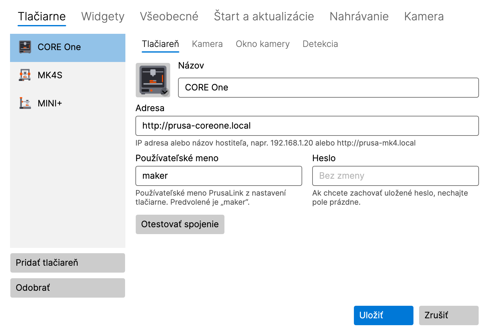
</p>

Ikona hneď začne ukazovať stav tlačiarne. Ďalšie tlačiarne pridáte rovnako: **Pridať tlačiareň** na karte
**Tlačiarne**.

**macOS 15 a novší:** pri prvom pripojení k tlačiarni alebo kamere sa systém spýta na prístup k **lokálnej sieti**
(Local Network). Kliknite na **Povoliť**. Ak ste prístup zamietli, pozrite si [Riešenie problémov](#15-riešenie-problémov).

Heslo sa ukladá do **Správcu poverení Windows** alebo do **Kľúčenky macOS**, nikdy nie do súboru s nastaveniami.
Keď tlačiareň neskôr upravujete, pole hesla ukazuje **Bez zmeny**; ak ho necháte prázdne, uložené heslo zostane.

**Varovanie pod adresou:** adresa `http://`, ktorá môže byť mimo miestnej siete (verejná IP adresa alebo iný názov
hostiteľa ako názov bez bodky alebo s koncovkou `.local`, `.lan` či `.home.arpa`), ukáže namiesto nápovedy varovanie.
PrusaLink prihlasuje bez šifrovania, takže heslo môže niekto cestou zachytiť. Uložiť adresu aj tak možno. Radšej použite
`https://` cez reverzný proxy alebo VPN. Odkaz **Viac informácií** vedľa varovania otvorí kapitolu [Zabezpečenie
prístupu k PrusaLinku](#14-zabezpečenie-prístupu-k-prusalinku).

### 3.3 Pridanie kamery (voliteľné)

1. V **Nastavenia → Tlačiarne** vyberte tlačiareň a otvorte jej podkartu **Kamera**.
2. Zapnite **Používať kameru (položka „Zobraziť kameru“ v ponuke oznamovacej oblasti)**.
3. Zadajte **Adresa RTSP streamu**, napr. `rtsp://192.168.1.21/live` pre kameru Buddy3D (predvolený port je 554).
   Do adresy nedávajte používateľské meno ani heslo.
4. Kliknite na **Otestovať kameru**. Funkčná kamera ukáže snímku a svoje rozlíšenie.
5. Kliknite na **Uložiť** a v podponuke tlačiarne vyberte **Zobraziť kameru**.

Rovnako ako pri adrese tlačiarne ukáže varovanie aj adresa kamery, ktorá môže byť mimo miestnej siete: RTSP nie je
šifrované, takže obraz kamery môže niekto cestou zachytiť. Uložiť adresu aj tak možno; radšej použite VPN. Rovnaký odkaz
vedľa neho otvorí kapitolu [Zabezpečenie prístupu k PrusaLinku](#14-zabezpečenie-prístupu-k-prusalinku).

### 3.4 Obrázok tlačiarne

Zoznam tlačiarní ukazuje pri každej tlačiarni obrázok, ktorý sa vyberie automaticky podľa modelu. Kliknutím na obrázok
môžete vybrať iný model, všeobecnú ilustráciu alebo vlastný obrázok (PNG, JPG).

## 4. Ikona a jej ponuka

### 4.1 Čo ikona ukazuje

Ikona ukazuje najdôležitejší stav zo všetkých vašich tlačiarní:

| Stav | Význam |
|---|---|
| **Pripravená** | tlačiareň nič nerobí |
| **Tlačí** | ikona sa postupne zapĺňa podľa priebehu tlače |
| **Pozastavené** | tlač je pozastavená |
| **Dokončené** / **Zastavené** | tlač skončila |
| **Vyžaduje zásah** | tlačiareň na vás čaká (napr. výmena filamentu alebo otázka na jej displeji) |
| **Chyba** | tlačiareň hlási chybu |
| **Nedostupná** | tlačiareň nie je dostupná |
| **Neplatné prihlasovacie údaje** | tlačiareň odmietla používateľské meno alebo heslo |

Keď nad ikonu presuniete myš, v bubline uvidíte podrobnosti: priebeh, zostávajúci čas a názov súboru. Kým sa nahráva
kamera tlačiarne, bublina ukazuje **Nahráva sa**.

### 4.2 Ponuka

- **Windows:** kliknite na ikonu pravým tlačidlom.
- **macOS:** kliknite na ikonu na paneli s ponukami.

Ponuka obsahuje:

- **Jednu podponuku pre každú tlačiareň**, v jej hlavičke je názov tlačiarne, stav a priebeh, a v nej:
  - **Zobraziť kameru** / **Skryť kameru** a pri otvorenom okne aj **Preniesť kameru do popredia**,
  - **Nahrávať** / **Zastaviť nahrávanie**, **Prehrať poslednú nahrávku**, **Otvoriť priečinok s nahrávkami**,
  - **Uložiť posledných 2 min** (keď je zapnutý dashcam, pozrite [8.3](#83-dashcam-posledné-minúty)),
  - položky timelapse (experimentálne, pozrite [8.4](#84-timelapse-experimentálne)),
  - **Otvoriť PrusaLink**: otvorí webové rozhranie PrusaLink tlačiarne v prehliadači, rovno prihlásené. Vaše heslo
    sa prehliadaču nikdy neodovzdá.
- **Diagnostika…** (pozrite [10](#10-diagnostika))
- **Nastavenia…**
- **Je dostupná nová verzia X.Y.Z** (iba keď je k dispozícii aktualizácia, pozrite [12](#12-aktualizácie))
- **Používateľská príručka**: otvorí túto príručku
- **O aplikácii**
- **Ukončiť**

Kým nepridáte prvú tlačiareň, ponuka namiesto podponúk tlačiarní ponúka **Pridať tlačiareň…**.

## 5. Okno kamery

<p align="center">
  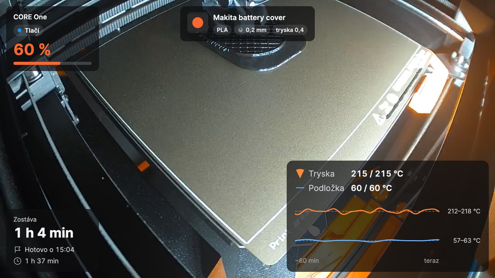
</p>

Otvoríte ho položkou **Zobraziť kameru** v podponuke tlačiarne. Okno ukazuje živý obraz z kamery a na ňom
[widgety](#6-widgety). Tlačidlá v okne sa objavia, keď nad ním pohnete myšou.

### 5.1 Tri režimy

| Režim | Ako prepnúť | Na čo slúži |
|---|---|---|
| **Normálne okno** | tlačidlo v okne alebo dvojklik v malom náhľade | poriadny pohľad, ľubovoľná veľkosť, ľubovoľný monitor |
| **Malý náhľad** | tlačidlo **Malý náhľad vždy navrchu** | malé okno, ktoré celý deň zostáva nad ostatnými oknami |
| **Celá obrazovka** | **Windows:** F11 · **macOS:** ⌃⌘F · alebo dvojklik na obraz; **Esc** sa vráti späť | celá obrazovka |

Malý náhľad má pod obrazom informačný pásik (priebeh, zostávajúci čas, čas dokončenia). Dve tlačidlá rozbalia ďalšie
riadky: **názov tlače** a **graf teplôt**. Čo pásik ukazuje, nastavíte na podkarte tlačiarne **Okno kamery**
(pozrite [11.1](#111-tlačiarne)).

Aby šetril procesor, ukazuje malý náhľad v predvolenom nastavení najviac 10 snímok za sekundu, čo malému obrazu stačí;
normálne okno a celá obrazovka ukazujú každú snímku kamery. Obmedzenie sa nastavuje na karte **Kamera** v nastaveniach
(pozrite [11.6](#116-kamera)).

<p align="center">
  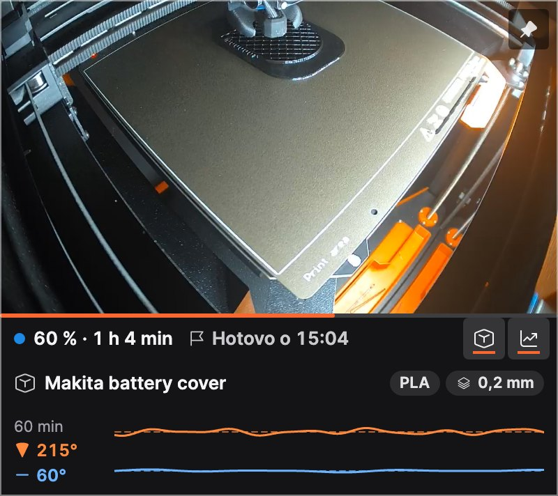
</p>

### 5.2 Vždy navrchu

Tlačidlo so špendlíkom v okne ukazuje, či okno zostáva nad ostatnými oknami, a jedným kliknutím to prepína.
Rovnaká voľba je aj v kontextovej ponuke okna (**Vždy navrchu**).

### 5.3 Kontextová ponuka okna

Kliknite na obraz pravým tlačidlom (v macOS aj s klávesom Control) a nájdete **Upraviť rozloženie**, **Vždy navrchu**,
nahrávanie, dashcam a timelapse.

### 5.4 Keď vypadne spojenie

Keď vypadne kamera alebo Wi-Fi, okno sa samo znova pripojí; medzitým ukazuje **Pripája sa ku kamere…** alebo **Bez
signálu**. Ďalší pokus príde o 5 sekúnd; kým je kamera nedostupná, prestávka sa zdvojnásobuje až na jednu minútu. Okno
priebežne ukazuje, približne o koľko príde ďalší pokus; keď okno otvoríte, obnovíte z minimalizácie alebo v nastaveniach
kliknete na **Otestovať kameru**, skúsi sa pripojiť hneď. Keď tlačiareň vypnete, okno sa zatvorí a po jej návrate sa
znova otvorí na rovnakom mieste. Toto správanie vypnete v **Nastavenia → Tlačiarne → Okno kamery** (**Zatvoriť, keď sa
tlačiareň vypne, a znova otvoriť po jej zapnutí**). Okno, ktoré zatvoríte sami, zostane zatvorené.

## 6. Widgety

Widgety sú karty nad obrazom z kamery. Každá tlačiareň má vlastnú sadu a rozloženie.

| Widget | Ukazuje |
|---|---|
| **Stav** | názov tlačiarne, stav a priebeh v percentách |
| **Časy** | zostávajúci čas, kedy bude tlač hotová, čas tlače |
| **Teploty** | tryska a podložka (aktuálna / cieľová) s grafom za posledných 60 minút |
| **Názov tlače** | čitateľný názov súboru s materiálom, výškou vrstvy a tryskou; väčšie veľkosti pridajú náhľad G-kódu |
| **Vychladnutie** | po tlači: ako veľmi už vychladla tryska a podložka a kedy je bezpečné tlačiareň vypnúť |

Každý widget má tri veľkosti: **S**, **M** a **L**. Tu napríklad teploty: S ukazuje hodnoty, M pridá graf, L popisky
a rozsah teplôt.

<p align="center">
  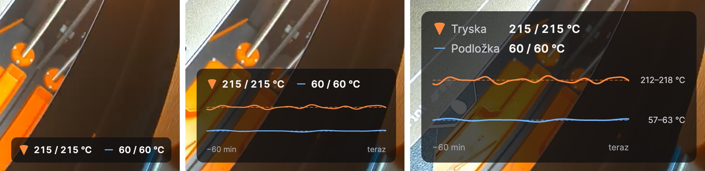
</p>

### 6.1 Výber widgetov

V **Nastavenia → Widgety** hore vyberte tlačiareň a zaškrtnite widgety, ktoré chcete. Keď widget vyberiete, zobrazia
sa jeho vlastné nastavenia, napr. prahy vychladnutia trysky a podložky. **Použiť rozloženie pre všetky tlačiarne**
skopíruje rozloženie na vaše ostatné tlačiarne. **Nepriehľadnosť pozadia kariet** udrží text čitateľný aj na svetlom
obraze (pre všetky tlačiarne).

<p align="center">
  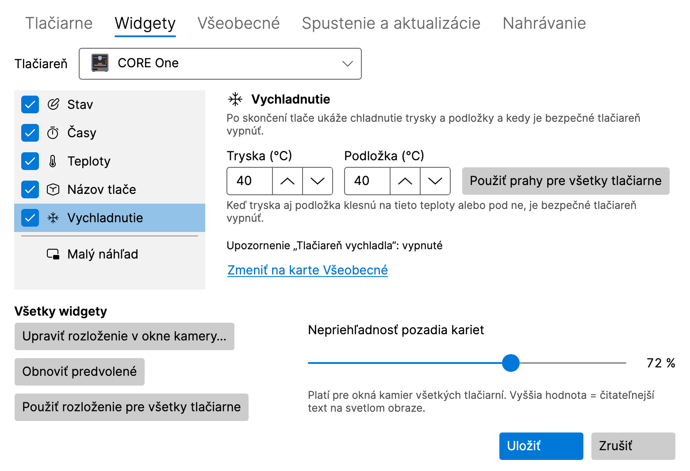
</p>

### 6.2 Rozmiestnenie widgetov v okne kamery

V okne kamery kliknite na **Upraviť rozloženie** (alebo na **Upraviť rozloženie v okne kamery…** v **Nastavenia →
Widgety**). V režime rozloženia:

- widget **pretiahnite** na jedno zo šiestich miest (hore a dole, vľavo, v strede a vpravo),
- kliknutím na widget otvoríte jeho voľby: **Veľkosť** (Malá, Stredná, Veľká) a **Zvýrazniť** (ukáže kľúčovú
  hodnotu farbou zvýraznenia),
- **Obnoviť predvolené** vráti predvolené rozloženie, **Hotovo** ho uloží.

Klávesnicou: **medzerník** widget zdvihne, **šípky** ho posúvajú, **Enter** otvorí jeho voľby a **Esc** zmeny
zahodí. Ak je okno príliš malé, najprv ho zväčšite.

<p align="center">
  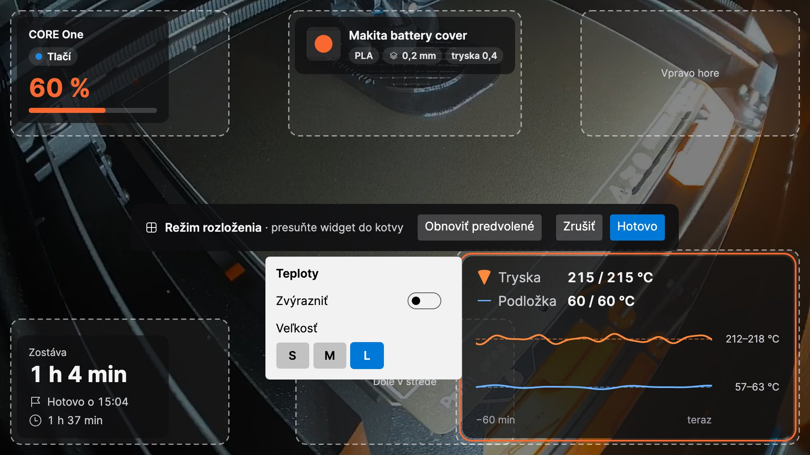
</p>

## 7. Upozornenia

LayerPeek zobrazuje natívne systémové upozornenia pri týchto udalostiach (každé môžete zapnúť alebo vypnúť
v **Nastavenia → Všeobecné**):

- tlač sa začala, skončila, bola pozastavená, pokračuje alebo bola zastavená,
- tlačiareň vyžaduje zásah (aj pri odmietnutom hesle), chyba,
- tlačiareň prestala byť dostupná alebo je znova dostupná,
- **Zostáva N min**, aby ste mohli byť pri tlačiarni, keď tlač skončí (**Upozorniť, keď zostáva toľko minút tlače
  (0 = vypnuté)**),
- **Tlačiareň vychladla**: tryska a podložka sú pod prahmi widgetu **Vychladnutie** a tlačiareň je bezpečné vypnúť.

**Zvuk** môže byť vypnutý, zapnutý iba pre dôležité upozornenia alebo pre všetky upozornenia. **Poslať skúšobné
upozornenie** ukáže ukážku, takže si overíte, že sa k vám upozornenia dostanú.

- **Windows:** ak sú upozornenia pre LayerPeek vypnuté v **Nastavenie → Systém → Oznámenia**, nastavenia LayerPeeku
  to oznámia a ponúknu **Otvoriť nastavenia oznámení**. Skontrolujte aj režim **Nerušiť**.
- **macOS:** pri prvom upozornení sa systém spýta na povolenie; kliknite na **Povoliť**. Ak sú upozornenia vypnuté
  v **Systémové nastavenia → Hlásenia**, nastavenia LayerPeeku ponúknu **Otvoriť nastavenia hlásení**. Skontrolujte aj
  režim **Sústredenie** (Focus).

Kliknutie na upozornenie tlačiarne otvorí webové rozhranie PrusaLink tlačiarne. Poplach pri chybe tlače otvorí okno
kamery, neúspešné nahrávanie otvorí kartu **Nahrávanie** v nastaveniach a dokončený prevod timelapse otvorí priečinok
s nahrávkami.

## 8. Nahrávanie, dashcam a timelapse

Všetky nahrávky zostávajú na vašom disku. Predvolene sa ukladajú do priečinka **Videá** (Windows) alebo **Filmy**
(macOS) do podpriečinka `LayerPeek`, pre každú tlačiareň do vlastného podpriečinka, pomenované podľa času a tlače. Video
sa ukladá ako MP4 bez prekódovania, takže procesor takmer nezaťaží.

<p align="center">
  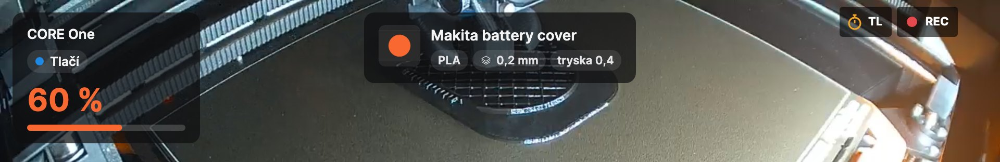
</p>

Kým sa kamera nahráva, okno kamery ukazuje červené **REC**; kým sa sníma timelapse, jantárové **TL**.

### 8.1 Ručné nahrávanie

**Nahrávať** / **Zastaviť nahrávanie** v podponuke tlačiarne alebo tlačidlo nahrávania v okne kamery. **Prehrať
poslednú nahrávku** a **Otvoriť priečinok s nahrávkami** sú v podponuke tlačiarne.

### 8.2 Nahrávanie každej tlače

Na podkarte tlačiarne **Kamera** zapnite **Automaticky nahrávať tlač**. Každá tlač sa nahrá od začiatku až do minúty
po jej skončení, aj bez otvoreného okna kamery.

<p align="center">
  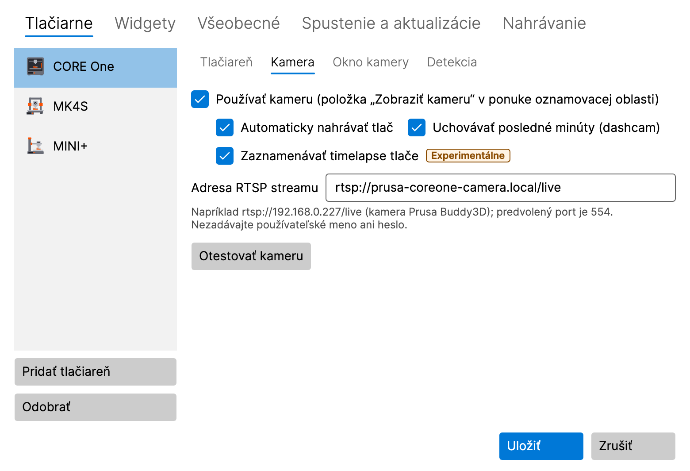
</p>

### 8.3 Dashcam: posledné minúty

Na podkarte tlačiarne **Kamera** zapnite **Uchovávať posledné minúty (dashcam)**. Počas tlače LayerPeek uchováva
v pamäti posledné 2 minúty z kamery (asi 8 MB na minútu a tlačiareň); kým sa záznam neuloží, na disk sa nič
nezapisuje. Posledné minúty spolu s 30 sekundami po udalosti sa uložia:

- automaticky pri chybe tlače, keď tlačiareň vyžaduje zásah, keď sa tlač zastaví a keď detekcia chýb tlače spustí
  poplach (každú z týchto možností môžete vypnúť na karte **Nahrávanie**),
- ručne položkou **Uložiť posledných 2 min** v podponuke tlačiarne alebo v kontextovej ponuke okna kamery.

Dĺžku (1 – 10 minút) nastavíte na karte **Nahrávanie**.

### 8.4 Timelapse (experimentálne)

Timelapse je krátke video celej tlače: predvolene jedna snímka každých 30 sekúnd, počas pozastavenej tlače žiadna,
prehrávané rýchlosťou 30 snímok za sekundu. Ukladá sa ako `…_timelapse.mp4` vedľa nahrávok.

- **Ručne:** **Spustiť timelapse (experimentálne)** / **Zastaviť timelapse (experimentálne)** v podponuke tlačiarne
  alebo tlačidlo so stopkami v okne kamery. **Prehrať posledný timelapse** je v podponuke.
- **Každá tlač:** **Zaznamenávať timelapse tlače** na podkarte tlačiarne **Kamera**.
- **Interval:** na karte **Nahrávanie**, 5 – 600 sekúnd, alebo prepnite na **Každú N. vrstvu (odhad)**: snímka pri
  začiatku novej vrstvy. PrusaLink vrstvy nehlási, preto ich LayerPeek odhaduje z výšky osi Z.
- **Vytvoriť timelapse z nahrávky… (experimentálne)** vytvorí timelapse z existujúcej nahrávky LayerPeeku.
- **Exportovať timelapse do JPEG… (experimentálne)** uloží snímky timelapse ako očíslované súbory JPEG, napr. na
  vlastnú úpravu videa.

Oba prevody ukazujú svoj priebeh v položke ponuky, kde ich môžete aj zrušiť, a keď sú hotové, dá vám o tom vedieť
upozornenie.

### 8.5 Priečinok a limit veľkosti

Na karte **Nahrávanie** môžete zmeniť **Priečinok na nahrávky** a **Limit veľkosti všetkých nahrávok (GB)**
(predvolene 50 GB). Po prekročení limitu sa najstaršie nahrávky vymažú; keď na disku zostane menej ako 5 GB voľného
miesta, nahrávanie sa zastaví. Neúspešné nahrávanie ohlási upozornenie.

<p align="center">
  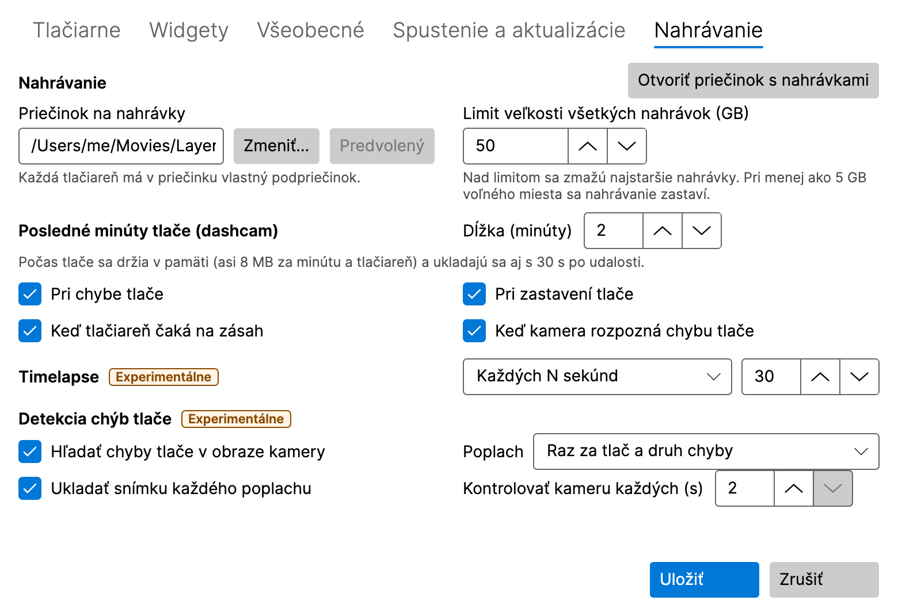
</p>

## 9. Detekcia chýb tlače (experimentálne)

LayerPeek môže cez kameru sledovať tlač a varovať vás, keď sa na podložke niečo pokazí. Beží iba na vašom počítači;
obraz z kamery ho nikdy neopustí.

<p align="center">
  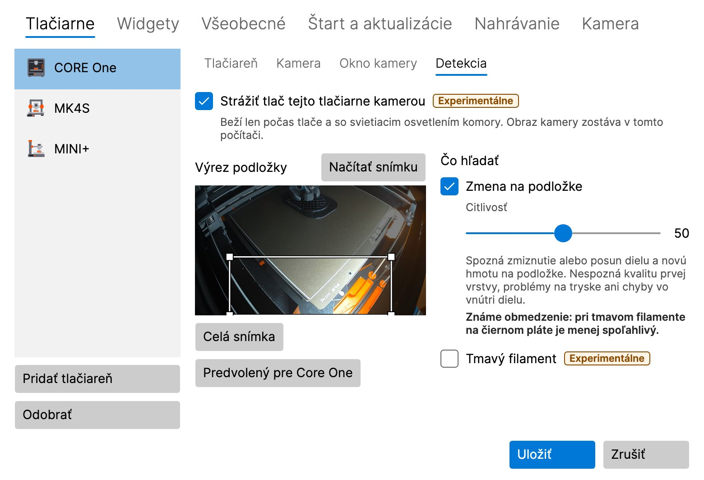
</p>

### 9.1 Zapnutie

Predvolene je vypnutá a treba ju zapnúť na dvoch miestach:

1. **Hľadať chyby tlače v obraze kamery** na karte **Nahrávanie** (pre všetky tlačiarne),
2. **Strážiť tlač tejto tlačiarne kamerou** na podkarte tlačiarne **Detekcia**.

Tlačiareň musí mať zapnutú kameru. Detekcia beží iba počas tlače a pri zapnutom osvetlení komory, aj bez otvoreného
okna kamery.

### 9.2 Výrez podložky

**Výrez podložky** je časť obrazu, ktorá sa sleduje. Myšou nakreslite nový obdĺžnik, posuňte ho alebo zmeňte jeho
veľkosť ťahaním za roh, prípadne použite šípky (Shift + šípky menia veľkosť). **Celá snímka** sleduje celý obraz,
**Načítať snímku** získa z kamery nový obraz a pri CORE One **Predvolený pre Core One** obnoví jeho prednastavenie.

### 9.3 Detektory

- **Zmena na podložke** si všimne diel, ktorý zmizol alebo sa posunul, a nový materiál na podložke (špagety, odtrhnutý
  diel). **Tmavý filament** pomáha pri čiernom alebo veľmi tmavom filamente, za cenu viacerých falošných poplachov.
- **Tlač do vzduchu** (predvolene vypnutá, iba pre tlačiarne, ktorých podložka počas tlače klesá: CORE One, CORE One
  L, XL) si všimne, že tlačiareň tlačí ďalej, ale nič už nepribúda, napr. keď došiel filament.

**Citlivosť** (0 – 100, predvolene 50): vyššia znamená viac poplachov, aj falošných; nižšia znamená menej poplachov,
ale chyba môže uniknúť.

### 9.4 Poplach

Poplach je upozornenie **Možná chyba tlače – …** so snímkou z kamery. Kliknutím naň otvoríte okno kamery. Tlačidlo
**Falošný poplach** uloží lokálny záznam na doladenie; nič neopustí váš počítač. Na karte **Nahrávanie** nastavíte, ako
často sa poplach opakuje, či sa ukladá snímka každého poplachu a ako často sa kamera kontroluje (2 – 5 sekúnd).

> [!WARNING]
> Detekcia si nevšimne kvalitu prvej vrstvy, problémy pri tryske ani chyby vo vnútri dielu. Môže chybu prehliadnuť
> alebo spustiť falošný poplach. Nespoliehajte sa na ňu ako na jedinú poistku tlače bez dozoru.

## 10. Diagnostika

**Diagnostika…** v ponuke ikony (tlačiareň vyberiete v hornej časti okna) ukazuje model tlačiarne a firmvér,
aktuálny stav, teploty trysky a podložky (aktuálne a cieľové), ventilátory, rýchlosť tlače, prietok a výšku Z a graf
teplôt za posledných 30 minút, 2 hodiny alebo 24 hodín. História sa uchováva iba v pamäti a začína pri spustení
LayerPeeku.

<p align="center">
  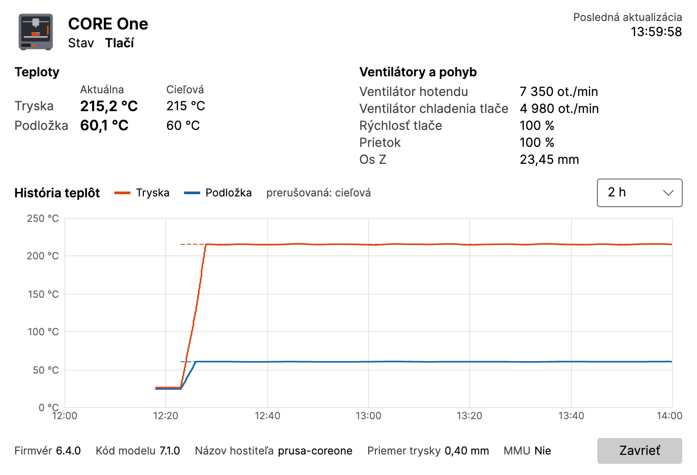
</p>

## 11. Prehľad nastavení

**Nastavenia…** otvoríte z ponuky ikony. Zmeny sa prejavia po kliknutí na **Uložiť**; **Zrušiť** ich zahodí.

### 11.1 Tlačiarne

Zoznam tlačiarní s tlačidlami **Pridať tlačiareň** a **Odobrať**. Každá tlačiareň má podkarty:

- **Tlačiareň:** názov, adresa, používateľské meno, heslo, **Otestovať spojenie**.
- **Kamera:** adresa RTSP, **Otestovať kameru**, automatické nahrávanie, dashcam a timelapse tlače.
- **Okno kamery:** **Otvoriť ako** (ako minule, normálne okno, malý náhľad, celá obrazovka), monitor, veľkosť,
  poloha a **Vždy navrchu** pre normálne okno aj malý náhľad, **Pamätať si poslednú polohu a veľkosť**,
  **Zatvoriť, keď sa tlačiareň vypne, a znova otvoriť po jej zapnutí** a čo ukazuje informačný pásik malého náhľadu.
- **Detekcia:** detekcia chýb tlače pre túto tlačiareň (pozrite [9](#9-detekcia-chýb-tlače-experimentálne)).

### 11.2 Widgety

Widgety každej tlačiarne, ich nastavenia a nepriehľadnosť kariet (pozrite [6](#6-widgety)).

### 11.3 Nahrávanie

Priečinok a limit veľkosti nahrávok, dashcam, timelapse a detekcia chýb tlače (pozrite
[8](#8-nahrávanie-dashcam-a-timelapse) a [9](#9-detekcia-chýb-tlače-experimentálne)). Experimentálne funkcie sú
označené štítkom **Experimentálne**.

### 11.4 Všeobecné

- **Upozornenia:** ktoré udalosti, **Zvuk**, pripomienka „zostávajúcich minút“, **Poslať skúšobné upozornenie**.
- **Interval dopytovania (sekundy):** ako často sa tlačiarne pýtajú na stav.
- **Jazyk:** **Podľa systému** alebo jeden z jazykov English, Čeština, Slovenčina, Deutsch, Español, Français, Italiano,
  Polski. Mení iba texty; čísla, dátumy a časy sa riadia miestnymi nastaveniami vášho systému.
- **Podrobné logovanie (Debug):** zapnite ho iba vtedy, keď vás o to pri riešení problému požiadajú.

### 11.5 Štart a aktualizácie

- **Windows:** **Spúšťať po prihlásení do Windows**. Predvolene zapnuté; k dispozícii iba v nainštalovanej verzii,
  nie vo verzii ZIP.
- **macOS:** **Otvoriť po prihlásení**. Predvolene vypnuté; k dispozícii iba vtedy, keď je LayerPeek v priečinku
  Aplikácie. Ak ste LayerPeek vypli v **Systémové nastavenia → Všeobecné → Položky a rozšírenia spúšťané pri
  prihlásení** (Login Items & Extensions), môžete ho tam znova povoliť iba vy; tlačidlo **Otvoriť Systémové
  nastavenia** vás tam zavedie.
- **Automaticky kontrolovať aktualizácie**, **Ponúkať predbežné verzie** a **Skontrolovať teraz** (pozrite
  [12](#12-aktualizácie)).

### 11.6 Kamera

Nastavenia pre všetky kamery (kameru jednotlivej tlačiarne nastavíte na jej podkarte **Kamera**, pozrite
[11.1](#111-tlačiarne)).

- **Snímková frekvencia malého náhľadu:** koľko snímok za sekundu malý náhľad ukazuje. **Úsporný** (5 fps), **Vyvážený**
  (10 fps, predvolený) alebo **Plynulý** (každá snímka kamery); posuvníkom nastavíte iné obmedzenie od 1 do 30 fps
  (**Vlastný**). Menej snímok znamená menšiu záťaž procesora a menej kopírovaných dát; kamera sa ďalej číta celá, takže
  nahrávky, timelapse a detekcia chýb tlače sa nemenia. Normálne okno a celá obrazovka ukazujú vždy každú snímku. Zmena
  sa pri otvorenom malom náhľade prejaví po **Uložiť**.

## 12. Aktualizácie

Krátko po spustení a potom raz denne sa LayerPeek opýta GitHubu, či vyšla nová verzia (môžete to vypnúť). Nová verzia
sa ukáže ako **Je dostupná nová verzia X.Y.Z** v ponuke ikony a raz aj ako upozornenie.

- **Windows, nainštalovaná verzia:** položka ponuky stiahne aktualizáciu, ukončí LayerPeek a spustí novú verziu.
- **Windows, verzia ZIP:** položka ponuky otvorí stránku s vydaniami; nový ZIP si stiahnite ručne.
- **macOS:** položka ponuky stiahne aktualizáciu a LayerPeek reštartuje, ale iba keď je aplikácia v priečinku
  **Aplikácie** (nie na obraze disku ani v priečinku Stiahnuté súbory).

Vaše nastavenia a heslá zostanú zachované.

**Aktualizácia odmietnutá:** nainštalovaná verzia prijme aktualizáciu, iba keď sa dá overiť jej podpis. Keď sa to nedá,
LayerPeek nič nenainštaluje: zobrazí upozornenie (raz pre každú ponúkanú verziu; kliknutím sa otvoria nastavenia) a
chybu na karte **Spustenie a aktualizácie** a v ponuke ikony namiesto novej verzie ukáže **Aktualizácia odmietnutá…**
(upozornenie na novú verziu zmizne). Tak to zostane, kým niektorá ďalšia kontrola neuspeje: potom sa nová verzia ponúkne
znova a upozornenie na ňu sa ukáže ešte raz. Túto verziu neinštalujte ručne, samotné vydanie mohol niekto podvrhnúť:
počkajte na ďalšie vydanie alebo sledujte oznámenia projektu.

## 13. Kde sú uložené vaše údaje

| Čo | Windows | macOS |
|---|---|---|
| Nastavenia | `%APPDATA%\LayerPeek\settings.json` | `~/Library/Application Support/LayerPeek/settings.json` |
| Heslá | Správca poverení Windows | prihlasovacia kľúčenka (login) |
| Logy | `%LOCALAPPDATA%\LayerPeek\logs` | `~/Library/Logs/LayerPeek` |
| Nahrávky | `Videos\LayerPeek` | `Movies/LayerPeek` |

História teplôt sa uchováva iba v pamäti. LayerPeek sa pripája iba k tlačiarňam a kamerám, ktoré pridáte, a ak
kontrolu aktualizácií nevypnete, aj ku GitHubu (zoznam vydaní, bez akéhokoľvek účtu, a stiahnutie aktualizácie, ktoré
sami spustíte). Nezbiera žiadnu telemetriu.

## 14. Zabezpečenie prístupu k PrusaLinku

PrusaLink v tlačiarni komunikuje len nešifrovaným **HTTP**, samotná tlačiareň HTTPS nemá. Prusa navrhuje PrusaLink pre
miestnu sieť a neodporúča k nemu pristupovať z internetu cez presmerovanie portu na routeri; namiesto toho odporúča
šifrovanú VPN. V domácej sieti, ktorú používate len vy, to zvyčajne stačí. Čítajte ďalej, ak sieť medzi počítačom
a tlačiarňou zdieľajú ďalší ľudia alebo zariadenia (zdieľaná Wi-Fi, kancelária, dielňa, internát), alebo ak chcete
k tlačiarni pristupovať odinakiaľ.

Adresa tlačiarne `http://` alebo adresa kamery, ktorá môže byť mimo miestnej siete, dostane v nastaveniach varovanie
(pozri [3.2 Pridanie tlačiarne](#32-pridanie-tlačiarne)); uložiť ju aj tak možno.

### 14.1 V čom je riziko

- **Ktokoľvek, kto vidí prevádzku** medzi počítačom a tlačiarňou, ju môže čítať: stav tlačiarne, názvy súborov aj G-code
  nahraný cez webové rozhranie PrusaLink.
- **Prihlásenie:** LayerPeek sa prihlasuje pomocou HTTP Digest, jediného prihlásenia, ktoré tlačiareň okrem API kľúča
  ponúka. Samotné heslo sa neposiela, ale Digest v tlačiarni je stará varianta s MD5 (RFC 2069). Z jedného zachyteného
  prihlásenia môže útočník skúšať heslo uhádnuť offline a až 5 minút môže rovnakú zachytenú požiadavku opakovať. Digest
  nechráni obsah: kto môže prevádzku meniť, môže meniť aj údaje.
- **API kľúč:** nástroje, ktoré sa prihlasujú API kľúčom (hlavička `X-Api-Key`), posielajú samotné heslo PrusaLinku
  čitateľne pre kohokoľvek, kto počúva. V PrusaSliceri preto namiesto API kľúča zvoľte **HTTP digest**.
- **S heslom** môže ktokoľvek tlačiareň cez PrusaLink plne ovládať: spúšťať a zastavovať tlače, nahrávať a mazať súbory.

### 14.2 Heslo

Heslo vytvára tlačiareň sama; súčasný firmvér ho tvorí z 15 náhodných znakov z 57 písmen a číslic (bez ľahko
zameniteľných 0, O, 1, l a I). Uhádnuť také heslo zo zachyteného prihlásenia nie je prakticky možné. V tlačiarňach
s firmvérom Buddy si vlastné heslo zadať nemôžete, môžete len nechať vytvoriť nové.

Nové heslo vytvorte vždy, keď mohlo to staré uniknúť (zdieľaná fotka displeja alebo QR kódu PrusaLinku, ktorý heslo
obsahuje, alebo API kľúč použitý v nedôveryhodnej sieti):

1. V tlačiarni otvorte **Nastavenia → Sieť → PrusaLink** (Settings → Network → PrusaLink) a zvoľte **Generate
   Password**.
2. V LayerPeeku otvorte **Nastavenia → Tlačiarne**, vyberte tlačiareň, na podzáložke **Tlačiareň** zadajte nové heslo do
   poľa **Heslo**, kliknite na **Otestovať spojenie** a **Uložiť**.
3. Zmeňte ho aj v ďalších nástrojoch, ktoré PrusaLink používajú (PrusaSlicer a ďalšie).

### 14.3 Oddelená sieť a firewall

- Dajte tlačiarne a kamery do **oddelenej siete** na routeri (pre zariadenia IoT, VLAN). Povoľte počítaču s LayerPeekom
  prístup k nim: port TCP **80** tlačiarne (PrusaLink) a port RTSP kamery (predvolený **554**). Siete pre hostí často
  blokujú spojenia medzi zariadeniami; pozrite si návod k routeru.
- **Nikdy nepresmerúvajte port routera** na tlačiareň. Odinakiaľ sa k nej pripojte cez VPN do domácej siete.
- LayerPeek sám do siete nič neponúka: **Otvoriť PrusaLink** počúva len na adrese `127.0.0.1` vášho počítača. Firewall
  počítača kvôli LayerPeeku nepotrebuje žiadne nové pravidlo.

### 14.4 HTTPS cez reverznú proxy

Na malom počítači vedľa tlačiarne (napríklad Raspberry Pi) beží reverzná proxy, **Caddy** alebo **nginx**. LayerPeek
komunikuje s proxy cez HTTPS; nešifrovaným HTTP s tlačiarňou hovorí len proxy. Proxy a tlačiareň prepojte krátkym káblom
alebo ich zapojte do rovnakého switchu, a ak to router umožňuje, povoľte prístup k tlačiarni len proxy.

- V LayerPeeku zadajte ako adresu tlačiarne adresu proxy, napr. `https://printer.home.arpa`. Názov musí viesť na proxy
  (záznam DNS v routeri alebo súbor `hosts`).
- Použite **pre každú tlačiareň jeden názov hostiteľa alebo port**, nie cestu typu `https://proxy/mk4/`. Tlačiareň
  overuje prihlásenie podľa cesty požiadavky, takže pri proxy, ktorá takú predponu odstráni, tlačiareň heslo odmietne.
- Kamera (RTSP) cez proxy nejde; LayerPeek sa k nej pripája priamo.

**Caddy** (súbor `Caddyfile`, `192.168.1.20` je tlačiareň):

```caddyfile
printer.home.arpa {
	tls internal
	reverse_proxy 192.168.1.20
}
```

Vďaka `tls internal` vydá Caddy certifikát zo svojej vlastnej certifikačnej autority (CA). Jej koreňovému certifikátu
v počítači dôverujte (pozri [14.5](#145-dôvera-v-certifikát-v-počítači)); keď Caddy beží ako služba systému Linux, je to
súbor `/var/lib/caddy/.local/share/caddy/pki/authorities/local/root.crt`. Caddy odovzdáva cestu aj hlavičky prihlásenia
bez zmeny.

**nginx** (blok `server`, napr. v `/etc/nginx/conf.d/printer.conf`):

```nginx
server {
    listen 443 ssl;
    server_name printer.home.arpa;
    ssl_certificate     /etc/nginx/tls/printer.crt;
    ssl_certificate_key /etc/nginx/tls/printer.key;
    client_max_body_size 0;

    location / {
        proxy_pass http://192.168.1.20;
    }
}
```

`proxy_pass` bez cesty odovzdáva cestu bez zmeny. `client_max_body_size 0` ruší limit 1 MB, aby fungovalo nahrávanie
G-code cez webové rozhranie PrusaLink. nginx potrebuje certifikát z vašej vlastnej CA, vytvorený napríklad pomocou
OpenSSL:

```sh
openssl req -x509 -newkey rsa:3072 -nodes -days 3650 -subj "/CN=Printer proxy CA" \
  -addext "basicConstraints=critical,CA:TRUE" -addext "keyUsage=critical,keyCertSign,cRLSign" \
  -keyout ca.key -out ca.crt
openssl req -newkey rsa:3072 -nodes -subj "/CN=printer.home.arpa" -keyout printer.key -out printer.csr
printf "subjectAltName=DNS:printer.home.arpa\nextendedKeyUsage=serverAuth\n" > printer.ext
openssl x509 -req -in printer.csr -CA ca.crt -CAkey ca.key -CAcreateserial -days 825 \
  -extfile printer.ext -out printer.crt
```

Súbory `printer.crt` a `printer.key` skopírujte na proxy a `ca.crt` do svojich počítačov; `ca.key` uschovajte v bezpečí
a mimo siete. Certifikát servera platí 825 dní, najdlhšie, čo macOS prijme.

### 14.5 Dôvera v certifikát v počítači

LayerPeek prijíma len certifikáty, ktorým dôveruje váš systém. Certifikát podpísaný sám sebou (self-signed) alebo
certifikát od CA, ktorú systém nepozná, zlyhá: **Otestovať spojenie** hlási *„Zabezpečené spojenie (https) zlyhalo.
Skúste adresu s http:// alebo skontrolujte certifikát tlačiarne.“*, tlačiareň je **Nedostupná** a **Diagnostika**
ukazuje *„Zabezpečené (https) spojenie s tlačiarňou zlyhalo.“* LayerPeek sám dôverovať jednotlivému certifikátu nevie;
pridajte certifikát svojej CA (`ca.crt` alebo `root.crt` od Caddy) do systému:

- **Windows:** stlačte **Win+R**, spustite `certmgr.msc`, kliknite pravým tlačidlom na **Dôveryhodné koreňové
  certifikačné autority → Certifikáty** (Trusted Root Certification Authorities → Certificates), zvoľte **Všetky úlohy →
  Importovať…** a importujte súbor do úložiska **Dôveryhodné koreňové certifikačné autority**; bezpečnostné upozornenie
  potvrďte. Alebo v termináli: `certutil -user -addstore Root ca.crt`.
- **macOS:** otvorte aplikáciu **Prístup ku kľúčenke** (nájdete ju cez Spotlight), vyberte kľúčenku **prihlásenie**
  (login) a pretiahnite súbor do okna. Dvakrát kliknite na certifikát, rozbaľte **Dôvera** a pri **Pri použití tohto
  certifikátu** nastavte **Vždy dôverovať** (Always Trust); potvrďte heslom.

Potom znova spustite **Otestovať spojenie**.

Zdroje: PrusaLink [v miestnej sieti](https://help.prusa3d.com/article/prusa-connect-and-prusalink-explained_302608),
[presmerovanie portu a VPN](https://help.prusa3d.com/article/prusalink-sl1-sl1s_146094), [HTTP digest
v PrusaSliceri](https://help.prusa3d.com/article/prusalink-troubleshooting_304411); firmvér: [port 80 bez
TLS](https://github.com/prusa3d/Prusa-Firmware-Buddy/blob/7d8bf6858b363c453c0617bceab5e66997d8fc25/lib/WUI/http_lifetime.cpp),
[Digest a API
kľúč](https://github.com/prusa3d/Prusa-Firmware-Buddy/blob/7d8bf6858b363c453c0617bceab5e66997d8fc25/lib/WUI/nhttp/req_parser.cpp),
[platnosť
nonce](https://github.com/prusa3d/Prusa-Firmware-Buddy/blob/7d8bf6858b363c453c0617bceab5e66997d8fc25/src/common/http/types.h),
[tvorba
hesla](https://github.com/prusa3d/Prusa-Firmware-Buddy/blob/7d8bf6858b363c453c0617bceab5e66997d8fc25/lib/WUI/wui.cpp)
a [dĺžka](https://github.com/prusa3d/Prusa-Firmware-Buddy/blob/7d8bf6858b363c453c0617bceab5e66997d8fc25/src/persistent_stores/store_instances/config_store/constants.hpp),
[ponuka
PrusaLink](https://github.com/prusa3d/Prusa-Firmware-Buddy/blob/7d8bf6858b363c453c0617bceab5e66997d8fc25/src/gui/screen_prusa_link.cpp);
[RFC 2069](https://www.rfc-editor.org/rfc/rfc2069); [Caddy
`reverse_proxy`](https://caddyserver.com/docs/caddyfile/directives/reverse_proxy),
[`tls`](https://caddyserver.com/docs/caddyfile/directives/tls), [dátový adresár](https://caddyserver.com/docs/running);
[nginx `proxy_pass`](https://nginx.org/en/docs/http/ngx_http_proxy_module.html#proxy_pass),
[`client_max_body_size`](https://nginx.org/en/docs/http/ngx_http_core_module.html#client_max_body_size); [požiadavky
Apple na certifikáty](https://support.apple.com/en-us/103769), [Prístup ku
kľúčenke](https://support.apple.com/guide/keychain-access/change-the-trust-settings-of-a-certificate-kyca11871/mac);
[certutil](https://learn.microsoft.com/en-us/windows-server/administration/windows-commands/certutil).

## 15. Riešenie problémov

**Ikona nie je vidieť (Windows).** Kliknite na šípku **`^`** v oznamovacej oblasti a pretiahnite ikonu LayerPeek na
panel úloh.

**Tlačiareň je v stave Nedostupná.** Skontrolujte, či je tlačiareň zapnutá a pripojená k sieti, či je adresa správna
(skúste ju v prehliadači) a či je váš počítač v rovnakej sieti. V nastaveniach tlačiarne spustite **Otestovať
spojenie**.

**Neplatné prihlasovacie údaje.** Znova zadajte používateľské meno a heslo z ponuky tlačiarne **Nastavenia → Sieť →
PrusaLink** a uložte.

**Zabezpečené spojenie (https) zlyhalo.** Adresa tlačiarne začína `https://`. Buď vedie priamo na tlačiareň, ktorá HTTPS
nemá (použite `http://`), alebo váš systém nedôveruje certifikátu proxy: pozri
[14.5](#145-dôvera-v-certifikát-v-počítači).

**V macOS nie je spojenie.** Prístup k lokálnej sieti môže byť vypnutý. LayerPeek potom ponúkne **Otvoriť Systémové
nastavenia**; zapnite LayerPeek v **Systémové nastavenia → Súkromie a bezpečnosť → Lokálna sieť**.

**Kamera ukazuje Bez signálu.** Overte adresu RTSP tlačidlom **Otestovať kameru** a skontrolujte, či je kamera
zapnutá a dostupná. Do adresy nedávajte používateľské meno ani heslo.

**Upozornenia sa nezobrazujú.** Použite **Poslať skúšobné upozornenie** v **Nastavenia → Všeobecné** a skontrolujte
režim **Nerušiť** (Windows) alebo **Sústredenie** (macOS).

**Nahlásenie chyby.** Z ponuky ikony otvorte **O aplikácii**:

- **Uložiť diagnostický balík…** uloží súbor ZIP s logmi, informáciami o verzii a systéme a nastaveniami,
  **bez hesiel a kľúčov**. Priložte ho k hláseniu chyby.
- **Kopírovať info do schránky** skopíruje krátky prehľad.
- **Otvoriť priečinok s logmi** otvorí logy.

Ak vás požiadajú o podrobný log, zapnite **Podrobné logovanie (Debug)** v **Nastavenia → Všeobecné**, zopakujte
problém, uložte balík a podrobné logovanie znova vypnite.

Chyby a nápady hláste v [issues](https://github.com/pfoltynek/LayerPeek/issues) na GitHube. Uveďte, prosím, model
tlačiarne, verziu firmvéru a operačný systém.

## 16. Odinštalovanie

- **Windows, nainštalovaná verzia:** **Nastavenie → Aplikácie → Nainštalované aplikácie → LayerPeek → Odinštalovať**.
- **Windows, verzia ZIP:** ukončite LayerPeek a vymažte jeho priečinok.
- **macOS:** ukončite LayerPeek (**Ukončiť** v jeho ponuke) a presuňte **LayerPeek** z priečinka **Aplikácie** do
  Koša.

Odinštalovanie ponechá vaše nastavenia, heslá a nahrávky. Ak ich chcete odstrániť tiež, vymažte priečinky
z [13](#13-kde-sú-uložené-vaše-údaje) a záznamy LayerPeek v Správcovi poverení (Windows) alebo v aplikácii Prístup ku
kľúčenke (macOS).
